# Advanced Amazon S3

## Lecture 133: ♻️ S3 Lifecycle Rules (with S3 Analytics)

> **Section**: Advanced Amazon S3 \| **Course**: Ultimate AWS Certified Developer Associate DVA-C02 2026

---

### 📌 Overview

S3 Lifecycle Rules allow you to **automatically transition or expire** S3 objects based on their age or version state. This is critical for **cost optimization** — you move data to cheaper storage classes as it gets older, and delete it when it's no longer needed.

---

### 🗂️ S3 Storage Class Transition Flow

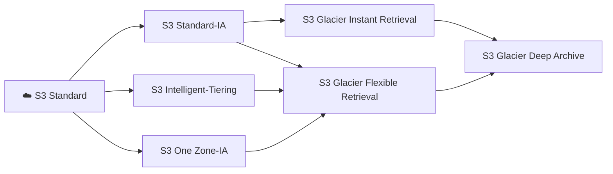

> Objects can **only move downward** (to cheaper/slower tiers). You **cannot** transition from Glacier back to Standard automatically via lifecycle rules.

---

### ⚙️ Lifecycle Rules — What You Can Do

S3 Lifecycle Rules have **two types of actions**:

#### 🔄 Transition Actions

Move objects to a different storage class after a certain number of days.

| Rule | Example |
| --- | --- |
| Move to Standard-IA | After 30 days |
| Move to Glacier Flexible | After 90 days |
| Move to Glacier Deep Archive | After 365 days |

#### 🗑️ Expiration Actions

Permanently delete objects (or versions) after a certain number of days.

| Rule | Example Use Case |
| --- | --- |
| Delete current version | Delete access logs older than 365 days |
| Delete expired delete markers | Cleanup versioned buckets |
| Delete incomplete multipart uploads | Free up space from failed uploads |

---

### 🛠️ Lifecycle Rule — Configuration Details

Lifecycle rules can be scoped to:

- **Entire bucket** — applies to all objects
- **Prefix** — e.g., only objects under `logs/`
- **Object Tags** — e.g., only objects tagged `Department: Finance`
- **Object Size** — minimum/maximum size filters (newer feature)

#### 📋 Example YAML (CloudFormation) — Lifecycle Rule

```yaml
Resources:
  MyS3Bucket:
    Type: AWS::S3::Bucket
    Properties:
      BucketName: my-lifecycle-demo-bucket
      LifecycleConfiguration:
        Rules:
          - Id: MoveToGlacierAndExpire
            Status: Enabled
            Prefix: logs/
            Transitions:
              - TransitionInDays: 30
                StorageClass: STANDARD_IA
              - TransitionInDays: 90
                StorageClass: GLACIER
            ExpirationInDays: 365
          - Id: CleanupIncompleteMultipart
            Status: Enabled
            AbortIncompleteMultipartUpload:
              DaysAfterInitiation: 7
```

---

### 🧩 Lifecycle Rules — Real-World Scenarios

#### 📦 Scenario 1: Application Logs

> Your app generates logs stored in S3. Logs are frequently accessed for the first 30 days, then rarely accessed, then never.

- **Day 0–30**: S3 Standard
- **Day 30**: Transition → S3 Standard-IA
- **Day 90**: Transition → S3 Glacier Flexible Retrieval
- **Day 365**: Expire (Delete permanently)

---

#### 📦 Scenario 2: Versioned Bucket — Deleted Objects

> Users delete objects, creating **delete markers**. You want to retain old versions for 90 days for recovery, then purge them.

- **Non-current versions**: Expire after 90 days (delete old versions)
- **Expired delete markers**: Delete to clean up tombstones

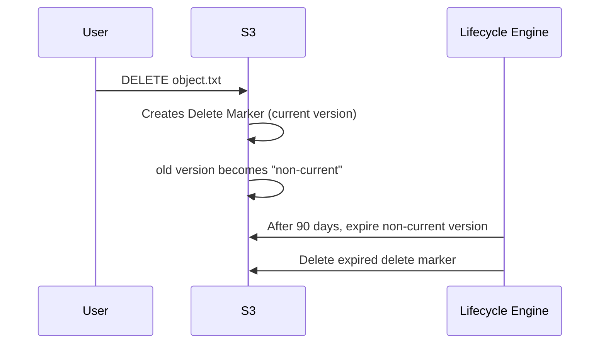

---

#### 📦 Scenario 3: Thumbnail Images

> You generate thumbnails and raw images. Thumbnails can be recreated; raw images are precious.

- **Thumbnails** (prefix: `thumbnails/`): Delete after 45 days
- **Raw images** (prefix: `raw/`): Move to Glacier after 45 days

---

### 🖥️ CLI — Setting Lifecycle Rules

```bash
# Put a lifecycle configuration from a JSON file
aws s3api put-bucket-lifecycle-configuration \
  --bucket my-demo-bucket \
  --lifecycle-configuration file://lifecycle.json

# Get current lifecycle config
aws s3api get-bucket-lifecycle-configuration \
  --bucket my-demo-bucket

# Delete all lifecycle rules
aws s3api delete-bucket-lifecycle \
  --bucket my-demo-bucket
```

#### 📄 lifecycle.json example

```json
{
  "Rules": [
    {
      "ID": "MoveToGlacier",
      "Status": "Enabled",
      "Filter": {
        "Prefix": "logs/"
      },
      "Transitions": [
        {
          "Days": 30,
          "StorageClass": "STANDARD_IA"
        },
        {
          "Days": 90,
          "StorageClass": "GLACIER"
        }
      ],
      "Expiration": {
        "Days": 365
      }
    }
  ]
}
```

---

### 🖥️ Node.js SDK — Setting Lifecycle Rules Programmatically

```javascript
import { S3Client, PutBucketLifecycleConfigurationCommand } from "@aws-sdk/client-s3";

const client = new S3Client({ region: "us-east-1" });

const lifecycleConfig = {
  Rules: [
    {
      ID: "MoveLogsToGlacier",
      Status: "Enabled",
      Filter: { Prefix: "logs/" },
      Transitions: [
        { Days: 30, StorageClass: "STANDARD_IA" },
        { Days: 90, StorageClass: "GLACIER" },
      ],
      Expiration: { Days: 365 },
      NoncurrentVersionExpiration: { NoncurrentDays: 90 },
      AbortIncompleteMultipartUpload: { DaysAfterInitiation: 7 },
    },
  ],
};

const command = new PutBucketLifecycleConfigurationCommand({
  Bucket: "my-lifecycle-demo-bucket",
  LifecycleConfiguration: lifecycleConfig,
});

const response = await client.send(command);
console.log("Lifecycle configuration applied:", response);
```

---

### 📊 S3 Analytics — Storage Class Analysis

> S3 Analytics helps you **decide when to transition objects** to S3 Standard-IA by analyzing access patterns.

#### 🔑 Key Facts

- Works **only** for `Standard → Standard-IA` transitions (not Glacier)
- Takes **24–48 hours** to generate the first report
- Produces a **CSV report** saved to an S3 bucket
- Can visualize reports in **Amazon QuickSight** or **third-party BI tools**
- The report updates **daily**

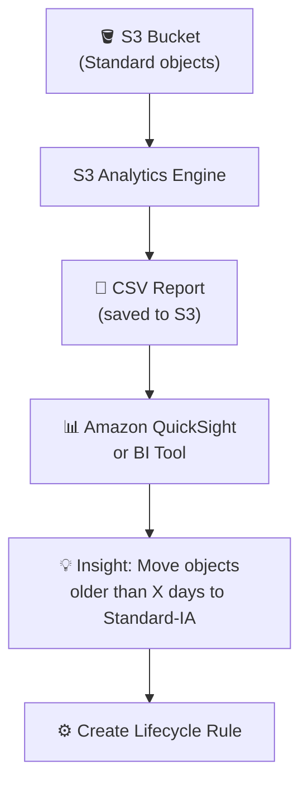

#### 📋 What the Report Tells You

| Metric | Description |
| --- | --- |
| Storage class breakdown | How much data is in Standard vs. IA |
| Object age distribution | How old objects are at time of access |
| Access frequency | How often objects of a given age are accessed |
| Recommended transition age | When it becomes cost-effective to move to IA |

#### 🖥️ Enable S3 Analytics via CLI

```bash
aws s3api put-bucket-analytics-configuration \
  --bucket my-demo-bucket \
  --id MyAnalyticsConfig \
  --analytics-configuration '{
    "Id": "MyAnalyticsConfig",
    "StorageClassAnalysis": {
      "DataExport": {
        "OutputSchemaVersion": "V_1",
        "Destination": {
          "S3BucketDestination": {
            "Format": "CSV",
            "Bucket": "arn:aws:s3:::my-reports-bucket",
            "Prefix": "analytics/"
          }
        }
      }
    }
  }'
```

---

### 💡 Lifecycle Rules vs. S3 Analytics — Quick Comparison

| Feature | S3 Lifecycle Rules | S3 Analytics |
| --- | --- | --- |
| Purpose | **Automate** transitions/expiration | **Analyze** access patterns |
| Action | Takes action on objects | Provides reports only |
| Supported classes | All storage classes | Standard → Standard-IA only |
| Report output | N/A | Daily CSV report |
| Use case | Cost optimization automation | Decide what lifecycle rules to create |

> **🔑 Tip**: Use **S3 Analytics first** to understand your data access patterns, then **create Lifecycle Rules** based on those insights.

---

### ⚡ Important Minimums & Constraints

| Constraint | Detail |
| --- | --- |
| Minimum days before transition to Standard-IA or One Zone-IA | **30 days** from creation |
| Minimum days to keep object in Standard-IA before Glacier | **30 days** |
| Minimum storage duration charge for Standard-IA | **30 days** |
| Minimum storage duration charge for Glacier Flexible | **90 days** |
| Minimum storage duration charge for Glacier Deep Archive | **180 days** |

> If you transition before the minimum, **you still pay for the minimum duration**. Plan transitions wisely.

---

### 🗺️ Full Lifecycle Architecture

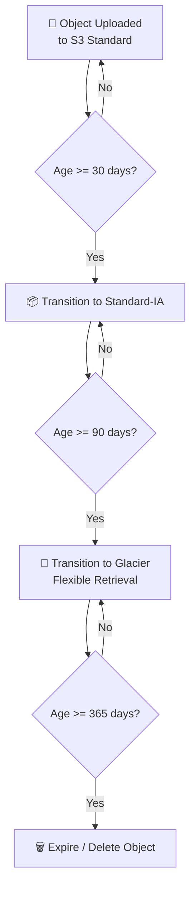

---

### 🎯 Key Exam Takeaways

- **Lifecycle rules** can **transition** objects to cheaper storage classes and **expire** (delete) them
- **Transition actions** and **Expiration actions** are the two main categories
- **Minimum 30 days** in Standard before transitioning to Standard-IA or One Zone-IA
- Rules can be scoped by **prefix**, **tags**, and **object size**
- **Expiration rules** can delete: current versions, non-current versions, incomplete multipart uploads, and expired delete markers
- **S3 Analytics** analyzes access patterns to recommend when to transition — reports take **24–48 hours** to appear and update **daily**
- S3 Analytics only covers **Standard → Standard-IA** (not Glacier)
- **Use S3 Analytics → then create Lifecycle Rules** — this is the recommended workflow on the exam

---

## Lecture 134: 🔄 S3 Lifecycle Rules - Hands On

> 🎓 **Course**: Ultimate AWS Certified Developer Associate DVA-C02 2026<br>👨‍🏫 **Instructor**: Stephane Maarek<br>📂 **Section 13**: Advanced Amazon S3

### 📋 Overview

> In this hands-on lecture, we walk through creating and configuring **S3 Lifecycle Rules** directly in the AWS Console. This builds on the theory from Lecture 133 and demonstrates how to set up transition actions, expiration actions, and rules for both current and noncurrent object versions.

### 🛠️ Step 1: Navigate to Lifecycle Configuration

- Open the **Amazon S3 Console** → select your bucket
- Go to the **Management** tab
- Scroll down to the **Lifecycle rules** section
- Click **Create lifecycle rule**

> 💡 You can have **multiple lifecycle rules** per bucket, each targeting different prefixes or tags.

### ✏️ Step 2: Configure Lifecycle Rule Basics

#### Rule Name & Scope

- **Lifecycle rule name**: Give it a descriptive name (e.g., `MoveToIAAndGlacier`)
- **Choose a rule scope**:

    - **Limit the scope of this rule using one or more filters** — apply to specific prefix or tags
    - **Apply to all objects in the bucket** — applies universally (requires acknowledgement checkbox)

> ⚠️ If you select "Apply to all objects in the bucket", AWS will show a warning that this rule applies to **every object**. You must check the acknowledgement box to proceed.

#### Filtering Options

- **Prefix**: Target only objects with a specific key prefix (e.g., `logs/`, `archive/`, `images/`)
- **Object tags**: Target objects with specific key-value tag pairs (e.g., `Environment: Production`)
- **Object size**: Filter by minimum and/or maximum object size

    - Useful when you only want to transition objects above a certain size threshold

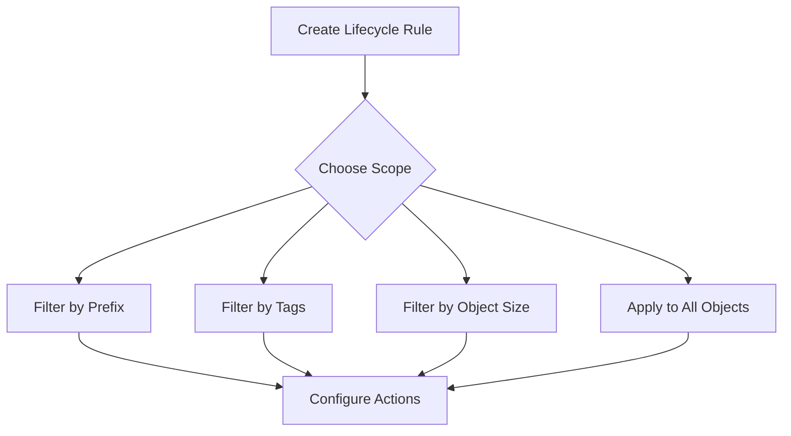

### 🔀 Step 3: Configure Lifecycle Rule Actions

> You select which **actions** the lifecycle rule should perform. You can enable one or more of the following:

#### Available Actions (Checkboxes)

| Action | Description |
| --- | --- |
| **Move current versions of objects between storage classes** | Transition current objects to cheaper storage classes after N days |
| **Move noncurrent versions of objects between storage classes** | Transition older versions (requires versioning enabled) |
| **Expire current versions of objects** | Permanently delete current objects after N days |
| **Permanently delete noncurrent versions of objects** | Delete old versions after N days |
| **Delete expired object delete markers or incomplete multipart uploads** | Clean up delete markers and aborted multipart uploads |

> 💡 You can combine multiple actions in a **single rule**. For example, transition current objects to IA after 30 days, then to Glacier after 90 days, and expire them after 365 days.

### 📦 Step 4: Transition Current Versions

- When you enable **"Move current versions of objects between storage classes"**, you configure transitions:

    - **Choose storage class** → Select the target class
    - **Days after object creation** → Number of days before the transition occurs

#### Adding Multiple Transitions

- Click **"Add transition"** to chain multiple transitions in sequence
- Example configuration:

| Transition | Storage Class | Days After Creation |
| --- | --- | --- |
| 1st | **Standard-IA** | 30 |
| 2nd | **Intelligent-Tiering** | 60 |
| 3rd | **Glacier Instant Retrieval** | 90 |
| 4th | **Glacier Flexible Retrieval** | 180 |
| 5th | **Glacier Deep Archive** | 365 |

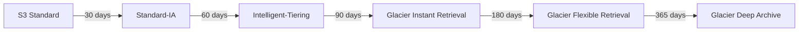

> ⚠️ **Constraint**: Each subsequent transition must be to a storage class that is **lower in the waterfall** hierarchy, and the number of days must be **greater than or equal to** the previous transition's days. AWS will validate this and show errors if violated.

#### Storage Class Waterfall (Transition Order)

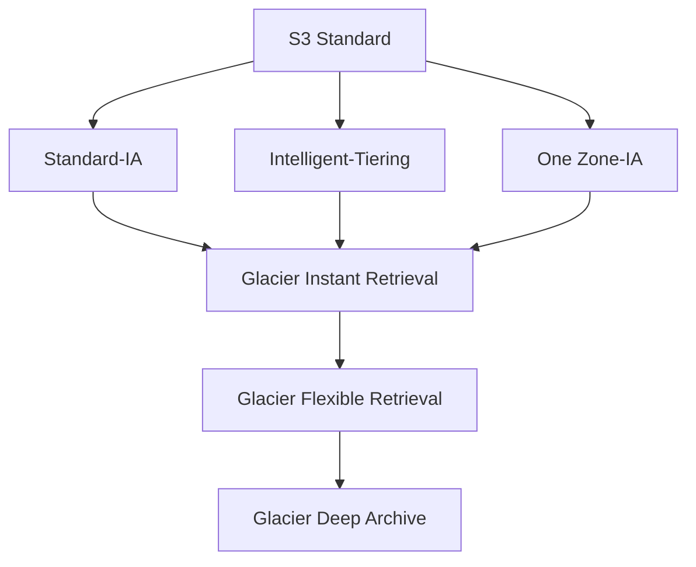

> 💡 **Minimum 30-day rule**: Objects must remain in S3 Standard for at least **30 days** before transitioning to Standard-IA or One Zone-IA (due to minimum storage duration charges).

### 📁 Step 5: Transition Noncurrent Versions

- When you enable **"Move noncurrent versions of objects between storage classes"**:

    - **Choose storage class** for noncurrent versions
    - **Days after objects become noncurrent** → Number of days after the object is no longer the current version
    - **Number of newer versions to retain** (optional) → Keep N newer noncurrent versions before transitioning older ones

> 🔑 **Noncurrent versions** only exist when **versioning** is enabled on the bucket. When you overwrite an object, the previous version becomes "noncurrent."

#### Example Noncurrent Version Transition

| Storage Class | Days After Becoming Noncurrent |
| --- | --- |
| **Standard-IA** | 30 |
| **Glacier Flexible Retrieval** | 90 |

### 🗑️ Step 6: Expiration Settings

#### Expire Current Versions

- **Days after object creation** → Objects are permanently deleted after this many days
- Example: Expire after **365 days** — the object will be deleted 1 year after creation

#### Permanently Delete Noncurrent Versions

- **Days after objects become noncurrent** → Delete noncurrent versions after N days
- **Number of newer versions to retain** → Optionally keep the most recent N noncurrent versions
- Example: Delete noncurrent versions after **90 days**, retain latest **3** versions

#### Delete Expired Object Delete Markers & Incomplete Multipart Uploads

- **Delete expired object delete markers** — Cleans up delete markers when they are the only remaining version of an object (a "one-version" delete marker)
- **Delete incomplete multipart uploads** — Specify number of days after which incomplete/aborted multipart uploads are automatically cleaned up (e.g., **7 days**)

> 💡 Cleaning up incomplete multipart uploads is a **best practice** to avoid paying storage costs for partial uploads that were never completed.

### 📊 Step 7: Review the Timeline Summary

- After configuring all actions, AWS shows a **Timeline summary** at the bottom
- This visual timeline displays the lifecycle of objects through all the configured transitions and expirations
- Review it carefully to verify your rule does what you expect

```mermaid
gantt
    title S3 Lifecycle Rule Timeline Example
    dateFormat  X
    axisFormat %s days
    section Current Version
    S3 Standard           :a1, 0, 30
    Standard-IA           :a2, 30, 90
    Glacier Flexible      :a3, 90, 365
    Expired/Deleted       :milestone, 365, 0
    section Noncurrent Version
    Standard-IA           :b1, 0, 90
    Deleted               :milestone, 90, 0
```

### ✅ Step 8: Create the Rule

- Click **Create rule**
- The rule appears in the **Lifecycle rules** list under the **Management** tab
- The rule status shows as **Enabled**

> 💡 Lifecycle rules are **evaluated once per day** by S3 at midnight UTC. Transitions and expirations don't happen immediately — they are processed asynchronously.

### 🔧 Managing Lifecycle Rules via AWS CLI

#### List Lifecycle Rules

```bash
aws s3api get-bucket-lifecycle-configuration --bucket my-bucket-name
```

#### Put a Lifecycle Configuration (JSON)

```json
{
  "Rules": [
    {
      "ID": "MoveToIAAndGlacier",
      "Status": "Enabled",
      "Filter": {
        "Prefix": "logs/"
      },
      "Transitions": [
        {
          "Days": 30,
          "StorageClass": "STANDARD_IA"
        },
        {
          "Days": 90,
          "StorageClass": "GLACIER"
        }
      ],
      "Expiration": {
        "Days": 365
      },
      "NoncurrentVersionTransitions": [
        {
          "NoncurrentDays": 30,
          "StorageClass": "STANDARD_IA"
        }
      ],
      "NoncurrentVersionExpiration": {
        "NoncurrentDays": 90,
        "NewerNoncurrentVersions": 3
      },
      "AbortIncompleteMultipartUpload": {
        "DaysAfterInitiation": 7
      }
    }
  ]
}
```

```bash
aws s3api put-bucket-lifecycle-configuration \
  --bucket my-bucket-name \
  --lifecycle-configuration file://lifecycle.json
```

#### Delete Lifecycle Configuration

```bash
aws s3api delete-bucket-lifecycle --bucket my-bucket-name
```

### 💻 Managing Lifecycle Rules via AWS SDK (Node.js)

```javascript
import {
  S3Client,
  PutBucketLifecycleConfigurationCommand,
  GetBucketLifecycleConfigurationCommand,
  DeleteBucketLifecycleCommand
} from "@aws-sdk/client-s3";

const client = new S3Client({ region: "us-east-1" });

// Put lifecycle configuration
const putLifecycle = async () => {
  const command = new PutBucketLifecycleConfigurationCommand({
    Bucket: "my-bucket-name",
    LifecycleConfiguration: {
      Rules: [
        {
          ID: "TransitionAndExpire",
          Status: "Enabled",
          Filter: { Prefix: "data/" },
          Transitions: [
            { Days: 30, StorageClass: "STANDARD_IA" },
            { Days: 90, StorageClass: "GLACIER" }
          ],
          Expiration: { Days: 365 },
          NoncurrentVersionTransitions: [
            { NoncurrentDays: 30, StorageClass: "STANDARD_IA" }
          ],
          NoncurrentVersionExpiration: {
            NoncurrentDays: 90,
            NewerNoncurrentVersions: 3
          },
          AbortIncompleteMultipartUpload: {
            DaysAfterInitiation: 7
          }
        }
      ]
    }
  });
  const response = await client.send(command);
  console.log("Lifecycle configuration applied:", response);
};

// Get lifecycle configuration
const getLifecycle = async () => {
  const command = new GetBucketLifecycleConfigurationCommand({
    Bucket: "my-bucket-name"
  });
  const response = await client.send(command);
  console.log("Current rules:", JSON.stringify(response.Rules, null, 2));
};

// Delete lifecycle configuration
const deleteLifecycle = async () => {
  const command = new DeleteBucketLifecycleCommand({
    Bucket: "my-bucket-name"
  });
  await client.send(command);
  console.log("Lifecycle configuration deleted");
};

putLifecycle();
```

### ⚠️ Important Considerations

- **Minimum storage duration**: Some storage classes have minimum storage charges:

    - **Standard-IA / One Zone-IA**: 30 days minimum
    - **Glacier Instant Retrieval**: 90 days minimum
    - **Glacier Flexible Retrieval**: 90 days minimum
    - **Glacier Deep Archive**: 180 days minimum
- **Small object overhead**: Standard-IA and One Zone-IA have a minimum billable object size of **128 KB**. Transitioning many tiny objects may not save costs.
- **Versioning interaction**: Noncurrent version rules only apply when bucket versioning is **enabled**
- **Rule evaluation**: Rules are processed **once per day** — not in real-time
- **S3 Analytics**: Use **S3 Storage Class Analysis** (covered in Lecture 133) to identify the right transition timing based on actual access patterns before creating lifecycle rules

### 🎯 Key Exam Takeaways

- **Lifecycle rules** can be configured for **transitions** (move between storage classes) and **expirations** (delete objects)
- Rules apply to both **current** and **noncurrent** versions independently
- **Filters** can scope rules by prefix, object tags, or object size
- You can **combine multiple actions** in a single lifecycle rule
- The **storage class waterfall** dictates valid transition paths — you can only move "downward" in the hierarchy
- **Incomplete multipart uploads** should be cleaned up with lifecycle rules to avoid unnecessary costs
- **Delete markers** can be automatically removed when they are the only version remaining
- Rules are evaluated **daily**, not instantly
- Use **S3 Analytics** to inform your lifecycle rule configuration with data-driven recommendations
- On the exam, if asked about **automating cost optimization** for S3 objects with changing access patterns → think **Lifecycle Rules**

---

## Lecture 135: 🔔 S3 Event Notifications

> **Section 13: Advanced Amazon S3** — Ultimate AWS Certified Developer Associate DVA-C02 2026

### 📖 Overview

> Amazon S3 Event Notifications allow you to automatically trigger actions in response to events that occur in your S3 buckets. When objects are created, deleted, restored, or replicated, S3 can send notifications to various AWS services to enable event-driven architectures.

- S3 Event Notifications are a **core building block** for serverless and event-driven applications on AWS
- They eliminate the need for polling — your downstream services react **in near real-time** to changes in S3
- This is a **frequently tested topic** on the DVA-C02 exam

### 🎯 Supported S3 Event Types

S3 can generate notifications for a wide variety of events:

#### 🆕 Object Created Events

- `s3:ObjectCreated:*` — All object creation events
- `s3:ObjectCreated:Put` — Object uploaded via PUT
- `s3:ObjectCreated:Post` — Object uploaded via POST
- `s3:ObjectCreated:Copy` — Object created via COPY
- `s3:ObjectCreated:CompleteMultipartUpload` — Multipart upload completed

#### 🗑️ Object Removed Events

- `s3:ObjectRemoved:*` — All object removal events
- `s3:ObjectRemoved:Delete` — Object deleted
- `s3:ObjectRemoved:DeleteMarkerCreated` — Delete marker created (versioned bucket)

#### 🔄 Object Restore Events

- `s3:ObjectRestore:Post` — Restore initiated from Glacier
- `s3:ObjectRestore:Completed` — Restore from Glacier completed

#### 📋 Replication Events

- `s3:Replication:*` — All replication events
- `s3:Replication:OperationFailedReplication` — Replication failed
- `s3:Replication:OperationMissedThreshold` — Replication exceeded 15 min threshold
- `s3:Replication:OperationReplicatedAfterThreshold` — Replicated after threshold
- `s3:Replication:OperationNotTracked` — Object not tracked by replication metrics

#### 🏷️ Other Events

- `s3:ObjectTagging:*` — Tag added or deleted on an object
- `s3:ObjectAcl:Put` — ACL set on an object
- `s3:LifecycleExpiration:*` — Lifecycle expiration events
- `s3:IntelligentTiering` — Object moved to a different access tier
- `s3:LifecycleTransition` — Object transitioned to another storage class

> **💡 Tip:** You can use wildcard `*` suffixes to capture all sub-events under a category (e.g., `s3:ObjectCreated:*`).

### 🏗️ Event Notification Destinations

S3 can send event notifications to **three classic destinations** and one newer universal option:

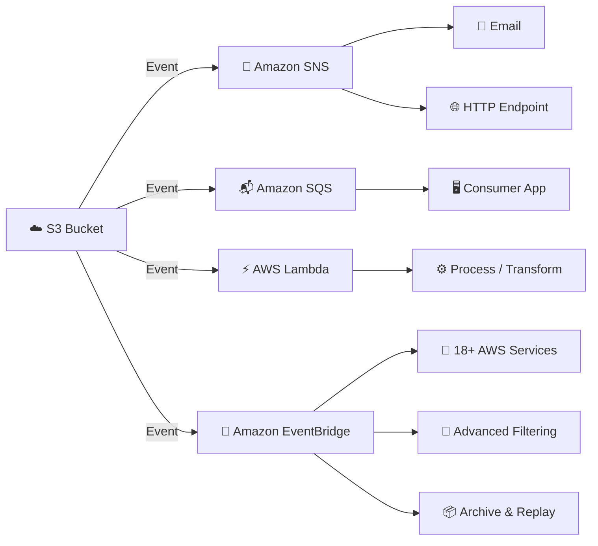

#### 📢 Amazon SNS (Simple Notification Service)

- Send notifications to **multiple subscribers** (email, HTTP, SQS, Lambda, SMS)
- Great for **fan-out** — one S3 event triggers multiple downstream actions
- Requires an **SNS Resource (Access) Policy** allowing S3 to publish

#### 📬 Amazon SQS (Simple Queue Service)

- Queue messages for **asynchronous processing**
- Ideal for **decoupling** — consumers process at their own pace
- Requires an **SQS Resource (Access) Policy** allowing S3 to send messages
- **Note:** Only **Standard SQS** queues are supported as a direct S3 notification destination (NOT FIFO)

#### ⚡ AWS Lambda

- Invoke a Lambda function **directly** to process events in real-time
- Common use cases: generate thumbnails, process uploads, index metadata
- Requires a **Lambda Resource-Based Policy** allowing S3 to invoke the function

#### 🌉 Amazon EventBridge (Recommended — Newest Option)

- **All S3 events** are sent to EventBridge by default when enabled
- Provides **advanced filtering** with JSON rules (filter by object name, size, metadata, etc.)
- Supports **18+ AWS service destinations** (Step Functions, Kinesis, Firehose, ECS, etc.)
- Enables **archive and replay** events
- Supports **multiple destinations** from a single rule
- Offers **reliable delivery** with retry policies and dead-letter queues

> **⭐ Key Insight:** EventBridge is the most powerful and flexible destination. AWS recommends using EventBridge for new implementations because it supports advanced filtering, multiple destinations, and archiving — features not available with the classic SNS/SQS/Lambda destinations.

### 🔐 IAM Permissions & Resource Policies

For S3 to deliver event notifications, the **destination service must allow S3 to write to it**. This is done via **resource-based policies** (NOT IAM roles).

#### SNS Resource Policy Example

```json
{
  "Version": "2012-10-17",
  "Statement": [
    {
      "Effect": "Allow",
      "Principal": {
        "Service": "s3.amazonaws.com"
      },
      "Action": "SNS:Publish",
      "Resource": "arn:aws:sns:us-east-1:123456789012:my-topic",
      "Condition": {
        "ArnLike": {
          "aws:SourceArn": "arn:aws:s3:::my-source-bucket"
        }
      }
    }
  ]
}
```

#### SQS Resource Policy Example

```json
{
  "Version": "2012-10-17",
  "Statement": [
    {
      "Effect": "Allow",
      "Principal": {
        "Service": "s3.amazonaws.com"
      },
      "Action": "SQS:SendMessage",
      "Resource": "arn:aws:sqs:us-east-1:123456789012:my-queue",
      "Condition": {
        "ArnLike": {
          "aws:SourceArn": "arn:aws:s3:::my-source-bucket"
        }
      }
    }
  ]
}
```

#### Lambda Resource-Based Policy Example

```json
{
  "Version": "2012-10-17",
  "Statement": [
    {
      "Effect": "Allow",
      "Principal": {
        "Service": "s3.amazonaws.com"
      },
      "Action": "lambda:InvokeFunction",
      "Resource": "arn:aws:lambda:us-east-1:123456789012:function:my-function",
      "Condition": {
        "ArnLike": {
          "aws:SourceArn": "arn:aws:s3:::my-source-bucket"
        }
      }
    }
  ]
}
```

> **⚠️ Important:** You do NOT attach an IAM role to S3 for event notifications. Instead, you configure **resource-based policies** on the destination service to allow the `s3.amazonaws.com` principal.

### 📬 S3 Event Notification Message Structure

When S3 sends an event notification, the message payload is a **JSON object** with details about the event:

```json
{
  "Records": [
    {
      "eventVersion": "2.1",
      "eventSource": "aws:s3",
      "awsRegion": "us-east-1",
      "eventTime": "2026-07-01T10:00:00.000Z",
      "eventName": "ObjectCreated:Put",
      "userIdentity": {
        "principalId": "AIDACKCEVSQ6C2EXAMPLE"
      },
      "s3": {
        "bucket": {
          "name": "my-bucket",
          "arn": "arn:aws:s3:::my-bucket"
        },
        "object": {
          "key": "images/photo.jpg",
          "size": 1048576,
          "eTag": "d41d8cd98f00b204e9800998ecf8427e"
        }
      }
    }
  ]
}
```

### 💻 Configuring S3 Event Notifications with AWS SDK v3

#### Setting Up SNS Notification on Object Creation

```javascript
import {
  S3Client,
  PutBucketNotificationConfigurationCommand,
} from "@aws-sdk/client-s3";

const s3Client = new S3Client({ region: "us-east-1" });

const putNotificationConfig = async () => {
  const command = new PutBucketNotificationConfigurationCommand({
    Bucket: "my-source-bucket",
    NotificationConfiguration: {
      TopicConfigurations: [
        {
          Id: "NotifyOnObjectCreated",
          TopicArn: "arn:aws:sns:us-east-1:123456789012:my-topic",
          Events: ["s3:ObjectCreated:*"],
          Filter: {
            Key: {
              FilterRules: [
                { Name: "prefix", Value: "images/" },
                { Name: "suffix", Value: ".jpg" },
              ],
            },
          },
        },
      ],
    },
  });

  const response = await s3Client.send(command);
  console.log("Notification configuration set:", response);
};

putNotificationConfig();
```

#### Setting Up SQS Notification on Object Removal

```javascript
import {
  S3Client,
  PutBucketNotificationConfigurationCommand,
} from "@aws-sdk/client-s3";

const s3Client = new S3Client({ region: "us-east-1" });

const putSqsNotification = async () => {
  const command = new PutBucketNotificationConfigurationCommand({
    Bucket: "my-source-bucket",
    NotificationConfiguration: {
      QueueConfigurations: [
        {
          Id: "NotifyOnObjectRemoved",
          QueueArn: "arn:aws:sqs:us-east-1:123456789012:my-queue",
          Events: ["s3:ObjectRemoved:*"],
        },
      ],
    },
  });

  const response = await s3Client.send(command);
  console.log("SQS notification set:", response);
};

putSqsNotification();
```

#### Setting Up Lambda Notification with Prefix/Suffix Filtering

```javascript
import {
  S3Client,
  PutBucketNotificationConfigurationCommand,
} from "@aws-sdk/client-s3";

const s3Client = new S3Client({ region: "us-east-1" });

const putLambdaNotification = async () => {
  const command = new PutBucketNotificationConfigurationCommand({
    Bucket: "my-source-bucket",
    NotificationConfiguration: {
      LambdaFunctionConfigurations: [
        {
          Id: "ThumbnailGenerator",
          LambdaFunctionArn:
            "arn:aws:lambda:us-east-1:123456789012:function:generateThumbnail",
          Events: ["s3:ObjectCreated:*"],
          Filter: {
            Key: {
              FilterRules: [
                { Name: "prefix", Value: "uploads/" },
                { Name: "suffix", Value: ".png" },
              ],
            },
          },
        },
      ],
    },
  });

  const response = await s3Client.send(command);
  console.log("Lambda notification set:", response);
};

putLambdaNotification();
```

#### Enabling EventBridge Notifications

```javascript
import {
  S3Client,
  PutBucketNotificationConfigurationCommand,
} from "@aws-sdk/client-s3";

const s3Client = new S3Client({ region: "us-east-1" });

const enableEventBridge = async () => {
  const command = new PutBucketNotificationConfigurationCommand({
    Bucket: "my-source-bucket",
    NotificationConfiguration: {
      EventBridgeConfiguration: {},
    },
  });

  const response = await s3Client.send(command);
  console.log("EventBridge notifications enabled:", response);
};

enableEventBridge();
```

### 🔍 Event Filtering with Prefix & Suffix

S3 Event Notifications support **filtering by object key** using prefix and suffix rules:

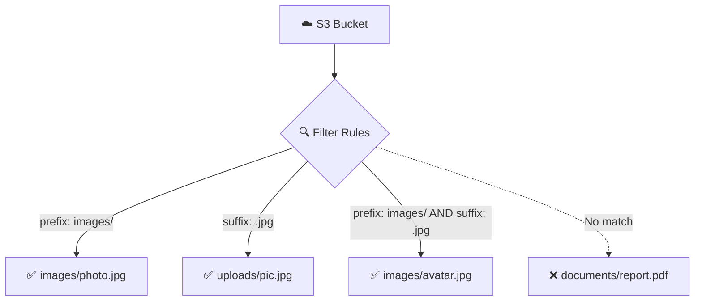

- **Prefix filter** — match objects whose key starts with a value (e.g., `images/`)
- **Suffix filter** — match objects whose key ends with a value (e.g., `.jpg`)
- You can combine **both** prefix and suffix in a single rule
- Filtering is available for SNS, SQS, and Lambda destinations
- For **advanced filtering** (by object size, metadata, tags, etc.), use **Amazon EventBridge**

> **💡 Tip:** With classic S3 notifications, you can only filter on prefix and suffix. If you need more complex filtering (e.g., object size &gt; 1MB, or specific tag values), you must use **EventBridge rules** with JSON-based content filtering.

### ⏱️ Delivery Timing & Reliability

- S3 Event Notifications are typically delivered in **seconds** but can sometimes take **a minute or longer**
- If you need to ensure **every event is processed**, enable **versioning** on your bucket

    - Without versioning, if two writes happen to the same object key simultaneously, you may only receive **one notification** instead of two
    - With versioning enabled, each write creates a unique version, guaranteeing a notification for each
- **EventBridge** provides built-in **retry policies** and **dead-letter queues** for more reliable delivery

> **⚠️ Exam Tip:** A common exam question asks: "How do you ensure that every S3 PUT event generates a notification?" — The answer is to **enable versioning** on the bucket.

### 🏛️ S3 Event Notifications vs EventBridge — Comparison

| Feature | Classic S3 Notifications | Amazon EventBridge |
| --- | --- | --- |
| **Destinations** | SNS, SQS, Lambda only | 18+ AWS services |
| **Filtering** | Prefix & Suffix only | Advanced JSON rules |
| **Multiple destinations** | One per event type/filter combo | Multiple targets per rule |
| **Archive & Replay** | ❌ Not supported | ✅ Supported |
| **Schema Discovery** | ❌ Not available | ✅ Available |
| **Retry Policy** | Basic (S3 retries) | Configurable retries + DLQ |
| **Setup complexity** | Simple | Slightly more complex |
| **Cross-account delivery** | Via resource policies | Via EventBridge rules |

### 🧩 Common Architecture Patterns

#### Pattern 1: Thumbnail Generation Pipeline

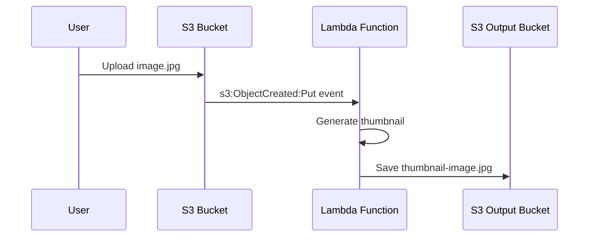

#### Pattern 2: Fan-Out with SNS

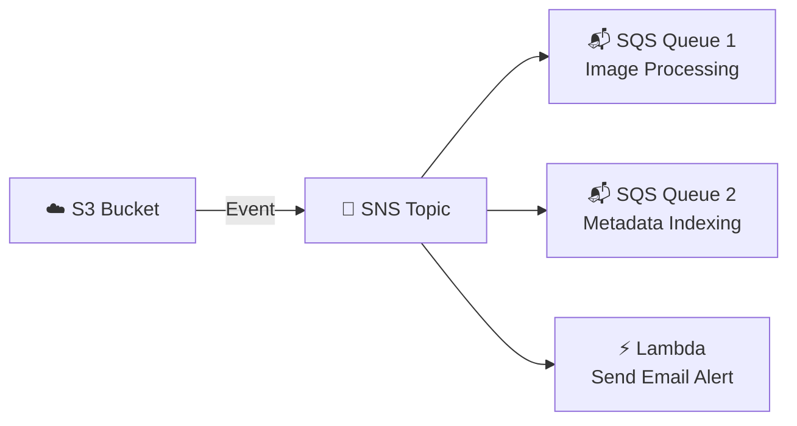

#### Pattern 3: EventBridge Advanced Routing

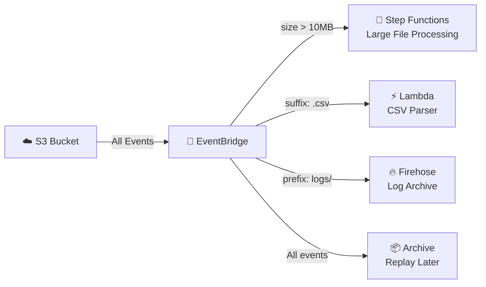

### 🔧 CLI Configuration

#### Configure S3 Event Notification via CLI

```bash
# Create a notification configuration JSON file
cat > notification.json << 'EOF'
{
  "LambdaFunctionConfigurations": [
    {
      "Id": "ProcessUploads",
      "LambdaFunctionArn": "arn:aws:lambda:us-east-1:123456789012:function:processUpload",
      "Events": ["s3:ObjectCreated:*"],
      "Filter": {
        "Key": {
          "FilterRules": [
            { "Name": "prefix", "Value": "uploads/" },
            { "Name": "suffix", "Value": ".csv" }
          ]
        }
      }
    }
  ]
}
EOF

# Apply the notification configuration
aws s3api put-bucket-notification-configuration \
  --bucket my-source-bucket \
  --notification-configuration file://notification.json
```

#### Get Current Notification Configuration

```bash
aws s3api get-bucket-notification-configuration \
  --bucket my-source-bucket
```

#### Enable EventBridge via CLI

```bash
aws s3api put-bucket-notification-configuration \
  --bucket my-source-bucket \
  --notification-configuration '{"EventBridgeConfiguration": {}}'
```

### ✅ Key Exam Takeaways

- S3 Event Notifications can be sent to **SNS, SQS, Lambda**, or **Amazon EventBridge**
- Classic destinations (SNS/SQS/Lambda) support **prefix and suffix filtering** only
- **EventBridge** enables **advanced filtering**, **18+ destinations**, **archive & replay**, and **multiple rules**
- You must configure **resource-based policies** (not IAM roles) on the destination to allow `s3.amazonaws.com` to send events
- **Enable versioning** on your bucket to guarantee notifications for every concurrent write to the same key
- Events are delivered in **seconds** typically, but there is **no guaranteed delivery time SLA**
- **SQS FIFO** queues are **NOT supported** as a direct S3 notification destination — only Standard SQS
- EventBridge is set up independently — you simply enable `EventBridgeConfiguration: {}` on the bucket
- For fan-out scenarios (one event → multiple consumers), use **SNS + SQS** or **EventBridge with multiple rules**
- You can have **multiple notification configurations** on a single bucket (e.g., one for SNS on `.jpg` and another for Lambda on `.csv`)

---

## Lecture 136: 🔔 S3 Event Notifications - Hands On

> **Course**: Ultimate AWS Certified Developer Associate DVA-C02 2026<br>**Section 13**: Advanced Amazon S3<br>**Lecture Type**: Hands-On Lab

### 🎯 Overview

> This hands-on lecture walks through configuring **S3 Event Notifications** in the AWS Management Console. You'll learn how to set up notifications that trigger when objects are created, deleted, or modified in an S3 bucket — routing events to **SQS**, **SNS**, **Lambda**, and **Amazon EventBridge**.

### 🪣 Step 1: Create or Select an S3 Bucket

- Navigate to the **S3 Console** → select an existing bucket or create a new one (e.g., `my-event-demo-bucket-2026`)
- Ensure **versioning** is enabled if you want to capture `ObjectRemoved` or `ObjectRestore` events accurately
- The bucket must be in the **same region** as the target SQS queue, SNS topic, or Lambda function

### 📨 Step 2: Setting Up an SQS Queue as a Destination

#### 2a. Create the SQS Queue

- Go to **Amazon SQS Console** → **Create Queue**
- Choose **Standard** queue type
- Name it (e.g., `s3-event-notification-queue`)
- Leave defaults and click **Create Queue**

#### 2b. Update the SQS Access Policy

> ⚠️ **Critical Step**: The SQS queue must have a **resource-based policy** that allows S3 to send messages to it. Without this, notifications will silently fail.

- In the SQS Console, select the queue → **Access Policy** tab → **Edit**
- Replace or add the following policy:

```json
{
  "Version": "2012-10-17",
  "Statement": [
    {
      "Sid": "AllowS3ToSendMessage",
      "Effect": "Allow",
      "Principal": {
        "Service": "s3.amazonaws.com"
      },
      "Action": "SQS:SendMessage",
      "Resource": "arn:aws:sqs:us-east-1:123456789012:s3-event-notification-queue",
      "Condition": {
        "ArnLike": {
          "aws:SourceArn": "arn:aws:s3:::my-event-demo-bucket-2026"
        }
      }
    }
  ]
}
```

- The `Condition` block ensures **only your specific bucket** can send messages to this queue

#### 2c. Create the S3 Event Notification

- Go back to your **S3 bucket** → **Properties** tab
- Scroll down to **Event notifications** → **Create event notification**
- Configure:

    - **Event name**: `ObjectCreatedToSQS`
    - **Prefix** (optional): `images/` — filters events to only objects under this prefix
    - **Suffix** (optional): `.jpg` — filters events to only `.jpg` files
    - **Event types**: Check ✅ `s3:ObjectCreated:*` (covers Put, Post, Copy, CompleteMultipartUpload)
    - **Destination**: Select **SQS Queue** → choose `s3-event-notification-queue`
- Click **Save changes**

#### 2d. Test It

- Upload an object (e.g., `images/photo.jpg`) to the bucket
- Go to **SQS Console** → select the queue → **Send and receive messages** → **Poll for messages**
- You should see a message containing the S3 event notification JSON payload:

```json
{
  "Records": [
    {
      "eventVersion": "2.1",
      "eventSource": "aws:s3",
      "awsRegion": "us-east-1",
      "eventTime": "2026-07-01T04:00:00.000Z",
      "eventName": "ObjectCreated:Put",
      "s3": {
        "bucket": {
          "name": "my-event-demo-bucket-2026",
          "arn": "arn:aws:s3:::my-event-demo-bucket-2026"
        },
        "object": {
          "key": "images/photo.jpg",
          "size": 204800,
          "eTag": "abc123def456"
        }
      }
    }
  ]
}
```

### 📢 Step 3: Setting Up an SNS Topic as a Destination

#### 3a. Create the SNS Topic

- Go to **Amazon SNS Console** → **Topics** → **Create topic**
- Type: **Standard**
- Name: `s3-event-notification-topic`
- Click **Create topic**

#### 3b. Create a Subscription

- After creating the topic, click **Create subscription**
- Protocol: **Email** (or SQS, Lambda, HTTP, etc.)
- Endpoint: your email address
- Click **Create subscription** → confirm via the email you receive

#### 3c. Update the SNS Access Policy

> ⚠️ Just like SQS, the SNS topic needs a **resource-based policy** granting S3 permission to publish.

- Select the topic → **Edit** → **Access policy**:

```json
{
  "Version": "2012-10-17",
  "Statement": [
    {
      "Sid": "AllowS3ToPublish",
      "Effect": "Allow",
      "Principal": {
        "Service": "s3.amazonaws.com"
      },
      "Action": "SNS:Publish",
      "Resource": "arn:aws:sns:us-east-1:123456789012:s3-event-notification-topic",
      "Condition": {
        "ArnLike": {
          "aws:SourceArn": "arn:aws:s3:::my-event-demo-bucket-2026"
        }
      }
    }
  ]
}
```

#### 3d. Create the S3 Event Notification for SNS

- S3 bucket → **Properties** → **Event notifications** → **Create event notification**
- **Event name**: `ObjectRemovedToSNS`
- **Event types**: ✅ `s3:ObjectRemoved:*`
- **Destination**: **SNS Topic** → select `s3-event-notification-topic`
- **Save changes**

#### 3e. Test It

- Delete an object from the bucket
- Check your email — you should receive a notification with the S3 event JSON payload

### ⚡ Step 4: Setting Up a Lambda Function as a Destination

#### 4a. Create the Lambda Function

- Go to **Lambda Console** → **Create function**
- **Author from scratch**
- Function name: `s3-event-processor`
- Runtime: **Node.js 20.x**
- Click **Create function**
- Replace the default handler code:

```javascript
// Lambda handler to process S3 event notifications
export const handler = async (event) => {
  console.log("S3 Event Received:", JSON.stringify(event, null, 2));

  for (const record of event.Records) {
    const bucket = record.s3.bucket.name;
    const key = decodeURIComponent(record.s3.object.key.replace(/\+/g, " "));
    const eventName = record.eventName;
    const eventTime = record.eventTime;
    const size = record.s3.object.size;

    console.log(`Event: ${eventName}`);
    console.log(`Bucket: ${bucket}`);
    console.log(`Key: ${key}`);
    console.log(`Size: ${size} bytes`);
    console.log(`Time: ${eventTime}`);
  }

  return {
    statusCode: 200,
    body: "S3 event processed successfully",
  };
};
```

- Click **Deploy**

#### 4b. S3 Adds the Resource-Based Policy Automatically

> 💡 Unlike SQS and SNS where you manually edit the access policy, when you configure the S3 event notification to target a Lambda function **through the S3 Console**, AWS **automatically** adds the necessary **resource-based policy** (Lambda permission) that allows S3 to invoke the function.

- You can verify this in the Lambda Console → **Configuration** → **Permissions** → **Resource-based policy statements**

#### 4c. Create the S3 Event Notification for Lambda

- S3 bucket → **Properties** → **Event notifications** → **Create event notification**
- **Event name**: `ObjectCreatedToLambda`
- **Prefix**: `uploads/`
- **Event types**: ✅ `s3:ObjectCreated:*`
- **Destination**: **Lambda Function** → select `s3-event-processor`
- **Save changes**

#### 4d. Test It

- Upload a file to `uploads/` prefix in your bucket
- Go to **Lambda Console** → **Monitor** → **View CloudWatch Logs**
- You should see the log output with bucket name, key, size, and event details

### 🌉 Step 5: Enabling Amazon EventBridge Integration

> EventBridge provides a more powerful and flexible alternative to native S3 event notifications. It supports **rule-based filtering**, **multiple destinations**, **archive & replay**, and **schema discovery**.

#### 5a. Enable EventBridge Notifications on the Bucket

- S3 bucket → **Properties** tab
- Scroll to **Amazon EventBridge** section
- Click **Edit** → toggle **On** → **Save changes**

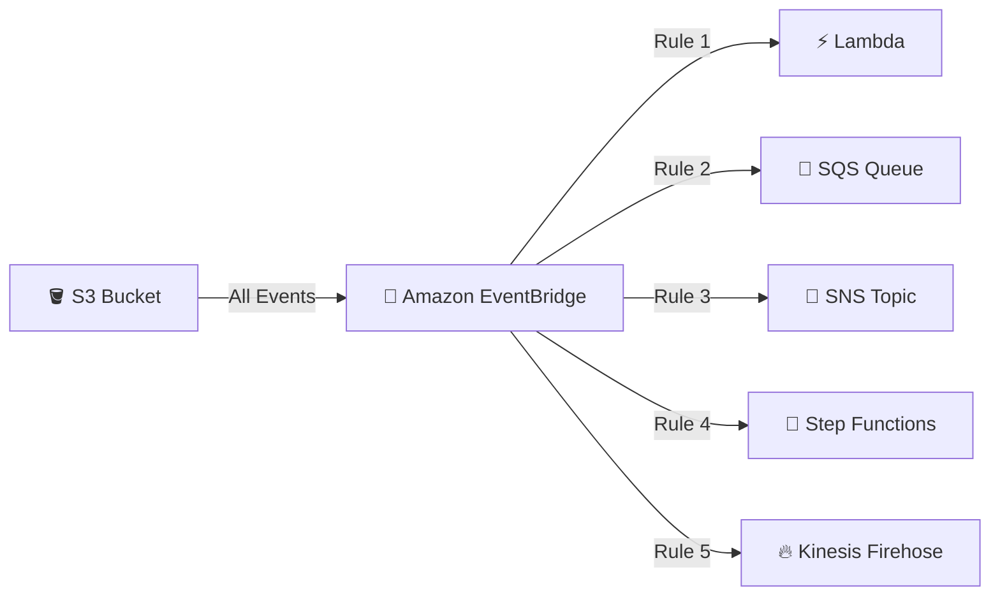

#### 5b. Create an EventBridge Rule

- Go to **Amazon EventBridge Console** → **Rules** → **Create rule**
- **Name**: `s3-object-created-rule`
- **Event bus**: `default`
- **Rule type**: Rule with an event pattern
- Click **Next**

#### 5c. Define the Event Pattern

- **Event source**: AWS services
- **AWS service**: **S3**
- **Event type**: **Amazon S3 Event Notification**
- Refine the pattern to match specific events:

```json
{
  "source": ["aws.s3"],
  "detail-type": ["Object Created"],
  "detail": {
    "bucket": {
      "name": ["my-event-demo-bucket-2026"]
    },
    "object": {
      "key": [{ "prefix": "reports/" }]
    }
  }
}
```

> 💡 EventBridge supports **content-based filtering** with operators like `prefix`, `suffix`, `anything-but`, `numeric`, and `exists` — far more powerful than native S3 prefix/suffix filters.

#### 5d. Select Target

- Choose a target (e.g., Lambda function, SQS queue, Step Functions, etc.)
- You can add **multiple targets** to a single rule — a key advantage over native S3 event notifications
- Click **Next** → **Create rule**

#### 5e. Test It

- Upload a file with the `reports/` prefix
- Verify the target receives the event

### 🛠️ Configuring S3 Event Notifications via AWS CLI

#### Create SQS Notification via CLI

```bash
# Create the notification configuration JSON file
cat > notification.json << 'EOF'
{
  "QueueConfigurations": [
    {
      "QueueArn": "arn:aws:sqs:us-east-1:123456789012:s3-event-notification-queue",
      "Events": ["s3:ObjectCreated:*"],
      "Filter": {
        "Key": {
          "FilterRules": [
            { "Name": "prefix", "Value": "images/" },
            { "Name": "suffix", "Value": ".jpg" }
          ]
        }
      }
    }
  ]
}
EOF

# Apply the notification configuration to the bucket
aws s3api put-bucket-notification-configuration \
  --bucket my-event-demo-bucket-2026 \
  --notification-configuration file://notification.json
```

#### View Current Notification Configuration

```bash
aws s3api get-bucket-notification-configuration \
  --bucket my-event-demo-bucket-2026
```

#### Configure Multiple Destinations at Once

```bash
cat > multi-notification.json << 'EOF'
{
  "QueueConfigurations": [
    {
      "QueueArn": "arn:aws:sqs:us-east-1:123456789012:s3-event-notification-queue",
      "Events": ["s3:ObjectCreated:*"]
    }
  ],
  "TopicConfigurations": [
    {
      "TopicArn": "arn:aws:sns:us-east-1:123456789012:s3-event-notification-topic",
      "Events": ["s3:ObjectRemoved:*"]
    }
  ],
  "LambdaFunctionConfigurations": [
    {
      "LambdaFunctionArn": "arn:aws:lambda:us-east-1:123456789012:function:s3-event-processor",
      "Events": ["s3:ObjectCreated:*"],
      "Filter": {
        "Key": {
          "FilterRules": [
            { "Name": "prefix", "Value": "uploads/" }
          ]
        }
      }
    }
  ],
  "EventBridgeConfiguration": {}
}
EOF

aws s3api put-bucket-notification-configuration \
  --bucket my-event-demo-bucket-2026 \
  --notification-configuration file://multi-notification.json
```

> ⚠️ **Important**: `put-bucket-notification-configuration` **replaces** the entire notification configuration. Always include ALL existing configurations when adding a new one, or they will be removed.

### 💻 Configuring S3 Event Notifications via Node.js SDK

```javascript
import {
  S3Client,
  PutBucketNotificationConfigurationCommand,
  GetBucketNotificationConfigurationCommand,
} from "@aws-sdk/client-s3";

const s3Client = new S3Client({ region: "us-east-1" });

// Set up notification configuration with all destination types
const putNotificationConfig = async () => {
  const command = new PutBucketNotificationConfigurationCommand({
    Bucket: "my-event-demo-bucket-2026",
    NotificationConfiguration: {
      QueueConfigurations: [
        {
          QueueArn:
            "arn:aws:sqs:us-east-1:123456789012:s3-event-notification-queue",
          Events: ["s3:ObjectCreated:*"],
          Filter: {
            Key: {
              FilterRules: [
                { Name: "prefix", Value: "images/" },
                { Name: "suffix", Value: ".png" },
              ],
            },
          },
        },
      ],
      LambdaFunctionConfigurations: [
        {
          LambdaFunctionArn:
            "arn:aws:lambda:us-east-1:123456789012:function:s3-event-processor",
          Events: ["s3:ObjectCreated:*"],
          Filter: {
            Key: {
              FilterRules: [{ Name: "prefix", Value: "uploads/" }],
            },
          },
        },
      ],
      // Enable EventBridge (empty object enables it)
      EventBridgeConfiguration: {},
    },
  });

  await s3Client.send(command);
  console.log("Notification configuration applied successfully");
};

// Retrieve current notification configuration
const getNotificationConfig = async () => {
  const command = new GetBucketNotificationConfigurationCommand({
    Bucket: "my-event-demo-bucket-2026",
  });

  const response = await s3Client.send(command);
  console.log(
    "Current configuration:",
    JSON.stringify(response, null, 2)
  );
};

await putNotificationConfig();
await getNotificationConfig();
```

### 🔄 Event Notification Flow Summary

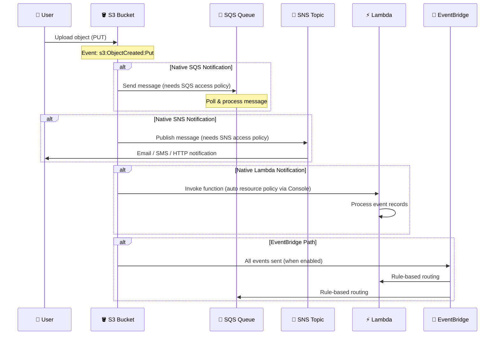

### ⚠️ Common Gotchas & Troubleshooting

| Issue | Cause | Solution |
| --- | --- | --- |
| Notification not working (no errors) | Missing resource-based policy on destination | Add SQS/SNS access policy allowing `s3.amazonaws.com` |
| "Unable to validate destination" error | Destination policy doesn't exist yet | Create the access policy on SQS/SNS **before** configuring the S3 notification |
| Events not firing for some objects | Prefix/suffix filter mismatch | Double-check filter rules — they are case-sensitive |
| Duplicate events received | Multiple overlapping notification configs | Ensure event type + prefix/suffix combos don't overlap across configurations |
| Old notifications disappeared | Used `put-bucket-notification-configuration` | This command **replaces** all configs — always include existing ones |
| EventBridge not receiving events | EventBridge integration not enabled on bucket | Go to bucket **Properties** → **Amazon EventBridge** → toggle **On** |

### 🧹 Cleanup

- **S3 Bucket**: Delete all objects → Delete the bucket (or remove notification configurations)
- **SQS Queue**: Go to SQS Console → select queue → **Delete**
- **SNS Topic**: Go to SNS Console → select topic → **Delete**
- **Lambda Function**: Go to Lambda Console → select function → **Actions** → **Delete**
- **EventBridge Rule**: Go to EventBridge Console → select rule → **Delete**

### 📝 Key Exam Takeaways

- S3 event notifications can target **SQS**, **SNS**, **Lambda**, or **EventBridge**
- **SQS and SNS** require **resource-based policies** (access policies) that explicitly allow `s3.amazonaws.com` to send/publish
- **Lambda** gets its resource-based policy **automatically** when configured through the S3 Console
- **EventBridge** must be **explicitly enabled** on the bucket (Properties → Amazon EventBridge → On)
- `put-bucket-notification-configuration` **replaces the entire configuration** — always include all existing configs
- Native S3 notifications support only **prefix** and **suffix** filtering; **EventBridge** supports advanced content-based filtering
- Native S3 notifications send to **one destination per rule**; **EventBridge** can route to **multiple targets** from a single rule
- You can have **multiple notification configurations** on a single bucket, but **event type + filter combos must not overlap** for the same destination type
- EventBridge adds support for **archive & replay**, **schema discovery**, and over **18+ target types**

---

## Lecture 137: 🚀 S3 Performance

> **Section 13: Advanced Amazon S3** — Ultimate AWS Certified Developer Associate DVA-C02 2026

### 📊 S3 Baseline Performance

- Amazon S3 automatically scales to very **high request rates** with very low latency (100–200 ms to get the first byte)
- Your application can achieve at least:

    - **3,500 PUT/COPY/POST/DELETE** requests per second **per prefix**
    - **5,500 GET/HEAD** requests per second **per prefix**
- There are **no limits** to the number of prefixes in a bucket

#### 🔑 Understanding Prefixes

- The **prefix** is everything between the bucket name and the object name (the "folder path")
- Examples:

| Object Key | Prefix |
| --- | --- |
| `bucket/folder1/sub1/file` | `/folder1/sub1/` |
| `bucket/folder1/sub2/file` | `/folder1/sub2/` |
| `bucket/1/file` | `/1/` |
| `bucket/2/file` | `/2/` |

- If you spread reads evenly across **4 prefixes**, you can achieve **22,000 GET requests per second** (4 × 5,500)
- This means: **design your key structure to distribute load across prefixes** for maximum throughput

### 📤 S3 Multi-Part Upload

- **Recommended** for files &gt; 100 MB
- **Required** (must use) for files &gt; **5 GB**
- Helps **parallelize uploads** → speeds up transfers by utilizing full bandwidth

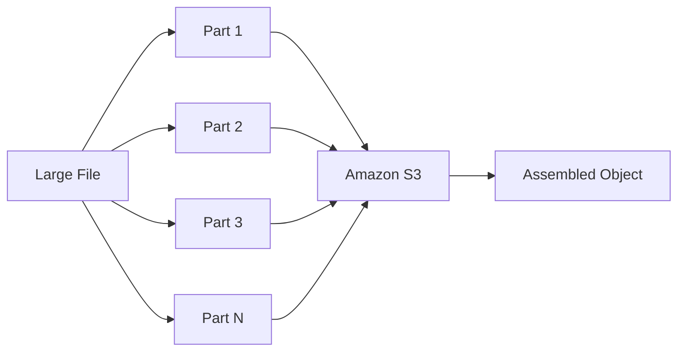

- Each part can be uploaded **independently** and in **parallel**
- If any part fails, only that part needs to be **retried** (not the whole file)
- AWS SDK handles the multi-part upload logic for you

```javascript
// Multi-Part Upload using AWS SDK v3
import { S3Client, CreateMultipartUploadCommand, UploadPartCommand, CompleteMultipartUploadCommand } from "@aws-sdk/client-s3";
import { Upload } from "@aws-sdk/lib-storage";
import { createReadStream } from "fs";

const s3Client = new S3Client({ region: "us-east-1" });

// Easy approach using lib-storage (recommended)
const upload = new Upload({
  client: s3Client,
  params: {
    Bucket: "my-bucket",
    Key: "large-file.zip",
    Body: createReadStream("./large-file.zip"),
  },
  // Optional: configure part size (minimum 5 MB)
  partSize: 10 * 1024 * 1024, // 10 MB per part
  leavePartsOnError: false,
});

upload.on("httpUploadProgress", (progress) => {
  console.log(`Uploaded: ${progress.loaded} / ${progress.total}`);
});

await upload.done();
console.log("Multi-part upload complete!");
```

### ⚡ S3 Transfer Acceleration

- Increase transfer speed by transferring files to an **AWS Edge Location** which will then forward the data to the S3 bucket in the target region over AWS's **private network**
- Compatible with **multi-part upload**
- Works for both **uploads and downloads**

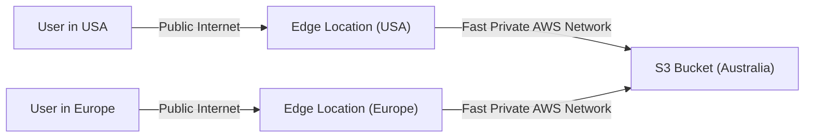

- Instead of uploading over the public internet all the way to a distant region, data travels quickly over the public internet to the **nearest edge location**, then over AWS's **optimized backbone network** to the target bucket
- The **endpoint changes** when using Transfer Acceleration:

    - Normal: `bucketname.s3.amazonaws.com`
    - Accelerated: `bucketname.s3-accelerate.amazonaws.com`

```javascript
import { S3Client, PutObjectCommand } from "@aws-sdk/client-s3";

// Use the Transfer Acceleration endpoint
const s3Client = new S3Client({
  region: "ap-southeast-2",
  useAccelerateEndpoint: true, // Enables Transfer Acceleration
});

const command = new PutObjectCommand({
  Bucket: "my-transfer-accel-bucket",
  Key: "my-large-file.zip",
  Body: fileBuffer,
});

await s3Client.send(command);
```

> ⚠️ Transfer Acceleration must be **enabled on the bucket** before use. It incurs additional data transfer charges.

### 📥 S3 Byte-Range Fetches

- Parallelize **GET requests** by requesting specific **byte ranges** of an object
- Better **resilience** in case of failures — only need to retry the small byte range, not the entire file
- Two primary use cases:

#### Use Case 1: Speed Up Downloads

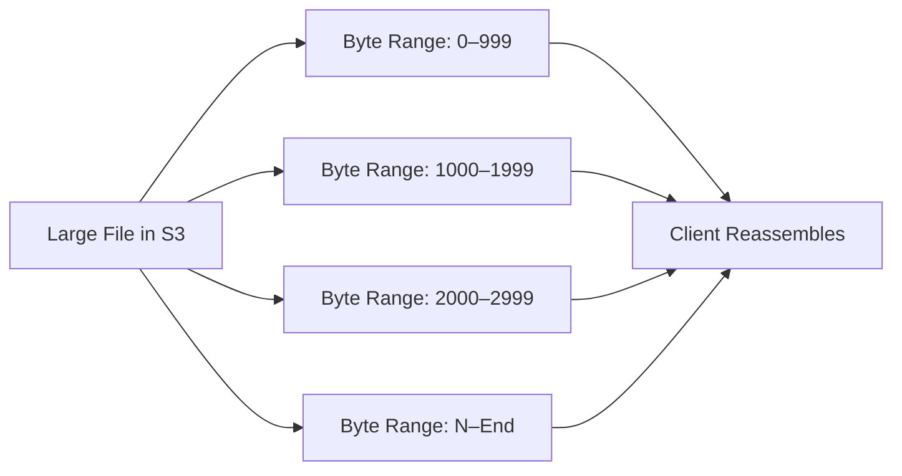

- Request multiple byte ranges **in parallel** to download parts of the file simultaneously
- Significantly speeds up download of large files

#### Use Case 2: Retrieve Partial Data (Head of File)

- You can request just the **first few bytes** of a file (e.g., the header)
- Useful when you only need **metadata** from the beginning of a file

```javascript
import { S3Client, GetObjectCommand } from "@aws-sdk/client-s3";

const s3Client = new S3Client({ region: "us-east-1" });

// Retrieve only the first 500 bytes (e.g., file header)
const command = new GetObjectCommand({
  Bucket: "my-bucket",
  Key: "large-data-file.csv",
  Range: "bytes=0-499", // Byte-range fetch
});

const response = await s3Client.send(command);
const headerData = await response.Body.transformToString();
console.log("File header:", headerData);
```

### 🔍 S3 Select & Glacier Select

- Retrieve **less data** using **SQL** by performing **server-side filtering**
- Can filter by **rows and columns** (simple SQL statements)
- **Less network transfer**, **less CPU cost** on the client side

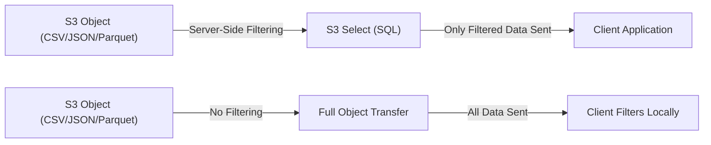

- **Up to 400% faster** and **up to 80% cheaper** than retrieving the entire object
- Filtering happens **on Amazon S3's side** (server-side), so you save on network and compute
- Works with **CSV**, **JSON**, and **Apache Parquet** formats
- Supports simple SQL expressions: `SELECT`, `WHERE`, `LIMIT`

```javascript
import { S3Client, SelectObjectContentCommand } from "@aws-sdk/client-s3";

const s3Client = new S3Client({ region: "us-east-1" });

const command = new SelectObjectContentCommand({
  Bucket: "my-bucket",
  Key: "sales-data.csv",
  Expression: "SELECT s.Name, s.City FROM s3object s WHERE s.City = 'New York'",
  ExpressionType: "SQL",
  InputSerialization: {
    CSV: {
      FileHeaderInfo: "USE", // First row contains column headers
      Comments: "#",
      QuoteEscapeCharacter: '"',
    },
  },
  OutputSerialization: {
    JSON: {},
  },
});

const response = await s3Client.send(command);

// Process the event stream
for await (const event of response.Payload) {
  if (event.Records) {
    const records = event.Records.Payload;
    const data = Buffer.from(records).toString("utf-8");
    console.log("Filtered results:", data);
  }
}
```

> 💡 **Glacier Select** works the same way but for data archived in Glacier — run SQL queries on archived data without restoring the entire archive.

### 🧠 Performance Optimization Summary

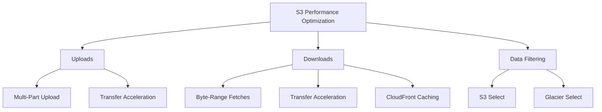

| Optimization | Use Case | Key Benefit |
| --- | --- | --- |
| **Multi-Part Upload** | Large file uploads (&gt;100 MB) | Parallel upload, retry individual parts |
| **Transfer Acceleration** | Cross-region or distant uploads/downloads | Uses edge locations + AWS backbone |
| **Byte-Range Fetches** | Large file downloads or partial reads | Parallel download, partial retrieval |
| **S3 Select** | Query CSV/JSON/Parquet in S3 | Server-side SQL filtering, 400% faster |
| **Prefix Distribution** | High request rate workloads | 3,500 PUT / 5,500 GET per prefix per second |

### 🎯 Key Exam Takeaways

- S3 can handle **3,500 writes** and **5,500 reads** per second **per prefix** — spread across prefixes to scale
- **Multi-part upload** is recommended for files &gt; 100 MB and **mandatory** for &gt; 5 GB
- **Transfer Acceleration** uses **edge locations** to speed up long-distance transfers over the AWS private network
- **Byte-Range Fetches** parallelize GETs and allow retrieval of **partial objects** (e.g., file headers)
- **S3 Select** enables **server-side filtering** with SQL — up to **400% faster** and **80% cheaper**
- S3 Select works on **CSV, JSON, and Parquet** files
- For maximum upload performance: combine **multi-part upload + Transfer Acceleration**
- For maximum download performance: combine **byte-range fetches + Transfer Acceleration + CloudFront caching**
- There is **no limit** on the number of prefixes per bucket

---

## Lecture 138: 🏷️ S3 Object Tags & Metadata

> **Section 13: Advanced Amazon S3** — Ultimate AWS Certified Developer Associate DVA-C02 2026

### 📋 S3 User-Defined Object Metadata

- When uploading an object to S3, you can attach **user-defined metadata** as key-value pairs
- User-defined metadata keys **must begin** with `x-amz-meta-`
- Amazon S3 stores user-defined metadata keys in **lowercase**
- Metadata is attached at the **time of upload** (PUT request)
- Metadata can be retrieved when **reading the object** (GET or HEAD request)

#### 🔑 Key Characteristics

- Metadata is **not searchable** — you cannot query or filter objects by metadata
- To find objects with specific metadata, you must use an **external search mechanism** (e.g., build an index in DynamoDB)
- Metadata is returned as **HTTP headers** in the response

```javascript
import { S3Client, PutObjectCommand, HeadObjectCommand } from "@aws-sdk/client-s3";

const s3Client = new S3Client({ region: "us-east-1" });

// Upload an object with user-defined metadata
const putCommand = new PutObjectCommand({
  Bucket: "my-bucket",
  Key: "reports/quarterly-report.pdf",
  Body: fileBuffer,
  Metadata: {
    // These will be stored as x-amz-meta-department, x-amz-meta-author, etc.
    "department": "finance",
    "author": "john-doe",
    "report-type": "quarterly",
    "fiscal-year": "2026",
  },
});

await s3Client.send(putCommand);

// Retrieve metadata without downloading the object (HEAD request)
const headCommand = new HeadObjectCommand({
  Bucket: "my-bucket",
  Key: "reports/quarterly-report.pdf",
});

const response = await s3Client.send(headCommand);
console.log("Metadata:", response.Metadata);
// Output: { department: "finance", author: "john-doe", "report-type": "quarterly", "fiscal-year": "2026" }
```

#### ⚠️ Important Notes on Metadata

- User-defined metadata is **immutable after upload** — to change it, you must **re-upload** the object or use a **COPY** operation (copy the object to itself with new metadata)
- There are also **S3 system-defined metadata** keys (e.g., `Content-Type`, `Content-Length`, `Last-Modified`, `ETag`) that S3 manages automatically
- Total user-defined metadata size is limited to **2 KB**

```javascript
import { S3Client, CopyObjectCommand } from "@aws-sdk/client-s3";

const s3Client = new S3Client({ region: "us-east-1" });

// Update metadata by copying the object to itself
const copyCommand = new CopyObjectCommand({
  Bucket: "my-bucket",
  Key: "reports/quarterly-report.pdf",
  CopySource: "my-bucket/reports/quarterly-report.pdf",
  MetadataDirective: "REPLACE", // Must be REPLACE to update metadata
  Metadata: {
    "department": "finance",
    "author": "john-doe",
    "report-type": "quarterly",
    "fiscal-year": "2026",
    "status": "reviewed", // New metadata field
  },
});

await s3Client.send(copyCommand);
```

### 🏷️ S3 Object Tags

- Object tags are **key-value pairs** attached to S3 objects (up to **10 tags** per object)
- Tags are useful for:

    - **Fine-grained permissions** — grant access to specific tagged objects via IAM policies
    - **Analytics** — classify objects and group them in S3 Analytics
    - **Lifecycle rules** — create lifecycle rules that target objects with specific tags
    - **Cost allocation** — track storage costs by tag
- Unlike metadata, tags **can be searched** using **S3 Inventory** + **Amazon Athena** or **S3 Batch Operations**

```mermaid
graph TD
    A["S3 Object"] --> B["User-Defined Metadata"]
    A --> C["Object Tags"]
    A --> D["System Metadata"]

    B --> B1["x-amz-meta-author: john"]
    B --> B2["x-amz-meta-dept: finance"]

    C --> C1["Environment: Production"]
    C --> C2["Project: Alpha"]
    C --> C3["Classification: Confidential"]

    D --> D1["Content-Type: application/pdf"]
    D --> D2["Content-Length: 2048"]
    D --> D3["Last-Modified: 2026-07-08"]
```

#### 🔧 Working with Object Tags

```javascript
import {
  S3Client,
  PutObjectTaggingCommand,
  GetObjectTaggingCommand,
  PutObjectCommand,
} from "@aws-sdk/client-s3";

const s3Client = new S3Client({ region: "us-east-1" });

// Upload an object with tags
const putCommand = new PutObjectCommand({
  Bucket: "my-bucket",
  Key: "data/user-data.csv",
  Body: fileBuffer,
  Tagging: "Environment=Production&Project=Alpha&Classification=Confidential",
});

await s3Client.send(putCommand);

// Add or update tags on an existing object
const putTagsCommand = new PutObjectTaggingCommand({
  Bucket: "my-bucket",
  Key: "data/user-data.csv",
  Tagging: {
    TagSet: [
      { Key: "Environment", Value: "Production" },
      { Key: "Project", Value: "Alpha" },
      { Key: "Classification", Value: "Confidential" },
      { Key: "DataOwner", Value: "analytics-team" },
    ],
  },
});

await s3Client.send(putTagsCommand);

// Retrieve tags from an object
const getTagsCommand = new GetObjectTaggingCommand({
  Bucket: "my-bucket",
  Key: "data/user-data.csv",
});

const tagsResponse = await s3Client.send(getTagsCommand);
console.log("Tags:", tagsResponse.TagSet);
// Output: [{ Key: "Environment", Value: "Production" }, { Key: "Project", Value: "Alpha" }, ...]
```

#### 🔒 IAM Policies with Object Tags

- You can write **IAM policies** that grant or deny access based on object tags
- This enables **fine-grained access control** at the object level

```json
{
  "Version": "2012-10-17",
  "Statement": [
    {
      "Effect": "Allow",
      "Action": "s3:GetObject",
      "Resource": "arn:aws:s3:::my-bucket/*",
      "Condition": {
        "StringEquals": {
          "s3:ExistingObjectTag/Environment": "Production",
          "s3:ExistingObjectTag/Classification": "Public"
        }
      }
    }
  ]
}
```

> 💡 This policy allows `GetObject` only on objects tagged with `Environment=Production` AND `Classification=Public`.

#### 📦 Lifecycle Rules with Object Tags

- You can create **S3 Lifecycle rules** that apply only to objects with specific tags
- Example: Transition objects tagged `Archive=true` to Glacier after 90 days

```mermaid
graph LR
    A["Objects Tagged: Archive=true"] -->|"90 Days"| B["S3 Glacier Flexible Retrieval"]
    C["Objects Tagged: Temp=true"] -->|"30 Days"| D["Deleted"]
    E["Objects Without Tags"] -->|"No Rule Applied"| F["Stay in S3 Standard"]
```

### 🔄 Metadata vs Tags — Comparison

| Feature | User-Defined Metadata | Object Tags |
| --- | --- | --- |
| **Format** | Key-value pairs (prefix: `x-amz-meta-`) | Key-value pairs (up to 10) |
| **Searchable** | ❌ Not searchable | ✅ Searchable (via Inventory + Athena) |
| **Modifiable** | ❌ Must re-upload or copy object | ✅ Can be updated anytime |
| **Use in IAM Policies** | ❌ Cannot be used in conditions | ✅ Can be used in IAM conditions |
| **Use in Lifecycle Rules** | ❌ Not supported | ✅ Supported as filter |
| **Analytics / Cost Allocation** | ❌ Not supported | ✅ Supported |
| **Max Size / Count** | 2 KB total | 10 tags per object |
| **Returned With** | GET / HEAD response headers | Separate `GetObjectTagging` API |

### 🎯 Key Exam Takeaways

- **S3 User-Defined Metadata** must have keys prefixed with `x-amz-meta-` and are stored in **lowercase**
- Metadata is **not searchable** — you need an external database (like DynamoDB) to search by metadata
- Metadata **cannot be modified** after upload — you must copy the object to itself with `MetadataDirective: REPLACE`
- **S3 Object Tags** are key-value pairs (up to **10 per object**) that **can be updated** without re-uploading
- Tags are useful for **IAM policy conditions**, **lifecycle rules**, **analytics**, and **cost allocation**
- Tags **can be searched** using S3 Inventory + Amazon Athena
- You **cannot search objects** directly in S3 by metadata or tags using the S3 API — you need external tools
- For fine-grained access control based on object properties, use **Object Tags** (not metadata)

---
