# Amazon S3 Introduction

## Lecture 113: 🪣 S3 Overview

> **Section 11: Amazon S3 Introduction**<br>Course: Ultimate AWS Certified Developer Associate DVA-C02 2026 — Stephane Maarek

### 📌 What is Amazon S3?

- Amazon **S3 (Simple Storage Service)** is one of the main building blocks of AWS
- S3 is advertised as **"infinitely scaling"** storage
- Many websites use S3 as a backbone, and many AWS services use S3 as an integration as well
- S3 is a **global service**, but buckets are created in a **specific region**

### 🪣 S3 Buckets

- Amazon S3 stores objects (files) in **buckets** (directories)
- Buckets must have a **globally unique name** (across all regions and all accounts)
- Buckets are defined at the **region level**
- S3 looks like a global service in the console, but buckets are region-specific

#### 🏷️ Bucket Naming Rules

- No uppercase letters, no underscores
- Must be 3–63 characters long
- Must not be an IP address
- Must start with a lowercase letter or number
- Must **not** start with the prefix `xn--`
- Must **not** end with the suffix `s3alias`

### 📄 S3 Objects

- Objects (files) have a **Key**
- The key is the **full path** of the object within the bucket:

    - `s3://my-bucket/my_file.txt`
    - `s3://my-bucket/my_folder/another_folder/my_file.txt`
- The key is composed of a **prefix** + **object name**

    - Example: `s3://my-bucket/my_folder/another_folder/my_file.txt`

        - Prefix: `my_folder/another_folder/`
        - Object Name: `my_file.txt`

> 💡 There's **no concept of "directories"** within buckets — the UI may show folders, but they are simply keys with slashes (`/`) in them.

#### 📊 Object Values

- Object values are the **content of the body**
- Max object size is **5 TB** (5 terabytes)
- If uploading more than **5 GB**, must use **multi-part upload**
- Each object can have:

    - **Metadata** — list of text key/value pairs (system or user metadata)
    - **Tags** — Unicode key/value pairs (up to 10) — useful for security and lifecycle
    - **Version ID** — if versioning is enabled

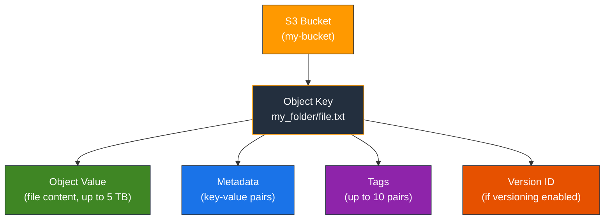

### 🔐 S3 Security Overview (High Level)

- **User-Based Security**:

    - **IAM Policies** — which API calls should be allowed for a specific user from IAM
- **Resource-Based Security**:

    - **Bucket Policies** — bucket-wide rules from the S3 console (allows cross-account access)
    - **Object Access Control List (ACL)** — finer grain (can be disabled)
    - **Bucket Access Control List (ACL)** — less common (can be disabled)

> 💡 An IAM principal can access an S3 object if:
>
> - The user IAM permissions **ALLOW** it **OR** the resource policy **ALLOWS** it
> - **AND** there is no explicit **DENY**

- **Encryption**: Encrypt objects in S3 using encryption keys

### 🌐 S3 Use Cases

- **Backup and storage** — for files, disks, etc.
- **Disaster Recovery** — move data to another region
- **Archive** — store data for long-term retrieval (e.g., with Glacier)
- **Hybrid Cloud storage** — expand on-premises storage to the cloud
- **Application hosting** — host static websites
- **Media hosting** — store and deliver videos, images
- **Data lakes & big data analytics** — store massive amounts of data for analytics
- **Software delivery** — host software updates and packages
- **Static website hosting** — serve HTML/CSS/JS directly from S3

### 💻 Working with S3 via AWS SDK (Node.js)

#### Creating a Bucket

```javascript
import { S3Client, CreateBucketCommand } from "@aws-sdk/client-s3";

const s3Client = new S3Client({ region: "us-east-1" });

const createBucket = async () => {
  const command = new CreateBucketCommand({
    Bucket: "my-unique-bucket-name-2026",
  });
  const response = await s3Client.send(command);
  console.log("Bucket created:", response.Location);
};

createBucket();
```

#### Uploading an Object

```javascript
import { S3Client, PutObjectCommand } from "@aws-sdk/client-s3";

const s3Client = new S3Client({ region: "us-east-1" });

const uploadObject = async () => {
  const command = new PutObjectCommand({
    Bucket: "my-unique-bucket-name-2026",
    Key: "my_folder/hello.txt",
    Body: "Hello from S3!",
    ContentType: "text/plain",
  });
  const response = await s3Client.send(command);
  console.log("Upload successful, ETag:", response.ETag);
};

uploadObject();
```

#### Listing Objects in a Bucket

```javascript
import { S3Client, ListObjectsV2Command } from "@aws-sdk/client-s3";

const s3Client = new S3Client({ region: "us-east-1" });

const listObjects = async () => {
  const command = new ListObjectsV2Command({
    Bucket: "my-unique-bucket-name-2026",
    Prefix: "my_folder/", // optional prefix filter
  });
  const response = await s3Client.send(command);
  response.Contents?.forEach((obj) => {
    console.log(`Key: ${obj.Key}, Size: ${obj.Size} bytes`);
  });
};

listObjects();
```

### 🔗 S3 Key Concepts Summary

| Concept | Details |
| --- | --- |
| **Bucket** | Container for objects, globally unique name, region-specific |
| **Object** | File stored in a bucket, identified by a key (full path) |
| **Key** | Full path of the object (`prefix` + `object name`) |
| **Max Object Size** | 5 TB |
| **Multi-Part Upload** | Required for files &gt; 5 GB |
| **Metadata** | System/user key-value pairs attached to objects |
| **Tags** | Up to 10 Unicode key-value pairs per object |
| **Version ID** | Assigned when versioning is enabled on the bucket |

### 🧠 Key Exam Takeaways

- S3 bucket names must be **globally unique** across all AWS accounts and regions
- S3 is a **global service** but buckets are created in a **specific AWS region**
- There is **no real directory concept** — the UI simulates folders using key prefixes with `/`
- Maximum object size is **5 TB**; use **multi-part upload** for anything over **5 GB**
- S3 security is governed by **IAM policies** (user-based) and **Bucket Policies** (resource-based)
- An IAM principal can access S3 if IAM permissions **OR** resource policy allows it, **AND** there is no explicit DENY
- Objects have **metadata**, **tags**, and optionally a **version ID**
- S3 is foundational for many AWS architectures: data lakes, static hosting, backups, disaster recovery, and media hosting

---

## Lecture 114: 🛠️ S3 Hands On

> **Section 11: Amazon S3 Introduction**<br>Course: Ultimate AWS Certified Developer Associate DVA-C02 2026 — Stephane Maarek

### 🪣 Creating an S3 Bucket

#### Step-by-Step in the AWS Console

- Navigate to the **S3** service in the AWS Console
- Click **"Create bucket"**
- S3 is a **global service** — the console shows all buckets across regions, but each bucket is created in a **specific region**
- Choose an **AWS Region** (e.g., `eu-west-1`) — pick a region close to you for lower latency
- Enter a **Bucket name**:

    - Must be **globally unique** across all AWS accounts worldwide
    - Must follow naming rules: lowercase, no underscores, 3–63 chars, not an IP, starts with letter or number

> ⚠️ If you get an error saying "Bucket name already exists", it means someone else in the world already has that name — pick a different one.

#### 🔧 Bucket Configuration Options

- **Object Ownership**:

    - Keep **ACLs disabled** (recommended) — the bucket owner owns all objects
    - ACLs are a legacy access control mechanism; bucket policies are preferred
- **Block Public Access settings**:

    - By default, **all public access is blocked** (all 4 checkboxes are checked)
    - This is a safety mechanism to prevent accidental data exposure
    - Leave these **enabled** for now (we will explore public access in later lectures)
- **Bucket Versioning**:

    - Can be **Disabled** or **Enabled**
    - Leave disabled for now (covered in Lecture 119)
- **Default Encryption**:

    - **SSE-S3** (Server-Side Encryption with Amazon S3-managed keys) is the default
    - Encryption is automatically applied to all objects
    - Can also choose **SSE-KMS** for more control
- **Bucket Key**:

    - Enabled by default — reduces costs when using SSE-KMS
- Click **"Create bucket"** to finish

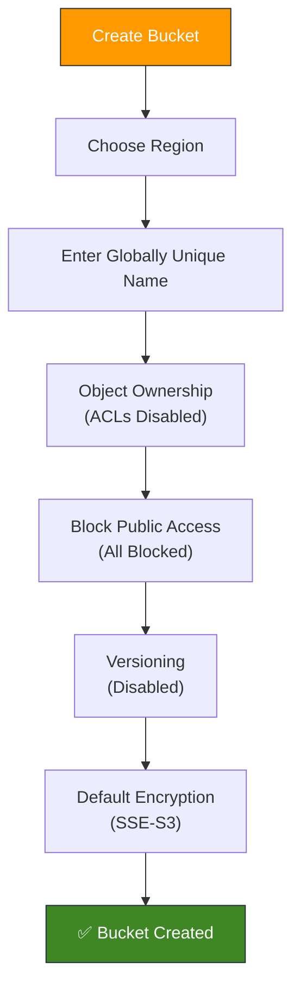

### 📤 Uploading Objects to S3

#### Uploading via the Console

- Click on your newly created bucket
- Click **"Upload"**
- Click **"Add files"** to select one or more files from your local machine
- You can also click **"Add folder"** to upload an entire directory
- Before uploading, you can expand optional settings:

    - **Storage class** — defaults to S3 Standard
    - **Encryption** — inherits from bucket default (SSE-S3)
    - **Metadata** — add custom key-value pairs
    - **Tags** — add key-value tags for organization
- Click **"Upload"** to complete

> 💡 When you upload a file, S3 assigns it a **Key** which is the full path (including any folder prefixes).

#### Understanding the "Folder" Illusion

- You can click **"Create folder"** in the console to create a prefix like `images/`
- Upload a file inside it → the key becomes `images/photo.jpg`
- S3 does **NOT** have real directories — these are just **key prefixes** displayed as folders in the UI
- The **full key** is what matters: `images/photo.jpg`

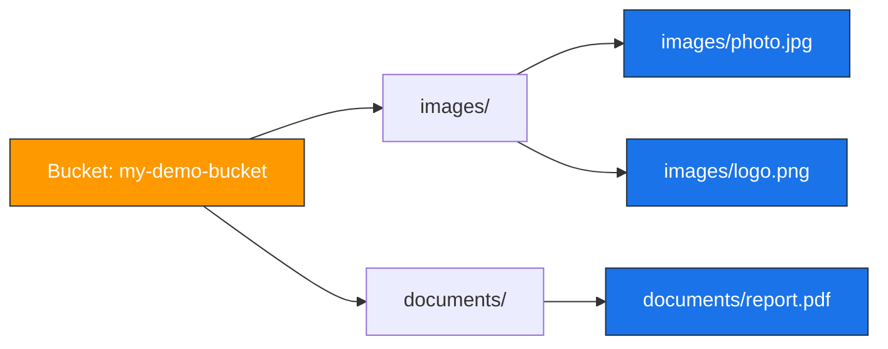

### 👁️ Viewing & Accessing Objects

#### Object Details

- Click on any uploaded object to see its details:

    - **Key** — the full path/name
    - **Size** — file size in bytes
    - **Type** — MIME content type (e.g., `image/png`, `text/plain`)
    - **Last modified** — timestamp
    - **ETag** — a hash of the object (useful for cache validation)
    - **Object URL** — a public URL (but it won't work unless the bucket allows public access)
    - **S3 URI** — the `s3://bucket-name/key` format URI

#### 🔗 Object URL vs Pre-Signed URL

- **Object URL**: `https://my-bucket.s3.amazonaws.com/my-file.txt`

    - This URL will return **403 Forbidden** if the bucket blocks public access
    - The object URL is the permanent address, but access depends on permissions
- **Open button / Pre-Signed URL**: Clicking **"Open"** in the console generates a **pre-signed URL**

    - This is a temporary URL with embedded authentication credentials
    - It works even when public access is blocked
    - Contains query parameters like `X-Amz-Security-Token`, `X-Amz-Signature`, etc.

> 💡 If you try the plain Object URL and get **403 Forbidden**, that's expected! The bucket is blocking public access. Use the **"Open"** button which generates a pre-signed URL with your credentials embedded.

#### Generating a Pre-Signed URL with the SDK

```javascript
import { S3Client, GetObjectCommand } from "@aws-sdk/client-s3";
import { getSignedUrl } from "@aws-sdk/s3-request-presigner";

const s3Client = new S3Client({ region: "eu-west-1" });

const generatePresignedUrl = async () => {
  const command = new GetObjectCommand({
    Bucket: "my-demo-bucket",
    Key: "images/photo.jpg",
  });

  // URL expires in 1 hour (3600 seconds)
  const url = await getSignedUrl(s3Client, command, { expiresIn: 3600 });
  console.log("Pre-signed URL:", url);
};

generatePresignedUrl();
```

### 📂 Working with S3 via the AWS CLI

#### Creating a Bucket

```bash
aws s3 mb s3://my-demo-bucket-2026 --region eu-west-1
```

#### Uploading a File

```bash
aws s3 cp my-file.txt s3://my-demo-bucket-2026/my-file.txt
```

#### Uploading an Entire Folder

```bash
aws s3 cp ./my-folder s3://my-demo-bucket-2026/my-folder/ --recursive
```

#### Listing Bucket Contents

```bash
# List all buckets
aws s3 ls

# List objects in a specific bucket
aws s3 ls s3://my-demo-bucket-2026/

# List objects with a prefix (simulate "directory listing")
aws s3 ls s3://my-demo-bucket-2026/images/
```

#### Downloading a File

```bash
aws s3 cp s3://my-demo-bucket-2026/my-file.txt ./downloaded-file.txt
```

#### Deleting an Object

```bash
aws s3 rm s3://my-demo-bucket-2026/my-file.txt
```

#### Deleting a Bucket (must be empty first)

```bash
# Remove all objects first
aws s3 rm s3://my-demo-bucket-2026/ --recursive

# Then delete the bucket
aws s3 rb s3://my-demo-bucket-2026
```

### 🔐 Default Security Behavior

- Newly created buckets are **private by default**
- All 4 **Block Public Access** settings are enabled:

    - Block public access via **new** ACLs
    - Block public access via **any** ACLs
    - Block public access via **new** public bucket policies
    - Block public access via **any** public bucket or access point policies
- Objects can only be accessed by the **bucket owner** or IAM users/roles with explicit permissions
- The **Object URL** will return `403 Forbidden` unless public access is explicitly enabled and a bucket policy grants `s3:GetObject`

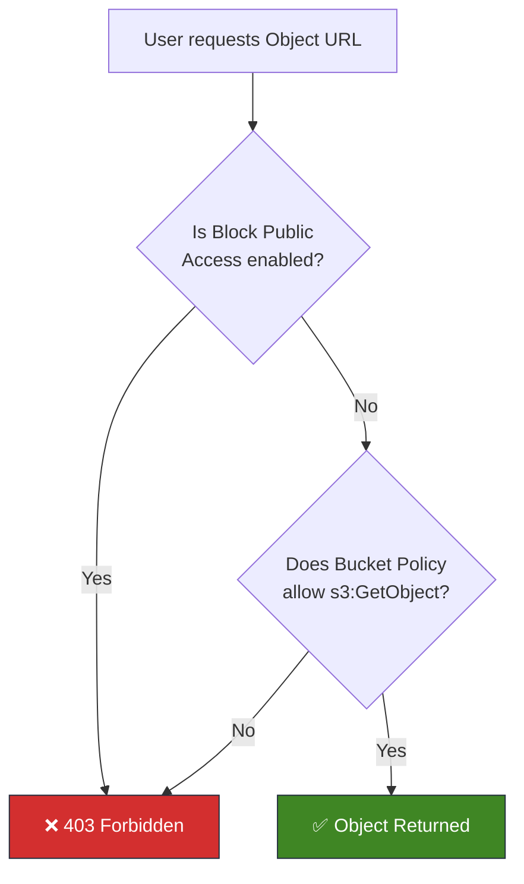

### 🧹 Cleanup

- To avoid charges, delete any objects and buckets you created during practice:

    - Select all objects in the bucket → click **"Delete"** → type `permanently delete` to confirm
    - Go back to the bucket list → select the empty bucket → click **"Delete"** → type the bucket name to confirm
- **Empty buckets** do not incur charges, but stored objects do (S3 Standard: ~$0.023/GB/month)

### 🧠 Key Exam Takeaways

- S3 buckets must have **globally unique names** and are created in a **specific region**
- **ACLs are disabled by default** — AWS recommends using bucket policies instead
- **Block Public Access** is enabled by default on all new buckets — this is an account-level and bucket-level safety guard
- S3 has **no real directory/folder concept** — the console displays key prefixes as folders, but everything is a flat key-value store
- The **Object URL** returns `403 Forbidden` unless public access is explicitly allowed via both Block Public Access settings and a bucket policy
- Clicking **"Open"** in the console generates a **pre-signed URL** with temporary credentials embedded in the query string
- **SSE-S3** encryption is enabled by default on all new buckets and objects
- Use `aws s3 cp`, `aws s3 ls`, `aws s3 rm`, and `aws s3 mb/rb` for common CLI operations

---

## Lecture 115: 🔐 S3 Security — Bucket Policy

> **Section 11: Amazon S3 Introduction**<br>Course: Ultimate AWS Certified Developer Associate DVA-C02 2026 — Stephane Maarek

### 📌 S3 Security Overview

Amazon S3 security can be categorized into two main types:

- **User-Based** — controlled via IAM
- **Resource-Based** — controlled via S3 itself (bucket policies, ACLs)

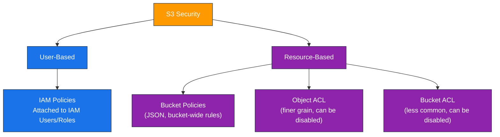

### 👤 User-Based Security — IAM Policies

- **IAM Policies** define which S3 API calls are allowed for a specific IAM user or role
- An IAM policy is attached to a **user**, **group**, or **role** — not to the bucket
- Example: An IAM policy that allows a user to perform `s3:GetObject` on a specific bucket

```json
{
  "Version": "2012-10-17",
  "Statement": [
    {
      "Effect": "Allow",
      "Action": [
        "s3:GetObject",
        "s3:PutObject"
      ],
      "Resource": "arn:aws:s3:::my-bucket/*"
    }
  ]
}
```

> 💡 IAM policies are best for controlling access for **specific users or roles within your own AWS account**.

### 🪣 Resource-Based Security — S3 Bucket Policies

#### What is a Bucket Policy?

- A **JSON-based** access policy attached directly to the S3 bucket
- Bucket policies allow you to:

    - **Grant public access** to the bucket
    - **Force objects to be encrypted** at upload
    - **Grant cross-account access** to another AWS account
- Bucket policies are the **most common way** to manage S3 security

#### 📐 Bucket Policy Structure

A bucket policy has 4 main components:

| Component | Description |
| --- | --- |
| **Sid** | Statement ID — an optional identifier for the statement |
| **Effect** | `Allow` or `Deny` |
| **Principal** | The account or user the policy applies to (`*` for everyone) |
| **Action** | The set of S3 API actions to allow or deny (e.g., `s3:GetObject`) |
| **Resource** | The bucket and objects the policy applies to (ARN format) |

#### ✅ Example: Allow Public Read Access

```json
{
  "Version": "2012-10-17",
  "Statement": [
    {
      "Sid": "PublicRead",
      "Effect": "Allow",
      "Principal": "*",
      "Action": "s3:GetObject",
      "Resource": "arn:aws:s3:::my-public-bucket/*"
    }
  ]
}
```

- `"Principal": "*"` — means **anyone** (public/anonymous access)
- `"Action": "s3:GetObject"` — allows reading/downloading objects
- `"Resource": "arn:aws:s3:::my-public-bucket/*"` — applies to all objects in the bucket (note the `/*` at the end)

> ⚠️ This policy alone is **not enough** for public access! You must also **disable Block Public Access** settings on the bucket (and potentially at the account level).

#### 🔄 Example: Cross-Account Access

```json
{
  "Version": "2012-10-17",
  "Statement": [
    {
      "Sid": "CrossAccountAccess",
      "Effect": "Allow",
      "Principal": {
        "AWS": "arn:aws:iam::123456789012:root"
      },
      "Action": [
        "s3:GetObject",
        "s3:PutObject"
      ],
      "Resource": "arn:aws:s3:::my-shared-bucket/*"
    }
  ]
}
```

#### 🔒 Example: Force SSL/HTTPS Only

```json
{
  "Version": "2012-10-17",
  "Statement": [
    {
      "Sid": "ForceSSLOnly",
      "Effect": "Deny",
      "Principal": "*",
      "Action": "s3:*",
      "Resource": [
        "arn:aws:s3:::my-secure-bucket",
        "arn:aws:s3:::my-secure-bucket/*"
      ],
      "Condition": {
        "Bool": {
          "aws:SecureTransport": "false"
        }
      }
    }
  ]
}
```

#### 🔐 Example: Force Encryption at Upload

```json
{
  "Version": "2012-10-17",
  "Statement": [
    {
      "Sid": "DenyUnencryptedUploads",
      "Effect": "Deny",
      "Principal": "*",
      "Action": "s3:PutObject",
      "Resource": "arn:aws:s3:::my-bucket/*",
      "Condition": {
        "StringNotEquals": {
          "s3:x-amz-server-side-encryption": "aws:kms"
        }
      }
    }
  ]
}
```

### 🧮 S3 Access Evaluation Logic

> 💡 An IAM principal can access an S3 object if:
>
> - The IAM permissions **ALLOW** it **OR** the resource policy (bucket policy) **ALLOWS** it
> - **AND** there is no explicit **DENY**

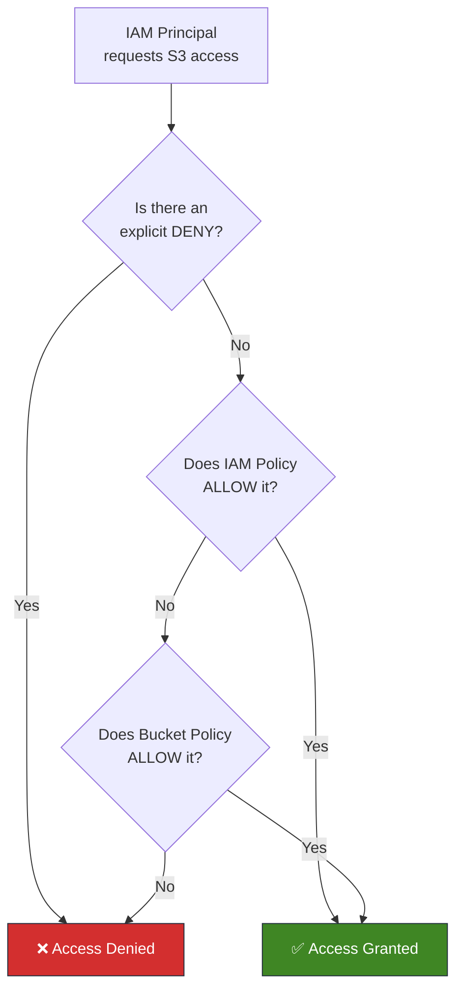

- This is a **union** model — either IAM OR bucket policy can grant access
- But an explicit **DENY always wins** over any ALLOW (from either IAM or bucket policy)

### 🚫 S3 Block Public Access Settings

- AWS provides an **extra layer of security** called **Block Public Access**
- These settings were created to **prevent company data leaks**
- Can be set at the **account level** or **bucket level**
- Even if a bucket policy grants public access, Block Public Access will **override** it

#### The 4 Block Public Access Settings

| Setting | What It Does |
| --- | --- |
| **BlockPublicAcls** | Blocks PUT calls with public ACLs |
| **IgnorePublicAcls** | Ignores any existing public ACLs on the bucket/objects |
| **BlockPublicPolicy** | Blocks PUT of bucket policies that grant public access |
| **RestrictPublicBuckets** | Restricts access to buckets with public policies to only AWS-authorized users |

> ⚠️ If you know your bucket should **never** be public, leave all of these **enabled**. They act as a safety net even if someone accidentally sets a permissive bucket policy.

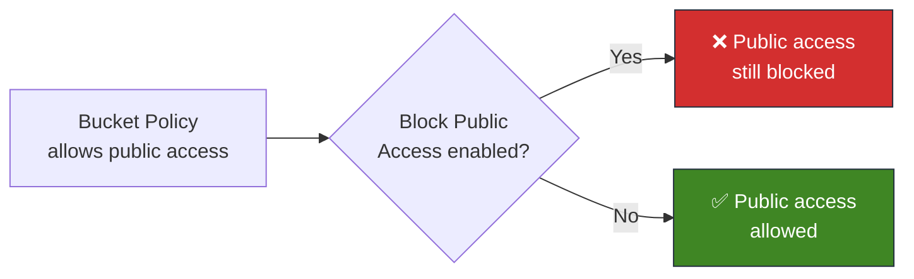

### 🌐 Common S3 Security Scenarios

#### Scenario 1: Public Access for Static Website Hosting

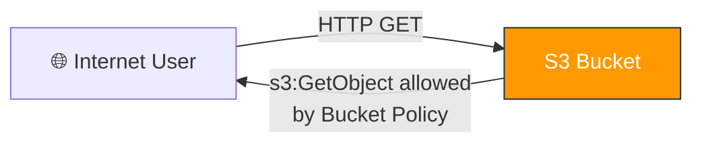

- **Disable** Block Public Access on the bucket
- Attach a bucket policy with `"Principal": "*"` and `"Action": "s3:GetObject"`

#### Scenario 2: IAM User Access Within Same Account

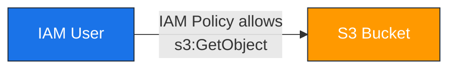

- IAM Policy attached to the user grants `s3:GetObject`
- No bucket policy needed (IAM ALLOW is sufficient)

#### Scenario 3: EC2 Instance Access via IAM Role

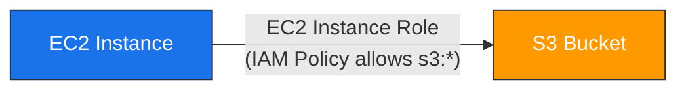

- Create an **IAM Role** with S3 permissions
- Attach the role to the EC2 instance (Instance Profile)
- The EC2 instance uses the role's temporary credentials to access S3

#### Scenario 4: Cross-Account Access

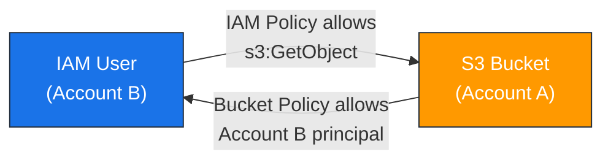

- Account A's bucket policy must allow the principal from Account B
- Account B's IAM user/role must also have an IAM policy allowing S3 access
- **Both** policies must allow access for cross-account to work

### 💻 Applying a Bucket Policy via SDK

```javascript
import { S3Client, PutBucketPolicyCommand } from "@aws-sdk/client-s3";

const s3Client = new S3Client({ region: "eu-west-1" });

const bucketPolicy = {
  Version: "2012-10-17",
  Statement: [
    {
      Sid: "PublicReadGetObject",
      Effect: "Allow",
      Principal: "*",
      Action: "s3:GetObject",
      Resource: "arn:aws:s3:::my-website-bucket/*",
    },
  ],
};

const applyBucketPolicy = async () => {
  const command = new PutBucketPolicyCommand({
    Bucket: "my-website-bucket",
    Policy: JSON.stringify(bucketPolicy),
  });
  await s3Client.send(command);
  console.log("Bucket policy applied successfully");
};

applyBucketPolicy();
```

#### Reading a Bucket Policy

```javascript
import { S3Client, GetBucketPolicyCommand } from "@aws-sdk/client-s3";

const s3Client = new S3Client({ region: "eu-west-1" });

const getBucketPolicy = async () => {
  const command = new GetBucketPolicyCommand({
    Bucket: "my-website-bucket",
  });
  const response = await s3Client.send(command);
  const policy = JSON.parse(response.Policy);
  console.log("Bucket Policy:", JSON.stringify(policy, null, 2));
};

getBucketPolicy();
```

### 🧩 Object ACLs vs Bucket Policies

| Feature | Bucket Policy | Object ACL |
| --- | --- | --- |
| **Scope** | Entire bucket or prefix | Individual object |
| **Format** | JSON policy document | XML-based ACL |
| **Granularity** | Can use conditions, principals, actions | Limited predefined grants |
| **Recommended** | ✅ Yes — preferred method | ❌ Legacy, can be disabled |
| **Cross-Account** | Yes, via Principal ARN | Yes, but more complex |
| **Public Access** | Yes, via `"Principal": "*"` | Yes, via `public-read` grant |

> 💡 AWS recommends **disabling ACLs** and using **bucket policies** for all access control. When ACLs are disabled, the bucket owner automatically owns all objects regardless of who uploaded them.

### 🧠 Key Exam Takeaways

- **IAM Policies** are user-based and attached to IAM users, groups, or roles — they control what a principal can do
- **Bucket Policies** are resource-based and attached to the bucket — they control who can access the bucket and what they can do
- Access is granted if IAM policy **OR** bucket policy allows it, **AND** there is no explicit **DENY**
- **Block Public Access** is an account/bucket-level override that prevents public access even if the bucket policy allows it — leave it **enabled** unless you explicitly need public access
- For **cross-account access**, you need **both** a bucket policy on the target account AND an IAM policy on the source account
- `"Principal": "*"` in a bucket policy means **anonymous/public** access
- The `Resource` ARN for objects uses `/*` at the end (e.g., `arn:aws:s3:::bucket/*`); the bucket itself uses no suffix (e.g., `arn:aws:s3:::bucket`)
- **ACLs are legacy** — AWS recommends disabling them and using bucket policies exclusively
- Always use **conditions** in bucket policies to enforce encryption (`s3:x-amz-server-side-encryption`) or SSL (`aws:SecureTransport`)

---

## Lecture 116: 🛠️ S3 Security — Bucket Policy Hands On

> **Section 11: Amazon S3 Introduction**<br>Course: Ultimate AWS Certified Developer Associate DVA-C02 2026 — Stephane Maarek

### 📌 What We're Doing

In this hands-on lecture, we walk through the AWS Console to:

- Verify that objects are **not publicly accessible** by default
- Disable **Block Public Access** settings
- Use the **AWS Policy Generator** to create a bucket policy
- Attach the bucket policy to make objects **publicly readable**
- Test public access via the **Object URL**

### 🔒 Step 1: Verify Default Access is Blocked

#### Test the Object URL

- Navigate to your S3 bucket and click on any uploaded object
- Copy the **Object URL** (e.g., `https://my-demo-bucket.s3.amazonaws.com/coffee.jpg`)
- Paste it into a **new browser tab** (or incognito window)
- You will see an **AccessDenied** XML error:

```xml
<Error>
  <Code>AccessDenied</Code>
  <Message>Access Denied</Message>
  <RequestId>XXXXXXXXXXXX</RequestId>
  <HostId>XXXXXXXXXXXX</HostId>
</Error>
```

> 💡 This is expected! By default, all S3 buckets and objects are **private**. Block Public Access is enabled, and there is no bucket policy granting public read.

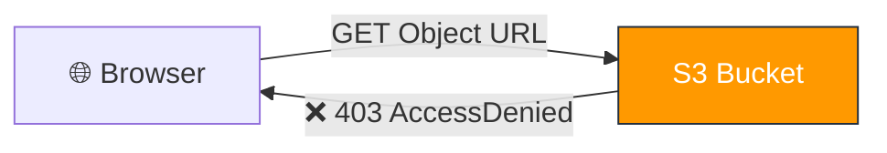

### 🔓 Step 2: Disable Block Public Access

- Go to your bucket → **Permissions** tab
- Scroll to **Block public access (bucket settings)** → click **Edit**
- **Uncheck** all 4 checkboxes:

    - ☐ Block public access to buckets and objects granted through **new** access control lists
    - ☐ Block public access to buckets and objects granted through **any** access control lists
    - ☐ Block public access to buckets and objects granted through **new** public bucket or access point policies
    - ☐ Block public access to buckets and objects granted through **any** public bucket or access point policies
- Click **Save changes**
- Type `confirm` in the confirmation dialog and click **Confirm**

> ⚠️ Disabling Block Public Access alone does **NOT** make objects public. You still need a **bucket policy** that explicitly allows public read access. This step simply removes the safety net that prevents public policies from taking effect.

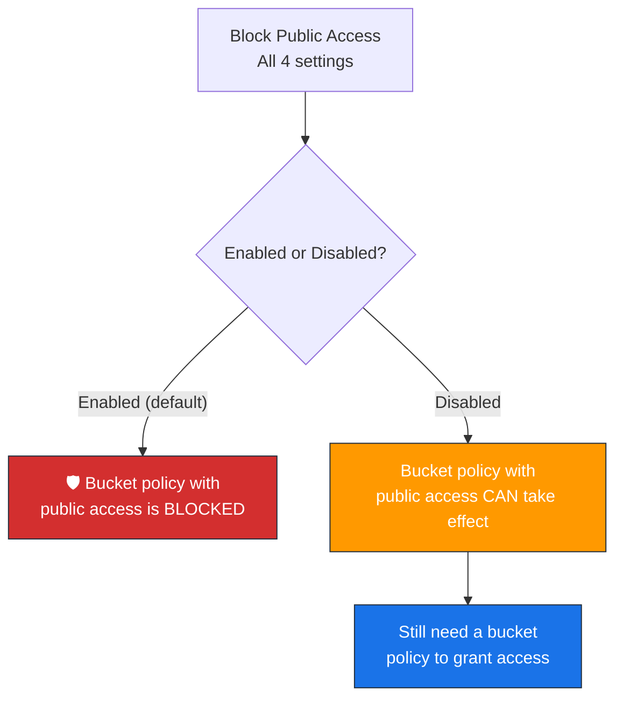

### 📝 Step 3: Create a Bucket Policy Using the Policy Generator

#### Navigate to Bucket Policy Editor

- In your bucket → **Permissions** tab → scroll to **Bucket policy** → click **Edit**
- You'll see an empty JSON editor
- Notice the **Bucket ARN** displayed above the editor (e.g., `arn:aws:s3:::my-demo-bucket`) — copy it
- Click the **Policy generator** link to open the AWS Policy Generator tool

#### Using the AWS Policy Generator

The **AWS Policy Generator** is a visual tool at `https://awspolicygen.s3.amazonaws.com/policygen.html` that helps you build JSON policies without writing them manually.

**Fill in the following fields:**

| Field | Value |
| --- | --- |
| **Select Type of Policy** | S3 Bucket Policy |
| **Effect** | Allow |
| **Principal** | `*` (asterisk = everyone/anonymous) |
| **AWS Service** | Amazon S3 |
| **Actions** | Select `GetObject` from the dropdown |
| **Amazon Resource Name (ARN)** | `arn:aws:s3:::my-demo-bucket/*` |

> ⚠️ **Critical**: You must append `/*` to the bucket ARN! The ARN `arn:aws:s3:::my-demo-bucket` refers to the **bucket itself**, while `arn:aws:s3:::my-demo-bucket/*` refers to **all objects inside** the bucket. `GetObject` operates on objects, not the bucket.

- Click **Add Statement** → the statement appears in the list below
- Click **Generate Policy** → a JSON policy is displayed in a popup
- **Copy** the entire JSON policy

#### The Generated Policy

```json
{
  "Id": "Policy1234567890",
  "Version": "2012-10-17",
  "Statement": [
    {
      "Sid": "Stmt1234567890",
      "Action": [
        "s3:GetObject"
      ],
      "Effect": "Allow",
      "Resource": "arn:aws:s3:::my-demo-bucket/*",
      "Principal": "*"
    }
  ]
}
```

#### Paste and Save

- Go back to the S3 console bucket policy editor
- **Paste** the generated JSON policy
- Click **Save changes**

> 💡 After saving, you will see an orange banner on the bucket saying **"Publicly accessible"** — this confirms the policy is active.

### ✅ Step 4: Test Public Access

- Go back to your object and copy the **Object URL** again
- Paste it in a new browser tab
- This time the object **loads successfully** — you can see/download the file! 🎉

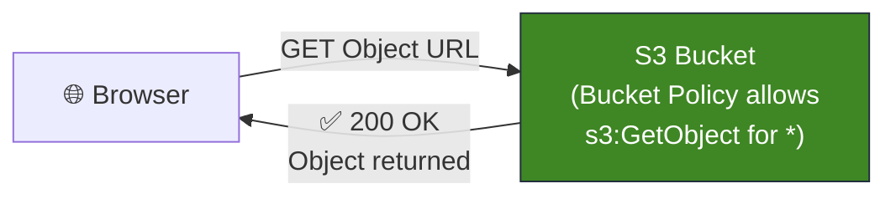

### 🔍 Understanding What Changed

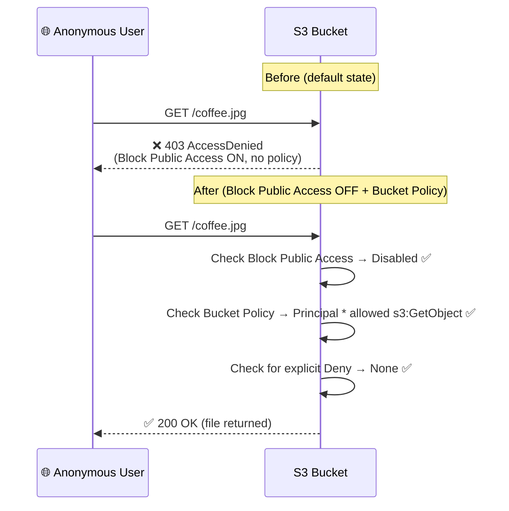

### 💻 Doing the Same via AWS CLI

#### Apply a Bucket Policy via CLI

```bash
# First, disable Block Public Access
aws s3api put-public-access-block \
  --bucket my-demo-bucket \
  --public-access-block-configuration \
  "BlockPublicAcls=false,IgnorePublicAcls=false,BlockPublicPolicy=false,RestrictPublicBuckets=false"

# Then apply the bucket policy
aws s3api put-bucket-policy \
  --bucket my-demo-bucket \
  --policy '{
    "Version": "2012-10-17",
    "Statement": [
      {
        "Sid": "PublicReadGetObject",
        "Effect": "Allow",
        "Principal": "*",
        "Action": "s3:GetObject",
        "Resource": "arn:aws:s3:::my-demo-bucket/*"
      }
    ]
  }'
```

#### Verify the Policy

```bash
# Read back the current bucket policy
aws s3api get-bucket-policy --bucket my-demo-bucket --output text | jq .
```

#### Test Public Access via CLI

```bash
# This should work without any credentials (--no-sign-request)
aws s3api get-object \
  --bucket my-demo-bucket \
  --key coffee.jpg \
  --no-sign-request \
  downloaded-coffee.jpg
```

### 💻 Doing the Same via SDK (Node.js)

```javascript
import {
  S3Client,
  PutPublicAccessBlockCommand,
  PutBucketPolicyCommand,
} from "@aws-sdk/client-s3";

const s3Client = new S3Client({ region: "eu-west-1" });
const BUCKET = "my-demo-bucket";

const makePublic = async () => {
  // Step 1: Disable Block Public Access
  await s3Client.send(
    new PutPublicAccessBlockCommand({
      Bucket: BUCKET,
      PublicAccessBlockConfiguration: {
        BlockPublicAcls: false,
        IgnorePublicAcls: false,
        BlockPublicPolicy: false,
        RestrictPublicBuckets: false,
      },
    })
  );
  console.log("✅ Block Public Access disabled");

  // Step 2: Apply public read bucket policy
  const policy = {
    Version: "2012-10-17",
    Statement: [
      {
        Sid: "PublicReadGetObject",
        Effect: "Allow",
        Principal: "*",
        Action: "s3:GetObject",
        Resource: `arn:aws:s3:::${BUCKET}/*`,
      },
    ],
  };

  await s3Client.send(
    new PutBucketPolicyCommand({
      Bucket: BUCKET,
      Policy: JSON.stringify(policy),
    })
  );
  console.log("✅ Bucket policy applied — objects are now publicly readable");
};

makePublic();
```

### 🧹 Reverting: Re-Enabling Block Public Access

If you want to undo public access after practicing:

- Go to **Permissions** tab → **Block public access** → **Edit**
- **Check all 4 boxes** again → **Save changes** → confirm
- Optionally **delete** the bucket policy under **Bucket policy** → **Edit** → clear all text → **Save**

```bash
# Re-enable Block Public Access via CLI
aws s3api put-public-access-block \
  --bucket my-demo-bucket \
  --public-access-block-configuration \
  "BlockPublicAcls=true,IgnorePublicAcls=true,BlockPublicPolicy=true,RestrictPublicBuckets=true"

# Delete the bucket policy
aws s3api delete-bucket-policy --bucket my-demo-bucket
```

### 📋 Hands-On Checklist Summary

| Step | Action | Result |
| --- | --- | --- |
| 1 | Access Object URL in browser | ❌ 403 AccessDenied |
| 2 | Disable Block Public Access (all 4 settings) | Safety net removed |
| 3 | Create bucket policy via Policy Generator | JSON policy with `s3:GetObject` for `Principal: *` |
| 4 | Paste and save the policy | Bucket marked as "Publicly accessible" |
| 5 | Access Object URL in browser again | ✅ Object loads successfully |

### 🧠 Key Exam Takeaways

- **Two steps** are required to make S3 objects public: disable **Block Public Access** AND add a **bucket policy** with `"Principal": "*"`
- The **AWS Policy Generator** is a helpful visual tool for creating S3 bucket policies, IAM policies, SQS policies, and more
- The ARN for **objects** must include `/*` at the end (e.g., `arn:aws:s3:::bucket/*`); omitting it targets the bucket resource itself, not the objects
- `s3:GetObject` is the action for **reading/downloading** objects — it applies to the **object resource** (`bucket/*`), not the bucket resource
- Block Public Access acts as an **override** — even with a permissive bucket policy, public access is blocked if these settings are enabled
- After applying a public bucket policy, the S3 console shows a **"Publicly accessible"** warning badge on the bucket
- For the exam, remember: public access requires **both** Block Public Access to be off **and** an explicit Allow in the bucket policy

---

## Lecture 117: 🌐 S3 Website Overview

> **Overview**: Amazon S3 can host static websites and make them accessible on the internet. This is one of the most popular use cases of S3 and a key concept for the DVA-C02 exam.

### 🏗️ What is S3 Static Website Hosting?

- Amazon S3 can host **static websites** and have them accessible on the **public internet**
- Static websites contain fixed content — HTML, CSS, JavaScript, images, videos — and do **not** require server-side processing
- The website URL depends on the **AWS Region** of the bucket:

    - Format 1: `http://<bucket-name>.s3-website-<region>.amazonaws.com`
    - Format 2: `http://<bucket-name>.s3-website.<region>.amazonaws.com`
    - Notice the difference: some regions use a **dash** () and some use a **dot** (`.`) before the region name

> **💡 Tip**: The two URL formats are both valid — the exam may test whether you can recognize a valid S3 website endpoint. Remember both patterns!

### 📄 How S3 Static Website Hosting Works

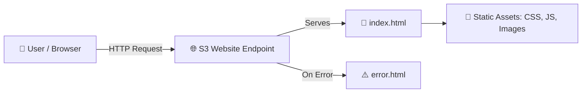

- When you enable static website hosting on an S3 bucket, you must specify:

    - **Index Document**: The default page returned when users visit the root URL (typically `index.html`)
    - **Error Document** *(optional)*: A custom error page returned for 4xx errors (typically `error.html`)
- S3 will serve the **index document** when users access the website root or any directory path
- S3 will serve the **error document** when users request a page that doesn't exist (404 errors)

### ⚙️ Enabling Static Website Hosting

- Navigate to your S3 bucket → **Properties** tab → **Static website hosting** → **Edit**
- Enable static website hosting and configure:

    - **Hosting type**: Host a static website
    - **Index document**: `index.html`
    - **Error document**: `error.html` (optional)
- After enabling, AWS provides the **bucket website endpoint URL**

#### 📋 Example: Minimal Static Website Files

```html
<!-- index.html -->
<!DOCTYPE html>
<html>
<head>
    <title>My S3 Website</title>
</head>
<body>
    <h1>Welcome to my S3-hosted website!</h1>
    <p>This page is served directly from Amazon S3.</p>
    
</body>
</html>
```

```html
<!-- error.html -->
<!DOCTYPE html>
<html>
<head>
    <title>Error</title>
</head>
<body>
    <h1>Oops! Something went wrong.</h1>
    <p>The page you're looking for doesn't exist.</p>
</body>
</html>
```

### 🔓 S3 Bucket Policy for Public Access (Critical!)

- If you enable static website hosting but **don't make the bucket public**, users will get a **403 Forbidden** error
- You **must** configure a **bucket policy** that allows **public reads** on all objects in the bucket
- You also need to **disable the Block Public Access settings** on the bucket

> **⚠️ Important**: If you get a `403 Forbidden` error when accessing your S3 website, it almost always means your **bucket policy does not allow public reads**. This is the #1 troubleshooting point for S3 static websites!

#### 🔑 Required Bucket Policy for Public Website

```json
{
  "Version": "2012-10-17",
  "Statement": [
    {
      "Sid": "PublicReadGetObject",
      "Effect": "Allow",
      "Principal": "*",
      "Action": "s3:GetObject",
      "Resource": "arn:aws:s3:::my-website-bucket/*"
    }
  ]
}
```

- `Principal": "*"` — Allows **anyone** (the public) to perform the action
- `Action": "s3:GetObject"` — Allows reading/downloading objects
- `Resource` — Must end with `/*` to apply to **all objects** inside the bucket

### 🔄 S3 Website Hosting Request Flow

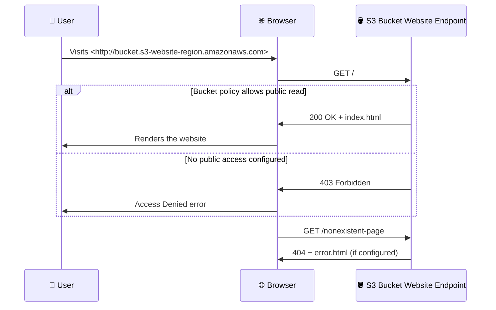

### 🛠️ Configuring S3 Website Hosting via AWS CLI

```bash
# Enable static website hosting on a bucket
aws s3 website s3://my-website-bucket/ \
  --index-document index.html \
  --error-document error.html

# Upload website files to the bucket
aws s3 cp index.html s3://my-website-bucket/
aws s3 cp error.html s3://my-website-bucket/
aws s3 cp beach.jpg s3://my-website-bucket/

# Sync an entire local website folder to S3
aws s3 sync ./my-website/ s3://my-website-bucket/ --acl public-read
```

### 💻 Configuring S3 Website Hosting via SDK (Node.js)

```javascript
import {
  S3Client,
  PutBucketWebsiteCommand,
  PutBucketPolicyCommand,
} from "@aws-sdk/client-s3";

const s3Client = new S3Client({ region: "us-east-1" });
const bucketName = "my-website-bucket";

// 1. Enable static website hosting
const websiteParams = {
  Bucket: bucketName,
  WebsiteConfiguration: {
    IndexDocument: { Suffix: "index.html" },
    ErrorDocument: { Key: "error.html" },
  },
};

await s3Client.send(new PutBucketWebsiteCommand(websiteParams));
console.log("✅ Static website hosting enabled!");

// 2. Apply a public-read bucket policy
const bucketPolicy = {
  Version: "2012-10-17",
  Statement: [
    {
      Sid: "PublicReadGetObject",
      Effect: "Allow",
      Principal: "*",
      Action: "s3:GetObject",
      Resource: `arn:aws:s3:::${bucketName}/*`,
    },
  ],
};

const policyParams = {
  Bucket: bucketName,
  Policy: JSON.stringify(bucketPolicy),
};

await s3Client.send(new PutBucketPolicyCommand(policyParams));
console.log("✅ Public bucket policy applied!");
```

### 🌍 S3 Website URL Patterns

| Region Style | URL Format | Example |
| --- | --- | --- |
| Dash style | `http://<bucket>.s3-website-<region>.amazonaws.com` | `http://my-bucket.s3-website-us-east-1.amazonaws.com` |
| Dot style | `http://<bucket>.s3-website.<region>.amazonaws.com` | `http://my-bucket.s3-website.eu-west-1.amazonaws.com` |

> **💡 Note**: These are **HTTP** endpoints, not HTTPS. To serve your S3 website over **HTTPS**, you need to place **Amazon CloudFront** in front of the S3 bucket as a CDN.

### 🏛️ S3 Static Website Architecture Patterns

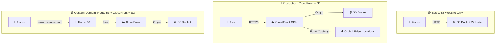

- **Basic**: Direct S3 website endpoint — simple, HTTP only
- **Production**: CloudFront in front for HTTPS, caching, and global distribution
- **Custom Domain**: Route 53 + CloudFront + S3 for a fully branded static website

### 🆚 S3 Website Hosting vs. Regular S3 Access

| Feature | S3 Website Endpoint | Regular S3 REST Endpoint |
| --- | --- | --- |
| **URL Format** | `bucket.s3-website-region.amazonaws.com` | `bucket.s3.region.amazonaws.com` |
| **Supports index.html** | ✅ Yes | ❌ No |
| **Supports error.html** | ✅ Yes | ❌ No (returns XML error) |
| **Supports redirects** | ✅ Yes | ❌ No |
| **Supports HTTPS** | ❌ No (HTTP only) | ✅ Yes |
| **Returns on 404** | Custom error page | XML error document |

### 📝 Key Exam Takeaways

- S3 can host **static websites** accessible via a public URL
- You **must** enable **static website hosting** in bucket properties
- You **must** allow **public reads** via a bucket policy — otherwise you get **403 Forbidden**
- The **Block Public Access** settings must be turned off for the bucket to serve content publicly
- Know both S3 website endpoint URL formats (dash  vs dot `.` before the region)
- S3 website endpoints support **HTTP only** — for HTTPS, use **CloudFront**
- The **index document** (e.g., `index.html`) is served for root/directory requests
- The **error document** (e.g., `error.html`) is served for 4xx client errors
- **403 Forbidden** = bucket policy is not configured for public access (most common exam trap!)

---

## Lecture 118: 🛠️ S3 Website Hands On

> **Overview**: This hands-on lecture walks through the step-by-step process of enabling static website hosting on an S3 bucket, uploading HTML files, configuring public access, and testing the website endpoint in the browser.

### 📋 Prerequisites

- An existing S3 bucket (e.g., `demo-stephane-v5`)
- Two HTML files ready to upload: `index.html` and `error.html`
- Basic understanding of S3 bucket policies (covered in Lectures 115–116)

### 🪣 Step 1: Upload Website Files to S3

- Navigate to your S3 bucket in the AWS Console
- Click **Upload** and add the following files:

#### 📄 index.html

```html
<!DOCTYPE html>
<html>
<head>
    <title>My S3 Website</title>
</head>
<body>
    <h1>I love coffee ☕</h1>
    <p>Hello world!</p>
</body>
</html>
```

#### ⚠️ error.html

```html
<!DOCTYPE html>
<html>
<head>
    <title>Error</title>
</head>
<body>
    <h1>Oops! This page doesn't exist.</h1>
    <p>Please check the URL and try again.</p>
</body>
</html>
```

- Click **Upload** to upload both files to the bucket

### ⚙️ Step 2: Enable Static Website Hosting

- Go to your S3 bucket → **Properties** tab
- Scroll all the way down to **Static website hosting** → click **Edit**
- Configure the following settings:

    - **Static website hosting**: **Enable**
    - **Hosting type**: Host a static website
    - **Index document**: `index.html`
    - **Error document**: `error.html`
- Click **Save changes**
- After saving, scroll back down to **Static website hosting** — you'll now see the **Bucket website endpoint** URL

> **💡 Tip**: Copy this endpoint URL — this is the public URL you'll use to access your website. It follows the format: `http://<bucket-name>.s3-website-<region>.amazonaws.com`

### 🚫 Step 3: Test the Website (Before Public Access)

- Open the **bucket website endpoint** URL in a new browser tab
- You will see a **403 Forbidden** error!

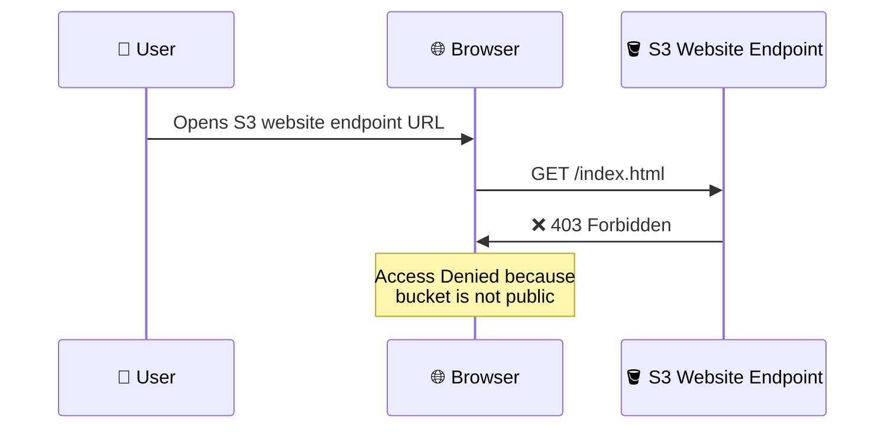

> **⚠️ Important**: This is expected! By default, S3 buckets block all public access. The website won't work until you configure a bucket policy to allow public reads.

### 🔓 Step 4: Disable Block Public Access

- Go to your S3 bucket → **Permissions** tab
- Under **Block public access (bucket settings)** → click **Edit**
- **Uncheck** "Block *all* public access"
- Click **Save changes**
- Type `confirm` in the confirmation dialog to acknowledge you're making the bucket publicly accessible

### 🔑 Step 5: Add a Bucket Policy for Public Read

- Still in the **Permissions** tab → scroll to **Bucket policy** → click **Edit**
- Add the following bucket policy:

```json
{
  "Version": "2012-10-17",
  "Statement": [
    {
      "Sid": "PublicReadGetObject",
      "Effect": "Allow",
      "Principal": "*",
      "Action": "s3:GetObject",
      "Resource": "arn:aws:s3:::demo-stephane-v5/*"
    }
  ]
}
```

- Replace `demo-stephane-v5` with **your actual bucket name**
- Click **Save changes**
- You'll notice the bucket now shows a **"Publicly accessible"** warning badge — this is expected

> **💡 Tip**: You can use the **Policy Generator** link in the console to build this policy if you don't want to write JSON by hand. Select S3 Bucket Policy as the type, `*` as Principal, `GetObject` as the action, and your bucket ARN with `/*` as the resource.

### ✅ Step 6: Test the Website (After Public Access)

- Go back to your browser tab with the S3 website endpoint
- **Refresh** the page
- You should now see your `index.html` content rendered — **"I love coffee ☕"**

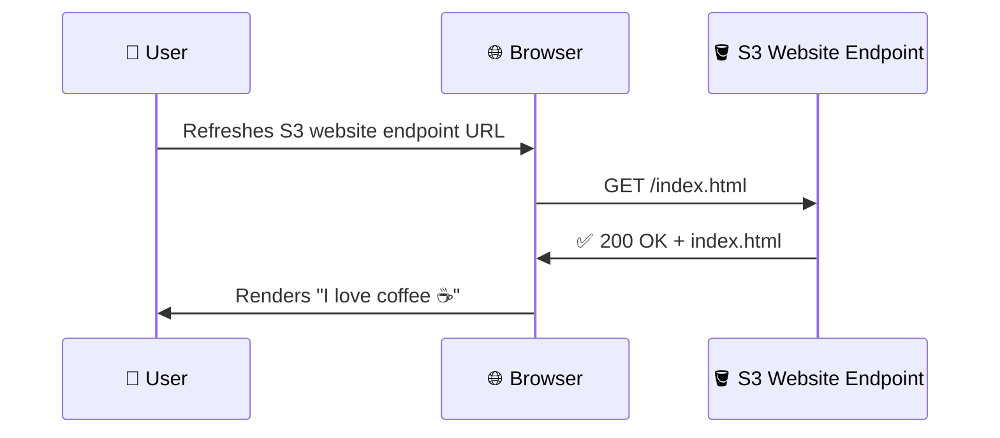

### 🔍 Step 7: Test the Error Page

- In the browser, modify the URL to request a page that **doesn't exist**

    - e.g., `http://<bucket>.s3-website-<region>.amazonaws.com/non-existent-page`
- S3 returns a **404** status and serves your custom `error.html` page
- You should see: **"Oops! This page doesn't exist."**

### 📊 Complete Hands-On Flow

```mermaid
graph TD
    A["📤 Upload index.html & error.html"] --> B["⚙️ Enable Static Website Hosting"]
    B --> C["🌐 Copy Website Endpoint URL"]
    C --> D["🚫 Test → 403 Forbidden"]
    D --> E["🔓 Disable Block Public Access"]
    E --> F["🔑 Add Public Read Bucket Policy"]
    F --> G["✅ Test → Website Works!"]
    G --> H["🔍 Test Error Page → Custom 404"]
```

### 🆚 Key Observations from the Hands-On

| Step | What Happens | Why |
| --- | --- | --- |
| Website enabled, no bucket policy | **403 Forbidden** | S3 blocks public access by default |
| Block Public Access disabled + bucket policy added | **200 OK** — website loads | Bucket policy explicitly allows `s3:GetObject` for `*` |
| Request non-existent page | **404** with custom error page | S3 serves the configured error document |
| Access via S3 REST endpoint (not website endpoint) | Returns **XML** or downloads file | Only the **website endpoint** renders HTML properly |

### ⚠️ Common Mistakes & Troubleshooting

- **Forgot to disable Block Public Access** → Even with a correct bucket policy, the block override will deny all public access
- **Bucket policy resource missing** `/*` → Policy applies to the bucket itself, not the objects inside — must use `arn:aws:s3:::bucket-name/*`
- **Using the wrong endpoint** → The S3 REST API endpoint (`bucket.s3.amazonaws.com`) is NOT the website endpoint — you must use the `s3-website` URL
- **Typo in index/error document name** → Must exactly match the uploaded file names (case-sensitive)

### 🛠️ Equivalent CLI Commands

```bash
# Enable static website hosting
aws s3 website s3://demo-stephane-v5/ \
  --index-document index.html \
  --error-document error.html

# Upload files
aws s3 cp index.html s3://demo-stephane-v5/
aws s3 cp error.html s3://demo-stephane-v5/

# Remove Block Public Access
aws s3api put-public-access-block \
  --bucket demo-stephane-v5 \
  --public-access-block-configuration \
  "BlockPublicAcls=false,IgnorePublicAcls=false,BlockPublicPolicy=false,RestrictPublicBuckets=false"

# Apply the public-read bucket policy
aws s3api put-bucket-policy \
  --bucket demo-stephane-v5 \
  --policy '{
    "Version": "2012-10-17",
    "Statement": [
      {
        "Sid": "PublicReadGetObject",
        "Effect": "Allow",
        "Principal": "*",
        "Action": "s3:GetObject",
        "Resource": "arn:aws:s3:::demo-stephane-v5/*"
      }
    ]
  }'

# Get the website endpoint configuration
aws s3api get-bucket-website --bucket demo-stephane-v5
```

### 📝 Key Exam Takeaways

- **403 Forbidden** on an S3 website = bucket policy does not allow public reads — this is the **most common exam scenario**
- You need **two things** for public S3 website hosting:

    - ✅ **Disable Block Public Access** on the bucket
    - ✅ **Add a bucket policy** with `s3:GetObject` for `Principal: "*"`
- The **website endpoint** URL (`s3-website`) is different from the **REST API endpoint** (`s3`) — only the website endpoint renders HTML and supports index/error documents
- The **index document** and **error document** must be actual objects uploaded to the bucket
- S3 static website hosting serves content over **HTTP only** — for HTTPS, use **CloudFront** in front of S3

---

## Lecture 119: 🔄 S3 Versioning

> **Overview**: Amazon S3 Versioning allows you to keep multiple variants of an object in the same bucket. It is a critical feature for data protection, accidental deletion recovery, and is a prerequisite for S3 Replication.

### 🧠 What is S3 Versioning?

- Versioning means keeping **multiple versions** of the same object (file) within a single S3 bucket
- Every time you **upload** an object with the **same key** (filename), S3 creates a **new version** of that object instead of overwriting it
- Each version gets a unique **Version ID** assigned by S3
- Versioning is enabled at the **bucket level**, not at the object level
- Once enabled, versioning **cannot be disabled** — it can only be **suspended**

```mermaid
graph TD
    A["📤 Upload: beach.jpg v1"] --> B["🪣 S3 Bucket"]
    C["📤 Upload: beach.jpg v2"] --> B
    D["📤 Upload: beach.jpg v3"] --> B
    B --> E["beach.jpg - Version ID: 111"]
    B --> F["beach.jpg - Version ID: 222"]
    B --> G["beach.jpg - Version ID: 333 ✅ Current"]
```

### ⚙️ How Versioning Works

- When versioning is **not enabled**, all objects have a Version ID of `null`
- When versioning is **enabled**:

    - Every new upload of an existing key creates a **new version** with a unique Version ID
    - The **latest version** is the one returned by default when you access the object
    - All previous versions are **retained** and can be accessed by specifying the Version ID
    - Objects uploaded **before** versioning was enabled will have a Version ID of `null`

```mermaid
graph LR
    subgraph Before["Before Versioning"]
        A1["my-file.txt"] --- A2["Version ID: null"]
    end
    subgraph After["After Versioning Enabled"]
        B1["my-file.txt upload #1"] --- B2["Version ID: abc123"]
        C1["my-file.txt upload #2"] --- C2["Version ID: def456"]
        D1["my-file.txt upload #3"] --- D2["Version ID: ghi789"]
    end
```

### 🤔 Why Enable Versioning?

- **Protect against unintended deletes** — deleted objects are not permanently removed; a **delete marker** is placed instead
- **Easy rollback to previous versions** — you can restore any prior version of an object at any time
- **Required for S3 Replication** — both Cross-Region Replication (CRR) and Same-Region Replication (SRR) require versioning on source and destination buckets
- **Audit and compliance** — maintain a full history of changes to objects

> **💡 Best Practice**: It is considered best practice to **enable versioning** on your S3 buckets. It adds a layer of protection at minimal cost.

### 🗑️ Deleting Objects with Versioning Enabled

- When you **delete** an object in a versioned bucket, S3 does **not** actually remove the object
- Instead, S3 inserts a **delete marker** — a special placeholder that makes the object appear deleted
- The previous versions still exist and are fully retrievable

```mermaid
sequenceDiagram
    participant User as 👤 User
    participant S3 as 🪣 S3 Bucket

    User->>S3: DELETE my-file.txt (no Version ID)
    S3->>S3: Adds Delete Marker (Version ID: xyz)
    S3->>User: 204 No Content
    Note over S3: my-file.txt appears deleted<br/>but all versions still exist

    User->>S3: GET my-file.txt
    S3->>User: 404 Not Found (delete marker)

    User->>S3: GET my-file.txt?versionId=abc123
    S3->>User: ✅ 200 OK (returns old version)
```

#### 🔑 Key Deletion Behaviors

| Action | Result |
| --- | --- |
| Delete without specifying Version ID | Adds a **delete marker** — object appears deleted but is recoverable |
| Delete with a specific Version ID | **Permanently deletes** that exact version (cannot be undone) |
| Delete the **delete marker** itself | **Restores** the object — it becomes visible again |

> **⚠️ Important**: Deleting a specific version by Version ID is a **permanent, irreversible** action. Only deleting without a Version ID is "soft" (adds a delete marker).

### 🔀 Versioning States

An S3 bucket can be in one of three versioning states:

```mermaid
graph LR
    A["🔘 Unversioned<br/>(Default)"] -->|"Enable Versioning"| B["✅ Versioning Enabled"]
    B -->|"Suspend Versioning"| C["⏸️ Versioning Suspended"]
    C -->|"Re-enable Versioning"| B
    A -.-x|"Cannot go back"| A
```

| State | Description |
| --- | --- |
| **Unversioned** (default) | No versioning — objects have Version ID `null`. This is the default for new buckets |
| **Versioning Enabled** | All new uploads get unique Version IDs. Previous versions are preserved |
| **Versioning Suspended** | New uploads get Version ID `null`. Existing versions are **retained** but no new versions are created |

> **💡 Note**: You **cannot** return a bucket to the "Unversioned" state once versioning has been enabled. You can only **suspend** it. Existing versioned objects remain intact when suspended.

### 📊 Version ID Behavior Summary

| Scenario | Version ID |
| --- | --- |
| Object uploaded **before** versioning enabled | `null` |
| Object uploaded **after** versioning enabled | Unique string (e.g., `abc123xyz`) |
| Object uploaded **while** versioning is suspended | `null` (overwrites previous `null` version) |

### 🛠️ Working with Versions via AWS CLI

```bash
# Enable versioning on a bucket
aws s3api put-bucket-versioning \
  --bucket my-bucket \
  --versioning-configuration Status=Enabled

# Check versioning status
aws s3api get-bucket-versioning --bucket my-bucket

# List all versions of objects in a bucket
aws s3api list-object-versions --bucket my-bucket

# Get a specific version of an object
aws s3api get-object \
  --bucket my-bucket \
  --key my-file.txt \
  --version-id abc123 \
  output-file.txt

# Delete a specific version permanently
aws s3api delete-object \
  --bucket my-bucket \
  --key my-file.txt \
  --version-id abc123

# Suspend versioning
aws s3api put-bucket-versioning \
  --bucket my-bucket \
  --versioning-configuration Status=Suspended
```

### 💻 Working with Versions via SDK (Node.js)

```javascript
import {
  S3Client,
  PutBucketVersioningCommand,
  GetBucketVersioningCommand,
  ListObjectVersionsCommand,
  GetObjectCommand,
} from "@aws-sdk/client-s3";

const s3Client = new S3Client({ region: "us-east-1" });
const bucketName = "my-bucket";

// 1. Enable versioning
await s3Client.send(
  new PutBucketVersioningCommand({
    Bucket: bucketName,
    VersioningConfiguration: { Status: "Enabled" },
  })
);
console.log("✅ Versioning enabled!");

// 2. Check versioning status
const versioningStatus = await s3Client.send(
  new GetBucketVersioningCommand({ Bucket: bucketName })
);
console.log("Status:", versioningStatus.Status); // "Enabled"

// 3. List all versions of objects
const versions = await s3Client.send(
  new ListObjectVersionsCommand({ Bucket: bucketName })
);

for (const version of versions.Versions || []) {
  console.log(
    `Key: ${version.Key}, VersionId: ${version.VersionId}, ` +
    `IsLatest: ${version.IsLatest}, Size: ${version.Size}`
  );
}

// 4. Get a specific version of an object
const specificVersion = await s3Client.send(
  new GetObjectCommand({
    Bucket: bucketName,
    Key: "my-file.txt",
    VersionId: "abc123xyz",
  })
);
const body = await specificVersion.Body.transformToString();
console.log("Content:", body);
```

### 💰 Cost Considerations

- **Every version is a full copy** of the object — versioning increases storage costs
- You are charged for **all versions** stored in the bucket, including old ones
- Use **S3 Lifecycle Rules** to automatically delete or transition old versions to cheaper storage classes (covered in Lecture 133)
- Delete markers are **free** — they don't incur storage charges
- Consider using lifecycle rules like `NoncurrentVersionExpiration` to auto-delete old versions after a set number of days

```mermaid
graph TD
    A["📁 my-file.txt (5 MB)"] --> B["Version 1: 5 MB"]
    A --> C["Version 2: 5 MB"]
    A --> D["Version 3: 5 MB"]
    B & C & D --> E["💰 Total Storage Charged: 15 MB"]
    E --> F["🔄 Use Lifecycle Rules to<br/>expire old versions"]
```

### 🔒 Versioning + MFA Delete

- **MFA Delete** is an extra layer of protection that can be enabled on versioned buckets
- When MFA Delete is enabled, you need to provide an MFA code to:

    - **Permanently delete** an object version
    - **Suspend** versioning on the bucket
- MFA Delete can only be enabled/disabled by the **bucket owner (root account)**
- This prevents accidental or malicious permanent deletion of versions

> **💡 Exam Tip**: MFA Delete is covered in more detail in Lecture 145 (S3 MFA Delete). For now, know that it adds protection on top of versioning.

### 📝 Key Exam Takeaways

- Versioning is enabled at the **bucket level**
- Once enabled, versioning **cannot be disabled**, only **suspended**
- Objects that existed before versioning was enabled have Version ID = `null`
- **Deleting without a Version ID** adds a **delete marker** (soft delete — recoverable)
- **Deleting with a specific Version ID** is a **permanent delete** (irreversible)
- Removing the **delete marker** effectively **restores** the object
- Versioning is a **prerequisite for S3 Replication** (CRR and SRR)
- Suspending versioning does **not** delete existing versions — they are retained
- All versions incur **storage costs** — use lifecycle rules to manage old versions
- If the exam mentions "protect against accidental deletion" → think **S3 Versioning**

---

## Lecture 120: 🔄 S3 Versioning - Hands On

> **Section 11: Amazon S3 Introduction** — Ultimate AWS Certified Developer Associate DVA-C02 2026

### 📋 Overview

> This hands-on lecture walks through enabling **S3 Versioning** on a bucket, uploading multiple versions of an object, viewing and managing version history, and understanding the behavior of delete operations (delete markers) in a versioned bucket.

### 🔧 Enabling Versioning on an S3 Bucket

#### Via the AWS Console

- Navigate to **S3 → Buckets → Select your bucket**
- Go to the **Properties** tab
- Scroll to **Bucket Versioning** and click **Edit**
- Select **Enable** and click **Save changes**

> ⚠️ **Important**: Once versioning is enabled, it **cannot be disabled** — it can only be **suspended**. Existing versions are preserved even after suspension.

#### Via AWS CLI

```bash
aws s3api put-bucket-versioning \
  --bucket my-demo-bucket \
  --versioning-configuration Status=Enabled
```

```bash
# Verify versioning status
aws s3api get-bucket-versioning --bucket my-demo-bucket
```

Expected output:

```json
{
  "Status": "Enabled"
}
```

#### Via AWS SDK v3 (Node.js)

```javascript
import { S3Client, PutBucketVersioningCommand } from "@aws-sdk/client-s3";

const client = new S3Client({ region: "eu-west-1" });

const enableVersioning = async () => {
  const command = new PutBucketVersioningCommand({
    Bucket: "my-demo-bucket",
    VersioningConfiguration: {
      Status: "Enabled", // "Enabled" or "Suspended"
    },
  });

  const response = await client.send(command);
  console.log("Versioning enabled:", response.$metadata.httpStatusCode);
};

enableVersioning();
```

### 📤 Uploading Multiple Versions of an Object

#### Console Walkthrough

- Upload a file (e.g., `index.html`) to the versioned bucket
- Modify the file content locally
- Upload the **same file name** again — S3 stores it as a **new version**
- Toggle **"Show versions"** in the console to see all versions listed with unique **Version IDs**

#### Via AWS CLI

```bash
# Upload version 1
echo "<h1>Hello Version 1</h1>" > index.html
aws s3 cp index.html s3://my-demo-bucket/index.html

# Modify and upload version 2
echo "<h1>Hello Version 2</h1>" > index.html
aws s3 cp index.html s3://my-demo-bucket/index.html

# Modify and upload version 3
echo "<h1>Hello Version 3 - Final</h1>" > index.html
aws s3 cp index.html s3://my-demo-bucket/index.html
```

#### Via AWS SDK v3 (Node.js)

```javascript
import { S3Client, PutObjectCommand } from "@aws-sdk/client-s3";

const client = new S3Client({ region: "eu-west-1" });

const uploadVersion = async (content, versionLabel) => {
  const command = new PutObjectCommand({
    Bucket: "my-demo-bucket",
    Key: "index.html",
    Body: content,
    ContentType: "text/html",
  });

  const response = await client.send(command);
  console.log(`${versionLabel} uploaded — VersionId: ${response.VersionId}`);
};

// Each call creates a new version under the same key
await uploadVersion("<h1>Hello Version 1</h1>", "V1");
await uploadVersion("<h1>Hello Version 2</h1>", "V2");
await uploadVersion("<h1>Hello Version 3 - Final</h1>", "V3");
```

### 📂 Viewing & Listing Object Versions

#### Console

- In the S3 console, navigate to your object
- Toggle **"Show versions"** to reveal all stored versions
- Each version has a **unique Version ID**, timestamp, and size
- The **latest version** (top of the list) is the "current" version served by default

#### Via AWS CLI

```bash
aws s3api list-object-versions \
  --bucket my-demo-bucket \
  --prefix index.html
```

Example output:

```json
{
  "Versions": [
    {
      "Key": "index.html",
      "VersionId": "abc123xyz",
      "IsLatest": true,
      "LastModified": "2026-06-27T00:05:00.000Z",
      "Size": 40
    },
    {
      "Key": "index.html",
      "VersionId": "def456uvw",
      "IsLatest": false,
      "LastModified": "2026-06-27T00:03:00.000Z",
      "Size": 35
    },
    {
      "Key": "index.html",
      "VersionId": "ghi789rst",
      "IsLatest": false,
      "LastModified": "2026-06-27T00:01:00.000Z",
      "Size": 35
    }
  ]
}
```

#### Via AWS SDK v3 (Node.js)

```javascript
import { S3Client, ListObjectVersionsCommand } from "@aws-sdk/client-s3";

const client = new S3Client({ region: "eu-west-1" });

const listVersions = async () => {
  const command = new ListObjectVersionsCommand({
    Bucket: "my-demo-bucket",
    Prefix: "index.html",
  });

  const response = await client.send(command);

  response.Versions.forEach((v) => {
    console.log(
      `VersionId: ${v.VersionId} | IsLatest: ${v.IsLatest} | Size: ${v.Size} | Modified: ${v.LastModified}`
    );
  });
};

listVersions();
```

### 🔄 How Versioning Works — Visual Flow

```mermaid
graph TD
    A["Upload index.html V1"] -->|"VersionId: ghi789rst"| B["S3 Bucket"]
    C["Upload index.html V2"] -->|"VersionId: def456uvw"| B
    D["Upload index.html V3"] -->|"VersionId: abc123xyz"| B
    B --> E{"GET index.html<br/>(no version specified)"}
    E -->|"Returns latest"| F["V3 - abc123xyz"]
    B --> G{"GET index.html<br/>(versionId=ghi789rst)"}
    G -->|"Returns specific version"| H["V1 - ghi789rst"]
```

### 📥 Retrieving a Specific Version

> By default, a `GET` request returns the **latest version**. To retrieve a specific version, pass the `versionId` parameter.

#### Via AWS CLI

```bash
# Get specific version
aws s3api get-object \
  --bucket my-demo-bucket \
  --key index.html \
  --version-id ghi789rst \
  old-index.html

cat old-index.html
# Output: <h1>Hello Version 1</h1>
```

#### Via AWS SDK v3 (Node.js)

```javascript
import { S3Client, GetObjectCommand } from "@aws-sdk/client-s3";

const client = new S3Client({ region: "eu-west-1" });

const getSpecificVersion = async (versionId) => {
  const command = new GetObjectCommand({
    Bucket: "my-demo-bucket",
    Key: "index.html",
    VersionId: versionId,
  });

  const response = await client.send(command);
  const body = await response.Body.transformToString();
  console.log(`Version ${versionId} content:`, body);
};

getSpecificVersion("ghi789rst"); // Retrieves V1
```

### 🗑️ Deleting Objects in a Versioned Bucket

#### Simple Delete (Creates a Delete Marker)

- When you **delete an object** without specifying a version ID, S3 does **NOT** physically remove the object
- Instead, it inserts a **Delete Marker** as the new "current" version
- The object appears deleted to standard `GET` and `LIST` operations
- All previous versions remain intact and retrievable by Version ID

```mermaid
graph TD
    A["index.html (3 versions)"] --> B["DELETE index.html<br/>(no versionId)"]
    B --> C["Delete Marker inserted<br/>as latest version"]
    C --> D{"GET index.html"}
    D -->|"404 Not Found"| E["Object appears deleted"]
    C --> F{"GET index.html?versionId=abc123xyz"}
    F -->|"200 OK"| G["V3 still accessible"]
```

#### Console Walkthrough

- Select `index.html` in the S3 console and click **Delete**
- Confirm deletion → the object disappears from the default list view
- Toggle **"Show versions"** → you'll see a **Delete Marker** at the top with a unique Version ID
- Previous versions (V1, V2, V3) are all still visible below the delete marker

#### Via AWS CLI

```bash
# Simple delete — creates a delete marker
aws s3api delete-object \
  --bucket my-demo-bucket \
  --key index.html

# Output includes the delete marker version
# {
#   "DeleteMarker": true,
#   "VersionId": "mno012pqr"
# }
```

```bash
# List versions to see the delete marker
aws s3api list-object-versions \
  --bucket my-demo-bucket \
  --prefix index.html
```

```json
{
  "DeleteMarkers": [
    {
      "Key": "index.html",
      "VersionId": "mno012pqr",
      "IsLatest": true,
      "LastModified": "2026-06-27T00:10:00.000Z"
    }
  ],
  "Versions": [
    {
      "Key": "index.html",
      "VersionId": "abc123xyz",
      "IsLatest": false
    },
    {
      "Key": "index.html",
      "VersionId": "def456uvw",
      "IsLatest": false
    },
    {
      "Key": "index.html",
      "VersionId": "ghi789rst",
      "IsLatest": false
    }
  ]
}
```

### ♻️ Restoring a Deleted Object (Removing the Delete Marker)

> To "undelete" an object, simply **delete the Delete Marker** by specifying its Version ID. This restores the most recent previous version as the current version.

#### Via AWS CLI

```bash
# Remove the delete marker to restore the object
aws s3api delete-object \
  --bucket my-demo-bucket \
  --key index.html \
  --version-id mno012pqr
```

```bash
# Verify the object is restored
aws s3api head-object \
  --bucket my-demo-bucket \
  --key index.html

# Returns 200 OK — object is back, latest version is abc123xyz (V3)
```

#### Via AWS SDK v3 (Node.js)

```javascript
import { S3Client, DeleteObjectCommand } from "@aws-sdk/client-s3";

const client = new S3Client({ region: "eu-west-1" });

const removeDeleteMarker = async (deleteMarkerVersionId) => {
  const command = new DeleteObjectCommand({
    Bucket: "my-demo-bucket",
    Key: "index.html",
    VersionId: deleteMarkerVersionId, // Targets the delete marker specifically
  });

  const response = await client.send(command);
  console.log("Delete marker removed:", response.DeleteMarker); // true
  console.log("Object is now restored!");
};

removeDeleteMarker("mno012pqr");
```

### 🔥 Permanently Deleting a Specific Version

> Specifying a **Version ID** in a delete request **permanently removes** that version. This action is **irreversible** and cannot be undone.

```bash
# Permanently delete Version 1
aws s3api delete-object \
  --bucket my-demo-bucket \
  --key index.html \
  --version-id ghi789rst
```

```javascript
import { S3Client, DeleteObjectCommand } from "@aws-sdk/client-s3";

const client = new S3Client({ region: "eu-west-1" });

const permanentlyDeleteVersion = async (versionId) => {
  const command = new DeleteObjectCommand({
    Bucket: "my-demo-bucket",
    Key: "index.html",
    VersionId: versionId, // Permanently removes this specific version
  });

  await client.send(command);
  console.log(`Version ${versionId} permanently deleted`);
};

permanentlyDeleteVersion("ghi789rst");
```

> ⚠️ **Caution**: Permanently deleting a version removes the data from S3 entirely. This is a destructive action. Use **MFA Delete** to protect against accidental permanent deletions (covered in a later lecture).

### 📊 Delete Behavior Summary

| Action | What Happens | Reversible? |
| --- | --- | --- |
| `DELETE` object (no versionId) | Inserts a **Delete Marker** | ✅ Yes — remove the delete marker |
| `DELETE` object with `versionId` | **Permanently deletes** that version | ❌ No — irreversible |
| `DELETE` the Delete Marker | **Restores** the object | ✅ Yes |

### 🗂️ Files Uploaded Before Versioning Was Enabled

- Any objects that existed **before** versioning was enabled will have a Version ID of `null`
- When you upload a new version of such an object, the new version gets a proper Version ID while the original retains `null`
- Deleting the `null` version permanently removes the pre-versioning copy

```bash
# List versions — note the null version ID for pre-versioning objects
aws s3api list-object-versions \
  --bucket my-demo-bucket \
  --prefix legacy-file.txt
```

```json
{
  "Versions": [
    {
      "Key": "legacy-file.txt",
      "VersionId": "xyz789abc",
      "IsLatest": true
    },
    {
      "Key": "legacy-file.txt",
      "VersionId": "null",
      "IsLatest": false
    }
  ]
}
```

### 🧊 Suspending Versioning

- Versioning can be **suspended** but never fully disabled once enabled
- Suspending versioning **does not delete** existing versions
- New objects uploaded after suspension get a Version ID of `null`
- If you upload an object with the same key after suspending, it **overwrites** any existing `null` version

```bash
# Suspend versioning
aws s3api put-bucket-versioning \
  --bucket my-demo-bucket \
  --versioning-configuration Status=Suspended
```

```mermaid
graph LR
    A["Unversioned Bucket"] -->|"Enable"| B["Versioned Bucket"]
    B -->|"Suspend"| C["Suspended Bucket"]
    C -->|"Enable"| B
    C -.->|"Cannot return to"| A

    B --> D["New uploads get<br/>unique Version IDs"]
    C --> E["New uploads get<br/>Version ID = null"]
```

### 🎯 Key Exam Takeaways

- **Versioning** is enabled at the **bucket level** — not at the object level
- Objects uploaded **before** enabling versioning have a Version ID of `null`
- **Simple delete** (no versionId) → creates a **Delete Marker** → object is hidden, not removed
- **Versioned delete** (with versionId) → **permanently removes** that specific version
- **Removing a Delete Marker** restores the object to its most recent version
- Versioning **cannot be disabled**, only **suspended** — existing versions are preserved
- Suspended buckets assign Version ID `null` to new uploads
- All versions of an object are **billed for storage** — S3 charges for every version stored
- Use **MFA Delete** for an extra layer of protection against accidental permanent deletes
- Use **Lifecycle Rules** to automatically manage and expire old versions to control storage costs

---

## Lecture 121: 🔁 S3 Replication

> **Section 11: Amazon S3 Introduction** — Ultimate AWS Certified Developer Associate DVA-C02 2026

### 📋 Overview

> S3 Replication allows you to **automatically and asynchronously copy objects** across S3 buckets. There are two types: **Cross-Region Replication (CRR)** and **Same-Region Replication (SRR)**. Replication is essential for compliance, latency reduction, and data redundancy strategies.

### 🔑 Prerequisites for S3 Replication

- **Versioning must be enabled** on both the **source** and **destination** buckets
- Buckets can be in **different AWS accounts**
- Replication happens **asynchronously** in the background
- You must grant S3 the proper **IAM permissions** (via a replication IAM role) to read from the source and write to the destination

### 🌍 Types of Replication

#### Cross-Region Replication (CRR)

- Source and destination buckets are in **different AWS Regions**
- **Use cases**:

    - **Compliance** — regulations may require data copies in geographically separate locations
    - **Lower latency access** — replicate to a region closer to your users
    - **Cross-account replication** — share data with a different AWS account

#### Same-Region Replication (SRR)

- Source and destination buckets are in the **same AWS Region**
- **Use cases**:

    - **Log aggregation** — collect logs from multiple buckets into one central bucket
    - **Live replication between production and test accounts** in the same region
    - **Data sovereignty** — keep a copy within the same region under a different account

```mermaid
graph LR
    subgraph CRR["🌍 Cross-Region Replication"]
        A["Source Bucket<br/>us-east-1"] -->|"Async replication"| B["Destination Bucket<br/>eu-west-1"]
    end

    subgraph SRR["🏠 Same-Region Replication"]
        C["Source Bucket<br/>us-east-1"] -->|"Async replication"| D["Destination Bucket<br/>us-east-1"]
    end
```

### ⚙️ How S3 Replication Works

```mermaid
sequenceDiagram
    participant User
    participant Source as Source Bucket
    participant IAM as Replication IAM Role
    participant Dest as Destination Bucket

    User->>Source: PutObject (new/updated object)
    Source->>IAM: Assume replication role
    IAM->>Source: Read object + metadata
    IAM->>Dest: Replicate object (async)
    Dest-->>Source: Replication status updated
    Note over Source,Dest: Objects replicated with same<br/>key, metadata, ACLs, tags,<br/>storage class (configurable)
```

### 📐 Replication Configuration

#### Key Configuration Elements

| Setting | Description |
| --- | --- |
| **Status** | Enabled or Disabled |
| **Prefix / Filter** | Replicate all objects or filter by prefix/tags |
| **Destination bucket** | Target bucket ARN (can be cross-account) |
| **IAM Role** | Role that S3 assumes to perform replication |
| **Storage class override** | Optionally change storage class at destination |
| **Replication Time Control (RTC)** | SLA-backed replication within 15 minutes |
| **Replica ownership** | Override to destination account ownership |

#### Example IAM Policy for Replication Role

```json
{
  "Version": "2012-10-17",
  "Statement": [
    {
      "Effect": "Allow",
      "Action": [
        "s3:GetReplicationConfiguration",
        "s3:ListBucket"
      ],
      "Resource": "arn:aws:s3:::source-bucket"
    },
    {
      "Effect": "Allow",
      "Action": [
        "s3:GetObjectVersionForReplication",
        "s3:GetObjectVersionAcl",
        "s3:GetObjectVersionTagging"
      ],
      "Resource": "arn:aws:s3:::source-bucket/*"
    },
    {
      "Effect": "Allow",
      "Action": [
        "s3:ReplicateObject",
        "s3:ReplicateDelete",
        "s3:ReplicateTags"
      ],
      "Resource": "arn:aws:s3:::destination-bucket/*"
    }
  ]
}
```

#### Setting Up Replication via AWS CLI

```bash
# Create the replication configuration JSON
cat > replication-config.json << 'EOF'
{
  "Role": "arn:aws:iam::123456789012:role/S3ReplicationRole",
  "Rules": [
    {
      "ID": "ReplicateAll",
      "Status": "Enabled",
      "Priority": 1,
      "Filter": {},
      "Destination": {
        "Bucket": "arn:aws:s3:::my-destination-bucket",
        "StorageClass": "STANDARD_IA"
      },
      "DeleteMarkerReplication": {
        "Status": "Enabled"
      }
    }
  ]
}
EOF

# Apply replication configuration to the source bucket
aws s3api put-bucket-replication \
  --bucket my-source-bucket \
  --replication-configuration file://replication-config.json
```

```bash
# Verify replication configuration
aws s3api get-bucket-replication --bucket my-source-bucket
```

#### Setting Up Replication via AWS SDK v3 (Node.js)

```javascript
import { S3Client, PutBucketReplicationCommand } from "@aws-sdk/client-s3";

const client = new S3Client({ region: "us-east-1" });

const setupReplication = async () => {
  const command = new PutBucketReplicationCommand({
    Bucket: "my-source-bucket",
    ReplicationConfiguration: {
      Role: "arn:aws:iam::123456789012:role/S3ReplicationRole",
      Rules: [
        {
          ID: "ReplicateEverything",
          Status: "Enabled",
          Priority: 1,
          Filter: {}, // Empty filter = replicate all objects
          Destination: {
            Bucket: "arn:aws:s3:::my-destination-bucket",
            StorageClass: "STANDARD_IA", // Optional: override storage class
          },
          DeleteMarkerReplication: {
            Status: "Enabled",
          },
        },
      ],
    },
  });

  const response = await client.send(command);
  console.log("Replication configured:", response.$metadata.httpStatusCode);
};

setupReplication();
```

### 🔍 Filtering — What Gets Replicated

#### Replicate All Objects

```json
{
  "Filter": {}
}
```

#### Replicate by Prefix

```json
{
  "Filter": {
    "Prefix": "documents/"
  }
}
```

#### Replicate by Tag

```json
{
  "Filter": {
    "Tag": {
      "Key": "environment",
      "Value": "production"
    }
  }
}
```

#### Replicate by Prefix AND Tag (requires `And` operator)

```json
{
  "Filter": {
    "And": {
      "Prefix": "logs/",
      "Tags": [
        { "Key": "department", "Value": "finance" }
      ]
    }
  }
}
```

### 📝 Important Replication Behaviors & Rules

#### What IS Replicated

- New objects uploaded **after** replication is enabled
- Object metadata (including tags, ACLs, and SSE-S3 encrypted objects)
- Unencrypted objects and objects encrypted with **SSE-S3**
- Objects encrypted with **SSE-KMS** (if explicitly configured)
- **Delete markers** (if `DeleteMarkerReplication` is enabled)

#### What is NOT Replicated

- **Existing objects** before replication was enabled (use **S3 Batch Replication** to replicate them)
- Objects encrypted with **SSE-C** (customer-provided keys)
- Objects in the **Glacier** or **Glacier Deep Archive** storage class
- Objects created by **lifecycle rules**
- Replicas of replicas (**no chaining** — if Bucket A → B → C, objects replicated to B are NOT automatically replicated to C)

```mermaid
graph TD
    A["Object uploaded to<br/>Source Bucket"] --> B{"Was replication<br/>enabled before upload?"}
    B -->|"Yes"| C{"Encryption type?"}
    B -->|"No"| D["❌ NOT replicated<br/>(use S3 Batch Replication)"]
    C -->|"Unencrypted / SSE-S3"| E["✅ Replicated automatically"]
    C -->|"SSE-KMS"| F{"KMS replication<br/>explicitly configured?"}
    C -->|"SSE-C"| G["❌ NOT replicated"]
    F -->|"Yes"| H["✅ Replicated with KMS"]
    F -->|"No"| I["❌ NOT replicated"]
```

### 🗑️ Delete Operations & Replication

#### Delete Marker Replication

- When `DeleteMarkerReplication` is **Enabled**: delete markers created by a simple `DELETE` (without version ID) **are replicated** to the destination
- When `DeleteMarkerReplication` is **Disabled** (default): delete markers are **NOT replicated** — the object appears deleted in the source but still visible in the destination

#### Permanent Deletes (with Version ID)

- Deletions that specify a **Version ID** are **never replicated** to the destination
- This is a **safety feature** to prevent malicious or accidental permanent deletions from propagating

> ⚠️ **Key Point**: Permanent version deletions are intentionally NOT replicated. This protects against accidental or malicious data loss across buckets.

| Delete Type | Replicated? | Behavior |
| --- | --- | --- |
| Simple `DELETE` (no versionId) → creates delete marker | ✅ If `DeleteMarkerReplication` is enabled | Delete marker appears in destination |
| `DELETE` with specific versionId → permanent delete | ❌ Never replicated | Only source version is removed |

### 📦 S3 Batch Replication

> **S3 Batch Replication** allows you to replicate **existing objects** that were uploaded before replication rules were configured, or objects that previously failed replication.

- Useful for **backfilling** — replicating historical data to a newly configured destination
- Also handles **failed replications** — objects that couldn't be replicated due to permission issues or other errors
- Uses **S3 Batch Operations** under the hood

```bash
# Create a batch replication job via CLI
aws s3control create-job \
  --account-id 123456789012 \
  --operation '{"S3ReplicateObject":{}}' \
  --manifest '{"Spec":{"Format":"S3BatchOperations_CSV_20180820","Fields":["Bucket","Key"]},"Location":{"ObjectArn":"arn:aws:s3:::manifest-bucket/manifest.csv","ETag":"manifest-etag"}}' \
  --report '{"Bucket":"arn:aws:s3:::report-bucket","Prefix":"batch-report","Format":"Report_CSV_20180820","Enabled":true,"ReportScope":"AllTasks"}' \
  --priority 10 \
  --role-arn arn:aws:iam::123456789012:role/BatchReplicationRole \
  --region us-east-1
```

### ⏱️ Replication Time Control (S3 RTC)

- **S3 Replication Time Control** provides an SLA guarantee that **99.99% of objects** are replicated **within 15 minutes**
- Includes **S3 Replication Metrics** — CloudWatch metrics to monitor replication progress:

    - `ReplicationLatency` — time taken to replicate
    - `OperationsPendingReplication` — number of objects pending
    - `BytesPendingReplication` — bytes pending replication
- Useful for **compliance** workloads requiring predictable replication times

```mermaid
graph LR
    A["Object uploaded"] --> B["S3 RTC enabled"]
    B --> C{"Replicated within<br/>15 minutes?"}
    C -->|"99.99% of objects"| D["✅ SLA met"]
    C -->|"Edge cases"| E["CloudWatch Metrics<br/>alert on delays"]
```

### 🔗 Cross-Account Replication

When replicating across **different AWS accounts**, additional configuration is needed:

- The **destination bucket policy** must grant permissions to the source account's replication role
- Optionally enable **Replica Ownership Override** so the destination account owns the replicas

#### Destination Bucket Policy (Cross-Account)

```json
{
  "Version": "2012-10-17",
  "Statement": [
    {
      "Sid": "AllowReplicationFromSourceAccount",
      "Effect": "Allow",
      "Principal": {
        "AWS": "arn:aws:iam::111111111111:role/S3ReplicationRole"
      },
      "Action": [
        "s3:ReplicateObject",
        "s3:ReplicateDelete",
        "s3:ReplicateTags",
        "s3:ObjectOwnerOverrideToBucketOwner"
      ],
      "Resource": "arn:aws:s3:::destination-bucket/*"
    }
  ]
}
```

### 🔄 Bi-Directional Replication

- You can configure replication in **both directions** between two buckets
- This creates a **bi-directional sync** — changes in either bucket are replicated to the other
- Requires **separate replication rules** on each bucket pointing to the other
- S3 is intelligent enough to **not re-replicate** a replica back (avoids infinite loops)

```mermaid
graph LR
    A["Bucket A<br/>us-east-1"] -->|"Rule 1: Replicate to B"| B["Bucket B<br/>eu-west-1"]
    B -->|"Rule 2: Replicate to A"| A
    A -.->|"Original objects sync"| B
    B -.->|"Original objects sync"| A
```

### 📊 Replication Architecture — Common Patterns

```mermaid
graph TD
    subgraph Pattern1["Pattern 1: Multi-Region DR"]
        P1A["Production Bucket<br/>us-east-1"] -->|"CRR"| P1B["DR Bucket<br/>eu-west-1"]
    end

    subgraph Pattern2["Pattern 2: Log Aggregation"]
        P2A["App Logs Bucket A"] -->|"SRR"| P2C["Central Logs Bucket"]
        P2B["App Logs Bucket B"] -->|"SRR"| P2C
    end

    subgraph Pattern3["Pattern 3: Cross-Account Sharing"]
        P3A["Account A<br/>Data Bucket"] -->|"CRR"| P3B["Account B<br/>Analytics Bucket"]
    end
```

### 🆚 CRR vs SRR Comparison

| Feature | CRR (Cross-Region) | SRR (Same-Region) |
| --- | --- | --- |
| **Bucket location** | Different regions | Same region |
| **Latency reduction** | ✅ Yes | ❌ No |
| **Compliance / DR** | ✅ Yes (geo-separation) | Partial (account-level) |
| **Log aggregation** | Possible but costly | ✅ Ideal |
| **Data transfer cost** | Higher (cross-region) | Lower (same region) |
| **Versioning required** | ✅ Both buckets | ✅ Both buckets |
| **Async replication** | ✅ Yes | ✅ Yes |

### 🎯 Key Exam Takeaways

- **Versioning must be enabled** on both source and destination buckets — replication will not work without it
- Two types: **CRR** (Cross-Region Replication) and **SRR** (Same-Region Replication)
- Replication is **asynchronous** — there is no guarantee of instant consistency
- **Only new objects** are replicated after the rule is enabled — use **S3 Batch Replication** for existing objects
- **Delete markers** can optionally be replicated (must enable `DeleteMarkerReplication`)
- **Permanent deletes** (with Version ID) are **never replicated** — this is a safety mechanism
- **No chaining**: A → B → C replication does NOT work automatically
- **SSE-C encrypted objects** cannot be replicated; **SSE-KMS** requires explicit configuration
- **S3 RTC** guarantees 99.99% of objects replicated within 15 minutes (SLA-backed)
- Cross-account replication requires a **destination bucket policy** granting the source role access
- CRR use cases: **compliance, lower latency, cross-account**
- SRR use cases: **log aggregation, live replication between prod/test**
- An **IAM role** must be configured to allow S3 to perform replication on your behalf

---

## Lecture 122: 🔄 S3 Replication Notes

> 📌 This lecture covers important additional considerations for S3 Replication (CRR & SRR) that are frequently tested on the exam.

### 📂 Existing Objects & Batch Replication

- After enabling replication, **only new objects** are replicated automatically
- Objects that existed **before** the replication rule was enabled are **not replicated**
- To replicate existing objects, use **S3 Batch Replication**

    - Can replicate existing objects and objects that previously **failed** to replicate

### 🗑️ Delete Operations & Replication

- **Delete markers** can optionally be replicated (setting called **Delete Marker Replication**)

    - Must be explicitly enabled in the replication rule
- Deletions with a **specific version ID** are **never replicated**

    - This is a safety mechanism to prevent malicious/accidental permanent deletes from propagating

```mermaid
graph TD
    A["Delete without Version ID"] -->|"Creates Delete Marker"| B["Can be replicated ✅"]
    C["Delete with Version ID"] -->|"Permanent Delete"| D["Never replicated ❌"]
```

### 🚫 No Replication Chaining

- Replication is **not transitive**
- If Bucket 1 replicates to Bucket 2, and Bucket 2 replicates to Bucket 3 → objects from Bucket 1 are **not** replicated to Bucket 3

```mermaid
graph LR
    B1["Bucket 1"] -->|"Replication Rule"| B2["Bucket 2"]
    B2 -->|"Replication Rule"| B3["Bucket 3"]
    B1 -.->|"❌ NOT replicated"| B3
```

### 🎯 Key Exam Takeaways

- **Existing objects** → use **S3 Batch Replication**
- **Delete markers** → optionally replicated (must enable)
- **Version ID deletes** → **never** replicated
- **No chaining** → replication is not transitive

---

## Lecture 123: 🔄 S3 Replication - Hands On

> 📘 **Course**: Ultimate AWS Certified Developer Associate DVA-C02 2026<br>👨‍🏫 **Instructor**: Stephane Maarek<br>📂 **Section 11**: Amazon S3 Introduction

### 🎯 Overview

> This hands-on lecture walks through the complete process of setting up **S3 Cross-Region Replication (CRR)** and **Same-Region Replication (SRR)** in the AWS Console. You'll create source and destination buckets, enable versioning, configure replication rules, and observe replication behavior for new and existing objects.

### 🪣 Step 1: Create Source & Destination Buckets

- Create **two S3 buckets** — one as the **source** and one as the **destination**
- For **CRR**, place each bucket in a **different AWS Region** (e.g., `us-east-1` → `eu-west-1`)
- For **SRR**, both buckets reside in the **same Region**
- ⚠️ **Versioning MUST be enabled** on **both** buckets — replication will not work without it

#### 🛠️ Creating Buckets via AWS CLI

```bash
# Create source bucket in us-east-1
aws s3 mb s3://my-source-bucket-demo --region us-east-1

# Create destination bucket in eu-west-1 (for CRR)
aws s3 mb s3://my-dest-bucket-demo --region eu-west-1

# Enable versioning on source bucket
aws s3api put-bucket-versioning \
  --bucket my-source-bucket-demo \
  --versioning-configuration Status=Enabled

# Enable versioning on destination bucket
aws s3api put-bucket-versioning \
  --bucket my-dest-bucket-demo \
  --versioning-configuration Status=Enabled
```

#### 🛠️ Creating Buckets via AWS SDK v3 (Node.js)

```javascript
import { S3Client, CreateBucketCommand, PutBucketVersioningCommand } from "@aws-sdk/client-s3";

const sourceClient = new S3Client({ region: "us-east-1" });
const destClient = new S3Client({ region: "eu-west-1" });

// Create source bucket
await sourceClient.send(new CreateBucketCommand({
  Bucket: "my-source-bucket-demo"
}));

// Create destination bucket (in eu-west-1 for CRR)
await destClient.send(new CreateBucketCommand({
  Bucket: "my-dest-bucket-demo",
  CreateBucketConfiguration: { LocationConstraint: "eu-west-1" }
}));

// Enable versioning on both buckets
const enableVersioning = (client, bucket) =>
  client.send(new PutBucketVersioningCommand({
    Bucket: bucket,
    VersioningConfiguration: { Status: "Enabled" }
  }));

await enableVersioning(sourceClient, "my-source-bucket-demo");
await enableVersioning(destClient, "my-dest-bucket-demo");
```

### ⚙️ Step 2: Configure Replication Rules

#### 📋 Console Walkthrough

- Navigate to the **source bucket** → **Management** tab → **Replication rules**
- Click **Create replication rule**
- Configure the following settings:

| Setting | Value |
| --- | --- |
| **Rule name** | `my-crr-rule` |
| **Status** | Enabled |
| **Source scope** | Apply to all objects or filter by prefix/tags |
| **Destination bucket** | Choose destination bucket (same or different account) |
| **IAM Role** | Create new role or choose existing |
| **Encryption** | Optionally replicate encrypted objects (SSE-S3, SSE-KMS) |
| **Storage class** | Optionally change storage class in destination |
| **RTC** | Enable Replication Time Control for 15-min SLA (optional) |

#### 🔑 IAM Role for Replication

> AWS automatically creates an IAM role when you set up replication through the console. This role grants S3 permission to **read from the source** and **replicate to the destination**.

```json
{
  "Version": "2012-10-17",
  "Statement": [
    {
      "Effect": "Allow",
      "Action": [
        "s3:GetReplicationConfiguration",
        "s3:ListBucket"
      ],
      "Resource": "arn:aws:s3:::my-source-bucket-demo"
    },
    {
      "Effect": "Allow",
      "Action": [
        "s3:GetObjectVersionForReplication",
        "s3:GetObjectVersionAcl",
        "s3:GetObjectVersionTagging"
      ],
      "Resource": "arn:aws:s3:::my-source-bucket-demo/*"
    },
    {
      "Effect": "Allow",
      "Action": [
        "s3:ReplicateObject",
        "s3:ReplicateDelete",
        "s3:ReplicateTags"
      ],
      "Resource": "arn:aws:s3:::my-dest-bucket-demo/*"
    }
  ]
}
```

#### 🛠️ Setting Up Replication via SDK (Node.js)

```javascript
import { S3Client, PutBucketReplicationCommand } from "@aws-sdk/client-s3";

const client = new S3Client({ region: "us-east-1" });

await client.send(new PutBucketReplicationCommand({
  Bucket: "my-source-bucket-demo",
  ReplicationConfiguration: {
    Role: "arn:aws:iam::123456789012:role/s3-replication-role",
    Rules: [
      {
        ID: "ReplicateEverything",
        Status: "Enabled",
        Priority: 1,
        Filter: {},   // Apply to all objects
        Destination: {
          Bucket: "arn:aws:s3:::my-dest-bucket-demo",
          StorageClass: "STANDARD"
        },
        DeleteMarkerReplication: {
          Status: "Enabled"
        }
      }
    ]
  }
}));

console.log("✅ Replication rule configured successfully!");
```

### 🔄 Step 3: Replication Flow Diagram

```mermaid
sequenceDiagram
    participant User
    participant Source as Source Bucket<br/>(us-east-1)
    participant IAM as IAM Replication Role
    participant Dest as Destination Bucket<br/>(eu-west-1)

    User->>Source: PUT object (new upload)
    Source->>IAM: Assume replication role
    IAM-->>Source: Credentials granted
    Source->>Dest: Replicate object asynchronously
    Dest-->>Source: Replication status: COMPLETED
    Note over Source,Dest: Replication is ASYNCHRONOUS<br/>Usually completes in seconds to minutes
```

### 📦 Step 4: Testing Replication Behavior

#### ✅ New Objects (After Rule is Enabled)

- Upload a **new object** to the source bucket
- Within seconds/minutes, the object appears in the **destination bucket**
- The object retains the **same key, metadata, tags, and ACL**
- The **version ID will be different** in the destination

```bash
# Upload a test file to source
aws s3 cp test-file.txt s3://my-source-bucket-demo/test-file.txt

# Check if it appears in the destination
aws s3 ls s3://my-dest-bucket-demo/
```

#### ❌ Existing Objects (Before Rule Was Enabled)

- **Existing objects are NOT replicated** when you create a replication rule
- You are prompted: *"Do you want to replicate existing objects?"*
- If **Yes** → AWS creates an **S3 Batch Replication job** to replicate existing objects
- If **No** → Only newly uploaded or modified objects will be replicated

> ⚠️ **Important**: S3 Batch Replication is the **only way** to replicate objects that existed before the rule was enabled. It also handles previously **failed replications**.

#### 🔁 S3 Batch Replication Job

```mermaid
graph LR
    A["Existing Objects<br/>(pre-rule)"] --> B["S3 Batch Replication Job"]
    C["Failed Replications"] --> B
    B --> D["Destination Bucket"]
    style B fill:#ff9900,stroke:#232f3e,color:#fff
    style D fill:#3f8624,stroke:#232f3e,color:#fff
```

### 🗑️ Step 5: Delete Marker Replication

- When you **delete** an object from the source bucket (without specifying a version ID), a **delete marker** is created
- **Delete marker replication** is an **optional setting** in the replication rule
- If enabled → Delete markers are replicated to the destination
- If disabled → Delete markers stay only in the source bucket

#### 🔍 Observing Delete Behavior

```bash
# Delete an object (creates a delete marker)
aws s3 rm s3://my-source-bucket-demo/test-file.txt

# Check the destination bucket — delete marker may or may not appear
# depending on your replication rule configuration
aws s3api list-object-versions --bucket my-dest-bucket-demo --prefix test-file.txt
```

> 💡 **Key Point**: Deletions with a **specific version ID** (permanent deletes) are **NEVER replicated**. This is a safety mechanism to prevent malicious deletes from propagating.

### ⛓️ Step 6: Replication Chaining

> **There is NO chaining of replication.** If Bucket A replicates to Bucket B, and Bucket B replicates to Bucket C, objects uploaded to Bucket A will replicate to Bucket B but **will NOT automatically replicate to Bucket C**.

```mermaid
graph LR
    A["Bucket A"] -->|"Replicates ✅"| B["Bucket B"]
    B -->|"Replicates ✅"| C["Bucket C"]
    A -.->|"Does NOT replicate ❌"| C
    style A fill:#1a73e8,stroke:#232f3e,color:#fff
    style B fill:#ff9900,stroke:#232f3e,color:#fff
    style C fill:#3f8624,stroke:#232f3e,color:#fff
```

### 📊 Step 7: Monitoring Replication Status

#### 🔎 Check Replication Status on an Object

```bash
# Check replication status of a specific object
aws s3api head-object \
  --bucket my-source-bucket-demo \
  --key test-file.txt
```

Possible `ReplicationStatus` values:

| Status | Meaning |
| --- | --- |
| `COMPLETED` | Object successfully replicated |
| `PENDING` | Replication is in progress |
| `FAILED` | Replication failed (check permissions/config) |
| `REPLICA` | Object is itself a replica (seen in destination bucket) |

#### 🛠️ Check Replication Status via SDK

```javascript
import { S3Client, HeadObjectCommand } from "@aws-sdk/client-s3";

const client = new S3Client({ region: "us-east-1" });

const response = await client.send(new HeadObjectCommand({
  Bucket: "my-source-bucket-demo",
  Key: "test-file.txt"
}));

console.log("Replication Status:", response.ReplicationStatus);
// "COMPLETED" | "PENDING" | "FAILED" | "REPLICA"
```

### ⏱️ Replication Time Control (RTC)

- **Optional feature** you can enable during rule configuration
- Guarantees that **99.99%** of objects are replicated within **15 minutes**
- Also enables **S3 Replication Metrics** and **CloudWatch metrics** for monitoring
- Use when you have **compliance or SLA requirements** for replication speed

```mermaid
graph TD
    A["Object Uploaded"] --> B{"RTC Enabled?"}
    B -->|Yes| C["Replicated within 15 min SLA<br/>99.99% compliance"]
    B -->|No| D["Best-effort replication<br/>(usually seconds to minutes)"]
    C --> E["CloudWatch Metrics Available"]
    style C fill:#3f8624,stroke:#232f3e,color:#fff
    style D fill:#ff9900,stroke:#232f3e,color:#fff
```

### 🧹 Step 8: Cleanup

```bash
# Delete all objects (including versions) from both buckets
aws s3 rm s3://my-source-bucket-demo --recursive
aws s3 rm s3://my-dest-bucket-demo --recursive

# Delete the buckets
aws s3 rb s3://my-source-bucket-demo --force
aws s3 rb s3://my-dest-bucket-demo --force
```

> ⚠️ Remember to also **delete the IAM replication role** if it was auto-created.

### 🎯 Key Exam Takeaways

- **Versioning must be enabled** on both source and destination buckets for replication to work
- **Existing objects are NOT replicated** — use **S3 Batch Replication** for pre-existing objects
- **Delete markers** can optionally be replicated (configurable in the rule)
- **Permanent deletes** (with version ID) are **never replicated** — this prevents malicious propagation
- **No replication chaining** — Bucket A → B → C does NOT mean A → C
- An **IAM role** is required to grant S3 permissions to read from source and write to destination
- **Replication is asynchronous** — objects replicate in seconds to minutes
- **Replication Time Control (RTC)** guarantees 99.99% of objects replicated within **15 minutes**
- **S3 Batch Replication** can also retry **previously failed** replications
- Replication works for **SSE-S3** and **SSE-KMS** encrypted objects (SSE-KMS requires additional configuration)

---

## Lecture 124: 🗄️ S3 Storage Classes Overview

> 📘 **Course**: Ultimate AWS Certified Developer Associate DVA-C02 2026<br>👨‍🏫 **Instructor**: Stephane Maarek<br>📂 **Section 11**: Amazon S3 Introduction

### 🔍 Overview

> Amazon S3 offers a range of **storage classes** designed for different use cases — from frequently accessed data to long-term archival. Choosing the right storage class directly impacts **cost**, **availability**, and **retrieval time**. This is a **heavily tested topic** on the DVA-C02 exam.

- All S3 storage classes offer **11 9s (99.999999999%) of durability** across multiple AZs (except One Zone-IA)
- S3 storage classes can be configured at the **object level**
- You can **transition between classes** manually or automatically using **Lifecycle Rules**

### 📊 S3 Storage Classes at a Glance

```mermaid
graph TD
    S3["☁️ Amazon S3 Storage Classes"]
    S3 --> GP["S3 Standard<br/>General Purpose"]
    S3 --> IA["Infrequent Access"]
    S3 --> GL["Glacier"]
    S3 --> INT["S3 Intelligent-Tiering"]

    IA --> SIA["S3 Standard-IA"]
    IA --> OIA["S3 One Zone-IA"]

    GL --> GIR["Glacier Instant Retrieval"]
    GL --> GFR["Glacier Flexible Retrieval"]
    GL --> GDA["Glacier Deep Archive"]

    style S3 fill:#1a73e8,stroke:#fff,color:#fff
    style GP fill:#34a853,stroke:#fff,color:#fff
    style IA fill:#fbbc04,stroke:#333,color:#333
    style GL fill:#4285f4,stroke:#fff,color:#fff
    style INT fill:#ea4335,stroke:#fff,color:#fff
    style SIA fill:#f9ab00,stroke:#333,color:#333
    style OIA fill:#f9ab00,stroke:#333,color:#333
    style GIR fill:#669df6,stroke:#fff,color:#fff
    style GFR fill:#669df6,stroke:#fff,color:#fff
    style GDA fill:#185abc,stroke:#fff,color:#fff
```

### 🟢 S3 Standard — General Purpose

> The **default** storage class. Best for **frequently accessed** data with **low latency** and **high throughput**.

- **Durability**: 99.999999999% (11 9s) across multiple AZs
- **Availability**: 99.99%
- **Use Cases**: Big data analytics, mobile & gaming applications, content distribution
- Sustains **2 concurrent facility failures**
- No retrieval fee, no minimum storage duration

```javascript
// Uploading an object with S3 Standard (default — no need to specify)
import { S3Client, PutObjectCommand } from "@aws-sdk/client-s3";

const s3 = new S3Client({ region: "us-east-1" });

const uploadStandard = async () => {
  await s3.send(new PutObjectCommand({
    Bucket: "my-app-bucket",
    Key: "analytics/report-2026.csv",
    Body: Buffer.from("id,name,value\n1,demo,100"),
    // StorageClass defaults to "STANDARD" — no need to set it
  }));
  console.log("✅ Uploaded with S3 Standard");
};

uploadStandard();
```

### 🔵 S3 Infrequent Access (IA) Classes

> For data that is **less frequently accessed** but requires **rapid access** when needed. Lower cost than S3 Standard, but you pay a **retrieval fee per GB**.

#### 📘 S3 Standard-IA (Infrequent Access)

- **Availability**: 99.9% (slightly lower than Standard)
- **Durability**: 99.999999999% (11 9s)
- **Minimum storage duration**: 30 days
- **Minimum object size charge**: 128 KB
- **Use Cases**: Disaster recovery, backups, secondary copies of on-premises data
- Lower storage cost than S3 Standard, but retrieval fee applies

#### 📙 S3 One Zone-IA (One Zone — Infrequent Access)

- **Availability**: 99.5% — data stored in a **single AZ**
- **Durability**: 99.999999999% (11 9s) **within that single AZ**
- **⚠️ Risk**: Data is **lost if the AZ is destroyed** (floods, earthquakes, etc.)
- **Minimum storage duration**: 30 days
- **Use Cases**: Secondary backup copies, data you can recreate (e.g., thumbnails)

```javascript
// Uploading with a specific storage class
import { S3Client, PutObjectCommand } from "@aws-sdk/client-s3";

const s3 = new S3Client({ region: "us-east-1" });

const uploadIA = async () => {
  // Standard-IA
  await s3.send(new PutObjectCommand({
    Bucket: "my-backup-bucket",
    Key: "backups/db-snapshot-2026.sql",
    Body: Buffer.from("-- DB snapshot data"),
    StorageClass: "STANDARD_IA",
  }));
  console.log("✅ Uploaded with Standard-IA");

  // One Zone-IA
  await s3.send(new PutObjectCommand({
    Bucket: "my-backup-bucket",
    Key: "thumbnails/img-001-thumb.jpg",
    Body: Buffer.from("thumbnail-binary-data"),
    StorageClass: "ONEZONE_IA",
  }));
  console.log("✅ Uploaded with One Zone-IA");
};

uploadIA();
```

### 🧊 S3 Glacier Storage Classes

> Designed for **archival** and **long-term backup** storage. Very low cost, but retrieval can take time depending on the tier.

#### ❄️ Glacier Instant Retrieval

- **Millisecond retrieval** — great for data accessed once a quarter
- **Minimum storage duration**: 90 days
- Great for data that is rarely accessed but needs **instant access** when requested
- **Use Cases**: Medical images, news media assets, user-generated content archives

#### 🧊 Glacier Flexible Retrieval (formerly "Glacier")

- **Three retrieval options**:

    - **Expedited**: 1–5 minutes
    - **Standard**: 3–5 hours
    - **Bulk**: 5–12 hours (free)
- **Minimum storage duration**: 90 days
- **Use Cases**: Disaster recovery data, compliance archives

#### 🏔️ Glacier Deep Archive

- **Lowest cost** storage class in all of S3
- **Two retrieval options**:

    - **Standard**: 12 hours
    - **Bulk**: 48 hours
- **Minimum storage duration**: 180 days
- **Use Cases**: Data that must be retained for 7–10+ years (regulatory compliance), magnetic tape replacement

```javascript
// Uploading directly to Glacier Deep Archive
import { S3Client, PutObjectCommand } from "@aws-sdk/client-s3";

const s3 = new S3Client({ region: "us-east-1" });

const uploadToGlacier = async () => {
  await s3.send(new PutObjectCommand({
    Bucket: "my-archive-bucket",
    Key: "compliance/financial-records-2019.zip",
    Body: Buffer.from("archived-financial-data"),
    StorageClass: "DEEP_ARCHIVE",
  }));
  console.log("✅ Uploaded to Glacier Deep Archive");
};

uploadToGlacier();
```

### 🧠 S3 Intelligent-Tiering

> Automatically moves objects between tiers based on **access patterns**. Ideal when you **don't know** how frequently data will be accessed.

- **Small monthly monitoring & auto-tiering fee** per object
- **No retrieval charges** when objects move between tiers
- Automatically moves objects through the following tiers:

| Tier | Access Pattern | Latency |
| --- | --- | --- |
| **Frequent Access** | Default tier | Milliseconds |
| **Infrequent Access** | Not accessed for 30 days | Milliseconds |
| **Archive Instant Access** | Not accessed for 90 days | Milliseconds |
| **Archive Access** | Optional — configurable (90–730 days) | Minutes to hours |
| **Deep Archive Access** | Optional — configurable (180–730 days) | Hours |

```mermaid
graph LR
    Upload["📤 Object Uploaded"] --> FA["Frequent Access Tier"]
    FA -->|"30 days no access"| IA["Infrequent Access Tier"]
    IA -->|"90 days no access"| AIA["Archive Instant Access Tier"]
    AIA -->|"Configurable"| AA["Archive Access Tier<br/>(Optional)"]
    AA -->|"Configurable"| DA["Deep Archive Access Tier<br/>(Optional)"]

    FA -->|"Object accessed"| FA
    IA -->|"Object accessed"| FA
    AIA -->|"Object accessed"| FA

    style Upload fill:#e8f0fe,stroke:#1a73e8,color:#1a73e8
    style FA fill:#34a853,stroke:#fff,color:#fff
    style IA fill:#fbbc04,stroke:#333,color:#333
    style AIA fill:#4285f4,stroke:#fff,color:#fff
    style AA fill:#669df6,stroke:#fff,color:#fff
    style DA fill:#185abc,stroke:#fff,color:#fff
```

> 💡 **Key Point**: Archive Access and Deep Archive Access tiers are **optional** — you must explicitly enable them. Frequent, Infrequent, and Archive Instant are automatic.

### 📋 Complete Comparison Table

| Storage Class | Durability | Availability | AZs | Min Duration | Retrieval Fee | Use Case |
| --- | --- | --- | --- | --- | --- | --- |
| **S3 Standard** | 11 9s | 99.99% | ≥ 3 | None | None | Frequently accessed data |
| **S3 Standard-IA** | 11 9s | 99.9% | ≥ 3 | 30 days | Per GB | Infrequent but rapid access |
| **S3 One Zone-IA** | 11 9s | 99.5% | 1 | 30 days | Per GB | Re-creatable infrequent data |
| **S3 Intelligent-Tiering** | 11 9s | 99.9% | ≥ 3 | None | None | Unpredictable access patterns |
| **Glacier Instant Retrieval** | 11 9s | 99.9% | ≥ 3 | 90 days | Per GB | Quarterly access, instant need |
| **Glacier Flexible Retrieval** | 11 9s | 99.99% | ≥ 3 | 90 days | Per GB | Archives with flexible timing |
| **Glacier Deep Archive** | 11 9s | 99.99% | ≥ 3 | 180 days | Per GB | Long-term regulatory storage |

### 🔄 Storage Class Transitions with Lifecycle Rules

> You can **transition objects** between storage classes using **S3 Lifecycle Rules** to optimize costs automatically.

```mermaid
graph TD
    STD["S3 Standard"] --> SIA["Standard-IA"]
    STD --> INT["Intelligent-Tiering"]
    STD --> OIA["One Zone-IA"]
    STD --> GIR["Glacier Instant Retrieval"]
    STD --> GFR["Glacier Flexible Retrieval"]
    STD --> GDA["Glacier Deep Archive"]

    SIA --> INT
    SIA --> OIA
    SIA --> GIR
    SIA --> GFR
    SIA --> GDA

    INT --> OIA
    INT --> GIR
    INT --> GFR
    INT --> GDA

    OIA --> GFR
    OIA --> GDA

    GIR --> GFR
    GIR --> GDA

    GFR --> GDA

    style STD fill:#34a853,stroke:#fff,color:#fff
    style SIA fill:#fbbc04,stroke:#333,color:#333
    style INT fill:#ea4335,stroke:#fff,color:#fff
    style OIA fill:#f9ab00,stroke:#333,color:#333
    style GIR fill:#669df6,stroke:#fff,color:#fff
    style GFR fill:#4285f4,stroke:#fff,color:#fff
    style GDA fill:#185abc,stroke:#fff,color:#fff
```

> ⚠️ **Important**: Transitions can only move objects **downward** in the diagram (toward colder storage). You **cannot** transition directly from Glacier back to Standard — you must **restore** the object first, then copy it.

```javascript
// Example: Checking the storage class of an object
import { S3Client, HeadObjectCommand } from "@aws-sdk/client-s3";

const s3 = new S3Client({ region: "us-east-1" });

const checkStorageClass = async () => {
  const response = await s3.send(new HeadObjectCommand({
    Bucket: "my-app-bucket",
    Key: "analytics/report-2026.csv",
  }));

  console.log(`📦 Storage Class: ${response.StorageClass || "STANDARD"}`);
  // Note: S3 Standard returns undefined for StorageClass in HeadObject
  // All other classes return their explicit name
};

checkStorageClass();
```

### 💰 S3 Storage Class Pricing Model

> Understanding the pricing components is critical for the exam and for real-world cost optimization.

- **Storage cost** (per GB/month) — varies by class (Standard most expensive, Deep Archive cheapest)
- **Request cost** (per 1,000 requests) — PUT, GET, LIST, etc.
- **Retrieval cost** (per GB) — applies to IA and Glacier classes
- **Monitoring cost** — applies only to Intelligent-Tiering
- **Minimum storage duration charge** — you pay for the minimum duration even if you delete the object earlier
- **Minimum object size charge** — for IA classes, objects smaller than 128 KB are charged as 128 KB

```javascript
// Example: Listing objects and their storage classes in a bucket
import { S3Client, ListObjectsV2Command } from "@aws-sdk/client-s3";

const s3 = new S3Client({ region: "us-east-1" });

const listWithStorageClasses = async () => {
  const response = await s3.send(new ListObjectsV2Command({
    Bucket: "my-app-bucket",
    Prefix: "backups/",
  }));

  console.log("📋 Objects and Storage Classes:");
  for (const obj of response.Contents || []) {
    console.log(`  📄 ${obj.Key} → ${obj.StorageClass || "STANDARD"} (${obj.Size} bytes)`);
  }
};

listWithStorageClasses();
```

### 🔁 Moving Between Storage Classes

> You can change the storage class of an existing object by **copying it to itself** with a new storage class.

```javascript
// Changing an object's storage class via copy
import { S3Client, CopyObjectCommand } from "@aws-sdk/client-s3";

const s3 = new S3Client({ region: "us-east-1" });

const changeStorageClass = async () => {
  const bucket = "my-app-bucket";
  const key = "logs/app-log-2025.json";

  await s3.send(new CopyObjectCommand({
    Bucket: bucket,
    Key: key,
    CopySource: `${bucket}/${key}`,
    StorageClass: "GLACIER",           // Move to Glacier Flexible Retrieval
    MetadataDirective: "COPY",         // Preserve existing metadata
  }));

  console.log(`✅ ${key} moved to GLACIER storage class`);
};

changeStorageClass();
```

### 🔓 Restoring Objects from Glacier

> Objects in Glacier classes are **not immediately accessible**. You must issue a **restore request** and wait for the restore to complete.

```javascript
// Restoring an object from Glacier
import { S3Client, RestoreObjectCommand } from "@aws-sdk/client-s3";

const s3 = new S3Client({ region: "us-east-1" });

const restoreFromGlacier = async () => {
  await s3.send(new RestoreObjectCommand({
    Bucket: "my-archive-bucket",
    Key: "compliance/financial-records-2019.zip",
    RestoreRequest: {
      Days: 7,                         // Number of days the restored copy is available
      GlacierJobParameters: {
        Tier: "Standard",              // "Expedited" | "Standard" | "Bulk"
      },
    },
  }));

  console.log("⏳ Restore initiated — check back in 3-5 hours (Standard tier)");
};

restoreFromGlacier();
```

> 💡 **How Glacier Restore Works**: A temporary copy is created in S3 Standard. After the specified `Days`, the temporary copy is deleted. The original archived object remains untouched in Glacier.

```mermaid
sequenceDiagram
    participant App as 🖥️ Application
    participant S3 as ☁️ Amazon S3
    participant Glacier as 🧊 Glacier

    App->>S3: RestoreObject (Tier: Standard)
    S3->>Glacier: Initiate retrieval job
    Glacier-->>S3: Restore complete (3-5 hrs)
    S3-->>App: Object available for download
    Note over S3: Temporary copy available<br/>for specified Days
    S3->>S3: Auto-delete temp copy after expiry
```

### 🎯 Key Exam Takeaways

> 🧠 **Must-Know Points for DVA-C02**

- **All storage classes** have **11 9s of durability** — durability is the same across all classes
- **Availability varies**: Standard (99.99%) &gt; Standard-IA / Intelligent-Tiering / Glacier Instant (99.9%) &gt; One Zone-IA (99.5%)
- **One Zone-IA** is the **only class** that stores data in a **single AZ** — data can be lost if AZ is destroyed
- **Intelligent-Tiering** has **no retrieval fees** — it charges a small monitoring fee instead
- **Glacier Instant Retrieval** = millisecond access, quarterly access pattern (competitor to Standard-IA for cold data)
- **Glacier Flexible Retrieval** = Expedited (1–5 min), Standard (3–5 hrs), Bulk (5–12 hrs, free)
- **Glacier Deep Archive** = cheapest, Standard (12 hrs), Bulk (48 hrs), minimum 180-day storage
- **Minimum storage duration charges**: IA classes = 30 days, Glacier Instant & Flexible = 90 days, Deep Archive = 180 days
- **Lifecycle Rules** automate transitions between classes — objects can only transition **downward** (toward colder tiers)
- **Cannot directly read** Glacier objects — must **restore** first (creates a temporary Standard copy)
- If the exam says **"cost-effective for unknown access patterns"** → **S3 Intelligent-Tiering**
- If the exam says **"data can be recreated, infrequent access"** → **S3 One Zone-IA**
- If the exam says **"regulatory compliance, 7+ year retention"** → **Glacier Deep Archive**

---

## Lecture 125: 🛠️ S3 Storage Classes Hands On

> 📘 **Course**: Ultimate AWS Certified Developer Associate DVA-C02 2026<br>👨‍🏫 **Instructor**: Stephane Maarek<br>📂 **Section 11**: Amazon S3 Introduction

### 🔍 Overview

> This hands-on lecture walks through **creating objects with different S3 storage classes**, **modifying storage classes** on existing objects, **configuring lifecycle rules** to automate transitions, and exploring the **S3 pricing comparison** in the AWS Console.

### 🪣 Step 1: Uploading an Object with a Specific Storage Class

> In the AWS Console, when you upload a file to S3, you can choose the **storage class** before completing the upload.

#### 📋 Console Walkthrough

- Navigate to **S3** → Select your bucket → Click **Upload**
- Click **Add files** → Select a file
- Expand the **Properties** section (below the file list)
- Under **Storage class**, you'll see a dropdown with all available options:

    - ✅ S3 Standard *(default)*
    - S3 Intelligent-Tiering
    - S3 Standard-IA
    - S3 One Zone-IA
    - S3 Glacier Instant Retrieval
    - S3 Glacier Flexible Retrieval
    - S3 Glacier Deep Archive
- Select your desired storage class → Click **Upload**

```mermaid
graph TD
    A["📤 Upload Object"] --> B["Expand Properties Section"]
    B --> C["Select Storage Class"]
    C --> D["S3 Standard"]
    C --> E["S3 Standard-IA"]
    C --> F["S3 One Zone-IA"]
    C --> G["S3 Intelligent-Tiering"]
    C --> H["Glacier Instant Retrieval"]
    C --> I["Glacier Flexible Retrieval"]
    C --> J["Glacier Deep Archive"]
    D --> K["✅ Click Upload"]
    E --> K
    F --> K
    G --> K
    H --> K
    I --> K
    J --> K

    style A fill:#1a73e8,stroke:#fff,color:#fff
    style C fill:#fbbc04,stroke:#333,color:#333
    style K fill:#34a853,stroke:#fff,color:#fff
```

#### 💻 CLI Equivalent

```bash
# Upload with S3 Standard (default — no flag needed)
aws s3 cp myfile.txt s3://my-demo-bucket/myfile.txt

# Upload with Standard-IA
aws s3 cp myfile.txt s3://my-demo-bucket/myfile-ia.txt \
  --storage-class STANDARD_IA

# Upload with One Zone-IA
aws s3 cp myfile.txt s3://my-demo-bucket/myfile-oz.txt \
  --storage-class ONEZONE_IA

# Upload with Intelligent-Tiering
aws s3 cp myfile.txt s3://my-demo-bucket/myfile-int.txt \
  --storage-class INTELLIGENT_TIERING

# Upload with Glacier Instant Retrieval
aws s3 cp myfile.txt s3://my-demo-bucket/myfile-gir.txt \
  --storage-class GLACIER_IR

# Upload with Glacier Flexible Retrieval
aws s3 cp myfile.txt s3://my-demo-bucket/myfile-glacier.txt \
  --storage-class GLACIER

# Upload with Glacier Deep Archive
aws s3 cp myfile.txt s3://my-demo-bucket/myfile-deep.txt \
  --storage-class DEEP_ARCHIVE
```

#### 💻 SDK Equivalent (Node.js)

```javascript
import { S3Client, PutObjectCommand } from "@aws-sdk/client-s3";
import { readFileSync } from "fs";

const s3 = new S3Client({ region: "us-east-1" });

// All valid StorageClass values for the SDK
const storageClasses = [
  "STANDARD",
  "INTELLIGENT_TIERING",
  "STANDARD_IA",
  "ONEZONE_IA",
  "GLACIER_IR",
  "GLACIER",
  "DEEP_ARCHIVE",
];

const uploadWithClass = async (key, storageClass) => {
  await s3.send(new PutObjectCommand({
    Bucket: "my-demo-bucket",
    Key: key,
    Body: readFileSync("myfile.txt"),
    StorageClass: storageClass,
  }));
  console.log(`✅ Uploaded ${key} with storage class: ${storageClass}`);
};

// Example: Upload to Standard-IA
await uploadWithClass("docs/report.txt", "STANDARD_IA");
```

### 🔎 Step 2: Viewing an Object's Storage Class

> After uploading, you can inspect the storage class assigned to each object.

#### 📋 Console Walkthrough

- Navigate to your bucket → Click on the uploaded object
- In the **Properties** tab, scroll to the **Storage class** section
- You'll see the current storage class displayed (e.g., *Standard-IA*)
- The bucket's **object list view** also shows a **Storage class** column for every object

#### 💻 CLI: Check Storage Class

```bash
# Using head-object to see storage class
aws s3api head-object \
  --bucket my-demo-bucket \
  --key myfile-ia.txt \
  --query "StorageClass"

# Output: "STANDARD_IA"

# List all objects with their storage classes
aws s3api list-objects-v2 \
  --bucket my-demo-bucket \
  --query "Contents[].{Key: Key, StorageClass: StorageClass, Size: Size}"
```

#### 💻 SDK: Check Storage Class

```javascript
import { S3Client, HeadObjectCommand, ListObjectsV2Command } from "@aws-sdk/client-s3";

const s3 = new S3Client({ region: "us-east-1" });

// Check a single object
const getStorageClass = async (bucket, key) => {
  const response = await s3.send(new HeadObjectCommand({
    Bucket: bucket,
    Key: key,
  }));

  // Note: S3 Standard returns undefined for StorageClass — it's the implicit default
  const storageClass = response.StorageClass || "STANDARD";
  console.log(`📦 ${key} → Storage Class: ${storageClass}`);
  console.log(`📏 Size: ${response.ContentLength} bytes`);
  console.log(`📅 Last Modified: ${response.LastModified}`);
  return storageClass;
};

await getStorageClass("my-demo-bucket", "myfile-ia.txt");

// List all objects with storage classes
const listAll = async (bucket) => {
  const response = await s3.send(new ListObjectsV2Command({ Bucket: bucket }));
  for (const obj of response.Contents || []) {
    console.log(`  📄 ${obj.Key} → ${obj.StorageClass || "STANDARD"} (${obj.Size} bytes)`);
  }
};

await listAll("my-demo-bucket");
```

### 🔄 Step 3: Modifying an Object's Storage Class

> You can change the storage class of an **existing** object directly from the console or by copying the object to itself.

#### 📋 Console Walkthrough

- Navigate to your bucket → Select the object (checkbox)
- Click **Actions** → **Edit storage class**
- Choose the new storage class from the dropdown
- Click **Save changes**

> ⚠️ **Important**: Under the hood, AWS performs a **COPY** operation — the object is copied to itself with the new storage class. This incurs PUT request charges.

#### 💻 CLI: Change Storage Class

```bash
# Change storage class using copy-object (copy to itself)
aws s3api copy-object \
  --bucket my-demo-bucket \
  --key myfile.txt \
  --copy-source my-demo-bucket/myfile.txt \
  --storage-class GLACIER \
  --metadata-directive COPY

# Alternatively, using the high-level s3 cp command
aws s3 cp s3://my-demo-bucket/myfile.txt s3://my-demo-bucket/myfile.txt \
  --storage-class ONEZONE_IA
```

#### 💻 SDK: Change Storage Class

```javascript
import { S3Client, CopyObjectCommand } from "@aws-sdk/client-s3";

const s3 = new S3Client({ region: "us-east-1" });

const changeStorageClass = async (bucket, key, newClass) => {
  await s3.send(new CopyObjectCommand({
    Bucket: bucket,
    Key: key,
    CopySource: `${bucket}/${key}`,
    StorageClass: newClass,
    MetadataDirective: "COPY",  // Preserve existing metadata
  }));
  console.log(`✅ Changed ${key} to ${newClass}`);
};

// Move from Standard to Glacier Flexible Retrieval
await changeStorageClass("my-demo-bucket", "myfile.txt", "GLACIER");
```

### ⚙️ Step 4: Creating Lifecycle Rules for Automatic Transitions

> **Lifecycle Rules** let you **automatically transition** objects between storage classes or **expire (delete)** them after a defined period — the primary mechanism for cost optimization at scale.

#### 📋 Console Walkthrough

- Navigate to your bucket → **Management** tab
- Click **Create lifecycle rule**
- Configure the rule:

    - **Rule name**: e.g., `move-to-glacier-after-60-days`
    - **Rule scope**: Choose between:

        - *Limit the scope using one or more filters* (prefix, tags)
        - *Apply to all objects in the bucket*
    - **Lifecycle rule actions** (check the desired boxes):

        - ✅ **Transition current versions** of objects between storage classes
        - ✅ **Transition previous versions** of objects (if versioning enabled)
        - ✅ **Expire current versions** of objects
        - ✅ **Delete expired object delete markers or incomplete multipart uploads**

#### 📋 Setting Transition Timelines

- Under **Transition current versions of objects**:

    - Choose target class → e.g., **Standard-IA**
    - Enter **Days after object creation** → e.g., **30**
- Click **Add transition** to chain additional tiers:

    - Standard-IA → 30 days
    - Glacier Flexible Retrieval → 90 days
    - Glacier Deep Archive → 365 days

```mermaid
graph LR
    subgraph Lifecycle["⚙️ Lifecycle Rule: move-to-ia-then-glacier"]
        direction LR
        Day0["Day 0<br/>S3 Standard"] -->|"30 days"| Day30["Day 30<br/>Standard-IA"]
        Day30 -->|"60 more days"| Day90["Day 90<br/>Glacier Flexible"]
        Day90 -->|"275 more days"| Day365["Day 365<br/>Deep Archive"]
        Day365 -->|"2190 more days"| Expire["Day 2555<br/>🗑️ Delete"]
    end

    style Day0 fill:#34a853,stroke:#fff,color:#fff
    style Day30 fill:#fbbc04,stroke:#333,color:#333
    style Day90 fill:#4285f4,stroke:#fff,color:#fff
    style Day365 fill:#185abc,stroke:#fff,color:#fff
    style Expire fill:#ea4335,stroke:#fff,color:#fff
```

> ⚠️ **Minimum Gap Constraint**: When transitioning from Standard to Standard-IA, the minimum is **30 days**. Between Standard-IA and Glacier tiers, there must be at least **30 days** gap after the previous transition.

#### 💻 CLI: Create Lifecycle Configuration

```bash
# Create lifecycle-rules.json
cat > lifecycle-rules.json << 'EOF'
{
  "Rules": [
    {
      "ID": "move-to-ia-then-glacier",
      "Status": "Enabled",
      "Filter": {
        "Prefix": "logs/"
      },
      "Transitions": [
        { "Days": 30, "StorageClass": "STANDARD_IA" },
        { "Days": 90, "StorageClass": "GLACIER" },
        { "Days": 365, "StorageClass": "DEEP_ARCHIVE" }
      ],
      "Expiration": {
        "Days": 2555
      }
    },
    {
      "ID": "cleanup-incomplete-uploads",
      "Status": "Enabled",
      "Filter": { "Prefix": "" },
      "AbortIncompleteMultipartUpload": {
        "DaysAfterInitiation": 7
      }
    }
  ]
}
EOF

# Apply the lifecycle configuration
aws s3api put-bucket-lifecycle-configuration \
  --bucket my-demo-bucket \
  --lifecycle-configuration file://lifecycle-rules.json

# Verify the lifecycle configuration
aws s3api get-bucket-lifecycle-configuration \
  --bucket my-demo-bucket
```

#### 💻 SDK: Create Lifecycle Configuration

```javascript
import {
  S3Client,
  PutBucketLifecycleConfigurationCommand,
  GetBucketLifecycleConfigurationCommand,
} from "@aws-sdk/client-s3";

const s3 = new S3Client({ region: "us-east-1" });

const createLifecycleRules = async () => {
  await s3.send(new PutBucketLifecycleConfigurationCommand({
    Bucket: "my-demo-bucket",
    LifecycleConfiguration: {
      Rules: [
        {
          ID: "move-to-ia-then-glacier",
          Status: "Enabled",
          Filter: { Prefix: "logs/" },
          Transitions: [
            { Days: 30, StorageClass: "STANDARD_IA" },
            { Days: 90, StorageClass: "GLACIER" },
            { Days: 365, StorageClass: "DEEP_ARCHIVE" },
          ],
          Expiration: { Days: 2555 },
        },
        {
          ID: "cleanup-incomplete-uploads",
          Status: "Enabled",
          Filter: { Prefix: "" },
          AbortIncompleteMultipartUpload: {
            DaysAfterInitiation: 7,
          },
        },
      ],
    },
  }));
  console.log("✅ Lifecycle rules created successfully");
};

await createLifecycleRules();

// Verify the rules
const verifyRules = async () => {
  const response = await s3.send(new GetBucketLifecycleConfigurationCommand({
    Bucket: "my-demo-bucket",
  }));
  for (const rule of response.Rules || []) {
    console.log(`📋 Rule: ${rule.ID} (${rule.Status})`);
    for (const t of rule.Transitions || []) {
      console.log(`   ➡️ After ${t.Days} days → ${t.StorageClass}`);
    }
    if (rule.Expiration) {
      console.log(`   🗑️ Expire after ${rule.Expiration.Days} days`);
    }
  }
};

await verifyRules();
```

### 💰 Step 5: Exploring the S3 Storage Class Pricing Comparison

> AWS provides a **storage class comparison** directly in the S3 console and on the pricing page — extremely useful for understanding cost trade-offs.

#### 📋 Console Walkthrough

- In the S3 console, when selecting a storage class during upload or edit, each option shows a brief **description** and **cost indicator**
- For full pricing details, visit: `https://aws.amazon.com/s3/pricing/`
- The pricing page breaks down costs by:

    - **Storage** (per GB/month)
    - **Requests & data retrievals** (per 1,000 requests)
    - **Data transfer** (per GB out)
    - **Management & analytics** (monitoring fees for Intelligent-Tiering)

#### 📊 Cost Comparison (us-east-1, approximate)

| Storage Class | Storage ($/GB/mo) | PUT per 1K | GET per 1K | Retrieval ($/GB) | Min Duration |
| --- | --- | --- | --- | --- | --- |
| **S3 Standard** | $0.023 | $0.005 | $0.0004 | Free | None |
| **S3 Intelligent-Tiering** | $0.023 – $0.004 | $0.005 | $0.0004 | Free | None |
| **S3 Standard-IA** | $0.0125 | $0.01 | $0.001 | $0.01 | 30 days |
| **S3 One Zone-IA** | $0.01 | $0.01 | $0.001 | $0.01 | 30 days |
| **Glacier Instant Retrieval** | $0.004 | $0.02 | $0.01 | $0.03 | 90 days |
| **Glacier Flexible Retrieval** | $0.0036 | $0.03 | $0.0004 | $0.01 – $0.03 | 90 days |
| **Glacier Deep Archive** | $0.00099 | $0.05 | $0.0004 | $0.02 | 180 days |

> 💡 **Key Pattern**: Storage cost decreases ↓ as you go colder, but request/retrieval costs increase ↑. Intelligent-Tiering is unique — it auto-adjusts and has **no retrieval fee**.

```mermaid
graph LR
    subgraph Cost["💰 Cost Trade-Off Spectrum"]
        direction LR
        Hot["🔴 S3 Standard<br/>High storage cost<br/>Free retrieval"] --> Warm["🟡 Standard-IA / One Zone-IA<br/>Medium storage cost<br/>Retrieval fee"]
        Warm --> Cold["🔵 Glacier Instant / Flexible<br/>Low storage cost<br/>Higher retrieval fee"]
        Cold --> Frozen["⚪ Glacier Deep Archive<br/>Lowest storage cost<br/>Highest retrieval time"]
    end

    style Hot fill:#ea4335,stroke:#fff,color:#fff
    style Warm fill:#fbbc04,stroke:#333,color:#333
    style Cold fill:#4285f4,stroke:#fff,color:#fff
    style Frozen fill:#5f6368,stroke:#fff,color:#fff
```

### 🧊 Step 6: Attempting to Access Glacier Objects

> Objects stored in **Glacier Flexible Retrieval** or **Glacier Deep Archive** are **not immediately downloadable**. If you try to download them from the console, you'll receive an error.

#### 📋 Console Behavior

- Navigate to a Glacier-class object → Click **Open** or **Download**
- You'll see an error: *"The operation is not valid for the object's access tier"*
- You must first **initiate a restore** request

#### 📋 Restoring from Glacier in Console

- Select the Glacier object → Click **Actions** → **Initiate restore**
- Configure:

    - **Number of days** the restored copy should be available (e.g., 7)
    - **Retrieval tier**:

        - **Expedited** (1–5 minutes) — most expensive
        - **Standard** (3–5 hours) — balanced
        - **Bulk** (5–12 hours) — cheapest / free for Flexible Retrieval
- Click **Initiate restore**
- The object shows status **"Restoration in progress"** until complete

```mermaid
sequenceDiagram
    participant User as 👤 User
    participant Console as 🖥️ S3 Console
    participant S3 as ☁️ Amazon S3
    participant Glacier as 🧊 Glacier

    User->>Console: Click "Open" on Glacier object
    Console-->>User: ❌ Error - Not accessible

    User->>Console: Actions → Initiate Restore
    Console->>S3: RestoreObject request
    S3->>Glacier: Begin retrieval job
    Note over S3: Status: "Restoration in progress"
    Glacier-->>S3: Retrieval complete
    Note over S3: Temporary copy in Standard tier
    S3-->>User: ✅ Object downloadable for N days
    Note over S3: Auto-deletes temp copy after expiry
```

#### 💻 CLI: Restore from Glacier

```bash
# Initiate restore (Standard tier, 7 days)
aws s3api restore-object \
  --bucket my-demo-bucket \
  --key myfile-glacier.txt \
  --restore-request '{"Days": 7, "GlacierJobParameters": {"Tier": "Standard"}}'

# Check restore status
aws s3api head-object \
  --bucket my-demo-bucket \
  --key myfile-glacier.txt \
  --query "Restore"

# Output while in progress: "ongoing-request=\"true\""
# Output when complete:     "ongoing-request=\"false\", expiry-date=\"Sat, 05 Jul 2026 00:00:00 GMT\""
```

#### 💻 SDK: Restore from Glacier

```javascript
import { S3Client, RestoreObjectCommand, HeadObjectCommand } from "@aws-sdk/client-s3";

const s3 = new S3Client({ region: "us-east-1" });

// Initiate restore
const restoreGlacierObject = async (bucket, key) => {
  await s3.send(new RestoreObjectCommand({
    Bucket: bucket,
    Key: key,
    RestoreRequest: {
      Days: 7,
      GlacierJobParameters: {
        Tier: "Standard",  // "Expedited" | "Standard" | "Bulk"
      },
    },
  }));
  console.log(`⏳ Restore initiated for ${key} — check back in 3-5 hours`);
};

// Check restore status
const checkRestoreStatus = async (bucket, key) => {
  const response = await s3.send(new HeadObjectCommand({
    Bucket: bucket,
    Key: key,
  }));

  if (response.Restore) {
    console.log(`🔄 Restore status: ${response.Restore}`);
    if (response.Restore.includes('ongoing-request="false"')) {
      console.log("✅ Restore complete — object is downloadable!");
    } else {
      console.log("⏳ Restore still in progress...");
    }
  } else {
    console.log("ℹ️ No restore in progress");
  }
};

await restoreGlacierObject("my-demo-bucket", "myfile-glacier.txt");
// ... wait 3-5 hours ...
await checkRestoreStatus("my-demo-bucket", "myfile-glacier.txt");
```

### 🧹 Step 7: Cleanup

> After the hands-on exercises, clean up to avoid charges.

#### 📋 Console Cleanup

- Delete test objects from your bucket
- Remove any lifecycle rules you created (Management → select rule → Delete)

#### 💻 CLI Cleanup

```bash
# Delete test objects
aws s3 rm s3://my-demo-bucket/myfile-ia.txt
aws s3 rm s3://my-demo-bucket/myfile-oz.txt
aws s3 rm s3://my-demo-bucket/myfile-int.txt
aws s3 rm s3://my-demo-bucket/myfile-gir.txt

# Note: Glacier objects can be deleted without restoring first
aws s3 rm s3://my-demo-bucket/myfile-glacier.txt
aws s3 rm s3://my-demo-bucket/myfile-deep.txt

# Remove lifecycle configuration entirely
aws s3api delete-bucket-lifecycle \
  --bucket my-demo-bucket
```

### 🎯 Key Exam Takeaways

> 🧠 **Must-Know Points for DVA-C02**

- **Storage class is set per-object**, not per-bucket — different objects in the same bucket can have different classes
- You can set the storage class at **upload time** using `StorageClass` in PutObject or the `-storage-class` CLI flag
- **Changing storage class** on an existing object = a **COPY operation** under the hood (incurs PUT charges)
- **Lifecycle rules** are the primary way to automate transitions — configured at the **bucket level** under the **Management** tab
- Lifecycle transitions can only go **downward** (Standard → IA → Glacier) — never upward automatically
- **Glacier objects cannot be read directly** — you must first **restore** them (creates a temporary Standard-tier copy)
- **Restore tiers** for Glacier Flexible: Expedited (1–5 min), Standard (3–5 hrs), Bulk (5–12 hrs)
- `HeadObject` returns the `Restore` header to track restoration progress (`ongoing-request="true"` or `"false"`)
- **Minimum storage duration charges** apply: deleting an IA object before 30 days still incurs the full 30-day charge
- **Intelligent-Tiering** requires no lifecycle rules — it transitions automatically and has **no retrieval fees**
- The `-storage-class` valid values: `STANDARD`, `STANDARD_IA`, `ONEZONE_IA`, `INTELLIGENT_TIERING`, `GLACIER_IR`, `GLACIER`, `DEEP_ARCHIVE`

---
