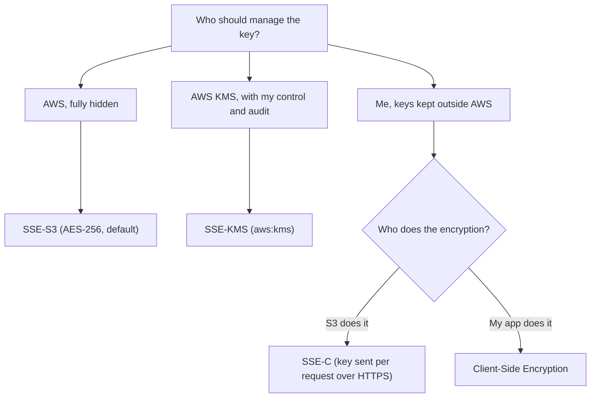
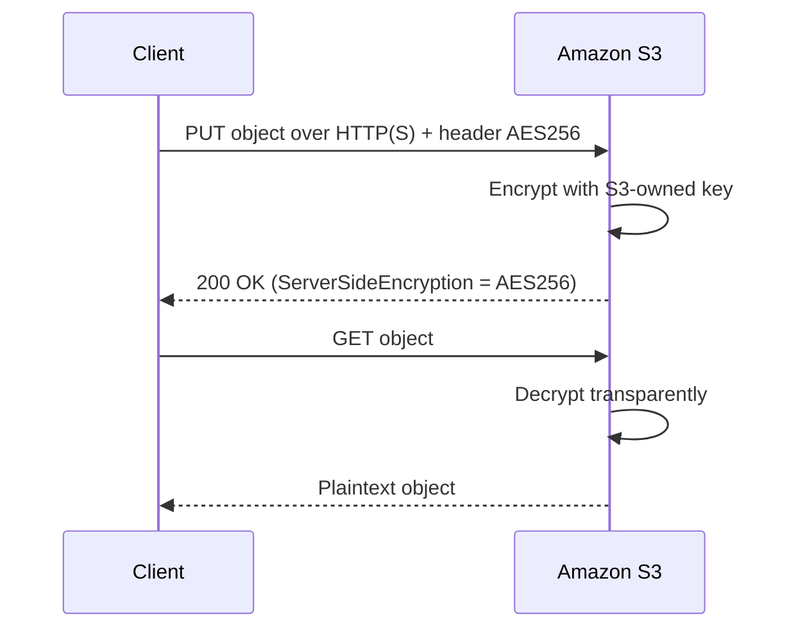
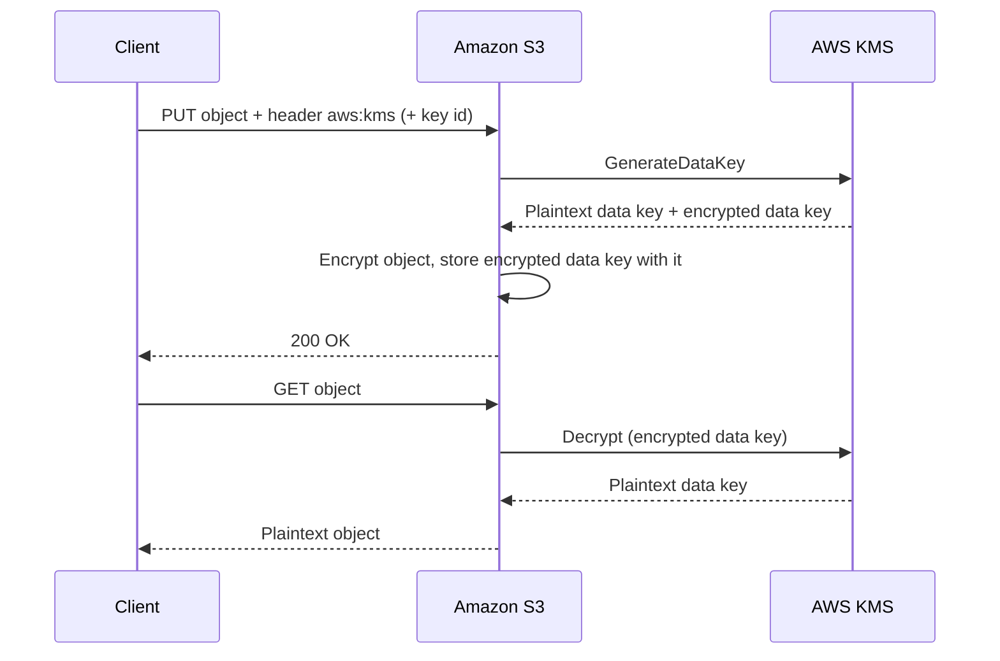
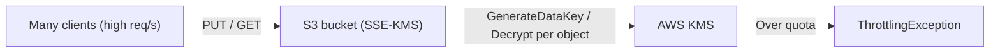
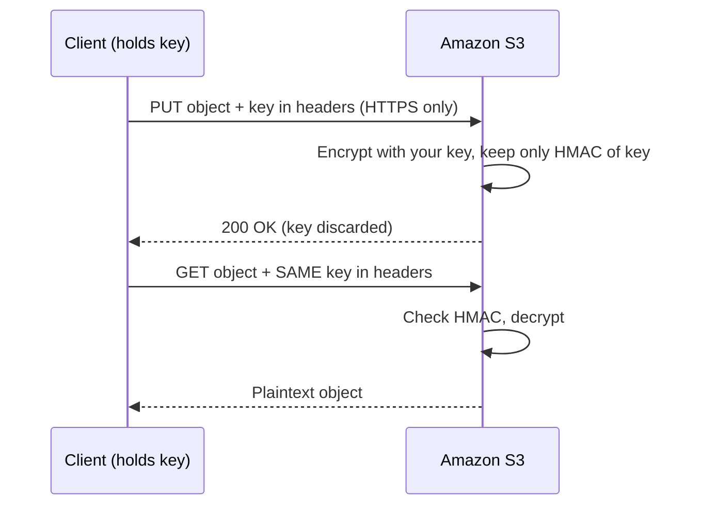
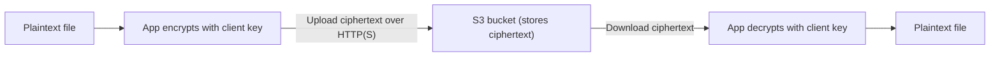
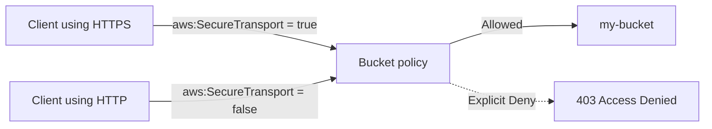

# Amazon S3 Security

## Lecture 139: 🔐 S3 Encryption

> **Overview**: Amazon S3 can protect objects at rest in four ways: three server-side options (SSE-S3, SSE-KMS, SSE-C), where S3 does the encryption for you, and client-side encryption, where your application encrypts before uploading. S3 also protects data in transit over HTTPS, and a bucket policy can refuse plain HTTP. For the exam you need to know who owns the key, which header to send, and the trade-offs of each method.

### 🧭 The Big Picture — Four Ways to Encrypt Objects at Rest

- **SSE-S3**: server-side encryption with keys that **Amazon S3 owns and manages**. Enabled by **default** on every bucket.
- **SSE-KMS**: server-side encryption with keys stored in **AWS KMS**, so you get **control and auditing** of the key.
- **SSE-C**: server-side encryption with a key that **you provide on every request**. AWS never stores it.
- **Client-Side Encryption**: you encrypt the data **before** it leaves your application. S3 only ever sees ciphertext.

> **Important**: Encryption applies **per object**, not per bucket. Objects in the same bucket can use different methods. The bucket's *default encryption* only decides what happens when a request does not say which method to use.



### 🟢 SSE-S3 — Keys Owned by Amazon S3

#### ⚙️ How It Works

- S3 encrypts each object with a unique data key, and that data key is itself protected by a root key that **AWS owns and rotates**. You never see or manage either.
- Algorithm: **AES-256** (AES-GCM).
- Request header: `x-amz-server-side-encryption: AES256`
- **Enabled by default** on all buckets and new objects since January 2023. If you send no encryption header, the object is still encrypted with SSE-S3.
- Decryption is transparent: anyone with `s3:GetObject` permission gets the plaintext back. No extra key permission is needed.



```javascript
import { S3Client, PutObjectCommand } from "@aws-sdk/client-s3";

const s3 = new S3Client({ region: "us-east-1" });

const res = await s3.send(
  new PutObjectCommand({
    Bucket: "my-bucket",
    Key: "docs/report.txt",
    Body: "hello",
    ServerSideEncryption: "AES256", // optional: this is already the default
  })
);
console.log(res.ServerSideEncryption); // "AES256"
```

#### ✅ When to Use It

- You just need data encrypted at rest, with no compliance requirement to control or audit the key.
- No extra cost and no KMS quota to worry about.

> **Analogy**: SSE-S3 is like a hotel safe whose master key stays with the hotel. Your valuables are locked, but you never hold the key and you can't see who opened it.

### 🟠 SSE-KMS — Keys Managed in AWS KMS

#### ⚙️ How It Works

- S3 asks **AWS KMS** for a data key, encrypts the object with it, and stores the **encrypted copy of the data key** next to the object.
- Request headers:

    - `x-amz-server-side-encryption: aws:kms`
    - `x-amz-server-side-encryption-aws-kms-key-id: <key-id-or-arn>` (optional; without it S3 uses the AWS managed key `aws/s3`)
    - `x-amz-server-side-encryption-context` (optional, Base64 JSON of extra encryption context)
    - `x-amz-server-side-encryption-bucket-key-enabled: true` (optional, turns on S3 Bucket Keys)
- You can use the **AWS managed key** (`aws/s3`) or your own **customer managed key**, which lets you control the key policy, rotation and disabling.

#### 🌟 Why Choose SSE-KMS

- **User control**: you decide who can use the key through the KMS key policy and IAM. This is a **second layer of access control** on top of S3 permissions.
- **Audit**: every use of the key shows up in **CloudTrail** (`GenerateDataKey`, `Decrypt`), so you can see who read encrypted data and when.
- **Key lifecycle**: rotation, disabling and scheduled deletion of customer managed keys.



#### 🔑 Permissions You Need

| Operation | S3 permission | KMS permission on the key |
| --- | --- | --- |
| Upload (`PutObject`) | `s3:PutObject` | `kms:GenerateDataKey` |
| Multipart upload | `s3:PutObject` | `kms:GenerateDataKey` **and** `kms:Decrypt` |
| Download (`GetObject`) | `s3:GetObject` | `kms:Decrypt` |
| Copy to another key | `s3:GetObject` + `s3:PutObject` | `kms:Decrypt` (source) + `kms:GenerateDataKey` (destination) |

> **Important**: Having `s3:GetObject` is **not enough** for an SSE-KMS object. Without `kms:Decrypt` on the key, the request fails with **403 Access Denied**. "User can list and see the object but can't download it" is a classic SSE-KMS permissions question.

```javascript
import { S3Client, PutObjectCommand, GetObjectCommand } from "@aws-sdk/client-s3";

const s3 = new S3Client({ region: "us-east-1" });

await s3.send(
  new PutObjectCommand({
    Bucket: "my-bucket",
    Key: "secure/payroll.csv",
    Body: csvData,
    ServerSideEncryption: "aws:kms",
    SSEKMSKeyId: "arn:aws:kms:us-east-1:111122223333:key/1234abcd-12ab-34cd-56ef-1234567890ab",
    BucketKeyEnabled: true, // fewer KMS calls, lower cost
  })
);

// Download: no key parameters needed, S3 calls KMS Decrypt for you.
// The caller still needs kms:Decrypt on the key.
const obj = await s3.send(
  new GetObjectCommand({ Bucket: "my-bucket", Key: "secure/payroll.csv" })
);
console.log(obj.ServerSideEncryption, obj.SSEKMSKeyId);
```

```bash
# Same upload with the CLI
aws s3 cp payroll.csv s3://my-bucket/secure/payroll.csv \
  --sse aws:kms \
  --sse-kms-key-id alias/my-app-key
```

#### ⚠️ SSE-KMS Limitation — KMS Request Quotas

- Every upload calls **`GenerateDataKey`** and every download calls **`Decrypt`**.
- These calls count against the **KMS cryptographic request quota per account per Region**: **5,500**, **10,000** or **30,000 requests/second** depending on the Region (symmetric keys). The quota is shared by everything in the account that uses KMS, including calls AWS services make on your behalf.
- When you exceed it, KMS returns a **`ThrottlingException`** and the S3 request fails. Mitigations:

    - Retry with **exponential backoff** (the SDK does this automatically).
    - Enable **S3 Bucket Keys**, which cut S3-to-KMS calls by up to **99%**.
    - Request a quota increase through the **Service Quotas** console.



> **Exam Tip**: "Application uploading thousands of objects per second to an SSE-KMS bucket is being throttled" → the bottleneck is **KMS**, not S3. Answer: S3 Bucket Key, quota increase, or switch to SSE-S3 if KMS control isn't required.

### 🔵 SSE-C — Customer-Provided Keys

#### ⚙️ How It Works

- You generate and manage a **256-bit key outside AWS** and send it **with every request**. S3 uses it to encrypt (or decrypt) the object and then **discards it**.
- S3 **does not store the key**. It keeps only a **salted HMAC** of the key so it can reject a wrong key on later requests.
- **HTTPS is mandatory**. S3 rejects SSE-C requests over plain HTTP.
- Request headers (on PUT **and** on every GET/HEAD):

    - `x-amz-server-side-encryption-customer-algorithm: AES256`
    - `x-amz-server-side-encryption-customer-key: <base64-encoded 256-bit key>`
    - `x-amz-server-side-encryption-customer-key-MD5: <base64 MD5 of the key>` (integrity check)



```javascript
import { randomBytes } from "node:crypto";
import { S3Client, PutObjectCommand, GetObjectCommand } from "@aws-sdk/client-s3";

const s3 = new S3Client({ region: "us-east-1" });
const customerKey = randomBytes(32); // 256-bit key that YOU must store safely

const sse = {
  SSECustomerAlgorithm: "AES256",
  SSECustomerKey: customerKey, // SDK v3 base64-encodes it and adds the MD5 header
};

await s3.send(new PutObjectCommand({ Bucket: "my-bucket", Key: "vault/a.bin", Body: data, ...sse }));

// Every read must send the same key, otherwise S3 rejects the request
const obj = await s3.send(new GetObjectCommand({ Bucket: "my-bucket", Key: "vault/a.bin", ...sse }));
```

#### ⚠️ Gotchas

- **Lose the key, lose the data.** AWS cannot recover it.
- **The S3 console can't upload or download SSE-C objects**; you must use the CLI, SDK or REST API.
- Key rotation means **re-copying every object** with the new key.
- AWS has added a bucket-level setting to **block SSE-C uploads**, and newer buckets may block SSE-C by default. If an SSE-C upload is rejected on a new bucket, check the bucket's encryption settings first.

### 🟣 Client-Side Encryption

- Your application **encrypts the data before uploading** and **decrypts after downloading**. S3 stores ciphertext and never sees the key or the plaintext.
- Typical tools: the **Amazon S3 Encryption Client** and the **AWS Encryption SDK**. The key can come from KMS (envelope encryption) or from your own key store.
- The **customer manages the keys and the whole encryption cycle**.
- Use it when compliance says data must be encrypted **before it leaves your environment**, or when nobody at AWS should be able to read the data even if S3 permissions are misconfigured.



```javascript
// Client-side envelope encryption with a KMS data key (simplified)
import { KMSClient, GenerateDataKeyCommand } from "@aws-sdk/client-kms";
import { S3Client, PutObjectCommand } from "@aws-sdk/client-s3";
import { createCipheriv, randomBytes } from "node:crypto";

const kms = new KMSClient({ region: "us-east-1" });
const s3 = new S3Client({ region: "us-east-1" });

const { Plaintext, CiphertextBlob } = await kms.send(
  new GenerateDataKeyCommand({ KeyId: "alias/my-app-key", KeySpec: "AES_256" })
);

const iv = randomBytes(12);
const cipher = createCipheriv("aes-256-gcm", Plaintext, iv);
const encrypted = Buffer.concat([cipher.update(fileData), cipher.final()]);

await s3.send(
  new PutObjectCommand({
    Bucket: "my-bucket",
    Key: "cse/data.bin",
    Body: Buffer.concat([iv, cipher.getAuthTag(), encrypted]),
    Metadata: { "encrypted-data-key": Buffer.from(CiphertextBlob).toString("base64") },
  })
);
```

> **Important**: In real projects use the S3 Encryption Client or AWS Encryption SDK rather than hand-rolled crypto. The snippet only shows the idea: S3 receives ciphertext plus an encrypted data key.

### 🚚 Encryption in Transit (SSL/TLS)

- Encryption in flight = **SSL/TLS**.
- S3 exposes an **HTTP endpoint** (not encrypted) and an **HTTPS endpoint** (encrypted in flight). HTTPS is recommended, and the SDKs and CLI use it by default.
- HTTPS is **mandatory for SSE-C**, since the key travels in the headers.
- To **force** HTTPS, add a bucket policy that denies any request where `aws:SecureTransport` is `false`:

```json
{
  "Version": "2012-10-17",
  "Statement": [
    {
      "Sid": "DenyInsecureTransport",
      "Effect": "Deny",
      "Principal": "*",
      "Action": "s3:*",
      "Resource": [
        "arn:aws:s3:::my-bucket",
        "arn:aws:s3:::my-bucket/*"
      ],
      "Condition": {
        "Bool": { "aws:SecureTransport": "false" }
      }
    }
  ]
}
```



### 📊 Comparison Table

| Aspect | SSE-S3 | SSE-KMS | SSE-C | Client-Side |
| --- | --- | --- | --- | --- |
| Who encrypts | S3 | S3 | S3 | Your app |
| Who manages the key | AWS (S3) | AWS KMS (you control policy) | You, outside AWS | You |
| Key stored by AWS | Yes | Yes (in KMS) | No | No (unless from KMS) |
| Header value | `AES256` | `aws:kms` | `...-customer-algorithm: AES256` + key headers | None (S3 sees ciphertext) |
| Audit in CloudTrail | No key usage events | Yes (`GenerateDataKey`, `Decrypt`) | No | Only if you use KMS |
| Extra permissions to read | None | `kms:Decrypt` | Must supply the key | Must hold the key |
| HTTPS required | No (recommended) | No (recommended) | **Yes** | No (recommended) |
| Console support | Yes | Yes | **No** | No |
| Quota concerns | None | KMS req/s quota | None | Your own / KMS |
| Default for new objects | **Yes** | No | No | No |

### 🎯 DVA-C02 Exam Tips

- **"Encrypt with no extra effort / no cost"** → SSE-S3 (already on by default).
- **"Audit who used the key" / "control the key" / "separation of duties"** → SSE-KMS with a customer managed key.
- **"Company must manage its own keys outside AWS, but S3 should do the encryption"** → SSE-C. Watch for the HTTPS requirement.
- **"Data must be encrypted before it is sent to AWS"** → Client-side encryption.
- **"403 on GetObject although the IAM policy allows `s3:GetObject`"** → missing `kms:Decrypt` on the KMS key (or a key policy that doesn't trust the principal). Cross-account access to SSE-KMS objects needs the **key policy** to allow the other account too; the AWS managed `aws/s3` key **can't** be shared cross-account, so use a customer managed key.
- **"SSE-KMS bucket throttled at high request rates"** → KMS quota; enable **S3 Bucket Key**, back off and retry, or request a quota increase.
- **"Enforce HTTPS"** → bucket policy with `aws:SecureTransport = false` → Deny. Security groups or ACLs are distractors.
- **"Force uploads to use a specific encryption"** → bucket policy denying `s3:PutObject` when the `s3:x-amz-server-side-encryption` condition key isn't the required value. Bucket policies are evaluated **before** default encryption.
- Changing a bucket's default encryption does **not** re-encrypt existing objects. To change an existing object's encryption you copy it (onto itself or elsewhere), for example with **S3 Batch Operations** for many objects.
- Besides these four, S3 also has **DSSE-KMS** (dual-layer server-side encryption with KMS), which applies two layers of encryption for strict compliance requirements.

### 📝 Key Exam Takeaways

- Four at-rest options: **SSE-S3** (default, AES-256, `AES256` header), **SSE-KMS** (`aws:kms` header, KMS key), **SSE-C** (your key in every request's headers, HTTPS only), **Client-Side** (you encrypt before upload).
- **SSE-S3** is enabled by default for all new buckets and objects. Reading needs only S3 permissions.
- **SSE-KMS** gives key control and CloudTrail auditing. It needs `kms:GenerateDataKey` to write and `kms:Decrypt` to read, and it is subject to **KMS request quotas** (5,500 / 10,000 / 30,000 req/s per Region).
- **S3 Bucket Keys** reduce SSE-KMS calls and cost by up to 99%.
- **SSE-C**: S3 never stores your key, HTTPS is mandatory, the key must be sent on every request, and the console doesn't support it.
- **Client-side encryption**: the customer manages keys and the whole encrypt/decrypt cycle; S3 only stores ciphertext.
- **In transit**: use HTTPS. Enforce it with a bucket policy that denies requests where `aws:SecureTransport` is `false`.

---
