# AWS Fundamentals : ELB + ASG

## Lecture 59: ⚖️ Elastic Load Balancing (ELB) Overview

> 🎓 Course: Ultimate AWS Certified Developer Associate DVA-C02 2026<br>👨‍🏫 Instructor: Stephane Maarek

### 🔍 What is Load Balancing?

- A **Load Balancer** is a server (or set of servers) that **forwards internet traffic** to multiple downstream servers (e.g., EC2 instances)
- Users connect to the load balancer, and the load balancer distributes the requests across the backend instances
- End users only see a **single point of access** (the load balancer's DNS name) and don't know which backend instance is handling their request

```text
         ┌──────────────┐
         │   Users      │
         └──────┬───────┘
                │
         ┌──────▼───────┐
         │ Load Balancer │
         └──┬────┬────┬─┘
            │    │    │
     ┌──────▼┐ ┌─▼────┐ ┌▼──────┐
     │ EC2 #1│ │EC2 #2│ │EC2 #3 │
     └───────┘ └──────┘ └───────┘
```

### 🤔 Why Use a Load Balancer?

- **Spread load** across multiple downstream instances
- Expose a **single point of access** (DNS hostname) to your application
- Seamlessly handle **failures** of downstream instances (health checks)
- Perform regular **health checks** on instances
- Provide **SSL termination** (HTTPS) for your websites
- Enforce **stickiness** with cookies
- Achieve **high availability** across Availability Zones
- Separate **public traffic** from **private traffic**

### 🏢 Why Use an Elastic Load Balancer (ELB)?

- ELB is a **managed load balancer** provided by AWS

    - AWS guarantees it will be working
    - AWS takes care of **upgrades, maintenance, and high availability**
    - AWS provides only a few **configuration knobs** to tune behavior
- It costs less to set up your own load balancer, **but** it will require much more effort on your end (maintenance, integrations, etc.)
- ELB is **integrated** with many AWS services:

    - EC2, EC2 Auto Scaling Groups, Amazon ECS
    - AWS Certificate Manager (ACM), CloudWatch
    - Route 53, AWS WAF, AWS Global Accelerator

### 💓 Health Checks

- Health Checks are **crucial** for load balancers — they tell the ELB whether instances are **healthy** and **available** to reply to requests
- The health check is done on a **port** and a **route** (e.g., `/health` on port `4567`)
- If the response is **not 200 (OK)**, then the instance is deemed **unhealthy**
- Unhealthy instances will **not receive traffic** from the load balancer

```text
         ┌──────────────┐
         │ Load Balancer │
         └──────┬───────┘
                │
        Health Check Request
        GET /health:4567
                │
         ┌──────▼───────┐
         │  EC2 Instance │
         │  Response 200 │ ✅ Healthy
         └──────────────┘
```

### 📦 Types of AWS Load Balancers

AWS offers **4 kinds** of managed load balancers:

#### 🟢 Classic Load Balancer (CLB) — v1, Old Generation (2009)

- Supports HTTP, HTTPS, TCP, SSL (secure TCP)
- **Deprecated** — AWS recommends migrating to newer load balancers
- Available in the console but **not recommended** for new applications

#### 🔵 Application Load Balancer (ALB) — v2, New Generation (2016)

- Supports **HTTP, HTTPS, WebSocket**
- Operates at **Layer 7** (Application Layer)
- Best suited for microservices and container-based architectures

#### 🟣 Network Load Balancer (NLB) — v2, New Generation (2017)

- Supports **TCP, TLS (secure TCP), UDP**
- Operates at **Layer 4** (Transport Layer)
- Ultra-high performance — handles **millions of requests per second**
- Ultra-low latency (~100ms vs ~400ms for ALB)

#### 🟠 Gateway Load Balancer (GWLB) — (2020)

- Operates at **Layer 3** (Network Layer) — **IP Protocol**
- Used for routing traffic to **third-party network virtual appliances** (e.g., firewalls, intrusion detection systems)

> 💡 **Exam Tip:** Some load balancers can be set up as **internal** (private) or **external** (public-facing) ELBs. Understand the difference for VPC-related questions.

### 🔒 Load Balancer Security Groups

- Users connect to the load balancer using **HTTP** or **HTTPS** from anywhere
- The **Load Balancer Security Group** should allow:

```text
Inbound Rules (Load Balancer SG):
┌──────────┬──────────┬───────────────┐
│ Protocol │   Port   │    Source     │
├──────────┼──────────┼───────────────┤
│  HTTPS   │   443    │  0.0.0.0/0   │
│  HTTP    │    80    │  0.0.0.0/0   │
└──────────┴──────────┴───────────────┘
```

- The **EC2 Instance Security Group** should only allow traffic **from the Load Balancer**:

```text
Inbound Rules (EC2 Instance SG):
┌──────────┬──────────┬──────────────────────────┐
│ Protocol │   Port   │         Source            │
├──────────┼──────────┼──────────────────────────┤
│  HTTP    │    80    │ Load Balancer SG (sg-xxx) │
└──────────┴──────────┴──────────────────────────┘
```

> 🔐 **Key Concept:** By linking the EC2 security group source to the load balancer's security group (instead of an IP range), instances **only accept traffic that flows through the load balancer**. This is a security best practice.

### 📊 Comparing Load Balancer Types

| Feature | CLB (v1) | ALB (v2) | NLB (v2) | GWLB |
| --- | --- | --- | --- | --- |
| **Year** | 2009 | 2016 | 2017 | 2020 |
| **Layer** | L4 & L7 | L7 | L4 | L3 |
| **Protocols** | HTTP, HTTPS, TCP, SSL | HTTP, HTTPS, WebSocket | TCP, TLS, UDP | IP |
| **Static IP** | ❌ | ❌ (fixed DNS) | ✅ (Elastic IP) | ❌ |
| **Performance** | Low | Medium | Ultra-high | High |
| **Use Case** | Legacy | Web apps, Microservices | Extreme performance | Network appliances |
| **Status** | Deprecated | ✅ Recommended | ✅ Recommended | ✅ Recommended |

### 📝 Key Takeaways

- ELB is a **managed service** — AWS handles availability, scaling, and maintenance
- **Health checks** ensure traffic is only routed to healthy instances
- **ALB** = Layer 7 (HTTP/HTTPS) — best for web applications and microservices
- **NLB** = Layer 4 (TCP/UDP) — best for ultra-high performance and low latency
- **GWLB** = Layer 3 (IP) — best for third-party virtual network appliances
- **CLB** is deprecated — don't use for new workloads
- Always configure **security groups** so EC2 instances only accept traffic from the load balancer

---

## Lecture 61: 🔵 Application Load Balancer (ALB)

> 🎓 Course: Ultimate AWS Certified Developer Associate DVA-C02 2026<br>👨‍🏫 Instructor: Stephane Maarek

### 🔍 What is an Application Load Balancer?

- ALB is a **Layer 7** (HTTP) load balancer
- It allows you to do load balancing to **multiple HTTP applications** across machines (called **Target Groups**)
- It also allows load balancing to **multiple applications on the same machine** (e.g., containers)
- ALB supports **HTTP/2** and **WebSocket**
- ALB supports **redirects** (e.g., from HTTP to HTTPS automatically)

### 🎯 ALB Routing Features

ALB supports advanced **routing** based on different criteria. You can route to different target groups based on:

#### 🌐 URL Path-Based Routing

- Route based on the **path in the URL**
- Example: `example.com/users` → Target Group 1, `example.com/posts` → Target Group 2

```text
                    ┌──────────────────┐
                    │       ALB        │
                    └──┬───────────┬───┘
                       │           │
              /users/*│           │/posts/*
                       │           │
              ┌────────▼──┐  ┌────▼────────┐
              │  TG #1    │  │   TG #2     │
              │ (Users)   │  │  (Posts)    │
              └───────────┘  └────────────┘
```

#### 🏷️ Hostname-Based Routing

- Route based on the **hostname in the URL**
- Example: `one.example.com` → Target Group 1, `other.example.com` → Target Group 2

#### 📝 Query String & Header-Based Routing

- Route based on **query string parameters** or **headers**
- Example: `example.com/users?platform=mobile` → Target Group 1 (mobile), `example.com/users?platform=desktop` → Target Group 2 (desktop)

```text
                       ┌──────────────────┐
                       │       ALB        │
                       └──┬───────────┬───┘
                          │           │
        ?platform=mobile  │           │ ?platform=desktop
                          │           │
                 ┌────────▼──┐  ┌────▼────────┐
                 │  TG #1    │  │   TG #2     │
                 │ (Mobile)  │  │ (Desktop)   │
                 └───────────┘  └────────────┘
```

> 💡 **Key Insight:** ALB is ideal for **microservices** and **container-based applications** (e.g., Docker, Amazon ECS) because you can route different URL paths or hostnames to different backend services — all through a single load balancer.

### 📦 Target Groups

ALB routes traffic to **Target Groups**, which can be:

#### 🖥️ EC2 Instances

- Can be managed by an **Auto Scaling Group**
- Health checks are performed at the target group level

#### 🐳 ECS Tasks

- Managed by **Amazon ECS**
- ALB works hand-in-hand with ECS for container orchestration

#### 🔧 Lambda Functions

- HTTP request is translated into a **JSON event**
- ALB can invoke Lambda functions as targets (serverless)

#### 🔗 IP Addresses

- Must be **private IPs**
- Useful for routing to on-premises servers or instances in peered VPCs

> ⚠️ **Important:** ALB can route to **multiple target groups**. Health checks are configured **at the target group level**, not at the individual instance level.

```text
                  ┌──────────────────────────┐
                  │     Application LB       │
                  └──┬─────────┬──────────┬──┘
                     │         │          │
            ┌────────▼──┐ ┌───▼─────┐ ┌──▼──────────┐
            │ TG: EC2   │ │TG: ECS  │ │TG: Lambda   │
            │ Instances │ │ Tasks   │ │ Functions   │
            └───────────┘ └─────────┘ └─────────────┘
```

### 🌐 ALB — Good to Know

#### 🔒 Fixed Hostname

- ALB provides a **fixed hostname** (e.g., `XXX.region.elb.amazonaws.com`)
- You do **NOT** get a static IP — you get a DNS name

#### 📋 Client IP — X-Forwarded Headers

- The application servers (EC2 instances) **do not see the client's IP directly**
- The true IP of the client is inserted in the header `X-Forwarded-For`
- The port is in `X-Forwarded-Port`
- The protocol is in `X-Forwarded-Proto`

```text
Client IP: 12.34.56.78
        │
        ▼
┌───────────────┐    Private IP     ┌────────────────┐
│      ALB      │ ──────────────▶   │  EC2 Instance  │
│ (Connection   │   10.0.0.1        │                │
│  Termination) │                   │ Sees:          │
└───────────────┘                   │ Src: 10.0.0.1  │ ← ALB private IP
                                    │                │
                                    │ Headers:       │
                                    │ X-Forwarded-For│
                                    │ = 12.34.56.78  │ ← Real client IP
                                    └────────────────┘
```

> 🔐 **Exam Tip:** When an application behind an ALB needs the real client IP, it must read the `X-Forwarded-For` header — not the source IP of the connection (which will be the ALB's private IP).

#### Example: Reading the Client IP in Code

```python
# Python (Flask) — Reading real client IP behind ALB
from flask import Flask, request

app = Flask(__name__)

@app.route("/")
def index():
    # The ALB sets X-Forwarded-For with the real client IP
    client_ip = request.headers.get("X-Forwarded-For", request.remote_addr)
    protocol = request.headers.get("X-Forwarded-Proto", "http")
    port = request.headers.get("X-Forwarded-Port", "80")

    return f"Client IP: {client_ip}, Protocol: {protocol}, Port: {port}"
```

```javascript
// Node.js (Express) — Reading real client IP behind ALB
app.get("/", (req, res) => {
    const clientIp = req.headers["x-forwarded-for"] || req.socket.remoteAddress;
    const protocol = req.headers["x-forwarded-proto"] || "http";
    const port = req.headers["x-forwarded-port"] || "80";

    res.send(`Client IP: ${clientIp}, Protocol: ${protocol}, Port: ${port}`);
});
```

### 🛡️ ALB Security Group Configuration

- The **ALB Security Group** allows inbound HTTP/HTTPS traffic from the internet
- The **EC2 Instance Security Group** should only allow traffic **from the ALB's security group**

```text
ALB Security Group (sg-alb):
┌──────────┬──────┬─────────────┐
│ Protocol │ Port │   Source     │
├──────────┼──────┼─────────────┤
│   HTTP   │  80  │  0.0.0.0/0  │
│  HTTPS   │ 443  │  0.0.0.0/0  │
└──────────┴──────┴─────────────┘

EC2 Instance Security Group:
┌──────────┬──────┬─────────────┐
│ Protocol │ Port │   Source     │
├──────────┼──────┼─────────────┤
│   HTTP   │  80  │   sg-alb    │
└──────────┴──────┴─────────────┘
```

### 🔄 ALB Listener Rules

- ALB uses **Listener Rules** to determine how to route incoming requests
- Rules are evaluated **in priority order** (lowest number = highest priority)
- Each rule has **conditions** and **actions**

#### Conditions (IF)

- **Host header** — match hostname (e.g., `api.example.com`)
- **Path pattern** — match URL path (e.g., `/api/*`)
- **HTTP methods** — match GET, POST, etc.
- **Query string** — match query parameters
- **Source IP** — match client IP range (CIDR)
- **HTTP headers** — match header values

#### Actions (THEN)

- **Forward** — route to a target group
- **Redirect** — redirect to another URL (e.g., HTTP → HTTPS)
- **Fixed response** — return a custom HTTP response (e.g., 404 page)

```text
Rule Priority Order:
┌────────┬────────────────────────┬──────────────────────┐
│ Priority│      Condition         │       Action         │
├────────┼────────────────────────┼──────────────────────┤
│   1    │ Path = /api/*          │ Forward → API TG     │
│   2    │ Path = /mobile/*       │ Forward → Mobile TG  │
│   3    │ Host = admin.site.com  │ Forward → Admin TG   │
│  Last  │ Default (no match)     │ Forward → Default TG │
└────────┴────────────────────────┴──────────────────────┘
```

### 📊 ALB vs CLB — Comparison

| Feature | Classic LB (CLB) | Application LB (ALB) |
| --- | --- | --- |
| **Layer** | Layer 4 & 7 | Layer 7 only |
| **Path Routing** | ❌ | ✅ |
| **Host Routing** | ❌ | ✅ |
| **Query String Routing** | ❌ | ✅ |
| **Multiple Target Groups** | ❌ | ✅ |
| **WebSocket** | ❌ | ✅ |
| **HTTP/2** | ❌ | ✅ |
| **Lambda Targets** | ❌ | ✅ |
| **Fixed Hostname** | ✅ | ✅ |
| **Container Support** | Basic | ✅ Advanced (ECS dynamic port mapping) |

> 💡 With CLB, you needed **one load balancer per application**. With ALB, a **single ALB can handle multiple applications** using routing rules and target groups — much more cost-effective!

### 📝 Key Takeaways

- ALB operates at **Layer 7** (HTTP/HTTPS/WebSocket)
- Supports **path-based**, **hostname-based**, **query string**, and **header-based** routing
- Routes to **Target Groups**: EC2 instances, ECS tasks, Lambda functions, or private IP addresses
- Provides a **fixed DNS hostname** (not a static IP)
- Client IP is available via the `X-Forwarded-For` header
- Perfect for **microservices** and **container-based architectures**
- A single ALB can replace **multiple CLBs** thanks to advanced routing rules
- Health checks are configured at the **target group level**
- **Listener Rules** are evaluated in order of priority to determine routing

---

## Lecture 62: 🛠️ Application Load Balancer (ALB) — Hands On — Part 1

> 🎓 Course: Ultimate AWS Certified Developer Associate DVA-C02 2026<br>👨‍🏫 Instructor: Stephane Maarek

### 🎯 Objective

- Launch **two EC2 instances** that serve different web pages
- Create an **Application Load Balancer (ALB)**
- Create a **Target Group** and register both instances
- Verify the ALB distributes traffic across both instances

### 🖥️ Step 1: Launch Two EC2 Instances

- Navigate to **EC2 Console** → **Instances** → **Launch Instances**
- Launch **2 instances** with the following configuration:

#### Instance Configuration

| Setting | Value |
| --- | --- |
| **Name** | `My First Instance` / `My Second Instance` |
| **AMI** | Amazon Linux 2 (or Amazon Linux 2023) |
| **Instance Type** | `t2.micro` (Free Tier eligible) |
| **Key Pair** | Proceed without a key pair (or select existing) |
| **Network** | Default VPC |
| **Security Group** | Create new — allow HTTP (port 80) from anywhere |

#### 🔐 Security Group Configuration

- Create a security group that allows **HTTP traffic on port 80** from **anywhere** (`0.0.0.0/0`)
- This is needed so the ALB and users can reach the instances

```text
Inbound Rules:
┌──────────┬──────┬─────────────┬──────────────────┐
│   Type   │ Port │  Protocol   │     Source       │
├──────────┼──────┼─────────────┼──────────────────┤
│   HTTP   │  80  │    TCP      │  0.0.0.0/0       │
└──────────┴──────┴─────────────┴──────────────────┘
```

#### 📜 User Data Script

- Under **Advanced Details** → **User Data**, paste a script so each instance serves a unique web page
- This script installs a web server and displays the instance's hostname

```bash
#!/bin/bash
# Install httpd (Amazon Linux 2)
yum update -y
yum install -y httpd
systemctl start httpd
systemctl enable httpd

# Create a simple web page showing the hostname
echo "<h1>Hello World from $(hostname -f)</h1>" > /var/www/html/index.html
```

> 💡 **Why different hostnames?** Each EC2 instance has a unique internal hostname. When the ALB load balances between them, you'll see the hostname change on each browser refresh — proving the load balancer is working!

- Launch **2 instances** (set "Number of instances" to 2)
- Wait for both instances to be in the **Running** state and pass **status checks**

#### ✅ Verify Instances Are Working

- Copy the **Public IPv4 address** of each instance
- Open each in a browser: `http://<public-ip>`
- You should see **"Hello World from ip-xxx-xxx-xxx-xxx"** with different hostnames

```text
Instance 1: <http://3.85.100.50>   → "Hello World from ip-172-31-20-100.ec2.internal"
Instance 2: <http://54.210.30.75>  → "Hello World from ip-172-31-25-200.ec2.internal"
```

### 🎯 Step 2: Create a Target Group

- Navigate to **EC2 Console** → **Load Balancing** → **Target Groups** → **Create target group**

#### Target Group Configuration

| Setting | Value |
| --- | --- |
| **Target type** | Instances |
| **Target group name** | `my-first-target-group` |
| **Protocol** | HTTP |
| **Port** | 80 |
| **VPC** | Default VPC |
| **Health check protocol** | HTTP |
| **Health check path** | `/` |

#### 🏥 Health Check Settings

```text
Health Check Configuration:
┌─────────────────────────┬────────────────┐
│        Setting          │     Value      │
├─────────────────────────┼────────────────┤
│ Protocol                │ HTTP           │
│ Path                    │ /              │
│ Healthy threshold       │ 5              │
│ Unhealthy threshold     │ 2              │
│ Timeout                 │ 5 seconds      │
│ Interval                │ 30 seconds     │
│ Success codes           │ 200            │
└─────────────────────────┴────────────────┘
```

> 📝 The health check sends an HTTP GET request to `/` on port 80. If the instance returns a **200 OK**, it's marked **healthy**. Otherwise, after the unhealthy threshold is reached, it's marked **unhealthy** and removed from rotation.

#### ➕ Register Targets

- Select **both EC2 instances** from the list
- Click **Include as pending below**
- Click **Create target group**

### ⚖️ Step 3: Create the Application Load Balancer

- Navigate to **EC2 Console** → **Load Balancing** → **Load Balancers** → **Create Load Balancer**
- Select **Application Load Balancer** → **Create**

#### ALB Configuration

| Setting | Value |
| --- | --- |
| **Name** | `my-first-alb` |
| **Scheme** | Internet-facing |
| **IP address type** | IPv4 |
| **VPC** | Default VPC |
| **Availability Zones** | Select **at least 2 AZs** (all available is best) |

> ⚠️ **Important:** You must select **at least 2 Availability Zones** for the ALB. This is required for high availability. AWS recommends selecting all available AZs.

#### 🔐 Security Group for the ALB

- Create a **new security group** (or use an existing one) that allows:

```text
ALB Security Group — Inbound Rules:
┌──────────┬──────┬─────────────┐
│   Type   │ Port │   Source     │
├──────────┼──────┼─────────────┤
│   HTTP   │  80  │ 0.0.0.0/0   │
└──────────┴──────┴─────────────┘
```

#### 🔊 Listener Configuration

| Setting | Value |
| --- | --- |
| **Protocol** | HTTP |
| **Port** | 80 |
| **Default action** | Forward to → `my-first-target-group` |

- The **Listener** listens on port 80 and forwards all traffic to the target group
- Click **Create load balancer**

#### ⏳ Wait for ALB to Become Active

- The ALB state will initially show as **Provisioning**
- Wait until the state changes to **Active** (this can take 2–5 minutes)

### 🧪 Step 4: Test the ALB

#### 🌐 Access the ALB DNS Name

- Once the ALB is **Active**, copy the **DNS name** from the ALB details
- The DNS name looks like: `my-first-alb-123456789.us-east-1.elb.amazonaws.com`

```text
Open in browser:
<http://my-first-alb-123456789.us-east-1.elb.amazonaws.com>
```

#### 🔄 Verify Load Balancing

- **Refresh the page multiple times** (Ctrl+F5 or Cmd+Shift+R)
- You should see the hostname **alternate** between the two instances:

```text
Refresh 1: "Hello World from ip-172-31-20-100.ec2.internal"  ← Instance 1
Refresh 2: "Hello World from ip-172-31-25-200.ec2.internal"  ← Instance 2
Refresh 3: "Hello World from ip-172-31-20-100.ec2.internal"  ← Instance 1
Refresh 4: "Hello World from ip-172-31-25-200.ec2.internal"  ← Instance 2
```

> 🎉 **Success!** The ALB is distributing traffic across both instances using **round-robin** by default.

#### 💓 Check Target Health

- Go to **Target Groups** → **my-first-target-group** → **Targets** tab
- Both instances should show status: **healthy**

```text
Registered Targets:
┌──────────────┬────────┬────────┬──────────┐
│  Instance ID │  Port  │  AZ    │  Status  │
├──────────────┼────────┼────────┼──────────┤
│ i-0abc123... │   80   │ us-e-1a│ healthy  │
│ i-0def456... │   80   │ us-e-1b│ healthy  │
└──────────────┴────────┴────────┴──────────┘
```

### 🔒 Step 5: Tighten EC2 Security (Best Practice)

- Currently, the EC2 instances are accessible **directly** via their public IPs AND through the ALB
- **Best practice:** Restrict EC2 instances to **only accept traffic from the ALB**

#### Update EC2 Security Group

- Go to the EC2 instance's security group
- **Modify** the inbound rule for HTTP (port 80):

    - Change the source from `0.0.0.0/0` to the **ALB's Security Group** (e.g., `sg-alb-xxxxx`)

```text
Updated EC2 Security Group — Inbound Rules:
┌──────────┬──────┬───────────────────────┐
│   Type   │ Port │       Source          │
├──────────┼──────┼───────────────────────┤
│   HTTP   │  80  │ sg-alb-xxxxx (ALB SG) │
└──────────┴──────┴───────────────────────┘
```

#### ✅ Verify Security

- Try accessing an EC2 instance **directly** via its public IP → ❌ **Should timeout/fail**
- Access the **ALB DNS name** → ✅ **Should still work perfectly**

> 🔐 **Exam Tip:** This pattern — referencing a security group as the source instead of an IP range — is a fundamental AWS security best practice. It ensures instances are only reachable through the load balancer.

### 📝 Key Takeaways

- Launched **2 EC2 instances** with different hostnames using **User Data** scripts
- Created a **Target Group** and registered both instances with health checks on `/`
- Created an **ALB** (internet-facing, HTTP on port 80, across multiple AZs)
- Verified **round-robin load balancing** by refreshing the ALB DNS URL
- Tightened security by restricting EC2 inbound rules to **only allow traffic from the ALB security group**
- The ALB provides a **single DNS endpoint** while distributing traffic across multiple healthy instances
- Always select **at least 2 AZs** when creating an ALB for high availability

---

## Lecture 63: 🛠️ Application Load Balancer (ALB) — Hands On — Part 2

> 🎓 Course: Ultimate AWS Certified Developer Associate DVA-C02 2026<br>👨‍🏫 Instructor: Stephane Maarek

### 🎯 Objective

- Explore **ALB Listener Rules** for advanced routing
- Configure **path-based routing** to forward requests to different target groups
- Add a **fixed response** rule for custom error pages
- Understand how **rule priority** and **conditions** work in practice

> 📌 **Prerequisite:** This lecture continues from Part 1 (Lecture 62). You should already have an ALB (`my-first-alb`) with a target group (`my-first-target-group`) containing 2 healthy EC2 instances.

### 🔊 Understanding ALB Listeners

- A **Listener** checks for connection requests from clients using the **protocol and port** you configure
- Each listener has a **default action** (e.g., forward to a target group)
- You can add **additional rules** to route traffic based on conditions

#### Viewing the Current Listener

- Go to **EC2 Console** → **Load Balancers** → select `my-first-alb`
- Click the **Listeners and rules** tab
- You'll see the existing **HTTP:80** listener with a default rule forwarding to `my-first-target-group`

```text
Current Listener: HTTP:80
┌──────────┬────────────────────┬─────────────────────────────┐
│ Priority │     Condition      │          Action             │
├──────────┼────────────────────┼─────────────────────────────┤
│  Default │  (no condition)    │ Forward → my-first-target-  │
│  (last)  │                    │ group                       │
└──────────┴────────────────────┴─────────────────────────────┘
```

### 📦 Step 1: Create a Second Target Group

- Before adding routing rules, create a **second target group** to route specific requests to
- Go to **EC2 Console** → **Target Groups** → **Create target group**

| Setting | Value |
| --- | --- |
| **Target type** | Instances |
| **Name** | `my-second-target-group` |
| **Protocol** | HTTP |
| **Port** | 80 |
| **VPC** | Default VPC |
| **Health check path** | `/` |

- Register **only one** of the two EC2 instances in this target group (to easily distinguish which group is being hit)
- Click **Create target group**

```text
Target Group Setup:
┌──────────────────────────┬────────────────────────┐
│  my-first-target-group   │ my-second-target-group │
├──────────────────────────┼────────────────────────┤
│  Instance 1 ✅           │  Instance 2 ✅         │
│  Instance 2 ✅           │                        │
└──────────────────────────┴────────────────────────┘
```

### 📋 Step 2: Add a Path-Based Routing Rule

- Go to **Load Balancers** → select `my-first-alb` → **Listeners and rules** tab
- Click on the **HTTP:80** listener → **Manage rules** → **Add rule**

#### Rule Configuration

| Setting | Value |
| --- | --- |
| **Name** | `my-target-group-2-rule` |
| **Priority** | 1 |

#### Condition — Path Pattern

- Click **Add condition** → select **Path**
- Enter the path pattern: `/error`

```text
Condition:
┌────────────────┬─────────────┐
│     Type       │    Value    │
├────────────────┼─────────────┤
│  Path pattern  │   /error    │
└────────────────┴─────────────┘
```

#### Action — Forward to Second Target Group

- Under **Actions**, select **Forward to target groups**
- Choose `my-second-target-group`
- Click **Create**

```text
Updated Listener Rules: HTTP:80
┌──────────┬────────────────────┬──────────────────────────────┐
│ Priority │     Condition      │           Action             │
├──────────┼────────────────────┼──────────────────────────────┤
│    1     │  Path = /error     │ Forward → my-second-target-  │
│          │                    │ group                        │
├──────────┼────────────────────┼──────────────────────────────┤
│  Default │  (no condition)    │ Forward → my-first-target-   │
│  (last)  │                    │ group                        │
└──────────┴────────────────────┴──────────────────────────────┘
```

#### 🧪 Test Path-Based Routing

```text
# Default path → routes to my-first-target-group (both instances)
<http://my-first-alb-xxxxx.us-east-1.elb.amazonaws.com/>

# /error path → routes to my-second-target-group (single instance)
<http://my-first-alb-xxxxx.us-east-1.elb.amazonaws.com/error>
```

> 💡 When you hit `/error`, the request goes to `my-second-target-group`. Since those instances don't have an `/error` page, you may see a **404** or the default page — but the key point is the **routing works correctly** to the second target group.

### 🛑 Step 3: Add a Fixed Response Rule

- Instead of forwarding to a target group, you can return a **custom fixed response** directly from the ALB
- Go to **Manage rules** → **Add rule**

#### Rule Configuration

| Setting | Value |
| --- | --- |
| **Name** | `custom-error-rule` |
| **Priority** | 2 (or insert before the default) |

#### Condition

- **Path pattern**: `/not-found`

#### Action — Fixed Response

- Select **Return fixed response**
- Configure the response:

| Setting | Value |
| --- | --- |
| **Response code** | `404` |
| **Content-Type** | `text/plain` |
| **Response body** | `Not Found — Custom ALB Error Page` |

```text
Updated Listener Rules: HTTP:80
┌──────────┬─────────────────────┬──────────────────────────────────────┐
│ Priority │     Condition       │              Action                  │
├──────────┼─────────────────────┼──────────────────────────────────────┤
│    1     │ Path = /error       │ Forward → my-second-target-group     │
├──────────┼─────────────────────┼──────────────────────────────────────┤
│    2     │ Path = /not-found   │ Fixed Response: 404                  │
│          │                     │ "Not Found — Custom ALB Error Page"  │
├──────────┼─────────────────────┼──────────────────────────────────────┤
│  Default │ (no condition)      │ Forward → my-first-target-group      │
└──────────┴─────────────────────┴──────────────────────────────────────┘
```

#### 🧪 Test Fixed Response

```text
<http://my-first-alb-xxxxx.us-east-1.elb.amazonaws.com/not-found>

Response:
  HTTP/1.1 404 Not Found
  Content-Type: text/plain
  Body: "Not Found — Custom ALB Error Page"
```

> 🔐 **Use Case:** Fixed responses are useful for returning custom error pages, maintenance messages, or health check endpoints directly from the ALB without hitting any backend server.

### 🔀 Available Condition Types in ALB Rules

When creating rules, you can match on multiple condition types:

| Condition Type | Description | Example |
| --- | --- | --- |
| **Host header** | Match by hostname | `api.example.com` |
| **Path** | Match by URL path | `/api/*`, `/images/*` |
| **HTTP request method** | Match by method | `GET`, `POST` |
| **Query string** | Match by query params | `?platform=mobile` |
| **Source IP** | Match by client CIDR | `203.0.113.0/24` |
| **HTTP header** | Match by header value | `User-Agent: Mobile*` |

#### Example: Multiple Conditions

```text
Rule: Mobile API routing
┌──────────────────────────────────────┐
│ Conditions (ALL must match — AND):   │
│  • Path = /api/*                     │
│  • Query string: platform=mobile     │
├──────────────────────────────────────┤
│ Action:                              │
│  Forward → mobile-api-target-group   │
└──────────────────────────────────────┘
```

> ⚠️ **Important:** When a rule has multiple conditions, **all conditions must be met** (logical AND). Rules are evaluated in **priority order** — the first matching rule wins.

### 🔀 Available Action Types in ALB Rules

| Action Type | Description | Use Case |
| --- | --- | --- |
| **Forward** | Route to one or more target groups | Standard routing |
| **Redirect** | Send HTTP redirect (301/302) | HTTP → HTTPS redirect |
| **Fixed response** | Return custom response from ALB | Error pages, health checks |

#### Example: HTTP to HTTPS Redirect

```text
Rule: Redirect HTTP to HTTPS
┌──────────────────────────────────┐
│ Listener: HTTP:80                │
│ Condition: (default — all)       │
│ Action: Redirect to HTTPS:443   │
│   Status Code: 301              │
└──────────────────────────────────┘
```

### ⚖️ Weighted Target Groups

- When forwarding, you can split traffic across **multiple target groups** with **weights**
- This is useful for **blue/green deployments** or **A/B testing**

```text
Action: Forward with weights
┌──────────────────────────────┬────────┐
│        Target Group          │ Weight │
├──────────────────────────────┼────────┤
│ my-first-target-group (v1)   │   70%  │
│ my-second-target-group (v2)  │   30%  │
└──────────────────────────────┴────────┘
```

> 💡 This allows you to gradually shift traffic from an old version to a new version — a common deployment strategy.

### 🧹 Cleanup (Optional)

- If you're done experimenting, clean up to avoid charges:

    1. **Delete the ALB**: Load Balancers → select `my-first-alb` → Actions → Delete
    1. **Delete target groups**: Target Groups → select each → Actions → Delete
    1. **Terminate EC2 instances**: Instances → select both → Instance State → Terminate

> ⚠️ If you're continuing to the next lectures (NLB, GWLB, etc.), you may want to **keep the EC2 instances** running and only delete the ALB.

### 📝 Key Takeaways

- ALB **Listener Rules** enable powerful routing based on path, hostname, headers, query strings, source IP, and HTTP methods
- Rules are evaluated in **priority order** — first match wins, with the **default rule** as a catch-all
- **Path-based routing** (e.g., `/api/*` → API servers, `/web/*` → web servers) is the most common pattern
- **Fixed responses** let the ALB return custom responses (like error pages) without hitting any backend
- **Redirect actions** are commonly used for HTTP → HTTPS enforcement
- **Weighted target groups** enable blue/green or canary deployment strategies
- Multiple conditions in a single rule use **AND logic** — all must match
- ALB rules make it possible to run **multiple microservices behind a single load balancer**

---

## Lecture 64: 🌐 Network Load Balancer (NLB)

> 📘 **Course**: Ultimate AWS Certified Developer Associate DVA-C02 2026<br>👨‍🏫 **Instructor**: Stephane Maarek<br>📂 **Section 7**: AWS Fundamentals: ELB + ASG

### 🔎 Overview

> The **Network Load Balancer (NLB)** operates at **Layer 4** (Transport Layer) of the OSI model. It is designed to handle **millions of requests per second** with **ultra-low latency** (~100ms vs ~400ms for ALB). NLB is the go-to choice when you need extreme performance, static IPs, or TCP/UDP protocol support.

### ⚙️ Key Characteristics of NLB

- Operates at **Layer 4** — deals with **TCP**, **UDP**, and **TLS** (secure TCP) traffic
- Can handle **millions of requests per second** — extremely high throughput
- **Ultra-low latency** — ~100 microseconds (vs ~400ms for ALB)
- Exposes **one static IP per Availability Zone** — helpful for whitelisting
- Supports assigning **Elastic IP** addresses — gives you a fixed, known IP
- **Not included** in the AWS Free Tier (unlike ALB)
- Best for applications requiring **extreme performance** with TCP or UDP traffic

> ⚡ **Key Exam Tip**: If the question mentions "static IP", "Elastic IP", "ultra-low latency", "millions of requests", "TCP/UDP", or "Layer 4" — think **NLB**.

### 🏗️ NLB Architecture

- **Client** sends TCP/UDP traffic to the NLB
- NLB has **one static IP per AZ** (can also assign an Elastic IP)
- NLB forwards traffic to **Target Groups**
- Target Groups perform health checks and route to healthy targets

```text
Client (TCP/UDP)
    │
    ▼
┌──────────────────────────┐
│   Network Load Balancer  │
│   (Layer 4 - TCP/UDP)    │
│                          │
│  AZ1: Static IP / EIP    │
│  AZ2: Static IP / EIP    │
│  AZ3: Static IP / EIP    │
└──────────┬───────────────┘
           │
           ▼
    ┌─────────────┐
    │ Target Group │
    │  (TCP/UDP)   │
    └──────┬──────┘
           │
    ┌──────┴──────┐
    │             │
 EC2 inst.   EC2 inst.
```

### 🎯 NLB Target Groups

NLB can route traffic to the following target types:

#### 📦 EC2 Instances

- NLB registers EC2 instances by their **Instance ID**
- Traffic is forwarded as TCP/UDP to the instance

#### 🔗 IP Addresses

- Must be **private IPs**
- Useful for routing to on-premises servers via Direct Connect or VPN
- Can also target instances in other VPCs (peered VPCs)

```json
{
  "TargetType": "ip",
  "Targets": [
    { "Id": "10.0.1.15", "Port": 80 },
    { "Id": "10.0.2.22", "Port": 80 }
  ]
}
```

#### ⚖️ Application Load Balancer (ALB)

- You can place an **NLB in front of an ALB**
- This gives you the benefit of a **static IP** (from NLB) combined with **Layer 7 routing rules** (from ALB)
- Common architecture pattern for fixed IP + advanced HTTP routing

```text
Client ──▶ NLB (Static IP) ──▶ ALB (HTTP Rules) ──▶ Target Group ──▶ EC2
```

> 💡 **Why NLB in front of ALB?** Some enterprise clients require whitelisting by **fixed IP addresses**. ALB IPs change dynamically, but NLB provides static IPs or Elastic IPs. Combining them gives you the best of both worlds.

### 🩺 NLB Health Checks

NLB supports health checks using **three protocols**:

| Protocol | Description |
| --- | --- |
| **TCP** | Attempts a TCP connection to the target — if it succeeds, the target is healthy |
| **HTTP** | Sends an HTTP request and checks for a `200 OK` response |
| **HTTPS** | Sends an HTTPS request and checks for a `200 OK` response |

- Health checks are performed at the **Target Group** level
- Unhealthy targets are automatically removed from the pool
- If all targets are unhealthy, NLB will still attempt to route (fail-open behavior)

```bash
# AWS CLI: Create a target group with HTTP health check on NLB
aws elbv2 create-target-group \\
  --name my-nlb-tg \\
  --protocol TCP \\
  --port 80 \\
  --vpc-id vpc-0123456789abcdef0 \\
  --health-check-protocol HTTP \\
  --health-check-path /health \\
  --target-type instance
```

### 🔐 NLB & Security Groups

- NLB itself **does not have a security group** (historically — though AWS recently added optional SG support)
- Traffic from NLB **appears to come from the client's IP** (NLB preserves the source IP)
- The **backend EC2 instances** must allow traffic from **anywhere** on the target port — because the traffic looks like it's coming directly from the client
- This is different from ALB, where backend instances only need to allow traffic from the ALB's security group

> ⚠️ **Important**: Because NLB passes through the client's original IP, your EC2 security group rules need to allow traffic from **0.0.0.0/0** (or the expected client IP ranges) on the health check and application ports.

```bash
# Security Group rule for EC2 instances behind NLB
# Must allow traffic from anywhere (client IPs are preserved)
aws ec2 authorize-security-group-ingress \\
  --group-id sg-0123456789abcdef0 \\
  --protocol tcp \\
  --port 80 \\
  --cidr 0.0.0.0/0
```

### 🔀 NLB vs ALB — Comparison

| Feature | ALB (Layer 7) | NLB (Layer 4) |
| --- | --- | --- |
| **OSI Layer** | Layer 7 (HTTP/HTTPS) | Layer 4 (TCP/UDP/TLS) |
| **Latency** | ~400ms | ~100μs (ultra-low) |
| **Static IP** | ❌ No (dynamic IPs) | ✅ Yes (1 static IP per AZ) |
| **Elastic IP** | ❌ Not supported | ✅ Supported |
| **Protocols** | HTTP, HTTPS, gRPC | TCP, UDP, TLS |
| **Path/Host Routing** | ✅ Yes | ❌ No |
| **Target Types** | Instance, IP, Lambda | Instance, IP, ALB |
| **SSL Termination** | ✅ Yes | ✅ Yes (TLS listener) |
| **Throughput** | High | Millions of req/s |
| **Health Check Protocols** | HTTP/HTTPS | TCP, HTTP, HTTPS |
| **Preserves Client IP** | Via `X-Forwarded-For` header | ✅ Natively (source IP) |
| **Security Group** | ✅ Has its own SG | Optional (historically none) |
| **Free Tier** | ✅ Included | ❌ Not included |

### 🔒 TLS (Transport Layer Security) with NLB

- NLB supports **TLS Listeners** for encrypted connections
- Handles **SSL/TLS termination** at the load balancer
- Supports **SNI** (Server Name Indication) to host multiple TLS certificates
- Integrates with **AWS Certificate Manager (ACM)** for certificate management

### 🌍 Cross-Zone Load Balancing with NLB

- **Disabled by default** for NLB (unlike ALB where it's enabled by default)
- When disabled, traffic is distributed only within the same AZ
- When enabled, traffic is evenly distributed across all registered targets in all AZs
- **You are charged** for inter-AZ data transfer if cross-zone is enabled on NLB

> 🎓 **Exam Tip**: Remember that cross-zone load balancing is **disabled by default** for NLB and **enabled by default** for ALB. NLB **charges** for inter-AZ data when cross-zone is enabled.

### 📋 Common Use Cases for NLB

- **Gaming servers** — ultra-low latency, TCP/UDP support
- **IoT applications** — millions of simultaneous connections
- **Financial trading platforms** — sub-millisecond latency requirements
- **VoIP / real-time communication** — UDP protocol support
- **Whitelisting by IP** — when clients need fixed IPs for firewall rules
- **Hybrid architectures** — routing to on-premises targets via private IPs
- **Placing in front of ALB** — combining static IPs with HTTP-level routing

### 🧠 Exam Tips & Key Takeaways

- NLB = **Layer 4** (TCP/UDP/TLS)
- Provides **one static IP per AZ** + supports **Elastic IP**
- Handles **millions of requests/sec** with **ultra-low latency**
- Target groups: **EC2 instances**, **private IP addresses**, **ALB**
- Health checks support **TCP**, **HTTP**, and **HTTPS**
- Client source IP is **preserved** (not hidden behind the LB)
- Security groups on backend must allow **client IPs directly**
- **Cross-zone LB is disabled by default** and incurs charges when enabled
- **Not in AWS Free Tier**
- If the exam asks for **static IP + HTTP routing**, think **NLB + ALB** combo

---

## Lecture 65: 🛠️ Network Load Balancer (NLB) - Hands On

> 📘 **Course**: Ultimate AWS Certified Developer Associate DVA-C02 2026<br>👨‍🏫 **Instructor**: Stephane Maarek<br>📂 **Section 7**: AWS Fundamentals: ELB + ASG

### 🔎 Overview

> This is a **hands-on lecture** where we walk through creating a **Network Load Balancer (NLB)** in the AWS Console. We will create a Target Group with TCP protocol, register EC2 instances, configure the NLB listener, and test connectivity. We also explore the critical **security group** behavior that differs from ALB.

### 🏗️ Hands-On Architecture

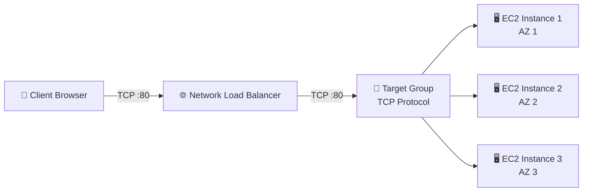

### 📋 Step 1: Verify Your EC2 Instances

> Before creating the NLB, make sure you have **EC2 instances** running across multiple Availability Zones, each serving HTTP traffic on port 80 (e.g., a simple web page via User Data script).

- Ensure you have at least **2–3 instances** running in different AZs
- Each instance should have a **Security Group** allowing HTTP traffic on port 80
- Verify each instance works by accessing its **public IP** directly in the browser

### 📋 Step 2: Create a Target Group

> Navigate to **EC2 Console → Target Groups → Create target group**

#### 🎯 Target Group Configuration

| Setting | Value |
| --- | --- |
| **Target type** | Instances |
| **Target group name** | `my-nlb-target-group` |
| **Protocol** | **TCP** |
| **Port** | 80 |
| **VPC** | Select your VPC |

> ⚠️ **Key Difference from ALB**: NLB Target Groups use **TCP** (Layer 4) protocol, not HTTP (Layer 7). This is because NLB operates at the transport layer.

#### 🩺 Health Check Configuration

| Setting | Value |
| --- | --- |
| **Health check protocol** | HTTP |
| **Health check path** | `/` |
| **Healthy threshold** | 3 |
| **Unhealthy threshold** | 3 |
| **Interval** | 30 seconds |

- Even though the target group protocol is **TCP**, the health check can use **HTTP** or **HTTPS**
- This allows NLB to verify that the application is actually responding, not just that the port is open
- Alternatively, you can use a **TCP health check** which only verifies the port is reachable

#### ➕ Register Targets

- Select your EC2 instances from the list
- Click **"Include as pending below"**
- Verify port **80** is listed for each instance
- Click **Create target group**

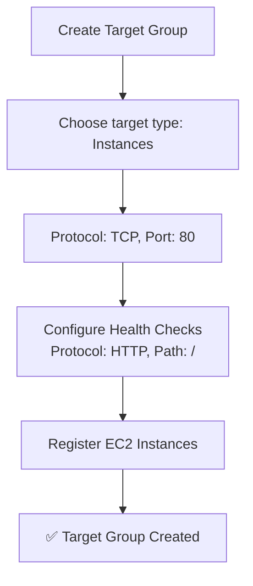

### 📋 Step 3: Create the Network Load Balancer

> Navigate to **EC2 Console → Load Balancers → Create Load Balancer → Network Load Balancer**

#### ⚙️ Basic Configuration

| Setting | Value |
| --- | --- |
| **Name** | `my-network-load-balancer` |
| **Scheme** | Internet-facing |
| **IP address type** | IPv4 |

#### 🌍 Network Mapping

- Select your **VPC**
- Select **at least 2 Availability Zones**
- For each AZ, AWS assigns a **static IP** automatically
- Optionally, you can assign an **Elastic IP** to each AZ for a truly fixed IP address

> 💡 **Important**: Each AZ gets **one static IP**. This is a major advantage of NLB — you get predictable, whitelistable IPs.

#### 🔊 Listener Configuration

| Setting | Value |
| --- | --- |
| **Protocol** | TCP |
| **Port** | 80 |
| **Default action** | Forward to → `my-nlb-target-group` |

#### 🔐 Security Group (Optional)

- NLB now supports **optional Security Groups**
- You can assign a security group to the NLB itself, or leave it without one
- If no SG is attached, the NLB passes traffic transparently and the **source IP is preserved** as the client's original IP

#### ✅ Review & Create

- Review the summary
- Click **Create load balancer**
- Wait for the NLB state to become **Active** (may take 2–5 minutes)

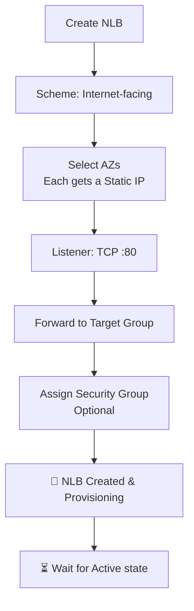

### 📋 Step 4: Test the NLB

#### 🌐 Access via DNS Name

- Copy the NLB **DNS name** from the Load Balancer details
- Paste it into your browser
- You should see the web page from one of your EC2 instances
- **Refresh** multiple times — you'll see responses from different instances (load balancing in action)

```bash
# Example: Test NLB DNS name with curl
curl <http://my-network-load-balancer-abc123.elb.us-east-1.amazonaws.com>

# You can also test with repeated requests to see load balancing
for i in {1..10}; do
  curl -s <http://my-network-load-balancer-abc123.elb.us-east-1.amazonaws.com> | grep "instance"
done
```

### 🔐 Step 5: Understanding Security Group Behavior

> ⚠️ This is a **critical concept** that differs from ALB and is frequently tested on the exam.

#### 🔄 ALB vs NLB — Security Group Flow

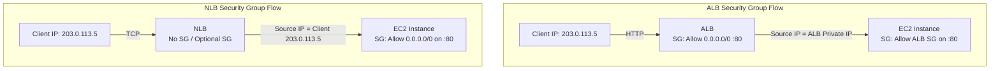

#### 🔑 Key Differences

| Behavior | ALB | NLB |
| --- | --- | --- |
| **Source IP at target** | ALB's private IP | Client's original IP |
| **EC2 SG rule needed** | Allow ALB's Security Group | Allow `0.0.0.0/0` or client IP ranges |
| **Client IP access** | Via `X-Forwarded-For` header | Directly from source IP |
| **LB Security Group** | Required | Optional |

> 🎓 **Exam Tip**: With NLB (without SG), the target EC2 instances see the **client's real IP** as the source. Therefore, the instance security group must allow traffic from the client IPs directly — you **cannot** reference the NLB's security group in the EC2 SG rules (unless the NLB has its own SG attached).

#### 🔧 Fixing "Unhealthy" Targets

If your targets show as **unhealthy** after creating the NLB, it's almost always a **security group issue**:

```bash
# The EC2 Security Group must allow:

# 1. Application traffic from anywhere (NLB preserves client IP)
#    Type: Custom TCP | Port: 80 | Source: 0.0.0.0/0

# 2. Health check traffic
#    (Same rule covers this since NLB health checks
#     also come from the NLB's private IPs in the VPC)
```

- Go to your EC2 instance's **Security Group**
- **Edit inbound rules**
- Add a rule: **TCP, Port 80, Source: 0.0.0.0/0**
- Wait for the health check to pass (may take 30–90 seconds)
- Targets should transition from **unhealthy → healthy**

### 📋 Step 6: Verify Target Health

> Navigate to **Target Groups → your target group → Targets tab**

| Status | Meaning |
| --- | --- |
| 🟢 **healthy** | Instance is passing health checks |
| 🔴 **unhealthy** | Instance is failing health checks (check SG rules) |
| 🟡 **initial** | Health check is still in progress |
| ⚪ **draining** | Instance is being deregistered |

```bash
# AWS CLI: Check target health status
aws elbv2 describe-target-health \\
  --target-group-arn arn:aws:elasticloadbalancing:us-east-1:123456789012:targetgroup/my-nlb-tg/abc123
```

```json
{
  "TargetHealthDescriptions": [
    {
      "Target": {
        "Id": "i-0abc123def456",
        "Port": 80
      },
      "TargetHealth": {
        "State": "healthy"
      }
    }
  ]
}
```

### 🧹 Step 7: Cleanup

> ⚠️ NLB is **not included in the Free Tier**, so remember to clean up to avoid charges.

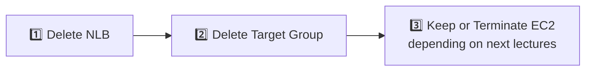

- **Delete the NLB**: EC2 Console → Load Balancers → Select → Actions → Delete
- **Delete the Target Group**: EC2 Console → Target Groups → Select → Actions → Delete
- **EC2 Instances**: Keep them if you plan to continue with the next lectures in this section

### 🧠 Key Takeaways

- NLB uses **TCP protocol** for target groups (not HTTP like ALB)
- Each AZ gets a **static IP** — you can optionally assign an **Elastic IP**
- Health checks support **TCP**, **HTTP**, and **HTTPS** even though the target group protocol is TCP
- NLB **preserves the client's source IP** — EC2 security groups must allow traffic from `0.0.0.0/0`
- You **cannot** reference the NLB security group in EC2 inbound rules (unless NLB has its own SG)
- Unhealthy targets are almost always caused by **security group misconfiguration**
- NLB is **not in the Free Tier** — always clean up after hands-on practice
- NLB takes a few minutes to provision — wait for **Active** state before testing

---

## Lecture 66: 🛡️ Gateway Load Balancer (GWLB)

> 📘 **Course**: Ultimate AWS Certified Developer Associate DVA-C02 2026<br>👨‍🏫 **Instructor**: Stephane Maarek<br>📂 **Section 7**: AWS Fundamentals: ELB + ASG

### 🔎 Overview

> The **Gateway Load Balancer (GWLB)** is the newest type of Elastic Load Balancer in AWS. It operates at **Layer 3** (Network Layer) of the OSI model and is used to deploy, scale, and manage a fleet of **3rd-party network virtual appliances** in AWS. Think firewalls, intrusion detection/prevention systems (IDS/IPS), deep packet inspection, payload manipulation, and more.

> 💡 GWLB allows you to **transparently inspect all network traffic** before it reaches your application — without changing the traffic flow from the user's perspective.

### 🤔 Why Do We Need GWLB?

Imagine you want all traffic entering your VPC to be inspected by a **firewall** or **intrusion detection system** before reaching your application EC2 instances.

- **Without GWLB**: You would need to manually configure complex routing with virtual appliances, handle scaling yourself, and manage failover — very error-prone and hard to maintain
- **With GWLB**: AWS handles the routing, scaling, and high availability of your virtual appliance fleet transparently

#### 🎯 Use Cases

- **Firewalls** — inspect and filter malicious traffic
- **Intrusion Detection & Prevention Systems (IDS/IPS)** — detect and block attacks
- **Deep Packet Inspection** — analyze packet payloads for compliance or threats
- **Payload Manipulation** — modify packets at the network level
- **Network monitoring & analytics** — tap into traffic for visibility

### 🏗️ GWLB Architecture — How It Works

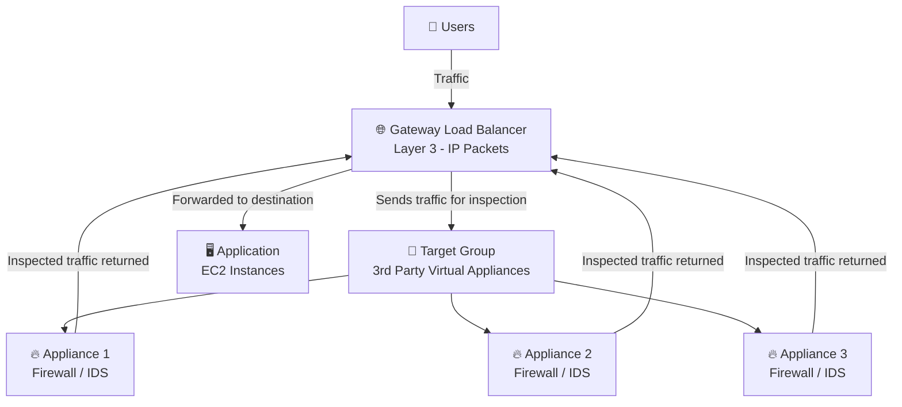

> The GWLB sits in the **traffic path**. All IP packets flow through it, get sent to the appliances for inspection, and are returned back to the GWLB which then forwards them to the final destination.

### 🔄 Detailed Traffic Flow

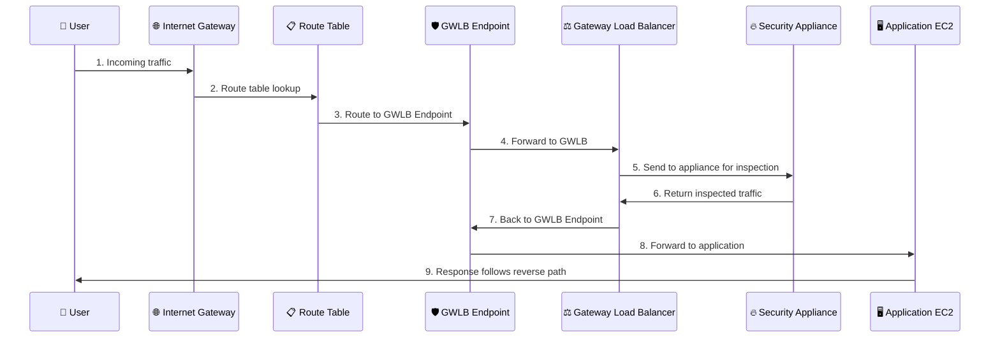

### ⚙️ Key Characteristics of GWLB

| Feature | Details |
| --- | --- |
| **OSI Layer** | Layer 3 — Network Layer (IP packets) |
| **Protocol** | Uses **GENEVE** protocol on port **6081** |
| **Function** | Transparent Network Gateway + Load Balancer |
| **Target Types** | EC2 instances, IP addresses (private IPs) |
| **Scaling** | Automatically scales the appliance fleet |
| **High Availability** | Distributes traffic across healthy appliances in multiple AZs |

### 🔀 Two Core Functions Combined

GWLB combines **two functions** into a single service:

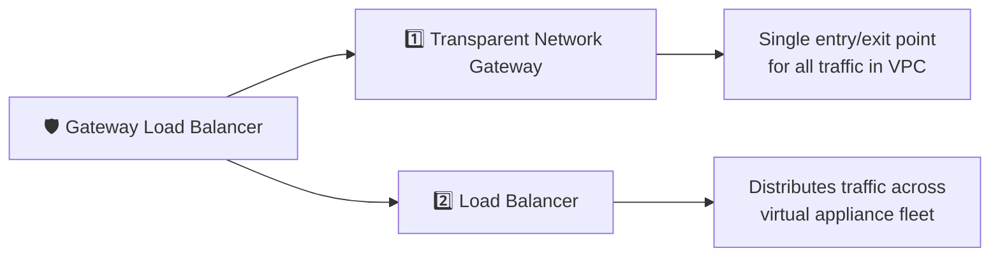

#### 1️⃣ Transparent Network Gateway

- Provides a **single entry and exit point** for all network traffic
- All traffic in the VPC passes through the GWLB before reaching the destination
- Configured via **VPC Route Tables** — traffic is transparently redirected

#### 2️⃣ Load Balancer

- Distributes traffic across the fleet of registered **virtual appliances**
- Performs **health checks** to ensure only healthy appliances receive traffic
- Handles **scaling** of the appliance fleet automatically

### 🔌 GENEVE Protocol — Port 6081

> ⚡ **Exam Tip**: If you see **GENEVE** or **port 6081** in a question, the answer is **Gateway Load Balancer**.

- GWLB uses the **GENEVE** (Generic Network Virtualization Encapsulation) protocol
- Operates on **port 6081**
- GENEVE encapsulates the original IP packet, sends it to the appliance, and the appliance sends it back after inspection
- This **preserves the original packet** headers and metadata throughout the inspection process

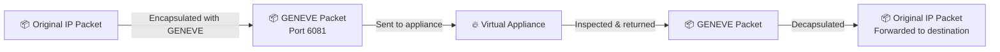

### 🎯 GWLB Target Groups

GWLB can route traffic to these target types:

#### 📦 EC2 Instances

- The virtual appliances (firewalls, IDS/IPS) run as EC2 instances
- Registered by **Instance ID**

#### 🔗 IP Addresses

- Must be **private IP addresses**
- Useful for appliances running on-premises or in other VPCs

```json
{
  "TargetType": "instance",
  "Protocol": "GENEVE",
  "Port": 6081,
  "Targets": [
    { "Id": "i-0abc123firewall01" },
    { "Id": "i-0abc123firewall02" },
    { "Id": "i-0abc123firewall03" }
  ]
}
```

> ⚠️ **Note**: Unlike ALB and NLB, GWLB does **not** support Lambda functions or ALB as targets. Only EC2 instances and IP addresses are valid targets.

### 🌐 GWLB Endpoints (GWLBe)

- GWLB uses **Gateway Load Balancer Endpoints (GWLBe)** powered by **AWS PrivateLink**
- GWLBe acts as the entry/exit point in the VPC where traffic is intercepted
- You configure **VPC Route Tables** to direct traffic to the GWLBe
- The GWLBe forwards traffic to the GWLB, which distributes it to the appliances

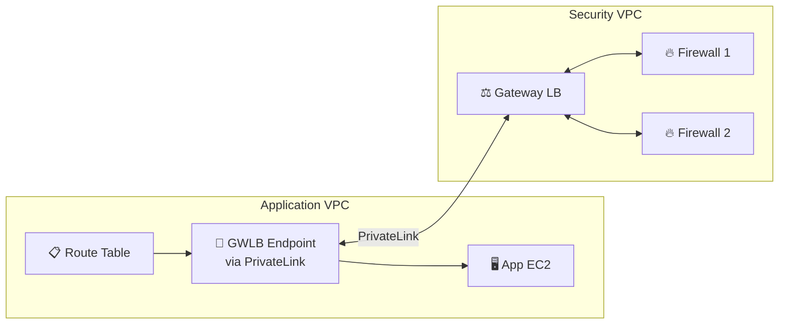

### 📊 ALB vs NLB vs GWLB — Full Comparison

| Feature | ALB | NLB | GWLB |
| --- | --- | --- | --- |
| **OSI Layer** | Layer 7 (HTTP) | Layer 4 (TCP/UDP) | Layer 3 (IP) |
| **Protocol** | HTTP, HTTPS, gRPC | TCP, UDP, TLS | **GENEVE (port 6081)** |
| **Primary Use** | Web apps, microservices | Ultra-low latency, static IP | Network security appliances |
| **Target Types** | Instance, IP, Lambda | Instance, IP, ALB | Instance, IP |
| **Static IP** | ❌ | ✅ | ❌ |
| **Elastic IP** | ❌ | ✅ | ❌ |
| **Latency** | ~400ms | ~100μs | N/A (pass-through) |
| **Free Tier** | ✅ | ❌ | ❌ |
| **Health Checks** | HTTP, HTTPS | TCP, HTTP, HTTPS | TCP, HTTP, HTTPS |
| **Security Group** | ✅ Required | Optional | N/A |
| **Cross-Zone LB** | Enabled by default | Disabled by default | Disabled by default |

### 🧪 Real-World Architecture Example

> A company wants to inspect all inbound traffic with a **3rd-party firewall** (e.g., Palo Alto, Fortinet, Check Point) before it reaches their application servers.

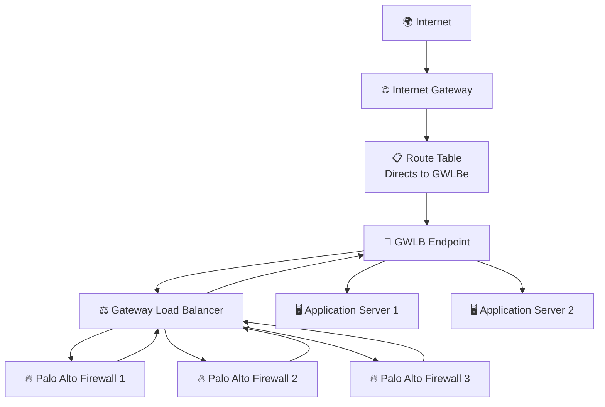

> This architecture ensures **every single packet** is inspected by the firewall fleet before reaching the application. GWLB handles the scaling and health of the firewall instances automatically.

### 🧠 Exam Tips & Key Takeaways

- GWLB = **Layer 3** (Network Layer — IP packets)
- Used to deploy & manage fleets of **3rd-party virtual appliances** (firewalls, IDS/IPS)
- Uses the **GENEVE** protocol on **port 6081** — this is a dead giveaway on the exam
- Combines **Transparent Gateway** + **Load Balancer** in one service
- Target groups: **EC2 instances** and **private IP addresses** only (no Lambda, no ALB)
- Uses **GWLB Endpoints** (powered by **PrivateLink**) to intercept VPC traffic
- Traffic is routed via **VPC Route Tables** → GWLBe → GWLB → Appliances → back
- **Not in AWS Free Tier**
- If the exam mentions "inspect traffic", "3rd party appliances", "firewalls", "IDS/IPS", "GENEVE", or "port 6081" — think **GWLB**

> 🎓 **Quick Exam Decision Tree**:
>
> - Need HTTP routing / path-based / host-based? → **ALB**
> - Need static IP / ultra-low latency / TCP/UDP? → **NLB**
> - Need to inspect traffic with 3rd party appliances? → **GWLB**

---

## Lecture 67: 📌 Elastic Load Balancer - Sticky Sessions

> 📘 **Course**: Ultimate AWS Certified Developer Associate DVA-C02 2026<br>👨‍🏫 **Instructor**: Stephane Maarek<br>📂 **Section 7**: AWS Fundamentals: ELB + ASG

### 🔎 Overview

> **Sticky Sessions** (also called **Session Affinity**) is a feature that allows a load balancer to bind a user's session to a **specific target instance**. This ensures that all requests from the same client are always routed to the same backend instance for the duration of the session.

### 🤔 Why Do We Need Sticky Sessions?

By default, a load balancer distributes each incoming request to a different backend instance in a round-robin fashion. This is great for stateless applications, but problematic for **stateful** ones.

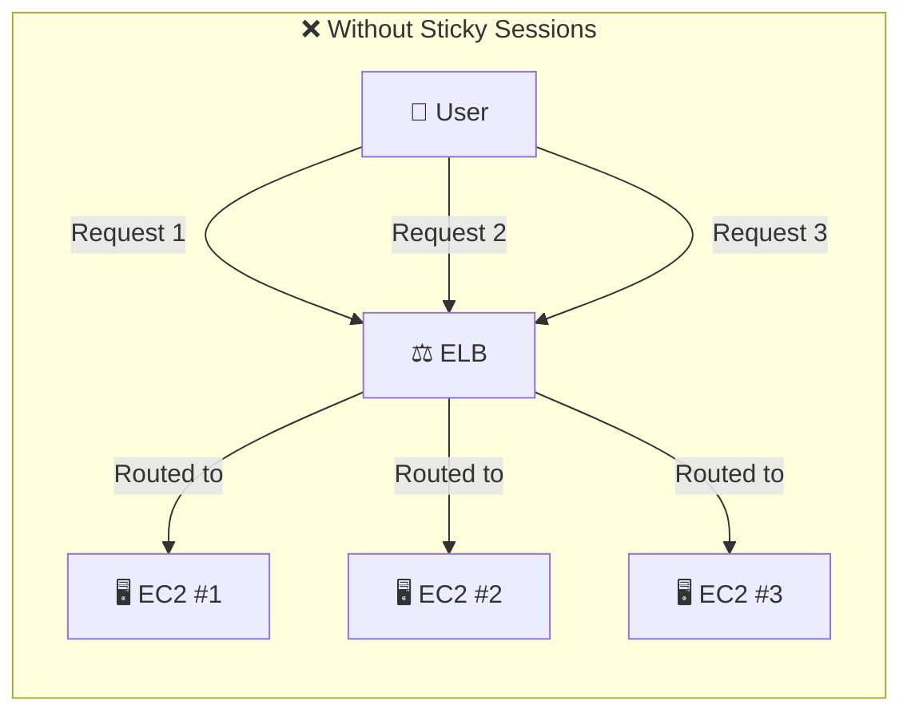

- Request 1 → EC2 #1 (user logs in, session created)
- Request 2 → EC2 #2 (session lost! user asked to log in again ❌)
- Request 3 → EC2 #3 (session lost again! ❌)

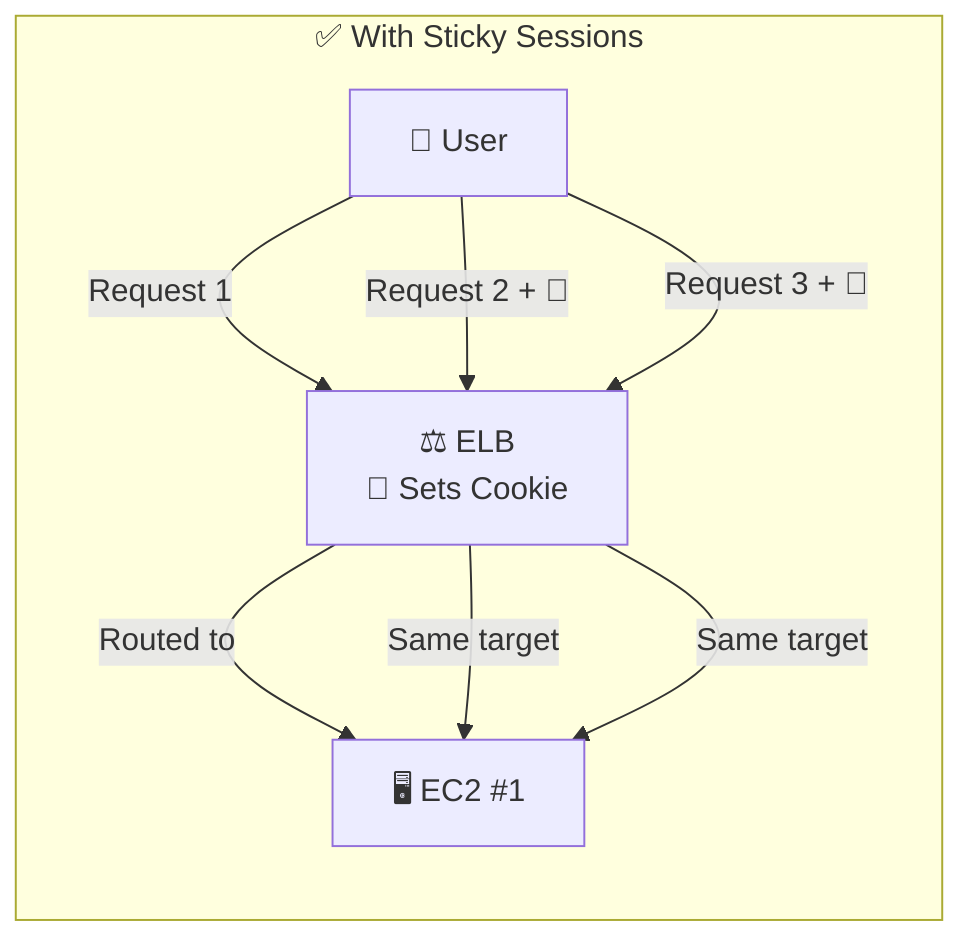

- All requests from the same user → always routed to **EC2 #1** ✅
- User session is preserved across requests

### ⚙️ How Sticky Sessions Work

- Sticky sessions use **cookies** to track which target instance a client is bound to
- The cookie is set in the **HTTP response** from the load balancer or the application
- On subsequent requests, the client sends the cookie back, and the ELB reads it to route to the **same target**
- The cookie has an **expiration date** — when it expires, the client may be routed to a different instance

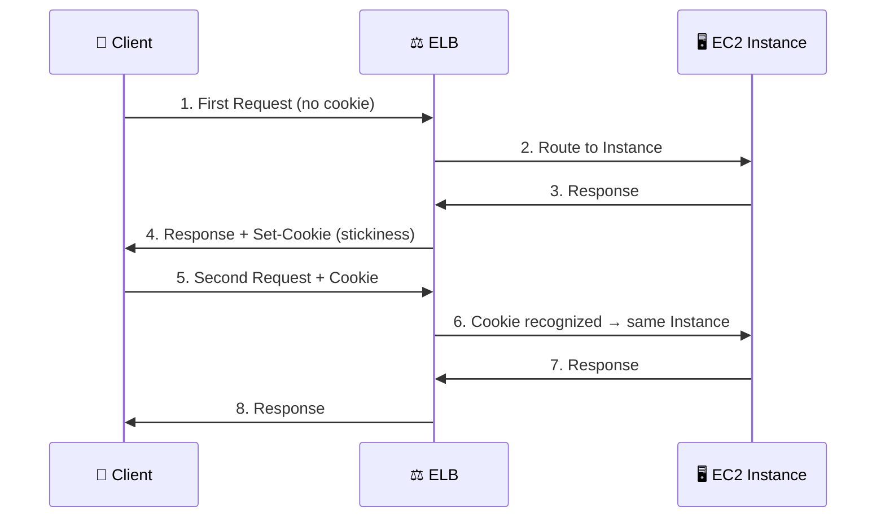

### 🔌 Supported Load Balancers

| Load Balancer | Sticky Sessions Support |
| --- | --- |
| **ALB** | ✅ Yes |
| **NLB** | ✅ Yes (works without cookies, uses connection-level stickiness) |
| **CLB** | ✅ Yes (legacy) |
| **GWLB** | ✅ Yes (uses 3-tuple or 5-tuple stickiness) |

> 💡 For ALB and CLB, sticky sessions are **cookie-based**. For NLB, stickiness is based on the **source IP** of the client (no cookies needed since NLB operates at Layer 4).

### 🍪 Cookie Types — Two Categories

#### 1️⃣ Application-Based Cookies

These are cookies generated by your **application** or configured through the **load balancer** at the application level.

#### 🔹 Custom Cookie (Application-Generated)

| Attribute | Details |
| --- | --- |
| **Generated by** | Your target application |
| **Cookie name** | Any custom name your app chooses |
| **Restrictions** | Must NOT use `AWSALB`, `AWSALBAPP`, or `AWSALBTG` (reserved by AWS) |
| **Content** | Can include any custom attributes the application requires |
| **Expiration** | Controlled by the application |

```bash
# Example: Your application sets a custom cookie
Set-Cookie: MY_APP_SESSION=abc123xyz; Path=/; Max-Age=3600
```

#### 🔹 Application Cookie (ELB-Generated)

| Attribute | Details |
| --- | --- |
| **Generated by** | The Load Balancer itself |
| **Cookie name** | `AWSALBAPP` |
| **Purpose** | ELB uses this to enforce stickiness at the application level |
| **Expiration** | Configured in the Target Group settings |

#### 2️⃣ Duration-Based Cookies (ELB-Generated)

| Attribute | Details |
| --- | --- |
| **Generated by** | The Load Balancer |
| **Cookie name** | `AWSALB` (for ALB) or `AWSELB` (for CLB) |
| **Expiration** | Specific duration configured by you (e.g., 1 second to 7 days) |
| **Purpose** | Pure duration-based — routes to same target until cookie expires |

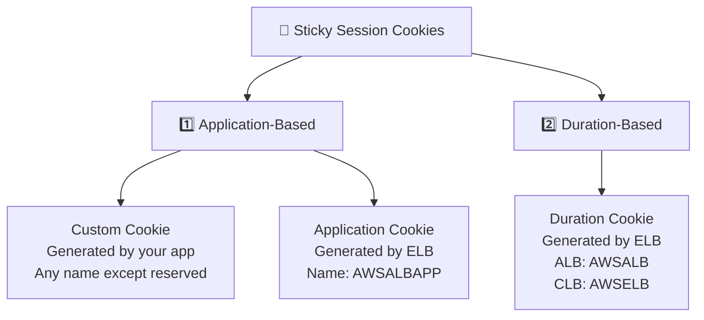

### 📋 Reserved Cookie Names

> ⚠️ **Important**: The following cookie names are **reserved by AWS** and must NOT be used by your application for custom cookies:

| Reserved Name | Used By |
| --- | --- |
| `AWSALB` | ALB — duration-based stickiness cookie |
| `AWSALBAPP` | ALB — application-based stickiness cookie |
| `AWSALBTG` | ALB — target group stickiness cookie |
| `AWSELB` | CLB — duration-based stickiness cookie |

### 🛠️ Enabling Sticky Sessions — Console Steps

#### For ALB (Target Group Level)

1. Navigate to **EC2 Console → Target Groups**
1. Select your target group
1. Go to **Attributes → Edit**
1. Enable **Stickiness**
1. Choose the **stickiness type**:

    - **Load balancer generated cookie** (duration-based)
    - **Application-based cookie**
1. Set the **stickiness duration** (1 second to 7 days)
1. If application-based, specify the **app cookie name**
1. Save changes

#### Via AWS CLI

```bash
# Enable duration-based stickiness (1 day = 86400 seconds)
aws elbv2 modify-target-group-attributes \\
  --target-group-arn arn:aws:elasticloadbalancing:us-east-1:123456789:targetgroup/my-tg/abc123 \\
  --attributes Key=stickiness.enabled,Value=true \\
               Key=stickiness.type,Value=lb_cookie \\
               Key=stickiness.lb_cookie.duration_seconds,Value=86400

# Enable application-based stickiness
aws elbv2 modify-target-group-attributes \\
  --target-group-arn arn:aws:elasticloadbalancing:us-east-1:123456789:targetgroup/my-tg/abc123 \\
  --attributes Key=stickiness.enabled,Value=true \\
               Key=stickiness.type,Value=app_cookie \\
               Key=stickiness.app_cookie.cookie_name,Value=MY_CUSTOM_COOKIE \\
               Key=stickiness.app_cookie.duration_seconds,Value=86400
```

### ⚠️ Trade-offs & Considerations

#### ✅ Pros

- **Session persistence** — user always reaches the same backend instance
- **Simpler stateful apps** — no need for external session store
- **Easy to enable** — just a configuration toggle

#### ❌ Cons

- **Imbalanced load** — some instances may get more traffic than others
- **Reduced fault tolerance** — if the sticky instance fails, the user loses their session
- **Scaling challenges** — new instances don't get traffic from sticky users until cookies expire

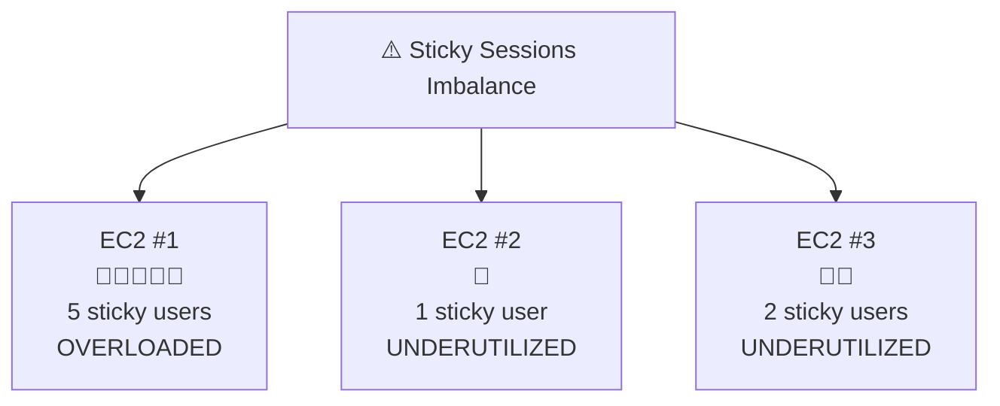

> 🎓 **Best Practice**: If possible, design your application to be **stateless** by storing session data in an **external store** like **ElastiCache (Redis/Memcached)** or **DynamoDB**. This eliminates the need for sticky sessions and allows true load balancing.

### 💡 Better Alternative — External Session Store

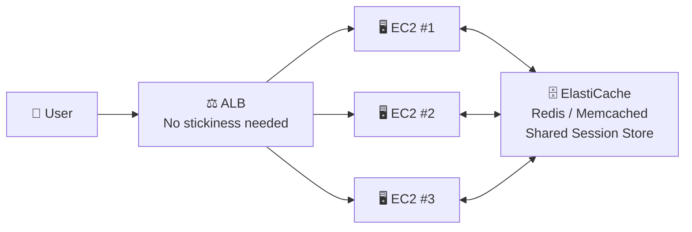

- All instances read/write sessions to a **shared store**
- Any instance can serve any user — true load balancing
- If an instance fails, another picks up seamlessly
- This is the **recommended architecture** for production workloads

### 🧠 Exam Tips & Key Takeaways

- Sticky sessions = **session affinity** — same client always routed to same target
- Uses **cookies** to maintain stickiness (ALB/CLB)
- **Two cookie types**: Application-based (custom or `AWSALBAPP`) and Duration-based (`AWSALB` / `AWSELB`)
- Reserved cookie names: `AWSALB`, `AWSALBAPP`, `AWSALBTG`, `AWSELB` — do **not** use these for custom cookies
- **ALB** and **NLB** both support sticky sessions
- NLB uses **source IP-based** stickiness (no cookies — Layer 4)
- Stickiness can cause **imbalanced load distribution** across targets
- **Better alternative**: Store sessions externally in **ElastiCache** or **DynamoDB** and keep your app stateless
- If the exam asks how to maintain user session while load balancing → **Sticky Sessions** or **ElastiCache/DynamoDB session store**
- Stickiness is configured at the **Target Group** level (not the load balancer level)

---

## Lecture 68: ⚖️ Elastic Load Balancer - Cross Zone Load Balancing

> 📘 **Course**: Ultimate AWS Certified Developer Associate DVA-C02 2026<br>👨‍🏫 **Instructor**: Stephane Maarek<br>📂 **Section 7**: AWS Fundamentals: ELB + ASG

### 🔎 Overview

> **Cross-Zone Load Balancing** controls whether traffic is distributed **evenly across all registered instances in all Availability Zones**, or only within the same AZ as the load balancer node. This is a critical concept for ensuring balanced traffic distribution and is frequently tested on the exam.

### 🤔 The Problem — Uneven Distribution Without Cross-Zone

Imagine you have 2 AZs, but the instances are **unevenly distributed**:

- **AZ 1**: 2 EC2 instances
- **AZ 2**: 8 EC2 instances

Without cross-zone load balancing, each AZ node receives 50% of total traffic, regardless of how many instances are behind it.

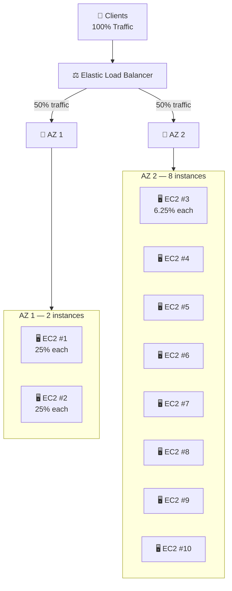

> ❌ **Problem**: Each instance in AZ 1 gets **25%** of total traffic, while each instance in AZ 2 gets only **6.25%**. The AZ 1 instances are heavily overloaded!

### ✅ With Cross-Zone Load Balancing

When cross-zone load balancing is **enabled**, the ELB distributes traffic **evenly across all registered instances in all AZs**, regardless of which AZ they are in.

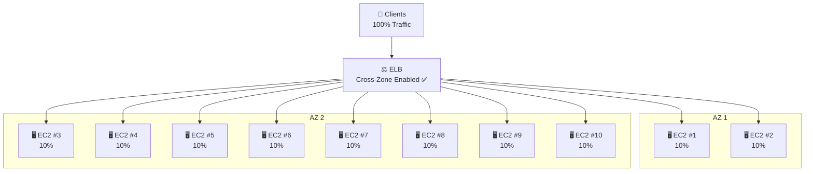

> ✅ **Result**: Every instance receives exactly **10%** of total traffic — perfectly balanced across all AZs!

### 🔄 Side-by-Side Comparison

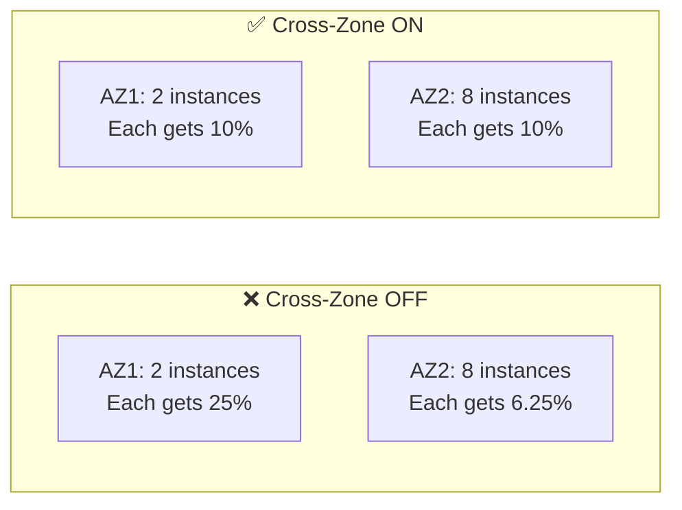

| Metric | Cross-Zone OFF | Cross-Zone ON |
| --- | --- | --- |
| **AZ 1 instance load** (2 instances) | 25% each | 10% each |
| **AZ 2 instance load** (8 instances) | 6.25% each | 10% each |
| **Distribution** | Per-AZ (uneven) | Per-instance (even) |
| **Traffic crosses AZ?** | ❌ No | ✅ Yes |

### 📊 Default Settings Per Load Balancer Type

> ⚡ This is one of the **most frequently tested** topics on the exam. You MUST memorize these defaults.

| Load Balancer | Cross-Zone Default | Charges for Inter-AZ Data |
| --- | --- | --- |
| **ALB** | ✅ **Enabled by default** | ❌ No charges (free) |
| **NLB** | ❌ **Disabled by default** | 💰 **Yes, charged** when enabled |
| **GWLB** | ❌ **Disabled by default** | 💰 **Yes, charged** when enabled |
| **CLB** | ❌ **Disabled by default** | ❌ No charges (free) if enabled |

```mermaid
graph TD
    A["🔄 Cross-Zone Load Balancing<br/>Defaults & Charges"] --> B["⚖️ ALB"]
    A --> C["🌐 NLB"]
    A --> D["🛡️ GWLB"]
    A --> E["📦 CLB"]

    B --> B1["✅ Enabled by default<br/>🆓 No inter-AZ charges<br/>Can be disabled at TG level"]
    C --> C1["❌ Disabled by default<br/>💰 Charges apply when enabled<br/>Enabled at TG level"]
    D --> D1["❌ Disabled by default<br/>💰 Charges apply when enabled"]
    E --> E1["❌ Disabled by default<br/>🆓 No inter-AZ charges"]
```

### 🔍 Deep Dive Per Load Balancer

#### ⚖️ Application Load Balancer (ALB)

- Cross-zone load balancing is **enabled by default**
- Can be **disabled at the Target Group level** (granular control)
- **No additional charges** for inter-AZ data transfer
- This is the reason ALB provides the best default load distribution

```bash
# AWS CLI: Disable cross-zone at Target Group level for ALB
aws elbv2 modify-target-group-attributes \\
  --target-group-arn arn:aws:elasticloadbalancing:us-east-1:123456789:targetgroup/my-tg/abc123 \\
  --attributes Key=load_balancing.cross_zone.enabled,Value=false
```

> 💡 **Note**: For ALB, cross-zone is controlled at the **Target Group** level, not the LB level. Different target groups on the same ALB can have different cross-zone settings.

#### 🌐 Network Load Balancer (NLB)

- Cross-zone load balancing is **disabled by default**
- Must be **explicitly enabled**
- **You pay** for inter-AZ data transfer when enabled
- Configured at the **Target Group level** (since Nov 2022) or at the LB level

```bash
# AWS CLI: Enable cross-zone for NLB target group
aws elbv2 modify-target-group-attributes \\
  --target-group-arn arn:aws:elasticloadbalancing:us-east-1:123456789:targetgroup/my-nlb-tg/xyz789 \\
  --attributes Key=load_balancing.cross_zone.enabled,Value=true

# Or at the LB level
aws elbv2 modify-load-balancer-attributes \\
  --load-balancer-arn arn:aws:elasticloadbalancing:us-east-1:123456789:loadbalancer/net/my-nlb/abc123 \\
  --attributes Key=load_balancing.cross_zone.enabled,Value=true
```

> ⚠️ **Cost Warning**: Enabling cross-zone on NLB incurs **inter-AZ data transfer charges** ($0.01/GB in most regions). Consider this for high-traffic applications.

#### 🛡️ Gateway Load Balancer (GWLB)

- Cross-zone load balancing is **disabled by default**
- Must be **explicitly enabled**
- **You pay** for inter-AZ data transfer when enabled

#### 📦 Classic Load Balancer (CLB)

- Cross-zone load balancing is **disabled by default**
- **No additional charges** for inter-AZ data if enabled
- Enabled at the **LB level** via console or CLI

```bash
# AWS CLI: Enable cross-zone for CLB
aws elb modify-load-balancer-attributes \\
  --load-balancer-name my-classic-lb \\
  --load-balancer-attributes "{\\"CrossZoneLoadBalancing\\":{\\"Enabled\\":true}}"
```

### 🛠️ How to Enable/Disable in the Console

#### For ALB

1. Navigate to **EC2 → Target Groups**
1. Select your target group → **Attributes** → **Edit**
1. Find **Cross-zone load balancing**
1. Toggle **On** or **Off**

#### For NLB

1. Navigate to **EC2 → Load Balancers**
1. Select your NLB → **Attributes** → **Edit**
1. Find **Cross-zone load balancing**
1. Toggle **On** (remember: this incurs data transfer charges)

### 💰 Inter-AZ Data Transfer Charges

```mermaid
flowchart LR
    subgraph AZ1["AZ 1"]
        LB_NODE["⚖️ LB Node"]
    end

    subgraph AZ2["AZ 2"]
        EC2_AZ2["🖥️ EC2 Instance"]
    end

    LB_NODE -->|"Cross-AZ traffic<br/>💰 $0.01/GB for NLB & GWLB<br/>🆓 Free for ALB & CLB"| EC2_AZ2
```

- When cross-zone is enabled, the LB node in AZ 1 sends traffic to instances in AZ 2
- This **crosses AZ boundaries**, which normally incurs data transfer charges
- **ALB & CLB**: AWS absorbs the cost — **free**
- **NLB & GWLB**: You pay standard **inter-AZ data transfer fees**

### 🧠 Exam Tips & Key Takeaways

- Cross-zone load balancing distributes traffic **evenly across all instances in all AZs**
- Without it, traffic is distributed evenly **per AZ**, not per instance — leading to imbalanced load
- **ALB**: Enabled by default, no extra charges, can be disabled per target group
- **NLB**: Disabled by default, **charges apply** for inter-AZ data when enabled
- **GWLB**: Disabled by default, **charges apply** for inter-AZ data when enabled
- **CLB**: Disabled by default, no extra charges when enabled
- If the exam shows an **uneven number of instances across AZs** and asks about unbalanced load → the answer is likely **cross-zone load balancing**
- If asked about **cost implications** of enabling cross-zone on NLB → mention **inter-AZ data transfer charges**
- ALB controls cross-zone at the **Target Group level**; NLB can control at **both LB and TG level**

> 🎓 **Memory Trick**:
>
> - **A**LB = **A**lways on (enabled by default), **A**lways free
> - **N**LB = **N**ot on by default, **N**ot free
> - **G**WLB = same as NLB (disabled, charged)
> - **C**LB = disabled by default, but free if enabled

---

## Lecture 69: 🔐 Elastic Load Balancer - SSL Certificates

> 📘 **Course**: Ultimate AWS Certified Developer Associate DVA-C02 2026<br>👨‍🏫 **Instructor**: Stephane Maarek<br>📂 **Section 7**: AWS Fundamentals: ELB + ASG

### 🔎 Overview

> **SSL/TLS certificates** allow traffic between your clients and your load balancer to be **encrypted in transit**. This is known as **in-flight encryption**. SSL certificates are essential for securing web applications and are a heavily tested topic on the exam.

### 📚 SSL & TLS — What's the Difference?

- **SSL** = Secure Sockets Layer — the original encryption protocol (now deprecated)
- **TLS** = Transport Layer Security — the newer, more secure successor to SSL
- In practice, people still say "SSL" even when they mean TLS
- **TLS certificates are the ones mainly used today**, but they are still commonly referred to as "SSL certificates"

> 💡 When AWS or the exam says "SSL certificate", they almost always mean a **TLS certificate**. The terms are used interchangeably.

### 🔒 How SSL/TLS Works with Load Balancers

```mermaid
sequenceDiagram
    participant User as 👤 Client Browser
    participant LB as ⚖️ Load Balancer
    participant EC2 as 🖥️ EC2 Instance

    User->>LB: 1. HTTPS Request (encrypted)
    Note over User,LB: 🔐 In-flight encryption<br/>over public internet
    LB->>LB: 2. SSL Termination<br/>(decrypts traffic)
    LB->>EC2: 3. HTTP Request (can be unencrypted)<br/>over private VPC network
    EC2->>LB: 4. HTTP Response
    LB->>User: 5. HTTPS Response (encrypted)
```

- The client connects to the load balancer using **HTTPS** (encrypted)
- The load balancer performs **SSL termination** — it decrypts the traffic
- The load balancer forwards the request to the backend EC2 instance over **HTTP** (private network)
- The backend traffic can optionally also be encrypted (HTTPS to backend), but is often unencrypted since it's within the VPC

### 📜 SSL Certificates — The Basics

- SSL certificates are issued by **Certificate Authorities (CAs)** — e.g., Comodo, Symantec, GoDaddy, Let's Encrypt, DigiCert
- Certificates have an **expiration date** and must be **renewed** periodically
- The certificate is loaded onto the load balancer to enable HTTPS listeners

#### 🏷️ What an SSL Certificate Contains

| Field | Description |
| --- | --- |
| **Domain name** | The domain the certificate secures (e.g., `example.com`) |
| **Public key** | Used by clients to encrypt data |
| **Issuer** | The Certificate Authority that issued it |
| **Validity period** | Start and expiration dates |
| **Signature** | CA's digital signature to prove authenticity |

### 🏗️ SSL on Load Balancers — Architecture

```mermaid
flowchart LR
    A["👤 Users"] -->|"HTTPS<br/>🔐 Encrypted"| B["⚖️ Load Balancer<br/>SSL Certificate loaded"]
    B -->|"HTTP or HTTPS<br/>🔓 Private VPC"| C["🖥️ EC2 Instances"]
```

- The load balancer uses an **X.509 certificate** (SSL/TLS server certificate)
- You can manage certificates using **AWS Certificate Manager (ACM)**
- Alternatively, you can upload your own certificates to the load balancer
- You **must** set an HTTPS listener on the load balancer
- You must specify a **default certificate**
- You can optionally add multiple certificates to support **multiple domains**

### 🎛️ AWS Certificate Manager (ACM)

> ACM is the **recommended way** to manage SSL certificates on AWS.

- **Free** public SSL/TLS certificates
- **Automatic renewal** — no manual intervention needed
- Integrates seamlessly with **ELB**, **CloudFront**, and **API Gateway**
- You can also import third-party certificates into ACM

```bash
# AWS CLI: Request a public certificate via ACM
aws acm request-certificate \\
  --domain-name example.com \\
  --subject-alternative-names "*.example.com" \\
  --validation-method DNS

# AWS CLI: List certificates
aws acm list-certificates
```

### 🔊 HTTPS Listener Configuration

When configuring an HTTPS listener on your load balancer, you must specify:

1. **A default SSL certificate** — used when no SNI match is found
1. **An optional list of additional certificates** — for hosting multiple domains
1. **A security policy** — defines which SSL/TLS protocols and ciphers to support
1. **Clients can use SNI** to specify which hostname they are connecting to

```mermaid
flowchart TD
    A["⚖️ Load Balancer<br/>HTTPS Listener :443"] --> B["🔐 Default Certificate<br/>example.com"]
    A --> C["🔐 Certificate 2<br/>api.example.com"]
    A --> D["🔐 Certificate 3<br/>shop.example.com"]
    A --> E["📋 Security Policy<br/>TLS 1.2, TLS 1.3<br/>Cipher suites"]
```

### 🌐 SNI — Server Name Indication

> **SNI** solves the problem of loading **multiple SSL certificates** onto a single load balancer to serve **multiple websites/domains**.

#### 🤔 The Problem Without SNI

- Traditionally, a server could only have **one SSL certificate**
- If you wanted to serve `example.com` and `api.example.com`, you needed **two servers** (or two load balancers)

#### ✅ The Solution With SNI

- SNI is a **newer protocol** that allows the client to indicate the **hostname** of the target server in the initial SSL handshake
- The load balancer then uses the correct certificate for that hostname
- Allows **multiple certificates** on a **single load balancer**

```mermaid
sequenceDiagram
    participant C1 as 👤 Client 1
    participant C2 as 👤 Client 2
    participant ALB as ⚖️ ALB
    participant TG1 as 🎯 TG: example.com
    participant TG2 as 🎯 TG: api.example.com

    C1->>ALB: TLS Handshake<br/>SNI: example.com
    ALB->>ALB: Uses cert for example.com ✅
    ALB->>TG1: Forward to example.com targets

    C2->>ALB: TLS Handshake<br/>SNI: api.example.com
    ALB->>ALB: Uses cert for api.example.com ✅
    ALB->>TG2: Forward to api.example.com targets
```

#### 📊 SNI Support Per Load Balancer

| Load Balancer | SNI Support |
| --- | --- |
| **ALB** | ✅ Yes — supports multiple certificates via SNI |
| **NLB** | ✅ Yes — supports multiple certificates via SNI |
| **CLB** | ❌ No — only ONE certificate per CLB |

> ⚡ **Exam Tip**: If the question asks about hosting **multiple SSL certificates** on a **single load balancer**, the answer involves **SNI** and requires **ALB** or **NLB**. CLB does NOT support SNI — you would need **multiple CLBs** (one per domain).

```mermaid
flowchart TD
    A["🤔 Multiple domains on one LB?"] --> B{"Which LB?"}
    B -->|ALB| C["✅ Use SNI<br/>Multiple certs on 1 ALB"]
    B -->|NLB| D["✅ Use SNI<br/>Multiple certs on 1 NLB"]
    B -->|CLB| E["❌ No SNI support<br/>Need 1 CLB per domain"]
```

### 🔀 SSL Certificates — Per Load Balancer Type

#### ⚖️ Application Load Balancer (ALB)

- Supports **HTTPS** listeners (port 443)
- Supports **multiple certificates** using SNI
- Can set **routing rules** based on hostname to route to different target groups
- SSL termination happens at the ALB
- Backend can use HTTP or HTTPS

#### 🌐 Network Load Balancer (NLB)

- Supports **TLS** listeners
- Supports **multiple certificates** using SNI
- Performs **SSL termination** at the NLB
- Can also do **TCP passthrough** (no termination — client connects directly to backend)

#### 📦 Classic Load Balancer (CLB)

- Supports **only ONE SSL certificate** per CLB
- **No SNI support**
- Must use **multiple CLBs** for multiple domains with different certificates
- This is a major limitation and one reason CLBs are considered legacy

### 🔐 SSL Security Policies

A **Security Policy** defines which SSL/TLS protocols and ciphers the load balancer will negotiate with clients.

| Policy Aspect | Details |
| --- | --- |
| **TLS Versions** | TLS 1.0, 1.1, 1.2, 1.3 |
| **Ciphers** | Encryption algorithms used for data transfer |
| **Recommendation** | Use the latest security policy for maximum security |

- AWS provides **predefined security policies** (e.g., `ELBSecurityPolicy-TLS13-1-2-2021-06`)
- You can choose which policy to apply to your HTTPS/TLS listener
- Newer policies disable older, less secure protocols (e.g., TLS 1.0)

```bash
# AWS CLI: View available SSL policies
aws elbv2 describe-ssl-policies

# AWS CLI: Create HTTPS listener with a specific SSL policy
aws elbv2 create-listener \\
  --load-balancer-arn arn:aws:elasticloadbalancing:us-east-1:123456789:loadbalancer/app/my-alb/abc123 \\
  --protocol HTTPS \\
  --port 443 \\
  --certificates CertificateArn=arn:aws:acm:us-east-1:123456789:certificate/abc-123-def \\
  --ssl-policy ELBSecurityPolicy-TLS13-1-2-2021-06 \\
  --default-actions Type=forward,TargetGroupArn=arn:aws:elasticloadbalancing:us-east-1:123456789:targetgroup/my-tg/xyz789
```

### 🏗️ Complete Architecture — Multiple Domains with SNI

```mermaid
flowchart TD
    U1["👤 www.example.com"] -->|HTTPS| ALB["⚖️ ALB<br/>HTTPS :443"]
    U2["👤 api.example.com"] -->|HTTPS| ALB
    U3["👤 shop.example.com"] -->|HTTPS| ALB

    ALB -->|"SNI: www.example.com<br/>🔐 Cert 1"| TG1["🎯 TG 1<br/>Web App Servers"]
    ALB -->|"SNI: api.example.com<br/>🔐 Cert 2"| TG2["🎯 TG 2<br/>API Servers"]
    ALB -->|"SNI: shop.example.com<br/>🔐 Cert 3"| TG3["🎯 TG 3<br/>E-Commerce Servers"]

    TG1 --> EC2_1["🖥️ EC2"]
    TG1 --> EC2_2["🖥️ EC2"]
    TG2 --> EC2_3["🖥️ EC2"]
    TG3 --> EC2_4["🖥️ EC2"]
    TG3 --> EC2_5["🖥️ EC2"]
```

- Single ALB with **3 SSL certificates** (one per domain)
- SNI determines which certificate to present to each client
- Host-based routing rules forward to the correct target group
- All managed through **ACM** with **automatic renewal**

### 🧠 Exam Tips & Key Takeaways

- SSL/TLS provides **in-flight encryption** between clients and the load balancer
- **TLS** is the modern version of SSL — terms are used interchangeably
- Load balancers perform **SSL termination** (decrypt at the LB, forward HTTP to backend)
- Use **AWS Certificate Manager (ACM)** to provision and manage SSL certificates for free
- **SNI** = Server Name Indication — allows multiple SSL certs on a single load balancer
- **ALB** and **NLB** support SNI → multiple certificates ✅
- **CLB** does NOT support SNI → only one certificate per CLB ❌
- For multiple domains on CLB → need **multiple CLBs** (one per domain)
- HTTPS listeners require a **default certificate** + optional additional certs
- **Security Policies** control which TLS versions and ciphers are supported
- If the exam mentions "multiple domains", "multiple SSL certificates", or "SNI" → think **ALB or NLB**
- If the exam mentions "one certificate per load balancer" limitation → think **CLB**
- ACM certificates are **free** and support **automatic renewal**

---

## Lecture 70: 🛠️ Elastic Load Balancer - SSL Certificates - Hands On

> 📘 **Course**: Ultimate AWS Certified Developer Associate DVA-C02 2026<br>👨‍🏫 **Instructor**: Stephane Maarek<br>📂 **Section 7**: AWS Fundamentals: ELB + ASG

### 🔎 Overview

> This is a **hands-on lecture** where we walk through adding an **HTTPS listener** with an **SSL/TLS certificate** to an Application Load Balancer. We explore AWS Certificate Manager (ACM), configuring SSL security policies, and setting up SNI for multiple certificates. Even without a registered domain, we'll see how the configuration works.

### 🏗️ Hands-On Architecture

```mermaid
flowchart LR
    A["👤 Client"] -->|"HTTPS :443<br/>🔐 Encrypted"| B["⚖️ ALB<br/>SSL Certificate"]
    B -->|"HTTP :80<br/>🔓 Internal"| C["🎯 Target Group"]
    C --> D["🖥️ EC2 #1"]
    C --> E["🖥️ EC2 #2"]
```

### 📋 Step 1: Provision a Certificate with ACM

> Navigate to **AWS Certificate Manager (ACM)** → **Request a certificate**

#### 🔐 Request a Public Certificate

| Setting | Value |
| --- | --- |
| **Certificate type** | Public certificate |
| **Domain name** | `example.com` (your registered domain) |
| **Additional names** | `*.example.com` (wildcard — optional) |
| **Validation method** | DNS validation (recommended) or Email validation |

```mermaid
flowchart TD
    A["📜 Request Certificate"] --> B{"Validation Method?"}
    B -->|DNS Validation| C["Add CNAME record<br/>to Route 53 / DNS provider"]
    B -->|Email Validation| D["Confirm via email<br/>sent to domain owner"]
    C --> E["⏳ Wait for validation"]
    D --> E
    E --> F["✅ Certificate Issued<br/>Status: Issued"]
```

#### 🔹 DNS Validation (Recommended)

- ACM provides a **CNAME record** you must add to your DNS
- If you use **Route 53**, you can click **"Create record in Route 53"** and it's done automatically
- Validation typically takes a few minutes
- Certificate **auto-renews** when using DNS validation

#### 🔹 Email Validation

- ACM sends an email to the domain's registered contact addresses
- You must click the approval link in the email
- Less convenient and does **not** support auto-renewal

```bash
# AWS CLI: Request a public certificate
aws acm request-certificate \\
  --domain-name example.com \\
  --subject-alternative-names "*.example.com" \\
  --validation-method DNS \\
  --region us-east-1

# AWS CLI: Describe the certificate to get DNS validation records
aws acm describe-certificate \\
  --certificate-arn arn:aws:acm:us-east-1:123456789:certificate/abc-123 \\
  --query "Certificate.DomainValidationOptions"
```

> ⚠️ **Note**: If you don't have a registered domain, you can still follow along and see the configuration — the certificate will stay in **"Pending validation"** status, but you can still attach it to a listener to see how the setup works.

### 📋 Step 2: Add an HTTPS Listener to the ALB

> Navigate to **EC2 Console → Load Balancers → Select your ALB → Listeners tab → Add listener**

#### 🔊 Listener Configuration

| Setting | Value |
| --- | --- |
| **Protocol** | HTTPS |
| **Port** | 443 |
| **Default action** | Forward to → your target group |
| **Security policy** | `ELBSecurityPolicy-TLS13-1-2-2021-06` (recommended) |
| **Default SSL/TLS certificate** | Select from ACM → choose your certificate |

```mermaid
flowchart TD
    A["Add HTTPS Listener"] --> B["Protocol: HTTPS, Port: 443"]
    B --> C["Default Action: Forward to TG"]
    C --> D["Select Security Policy<br/>TLS 1.2 / 1.3"]
    D --> E["Choose SSL Certificate<br/>From ACM"]
    E --> F["✅ HTTPS Listener Created"]
```

#### 📋 Security Policy Options

> The security policy determines which **TLS versions** and **cipher suites** clients can use to connect.

| Policy Name | TLS Versions | Use Case |
| --- | --- | --- |
| `ELBSecurityPolicy-2016-08` | TLS 1.0, 1.1, 1.2 | Legacy compatibility |
| `ELBSecurityPolicy-TLS-1-2-2017-01` | TLS 1.2 only | Modern clients only |
| `ELBSecurityPolicy-TLS13-1-2-2021-06` | TLS 1.2 + 1.3 | **Recommended** |
| `ELBSecurityPolicy-TLS13-1-3-2021-06` | TLS 1.3 only | Strictest, newest clients only |

> 💡 **Best Practice**: Use `ELBSecurityPolicy-TLS13-1-2-2021-06` to support both TLS 1.2 and 1.3. This covers most modern clients while maintaining strong security.

### 📋 Step 3: Configure HTTP → HTTPS Redirect (Optional)

> A common pattern is to redirect all HTTP traffic on port 80 to HTTPS on port 443.

#### 🔧 Modify the HTTP Listener

1. Go to **Listeners tab** → select the **HTTP :80** listener
1. Click **Edit** → change the default action
1. Change from **"Forward to"** → **"Redirect to"**
1. Configure:

    - Protocol: **HTTPS**
    - Port: **443**
    - Status code: **301** (Permanent redirect)

```mermaid
sequenceDiagram
    participant C as 👤 Client
    participant ALB as ⚖️ ALB

    C->>ALB: HTTP :80 Request
    ALB->>C: 301 Redirect → HTTPS :443
    C->>ALB: HTTPS :443 Request (encrypted)
    ALB->>ALB: SSL Termination
    Note over ALB: Forwards to Target Group
```

```bash
# AWS CLI: Modify HTTP listener to redirect to HTTPS
aws elbv2 modify-listener \\
  --listener-arn arn:aws:elasticloadbalancing:us-east-1:123456789:listener/app/my-alb/abc123/def456 \\
  --default-actions Type=redirect,RedirectConfig="{Protocol=HTTPS,Port=443,StatusCode=HTTP_301}"
```

### 📋 Step 4: Adding Multiple Certificates (SNI)

> If you host **multiple domains** on the same ALB, you can add additional certificates.

#### 🔧 Add Additional Certificates

1. Go to **Listeners tab** → select the **HTTPS :443** listener
1. Click **View/edit certificates**
1. Click the **+** button → **Add certificate**
1. Select additional ACM certificates
1. Each certificate maps to a different domain

#### 🔧 Configure Listener Rules for Each Domain

1. Go to **Listeners tab** → select **HTTPS :443** → **View/edit rules**
1. Add a rule:

    - **IF** Host header is `api.example.com`
    - **THEN** Forward to `api-target-group`
1. Add another rule:

    - **IF** Host header is `shop.example.com`
    - **THEN** Forward to `shop-target-group`

```mermaid
flowchart TD
    A["⚖️ ALB — HTTPS :443"] --> B{"SNI: Which hostname?"}
    B -->|"www.example.com<br/>🔐 Cert 1"| C["Rule: Forward to<br/>🎯 Web TG"]
    B -->|"api.example.com<br/>🔐 Cert 2"| D["Rule: Forward to<br/>🎯 API TG"]
    B -->|"shop.example.com<br/>🔐 Cert 3"| E["Rule: Forward to<br/>🎯 Shop TG"]
    B -->|"No match<br/>🔐 Default Cert"| F["Default Action:<br/>🎯 Default TG"]
```

```bash
# AWS CLI: Add additional certificate to HTTPS listener
aws elbv2 add-listener-certificates \\
  --listener-arn arn:aws:elasticloadbalancing:us-east-1:123456789:listener/app/my-alb/abc123/def456 \\
  --certificates CertificateArn=arn:aws:acm:us-east-1:123456789:certificate/second-cert-id

# AWS CLI: Create a host-based routing rule
aws elbv2 create-rule \\
  --listener-arn arn:aws:elasticloadbalancing:us-east-1:123456789:listener/app/my-alb/abc123/def456 \\
  --priority 10 \\
  --conditions Field=host-header,Values=api.example.com \\
  --actions Type=forward,TargetGroupArn=arn:aws:elasticloadbalancing:us-east-1:123456789:targetgroup/api-tg/xyz789
```

### 📋 Step 5: Verify the HTTPS Setup

#### 🌐 Test in Browser

- Access your ALB using `https://your-alb-dns-name`
- If using a **custom domain** with a valid certificate, you'll see the 🔒 padlock icon
- If accessing via the **ALB DNS name** directly, the browser will show a certificate warning (domain mismatch) — this is expected since the cert is for your domain, not the ALB DNS name

#### 🔍 Test with curl

```bash
# Test HTTPS connection
curl -v <https://www.example.com>

# Test with ALB DNS (expect certificate mismatch warning)
curl -vk <https://my-alb-123456.us-east-1.elb.amazonaws.com>

# Check which certificate is being served
openssl s_client -connect www.example.com:443 -servername www.example.com 2>/dev/null | openssl x509 -noout -subject -dates
```

### 📋 Step 6: Viewing Certificate Details in ACM

> Navigate to **ACM Console** to see your certificate details

| Field | Details |
| --- | --- |
| **Status** | Issued ✅ (or Pending validation ⏳) |
| **Type** | Amazon Issued |
| **In use?** | Yes — associated with your ALB |
| **Renewal eligibility** | Eligible (if DNS validated) |
| **Domain name** | [example.com](http://example.com/) |
| **Additional names** | \*.example.com |

```bash
# AWS CLI: List all certificates
aws acm list-certificates --certificate-statuses ISSUED

# AWS CLI: Get certificate details
aws acm describe-certificate \\
  --certificate-arn arn:aws:acm:us-east-1:123456789:certificate/abc-123
```

```json
{
  "Certificate": {
    "DomainName": "example.com",
    "SubjectAlternativeNames": ["example.com", "*.example.com"],
    "Status": "ISSUED",
    "Type": "AMAZON_ISSUED",
    "RenewalEligibility": "ELIGIBLE",
    "InUseBy": [
      "arn:aws:elasticloadbalancing:us-east-1:123456789:loadbalancer/app/my-alb/abc123"
    ]
  }
}
```

### ⚠️ Common Issues & Troubleshooting

| Issue | Cause | Fix |
| --- | --- | --- |
| Certificate stuck in **"Pending validation"** | DNS CNAME record not added | Add the CNAME record to Route 53 or your DNS provider |
| Browser shows **certificate warning** | Accessing ALB DNS name, not the domain on the cert | Use your custom domain name, not the ALB DNS |
| **Connection refused** on port 443 | No HTTPS listener configured | Add an HTTPS listener on port 443 |
| **Security group** blocking 443 | SG only allows port 80 | Add inbound rule for TCP port 443 |
| Targets showing **unhealthy** | Health check still on port 80 | Verify health check configuration matches your setup |

### 🧠 Key Takeaways

- Use **AWS Certificate Manager (ACM)** to provision free, auto-renewing SSL certificates
- **DNS validation** is preferred over email validation — enables auto-renewal
- Add an **HTTPS listener on port 443** to your ALB and attach the ACM certificate
- Choose a **Security Policy** that matches your TLS version requirements
- Set up **HTTP → HTTPS redirect** (301) on port 80 for a seamless user experience
- Use **SNI** to add multiple certificates for different domains on a single ALB
- Combine SNI with **host-based routing rules** to route to different target groups per domain
- Don't forget to update your **Security Group** to allow inbound traffic on port **443**
- ACM certificates are **regional** — the cert must be in the same region as the ALB

---

## Lecture 71: 🚰 Elastic Load Balancer - Connection Draining

> 📘 **Course**: Ultimate AWS Certified Developer Associate DVA-C02 2026<br>👨‍🏫 **Instructor**: Stephane Maarek<br>📂 **Section 7**: AWS Fundamentals: ELB + ASG

### 🔎 Overview

> **Connection Draining** (CLB) / **Deregistration Delay** (ALB & NLB) is a feature that gives **in-flight requests** time to complete before a target instance is deregistered or marked unhealthy. Instead of abruptly killing active connections, the load balancer gracefully waits for existing requests to finish while stopping the routing of new requests to that instance.

### 🏷️ Naming — Same Concept, Different Names

| Load Balancer | Feature Name |
| --- | --- |
| **Classic Load Balancer (CLB)** | **Connection Draining** |
| **Application Load Balancer (ALB)** | **Deregistration Delay** |
| **Network Load Balancer (NLB)** | **Deregistration Delay** |

> 💡 The exam may use either term — they mean the **exact same thing**. The behavior is identical across all load balancer types.

### 🤔 Why Do We Need This?

When an instance is being **deregistered** (removed from the target group) or becomes **unhealthy**, there are likely active requests still being processed. Without connection draining, these requests would be **abruptly terminated**, causing errors for users.

```mermaid
flowchart TD
    subgraph Without["❌ Without Connection Draining"]
        A1["Instance being removed"] --> B1["Active requests KILLED immediately"]
        B1 --> C1["❌ Users get 502/504 errors"]
    end

    subgraph With["✅ With Connection Draining"]
        A2["Instance being removed"] --> B2["New requests → other instances"]
        A2 --> C2["Existing requests → finish gracefully"]
        C2 --> D2["✅ Users experience no errors"]
    end
```

### 🔄 How Connection Draining Works

```mermaid
sequenceDiagram
    participant C1 as 👤 New Client
    participant C2 as 👤 Existing Client
    participant ELB as ⚖️ ELB
    participant EC2_H as 🟢 Healthy EC2
    participant EC2_D as 🟡 Draining EC2

    Note over EC2_D: Instance marked for<br/>deregistration

    C2->>ELB: Ongoing request (started before deregistration)
    ELB->>EC2_D: Allowed to complete ✅
    EC2_D->>ELB: Response
    ELB->>C2: Response delivered

    C1->>ELB: New request
    ELB->>EC2_H: Routed to healthy instance ✅
    Note over EC2_D: ❌ No new requests sent here

    Note over EC2_D: ⏳ Draining period expires<br/>or all connections complete
    Note over EC2_D: Instance fully deregistered
```

#### 📝 Step-by-Step Process

1. An instance is marked for **deregistration** (manually, via ASG scale-in, or health check failure)
1. The ELB puts the instance in **"draining"** state
1. **New requests** are routed to other **healthy** instances
1. **Existing in-flight requests** on the draining instance are allowed to **complete**
1. The ELB waits for a configurable **draining period** (timeout)
1. Once all connections close **OR** the timeout expires → the instance is **fully deregistered**

### ⏱️ Draining Period Configuration

| Setting | Details |
| --- | --- |
| **Parameter name** | Deregistration Delay (ALB/NLB) / Connection Draining (CLB) |
| **Default value** | **300 seconds** (5 minutes) |
| **Minimum value** | **0 seconds** (disable draining entirely) |
| **Maximum value** | **3600 seconds** (1 hour) |

```mermaid
graph LR
    A["⏱️ Deregistration Delay"] --> B["0 seconds<br/>Disabled — immediate kill"]
    A --> C["300 seconds<br/>Default — 5 min wait"]
    A --> D["3600 seconds<br/>Maximum — 1 hour wait"]
```

### 🎯 Choosing the Right Timeout Value

> The ideal timeout depends on the **nature of your requests**.

| Request Type | Recommended Timeout | Reasoning |
| --- | --- | --- |
| **Short requests** (API calls, web pages) | **30–60 seconds** | Requests complete quickly; no need to wait long |
| **Medium requests** (file uploads, reports) | **120–300 seconds** | Default is often fine |
| **Long requests** (file processing, large queries) | **300–3600 seconds** | Need more time for completion |
| **WebSocket connections** | **3600 seconds** | Long-lived connections need max time |
| **Frequent deployments / auto-scaling** | **Low values (30s)** | Faster recycling of instances |
| **Disable entirely** | **0 seconds** | Only if app handles reconnection gracefully |

```mermaid
flowchart TD
    A["🤔 What timeout should I set?"] --> B{"How long do your<br/>requests typically take?"}
    B -->|"< 1 second<br/>Simple API calls"| C["⚡ Set 30 seconds"]
    B -->|"1-30 seconds<br/>Standard web requests"| D["✅ Set 60 seconds"]
    B -->|"30+ seconds<br/>File uploads, processing"| E["⏳ Set 300 seconds"]
    B -->|"Minutes+<br/>Long-lived connections"| F["🕐 Set 3600 seconds"]
    B -->|"App handles retries<br/>on its own"| G["🔴 Set 0 seconds<br/>Disable draining"]
```

> ⚡ **Key Insight**: If you set the value **too high**, deregistration takes longer, and scaling events (like ASG scale-in) are delayed. If you set it **too low**, in-flight requests may be killed before they finish.

### 🔧 Configuration — AWS Console & CLI

#### Console (ALB / NLB)

1. Navigate to **EC2 → Target Groups**
1. Select your target group → **Attributes** → **Edit**
1. Find **Deregistration delay**
1. Set the desired value (0–3600 seconds)
1. Save changes

#### AWS CLI

```bash
# ALB / NLB: Set deregistration delay to 60 seconds
aws elbv2 modify-target-group-attributes \\
  --target-group-arn arn:aws:elasticloadbalancing:us-east-1:123456789:targetgroup/my-tg/abc123 \\
  --attributes Key=deregistration_delay.timeout_seconds,Value=60
```

```bash
# CLB: Set connection draining to 60 seconds
aws elb modify-load-balancer-attributes \\
  --load-balancer-name my-classic-lb \\
  --load-balancer-attributes "{\\"ConnectionDraining\\":{\\"Enabled\\":true,\\"Timeout\\":60}}"

# CLB: Disable connection draining entirely
aws elb modify-load-balancer-attributes \\
  --load-balancer-name my-classic-lb \\
  --load-balancer-attributes "{\\"ConnectionDraining\\":{\\"Enabled\\":false}}"
```

### 🔍 Target States During Draining

> When viewing your target group in the console, you'll see different **target states**:

| State | Icon | Description |
| --- | --- | --- |
| **healthy** | 🟢 | Instance is healthy and receiving traffic |
| **unhealthy** | 🔴 | Instance failed health checks, no longer receiving traffic |
| **draining** | 🟡 | Instance is being deregistered; existing connections completing |
| **initial** | ⚪ | Health checks in progress (newly registered) |
| **unused** | ⚫ | Not registered in any AZ or target group |

```mermaid
stateDiagram-v2
    [*] --> initial: Instance registered
    initial --> healthy: Health check passes
    initial --> unhealthy: Health check fails
    healthy --> draining: Deregistration triggered
    healthy --> unhealthy: Health check fails
    unhealthy --> healthy: Health check passes
    unhealthy --> draining: Deregistration triggered
    draining --> [*]: All connections closed<br/>OR timeout expires
```

### 🔗 Connection Draining & Auto Scaling

Connection draining is especially important when combined with **Auto Scaling Groups (ASG)**:

```mermaid
flowchart TD
    A["📉 ASG Scale-In Event<br/>Remove 1 instance"] --> B["ASG tells ELB to<br/>deregister instance"]
    B --> C["ELB puts instance in<br/>🟡 DRAINING state"]
    C --> D["New requests → other instances<br/>Existing requests → complete"]
    D --> E{"All connections closed<br/>OR timeout expired?"}
    E -->|Yes| F["Instance fully deregistered"]
    F --> G["ASG terminates the instance"]
    E -->|No| D
```

- ASG **waits** for the draining period to complete before terminating the instance
- This ensures **zero dropped connections** during scale-in events
- If the timeout is very long, it delays the scale-in, which could increase costs

### ⚠️ What Happens When Timeout Expires?

If the draining period expires and there are **still active connections**:

- All remaining connections are **forcefully terminated**
- Clients may receive **errors** (502, 504, or connection reset)
- This is why it's important to set an appropriate timeout for your workload

### 🧠 Exam Tips & Key Takeaways

- **Connection Draining** (CLB) = **Deregistration Delay** (ALB/NLB) — same concept, different names
- Allows **in-flight requests to complete** before an instance is fully removed
- **New requests** are NOT sent to the draining instance
- Default timeout: **300 seconds** (5 minutes)
- Range: **0 seconds** (disabled) to **3600 seconds** (1 hour)
- Set to **0** to disable — connections are killed immediately
- Set a **low value** (30–60s) if your requests are short and you do frequent deployments
- Set a **high value** if your application has long-lived connections
- Configured at the **Target Group level** (ALB/NLB) or **LB level** (CLB)
- Works seamlessly with **Auto Scaling** — ASG waits for draining to complete before terminating
- If the exam mentions "graceful shutdown", "in-flight requests", "deregistration", or "draining" → think **Connection Draining / Deregistration Delay**

---

## Lecture 72: 📈 Auto Scaling Groups (ASG) Overview

> 🎯 **Overview**: Auto Scaling Groups (ASG) automatically adjust the number of EC2 instances to handle varying levels of load, ensuring high availability, cost optimization, and fault tolerance.

### 🤔 Why Auto Scaling?

- In real-world applications, **load on websites and applications can change over time**
- In the cloud, you can **create and terminate servers very quickly**
- The goal of an Auto Scaling Group is to:

    - **Scale out** (add EC2 instances) to match an increased load
    - **Scale in** (remove EC2 instances) to match a decreased load
    - Ensure we have a **minimum** and a **maximum** number of machines running
    - **Automatically register new instances** to a load balancer
    - **Replace unhealthy instances** automatically
- ASG provides **cost savings** — you only run at an optimal capacity

### 🏗️ ASG Core Attributes

#### 📋 Launch Template / Launch Configuration

- A **Launch Template** (newer, recommended) defines:

    - **AMI** + Instance Type
    - EC2 User Data
    - EBS Volumes
    - Security Groups
    - SSH Key Pair
    - IAM Roles for EC2 Instances
    - Network + Subnets Information
    - Load Balancer Information

> 💡 **Note**: Launch Configurations are legacy and have been deprecated. Always use **Launch Templates**, which support versioning, parameter inheritance, and mixed instance types.

#### 📊 Capacity Settings

- **Minimum Capacity** — the minimum number of instances that should always be running
- **Desired Capacity** — the number of instances the ASG will try to maintain
- **Maximum Capacity** — the maximum number of instances the ASG can scale out to

```text
Example Capacity Configuration:
┌──────────────────────────────────────────────────┐
│  Minimum Capacity:  2                            │
│  Desired Capacity:  4  (current running count)   │
│  Maximum Capacity: 10                            │
└──────────────────────────────────────────────────┘
```

```mermaid
graph LR
    A["Minimum Size<br/>(e.g. 2)"] --> B["Desired Capacity<br/>(e.g. 4)"]
    B --> C["Maximum Size<br/>(e.g. 10)"]
    style A fill:#e74c3c,stroke:#c0392b,color:#fff
    style B fill:#f39c12,stroke:#e67e22,color:#fff
    style C fill:#27ae60,stroke:#1e8449,color:#fff
```

### 🔄 ASG with Load Balancer

- ASGs work seamlessly with **Elastic Load Balancers (ELB)**
- New instances launched by the ASG are **automatically registered** with the load balancer
- The load balancer distributes traffic evenly across all healthy instances
- If an instance is deemed **unhealthy** by the load balancer, the ASG can **automatically terminate and replace** it

```mermaid
graph TD
    Users["👥 Users"] --> ELB["🔀 Elastic Load Balancer"]
    ELB --> ASG["📈 Auto Scaling Group"]
    ASG --> EC2_1["🖥️ EC2 Instance 1"]
    ASG --> EC2_2["🖥️ EC2 Instance 2"]
    ASG --> EC2_3["🖥️ EC2 Instance 3"]
    ASG --> EC2_N["🖥️ EC2 Instance N..."]
    ELB -- "Health Checks" --> EC2_1
    ELB -- "Health Checks" --> EC2_2
    ELB -- "Health Checks" --> EC2_3
    style Users fill:#3498db,stroke:#2980b9,color:#fff
    style ELB fill:#9b59b6,stroke:#8e44ad,color:#fff
    style ASG fill:#e67e22,stroke:#d35400,color:#fff
    style EC2_1 fill:#2ecc71,stroke:#27ae60,color:#fff
    style EC2_2 fill:#2ecc71,stroke:#27ae60,color:#fff
    style EC2_3 fill:#2ecc71,stroke:#27ae60,color:#fff
    style EC2_N fill:#2ecc71,stroke:#27ae60,color:#fff
```

### ❤️ Health Checks in ASG

- ASGs can use **two types of health checks**:

    - **EC2 Status Checks** — default; checks if the instance itself is running
    - **ELB Health Checks** — checks if the instance is healthy from the load balancer's perspective (application-level)
- If an instance is determined to be unhealthy, the ASG **terminates it** and launches a **new replacement instance**

> ⚠️ **Important for Exam**: If you enable ELB health checks on the ASG, instances that fail the ELB health check will be terminated and replaced, even if the EC2 status check passes.

### 📐 Scaling Policies Overview

- **Scaling Policies** define **when and how** the ASG should scale
- Types of scaling policies (covered in depth in Lecture 74):

| Scaling Policy | Description |
| --- | --- |
| **Dynamic Scaling — Target Tracking** | Set a target metric (e.g., average CPU at 40%), ASG adjusts automatically |
| **Dynamic Scaling — Simple / Step** | Scale based on CloudWatch alarms (e.g., when CPU &gt; 70%, add 2 units) |
| **Scheduled Scaling** | Scale based on anticipated usage patterns (e.g., increase capacity at 5 PM on Fridays) |
| **Predictive Scaling** | Uses machine learning to predict future traffic and schedules scaling ahead of time |

```mermaid
graph TD
    CW["☁️ CloudWatch Alarm<br/>(e.g. CPU > 70%)"] --> ASG["📈 Auto Scaling Group"]
    ASG -- "Scale Out" --> AddInst["➕ Add Instances"]
    ASG -- "Scale In" --> RemInst["➖ Remove Instances"]
    style CW fill:#e74c3c,stroke:#c0392b,color:#fff
    style ASG fill:#f39c12,stroke:#e67e22,color:#fff
    style AddInst fill:#27ae60,stroke:#1e8449,color:#fff
    style RemInst fill:#3498db,stroke:#2980b9,color:#fff
```

### 📏 Scaling Metrics to Watch

- Common metrics used to trigger scaling actions:

    - **CPUUtilization** — average CPU utilization across instances
    - **RequestCountPerTarget** — number of requests per EC2 instance (ensures stable request count per instance)
    - **Average Network In / Out** — useful for network-bound applications
    - **Any custom CloudWatch metric** — e.g., number of connected users, queue depth

> 💡 **Tip**: `RequestCountPerTarget` is particularly useful when paired with ALB to ensure each target receives a consistent number of requests.

### ⏳ Scaling Cooldowns

- After a scaling activity happens, the ASG enters a **cooldown period** (default: **300 seconds / 5 minutes**)
- During the cooldown, the ASG will **not launch or terminate additional instances**
- This allows metrics to stabilize before the next scaling decision
- **Advice**: Use a **ready-to-use AMI** to reduce configuration time and allow instances to serve requests faster, which shortens the time to stabilize and allows the cooldown to be reduced

```mermaid
sequenceDiagram
    participant CW as CloudWatch Alarm
    participant ASG as Auto Scaling Group
    participant EC2 as New EC2 Instance
    CW->>ASG: Alarm triggered (CPU > 70%)
    ASG->>EC2: Launch new instance
    Note over ASG: Cooldown period begins (300s)
    Note over ASG: No scaling actions during cooldown
    EC2-->>ASG: Instance ready & serving traffic
    Note over ASG: Cooldown ends, metrics re-evaluated
```

### 🔑 Key Exam Takeaways

- ASGs ensure **high availability** by maintaining a desired count of instances across multiple AZs
- ASGs can **automatically replace unhealthy instances** (based on EC2 or ELB health checks)
- ASGs **work hand-in-hand with ELB** — new instances auto-register, terminated instances auto-deregister
- **Launch Templates** are the modern way to define instance configurations (replaces Launch Configurations)
- **Scaling Cooldowns** prevent rapid, unnecessary scaling oscillations
- ASGs are **free** — you only pay for the underlying EC2 instances and resources
- ASG automatically **distributes instances across AZs** for fault tolerance

### 💻 CLI Quick Reference

```bash
# Create an Auto Scaling Group
aws autoscaling create-auto-scaling-group \\
  --auto-scaling-group-name my-asg \\
  --launch-template LaunchTemplateId=lt-0abcd1234efgh5678,Version='$Latest' \\
  --min-size 2 \\
  --max-size 10 \\
  --desired-capacity 4 \\
  --vpc-zone-identifier "subnet-abc123,subnet-def456" \\
  --target-group-arns "arn:aws:elasticloadbalancing:us-east-1:123456789:targetgroup/my-tg/abc123"

# Describe Auto Scaling Groups
aws autoscaling describe-auto-scaling-groups \\
  --auto-scaling-group-names my-asg

# Update desired capacity manually
aws autoscaling set-desired-capacity \\
  --auto-scaling-group-name my-asg \\
  --desired-capacity 6

# Enable ELB health checks on ASG
aws autoscaling update-auto-scaling-group \\
  --auto-scaling-group-name my-asg \\
  --health-check-type ELB \\
  --health-check-grace-period 300
```

---

## Lecture 73: 🛠️ Auto Scaling Groups Hands On

> 🎯 **Overview**: This hands-on lecture walks through creating an Auto Scaling Group (ASG) in the AWS Console, connecting it to an Application Load Balancer (ALB), and observing how it automatically manages EC2 instances.

### 🧱 Step 1: Create a Launch Template

- Navigate to **EC2 Console → Launch Templates → Create launch template**
- Configure the following settings:

| Setting | Value |
| --- | --- |
| **Launch template name** | `DemoLaunchTemplate` |
| **AMI** | Amazon Linux 2 (free tier eligible) |
| **Instance type** | `t2.micro` (free tier) |
| **Key pair** | Select your existing key pair (or create one) |
| **Security group** | Select an existing SG that allows HTTP (port 80) and SSH (port 22) |
| **User Data** | Paste the bootstrap script (under Advanced Details) |

#### 📜 User Data Script

```bash
#!/bin/bash
# Use this for your user data (script from top to bottom)
# install httpd (Linux 2 version)
yum update -y
yum install -y httpd
systemctl start httpd
systemctl enable httpd
echo "<h1>Hello World from $(hostname -f)</h1>" > /var/www/html/index.html
```

> 💡 This script installs Apache HTTP server and creates a simple webpage displaying the instance's hostname — perfect for verifying load balancing across multiple instances.

### 📈 Step 2: Create the Auto Scaling Group

- Navigate to **EC2 Console → Auto Scaling Groups → Create Auto Scaling group**

#### 🔧 Configuration Walkthrough

**Step 2a: Choose Launch Template**

- **ASG Name**: `DemoASG`
- **Launch Template**: Select `DemoLaunchTemplate` created above
- **Version**: `Latest`

**Step 2b: Choose Instance Launch Options**

- **VPC**: Select your default VPC
- **Availability Zones & Subnets**: Select **multiple AZs** (e.g., `us-east-1a`, `us-east-1b`, `us-east-1c`) for high availability

```mermaid
graph TD
    ASG["📈 Auto Scaling Group"] --> AZ1["🏢 us-east-1a<br/>Subnet A"]
    ASG --> AZ2["🏢 us-east-1b<br/>Subnet B"]
    ASG --> AZ3["🏢 us-east-1c<br/>Subnet C"]
    AZ1 --> EC2_1["🖥️ Instance"]
    AZ2 --> EC2_2["🖥️ Instance"]
    AZ3 --> EC2_3["🖥️ Instance"]
    style ASG fill:#e67e22,stroke:#d35400,color:#fff
    style AZ1 fill:#3498db,stroke:#2980b9,color:#fff
    style AZ2 fill:#3498db,stroke:#2980b9,color:#fff
    style AZ3 fill:#3498db,stroke:#2980b9,color:#fff
    style EC2_1 fill:#2ecc71,stroke:#27ae60,color:#fff
    style EC2_2 fill:#2ecc71,stroke:#27ae60,color:#fff
    style EC2_3 fill:#2ecc71,stroke:#27ae60,color:#fff
```

**Step 2c: Configure Advanced Options — Load Balancing**

- Select **Attach to an existing load balancer**
- Choose your existing ALB **Target Group** (e.g., the one created in the ALB hands-on lectures)
- Alternatively, select **Attach to a new load balancer** to create one inline

> ⚠️ **Important**: Under **Health checks**, enable **ELB health checks** in addition to the default EC2 health checks. This ensures the ASG replaces instances that are unhealthy at the application level.

- **Health check grace period**: `300` seconds (gives instances time to boot and start serving traffic before health checks kick in)

**Step 2d: Configure Group Size and Scaling Policies**

- **Desired capacity**: `2`
- **Minimum capacity**: `1`
- **Maximum capacity**: `4`
- For this hands-on, select **None** for scaling policies (we'll configure them in Lecture 74)

**Step 2e: Add Notifications (Optional)**

- You can configure SNS notifications for events like instance launches, terminations, and failures
- Skip for now

**Step 2f: Add Tags**

- Add a tag: `Key = Name`, `Value = ASG-Instance`
- This tag is **propagated to EC2 instances** launched by the ASG, making them easy to identify

**Step 2g: Review and Create**

- Review all settings and click **Create Auto Scaling group**

### ✅ Step 3: Verify the ASG is Working

#### 🖥️ Check EC2 Instances

- Go to **EC2 → Instances** and verify that 2 instances (desired capacity) have been launched
- Each instance should have the `Name = ASG-Instance` tag
- Instances should be spread across the selected Availability Zones

#### 🎯 Check Target Group Health

- Go to **EC2 → Target Groups → Select your TG → Targets tab**
- Both instances should show as **healthy** after the health check grace period

#### 🌐 Test via Load Balancer

- Copy the **ALB DNS name** and open it in a browser
- Refresh multiple times — you should see different hostnames, proving the load balancer is distributing traffic across ASG instances

```text
First request:   "Hello World from ip-172-31-20-45.ec2.internal"
Second request:  "Hello World from ip-172-31-35-12.ec2.internal"
(Hostnames alternate as ALB distributes traffic)
```

### 🔄 Step 4: Test Self-Healing

- **Manually terminate one instance** from the EC2 console
- Go back to **Auto Scaling Groups → Activity tab**
- Observe the ASG **automatically launching a new replacement instance** to maintain the desired capacity of 2

```mermaid
sequenceDiagram
    participant User as 👤 User
    participant EC2 as 🖥️ EC2 Console
    participant ASG as 📈 Auto Scaling Group
    participant New as 🖥️ New Instance

    User->>EC2: Terminate Instance 1
    EC2-->>ASG: Instance 1 terminated
    Note over ASG: Desired = 2, Running = 1
    ASG->>New: Launch replacement instance
    Note over ASG: Desired = 2, Running = 2 ✅
```

> 💡 **Key Insight**: The ASG's **Activity History** tab is your go-to place for troubleshooting. It shows every launch/terminate event and the reason behind it.

### 📊 Step 5: Exploring ASG Console Tabs

| Tab | Description |
| --- | --- |
| **Details** | Shows group configuration: launch template, capacity settings, AZs, health check type |
| **Activity** | History of all scaling events (launches, terminations, and reasons) |
| **Automatic Scaling** | Where scaling policies are configured (covered in Lecture 74) |
| **Instance Management** | Lists all current instances with their lifecycle state, health status, and AZ |
| **Monitoring** | CloudWatch metrics for the ASG (group metrics must be enabled) |
| **Instance Refresh** | For rolling updates to instances (covered in Lecture 76) |

### 🔧 Step 6: Modifying the ASG

- You can **edit the ASG** at any time to change:

    - Desired / Min / Max capacity
    - Launch template version
    - Health check type and grace period
    - Availability Zones
- Changing the **desired capacity** triggers immediate scaling:

```bash
# CLI equivalent: Update desired capacity to 3
aws autoscaling set-desired-capacity \\
  --auto-scaling-group-name DemoASG \\
  --desired-capacity 3

# CLI equivalent: Update min/max
aws autoscaling update-auto-scaling-group \\
  --auto-scaling-group-name DemoASG \\
  --min-size 1 \\
  --max-size 6 \\
  --desired-capacity 3
```

### 🧹 Cleanup

- To avoid charges, either:

    - **Set Desired/Min/Max to 0** — terminates all instances but keeps the ASG
    - **Delete the ASG entirely** — terminates all instances and removes the group
- Also delete the ALB and Target Group if no longer needed

```bash
# Delete the ASG (force deletes instances too)
aws autoscaling delete-auto-scaling-group \\
  --auto-scaling-group-name DemoASG \\
  --force-delete

# Delete the launch template
aws ec2 delete-launch-template \\
  --launch-template-name DemoLaunchTemplate
```

### 🔑 Key Takeaways

- **Launch Templates** define *what* to launch (AMI, instance type, security groups, user data)
- **Auto Scaling Groups** define *how many* and *where* to launch (capacity, AZs, health checks)
- ASGs **self-heal** — terminated or unhealthy instances are automatically replaced
- The **Activity tab** logs every scaling event with detailed reasons
- Always select **multiple AZs** for fault tolerance
- Enable **ELB health checks** on the ASG for application-level health awareness
- **Tags** on the ASG propagate to launched instances for easy identification

---

## Lecture 74: 📈 Auto Scaling Groups - Scaling Policies

> 📌 **Overview**: ASG Scaling Policies allow you to define **when** and **how** your Auto Scaling Group should add or remove EC2 instances in response to changing demand. AWS offers multiple policy types to handle different scaling scenarios — from reactive metric-based scaling to time-based scheduling.

### 🧠 Why Scaling Policies Matter

- ASGs by themselves maintain a fixed number of instances
- Scaling policies make ASGs **dynamic** — they respond to real-world load automatically
- Goal: Keep your app **responsive** under load while **minimizing cost** during low traffic
- Policies are associated with **CloudWatch Alarms** or predefined **schedules**

### 🔀 Types of Scaling Policies

#### \## 1️⃣ Dynamic Scaling Policies

Dynamic scaling responds to **real-time metrics** and adjusts capacity on-the-fly.

#### \### 🎯 Target Tracking Scaling

> The **simplest and most recommended** policy type. You define a target value for a specific metric and AWS automatically adjusts capacity to keep the metric at that target.

- **How it works**: ASG adds/removes instances to keep the metric near the target
- Example: Keep **average CPU utilization at 40%**
- Example: Keep **RequestCountPerTarget at 1000 per instance**
- AWS handles both scale-out and scale-in automatically
- Metrics commonly used:

    - `ASGAverageCPUUtilization`
    - `ASGAverageNetworkIn`
    - `ASGAverageNetworkOut`
    - `ALBRequestCountPerTarget` (requires an ALB)

```bash
# AWS CLI: Create a Target Tracking policy
aws autoscaling put-scaling-policy \
  --auto-scaling-group-name my-asg \
  --policy-name cpu-target-tracking \
  --policy-type TargetTrackingScaling \
  --target-tracking-configuration '{
    "PredefinedMetricSpecification": {
      "PredefinedMetricType": "ASGAverageCPUUtilization"
    },
    "TargetValue": 40.0
  }'
```

#### \### 📊 Step Scaling

> Responds to CloudWatch alarms by **scaling in steps** based on the **magnitude** of the alarm breach. More granular control than simple scaling.

- You define **step adjustments** — e.g., add 2 instances if CPU &gt; 70%, add 4 if CPU &gt; 90%
- While a scaling activity is in progress, further alarms can still trigger additional steps
- Requires you to manually set up **CloudWatch Alarms**

```bash
# Step Scaling policy example: scale out on high CPU
# Step 1: If CPU between 70-90%, add 2 instances
# Step 2: If CPU > 90%, add 4 instances
aws autoscaling put-scaling-policy \
  --auto-scaling-group-name my-asg \
  --policy-name step-scale-out \
  --policy-type StepScaling \
  --adjustment-type ChangeInCapacity \
  --step-adjustments '[
    {"MetricIntervalLowerBound": 0, "MetricIntervalUpperBound": 20, "ScalingAdjustment": 2},
    {"MetricIntervalLowerBound": 20, "ScalingAdjustment": 4}
  ]'
```

#### \### ➕ Simple Scaling

> The original and most basic type. Triggered by a CloudWatch alarm, it performs a **single scaling action**, then waits for a **cooldown period** before allowing another action.

- Less granular — can only perform one adjustment per trigger
- Must wait for cooldown before responding again (even if load keeps rising)
- Generally **not recommended** — prefer Step or Target Tracking instead
- Cooldown default: **300 seconds**

```mermaid
sequenceDiagram
    participant CW as CloudWatch Alarm
    participant ASG as Auto Scaling Group
    participant EC2 as EC2 Instances

    CW->>ASG: CPU > 70% triggered!
    ASG->>EC2: Add 1 instance
    Note over ASG: Cooldown period (300s)
    CW->>ASG: CPU still > 70% (ignored during cooldown)
    Note over ASG: Cooldown expires
    CW->>ASG: CPU > 70% triggered again!
    ASG->>EC2: Add 1 instance
```

#### \## 2️⃣ Scheduled Scaling

> Use when you know **in advance** when your traffic spikes will occur (e.g., every Monday morning, Black Friday, end-of-month batch jobs).

- Define a **minimum capacity** at a specific time
- Examples:

    - At 9 AM Monday, set min capacity to 10
    - At 10 PM Friday, scale down to 2
- Not reactive — purely **time-based**

```bash
# CLI: Schedule a scale-out action every weekday at 9 AM UTC
aws autoscaling put-scheduled-update-group-action \
  --auto-scaling-group-name my-asg \
  --scheduled-action-name weekday-scale-out \
  --recurrence "0 9 * * MON-FRI" \
  --min-size 5 \
  --max-size 20 \
  --desired-capacity 10
```

#### \## 3️⃣ Predictive Scaling

> Uses **machine learning** to analyze historical load patterns and **proactively** launch instances **before** traffic arrives.

- AWS analyzes weeks of historical data to **forecast** future traffic
- Automatically provisions capacity **in advance** (ahead of predicted load)
- Eliminates the lag of reactive scaling — instances are **ready before** traffic spikes
- Works well for **cyclical, repeating patterns** (e.g., daily, weekly traffic rhythms)
- Requires **at least 24 hours of historical data** to start making predictions

```mermaid
graph LR
    A["📊 Historical Metrics\n(CloudWatch data)"] --> B["🤖 ML Forecast Engine\n(AWS Predictive Scaling)"]
    B --> C["📅 Capacity Forecast"]
    C --> D["🚀 Pre-launch EC2 Instances\n(before traffic arrives)"]
    D --> E["✅ Ready to handle load\n(no warm-up lag)"]
```

### 📏 Good Metrics to Scale On

> Choosing the right metric is critical to effective scaling. Here are the most important metrics for ASG scaling decisions:

| Metric | Use Case |
| --- | --- |
| **CPUUtilization** | Most common — average CPU across instances |
| **RequestCountPerTarget** | ALB-backed apps — requests per instance |
| **Average Network I/O** | Network-intensive apps (streaming, data transfer) |
| **Custom CloudWatch Metric** | Any app-specific metric (e.g., queue depth, session count) |

- For **SQS-backed processing**: Scale based on `ApproximateNumberOfMessagesVisible` (queue depth)
- Publish custom metrics using the **CloudWatch PutMetricData API**

```bash
# Push a custom metric to CloudWatch (e.g., queue depth)
aws cloudwatch put-metric-data \
  --namespace "MyApp/Queue" \
  --metric-name "QueueDepth" \
  --value 150 \
  --unit Count
```

### ⏳ Scaling Cooldowns

> A **cooldown period** prevents ASG from launching or terminating more instances before the previous scaling activity takes effect and stabilizes.

- **Default cooldown**: 300 seconds (5 minutes)
- During cooldown: ASG **ignores** new scale-in or scale-out requests
- **Best practice**: Use a **ready-to-use AMI** so instances launch faster → reduce cooldown period → react faster to demand changes
- Target Tracking and Step Scaling have their own **instance warmup** setting (separate from cooldown)

```mermaid
graph TD
    A["⚡ CloudWatch Alarm Fires"] --> B["ASG Launches New Instance"]
    B --> C["Cooldown Period Starts (300s)"]
    C --> D{"New Alarm During Cooldown?"}
    D -- Yes --> E["🚫 Request Ignored"]
    D -- No --> F["✅ Cooldown Expires → Ready for next action"]
```

### 🧩 Scaling Policy Decision Guide

```mermaid
graph TD
    A["Need Scaling Policy?"] --> B{"Do you know WHEN load increases?"}
    B -- Yes, predictable schedule --> C["⏰ Scheduled Scaling"]
    B -- Yes, repeating pattern with ML --> D["🤖 Predictive Scaling"]
    B -- No, react to real-time metrics --> E{"How granular?"}
    E -- Simple target, low overhead --> F["🎯 Target Tracking (Recommended)"]
    E -- Multi-step response needed --> G["📊 Step Scaling"]
    E -- Basic, legacy setup --> H["➕ Simple Scaling (Not recommended)"]
```

### 🌡️ Instance Warmup

> When a new instance launches, it may need time to initialize before it can handle traffic effectively. **Instance Warmup** prevents the newly launched instance from being counted in the ASG metrics until it's ready.

- Used with **Target Tracking** and **Step Scaling**
- While an instance is warming up, it does NOT count toward the ASG metrics
- Prevents triggering more scale-out events due to a briefly high CPU from a booting instance
- Configure via `DefaultInstanceWarmup` (ASG-level) or per-policy `EstimatedInstanceWarmup`

### 🔑 Key Exam Tips

> 💡 **Remember these for the DVA-C02 exam:**

- **Target Tracking** = simplest, let AWS manage the math — use it by default
- **Step Scaling** = you want fine-grained control based on alarm breach magnitude
- **Scheduled Scaling** = you know the time of load spikes in advance
- **Predictive Scaling** = ML-based, proactive — great for cyclical traffic patterns
- **Simple Scaling** = legacy, avoid in new designs — has cooldown limitations
- Cooldown default = **300 seconds** — reduce it with fast-booting AMIs
- Always scale on **RequestCountPerTarget** when using an ALB (not raw request count)
- Use **Custom CloudWatch Metrics** for application-level scaling decisions (e.g., SQS queue depth)
- **Instance Warmup** prevents false metric spikes from newly booted instances skewing the ASG decision

### 📋 Quick Reference Comparison Table

| Policy Type | Trigger | Complexity | Best For |
| --- | --- | --- | --- |
| Target Tracking | Metric threshold | Low | Most workloads (default choice) |
| Step Scaling | CloudWatch Alarm | Medium | Tiered responses to load levels |
| Simple Scaling | CloudWatch Alarm | Low | Legacy apps (avoid) |
| Scheduled Scaling | Time/cron | Low | Known traffic patterns |
| Predictive Scaling | ML forecast | Low (setup) | Cyclical, repeating workloads |

---

## Lecture 75: 🖥️ Auto Scaling Groups - Scaling Policies Hands On

> 📌 **Overview**: This hands-on lecture walks through creating and configuring ASG Scaling Policies directly in the AWS Management Console. You'll create a **Target Tracking** policy, a **Scheduled Action**, observe how **CloudWatch Alarms** are automatically created, and understand how to monitor scaling activity through the ASG Activity tab.

### 🧭 Prerequisites

> Before starting, ensure you have an existing ASG from Lecture 73 (Auto Scaling Groups Hands On). The ASG should already be linked to a Launch Template and an ALB.

- An ASG named something like `my-first-asg`
- Min: 1, Max: 3, Desired: 1
- ALB attached as a load balancer target group
- EC2 instances running your web server

### 🎯 Step 1: Create a Target Tracking Scaling Policy

#### \## 📍 Navigate to the Scaling Policies Tab

- Go to **EC2 Console** → **Auto Scaling Groups** → Select your ASG
- Click on the **Automatic Scaling** tab
- Click **Create dynamic scaling policy**

#### \## ⚙️ Configure the Policy

| Field | Value |
| --- | --- |
| Policy type | **Target tracking scaling** |
| Scaling policy name | `CPUTargetTracking` |
| Metric type | **Average CPU Utilization** |
| Target value | `40` (%) |
| Instance warmup | `300` seconds |

- **Disable scale in** checkbox: Leave **unchecked** (allow both scale-out AND scale-in)
- Click **Create**

```mermaid
graph TD
    A["🖥️ AWS Console\nEC2 → ASG → my-first-asg"] --> B["Automatic Scaling Tab"]
    B --> C["Create dynamic scaling policy"]
    C --> D["Policy Type: Target Tracking"]
    D --> E["Metric: ASGAverageCPUUtilization\nTarget: 40%"]
    E --> F["✅ Policy Created"]
    F --> G["🔔 CloudWatch Alarms auto-created"]
```

#### \## 🔔 Auto-Created CloudWatch Alarms

> **Important observation**: After creating the Target Tracking policy, AWS **automatically creates TWO CloudWatch Alarms** — you do NOT need to create them manually!

- **Scale-Out Alarm**: `TargetTracking-my-first-asg-AlarmHigh-...`

    - Triggers when: CPU &gt; 40% for a sustained period
    - Action: Add instances to the ASG
- **Scale-In Alarm**: `TargetTracking-my-first-asg-AlarmLow-...`

    - Triggers when: CPU &lt; 28% (lower than target, with buffer)
    - Action: Remove instances from the ASG

```bash
# You can view auto-created alarms via CLI:
aws cloudwatch describe-alarms \
  --alarm-name-prefix "TargetTracking-my-first-asg" \
  --query "MetricAlarms[*].{Name:AlarmName,State:StateValue,Threshold:Threshold}"
```

> 💡 **Do NOT manually delete** these auto-created alarms — they are managed by the Target Tracking policy. Deleting them will break the policy. Delete the **policy** itself if you want to remove everything.

### ⏰ Step 2: Create a Scheduled Scaling Action

#### \## 📋 Configure a Schedule

- Still on the **Automatic Scaling** tab
- Scroll to **Scheduled actions** section
- Click **Create scheduled action**

| Field | Value |
| --- | --- |
| Name | `morning-scale-up` |
| Desired capacity | `2` |
| Min capacity | `2` |
| Max capacity | `5` |
| Recurrence | `0 9 * * MON-FRI` (Every weekday at 9 AM UTC) |
| Start time | Leave blank or set a future date |

- Click **Create**

```bash
# Equivalent CLI command for the scheduled action:
aws autoscaling put-scheduled-update-group-action \
  --auto-scaling-group-name my-first-asg \
  --scheduled-action-name morning-scale-up \
  --recurrence "0 9 * * MON-FRI" \
  --min-size 2 \
  --max-size 5 \
  --desired-capacity 2
```

### 📊 Step 3: Observe Scaling Activity

#### \## 🔍 Activity Tab — The Scaling Log

- Click on the **Activity** tab of your ASG
- This shows a chronological log of all scaling events:

    - Instance launches
    - Instance terminations
    - Policy triggers
    - Manual capacity changes

```mermaid
sequenceDiagram
    participant Policy as Target Tracking Policy
    participant CW as CloudWatch Alarm
    participant ASG as Auto Scaling Group
    participant EC2 as EC2 Instances

    Note over CW: CPU > 40% sustained
    CW->>ASG: AlarmHigh triggered!
    ASG->>EC2: Launch new instance
    ASG->>Policy: Report new capacity
    Note over EC2: Instance warmup (300s)
    Policy->>CW: Re-evaluate CPU with new instance
    Note over CW: CPU drops to ~30%
    CW->>ASG: AlarmLow triggered!
    ASG->>EC2: Terminate excess instance
```

#### \## 📈 Monitoring Tab — CloudWatch Metrics

- Click on the **Monitoring** tab
- Enable **Auto Scaling group metrics collection** (if not already enabled)
- You can see graphs for:

    - `GroupDesiredCapacity`
    - `GroupInServiceInstances`
    - `GroupMinSize` / `GroupMaxSize`
    - `GroupPendingInstances`
    - `GroupTerminatingInstances`

```bash
# View ASG activity history via CLI:
aws autoscaling describe-scaling-activities \
  --auto-scaling-group-name my-first-asg \
  --max-items 10
```

### 🧪 Step 4: Manually Test Scale-Out (Stress Test)

> You can simulate high CPU to trigger the Target Tracking policy and observe auto-scaling in action.

#### \## 💻 SSH into an EC2 instance and run a CPU stress test

```bash
# Install stress tool (Amazon Linux 2)
sudo amazon-linux-extras install epel -y
sudo yum install stress -y

# Run stress test (max CPU for 300 seconds)
stress --cpu 4 --timeout 300
```

#### \## 🔍 What to Watch

```mermaid
graph LR
    A["🔥 stress running\nCPU = ~100%"] --> B["CloudWatch detects\nCPU > 40%"]
    B --> C["AlarmHigh fires\nafter ~3 data points"]
    C --> D["ASG adds 1-2 instances"]
    D --> E["CPU distributed across instances\nCPU drops below 40%"]
    E --> F["stress ends\nCPU = ~0%"]
    F --> G["AlarmLow fires"]
    G --> H["ASG scales in\nterminates extra instances"]
```

- Watch the **Activity** tab for new instance launches
- Watch **Monitoring** tab → `GroupInServiceInstances` graph spike then drop
- CloudWatch alarms change state: `OK` → `ALARM` → `OK`

```bash
# Monitor ASG instance count in real-time via CLI:
aws autoscaling describe-auto-scaling-groups \
  --auto-scaling-group-names my-first-asg \
  --query "AutoScalingGroups[0].{Desired:DesiredCapacity,Min:MinSize,Max:MaxSize,Instances:length(Instances)}"
```

### 🔄 Step 5: Understanding Scale-In Protection

> By default, when load drops, ASG will **terminate instances** to scale in. You can protect specific instances from termination.

- Select a running instance in the ASG
- **Actions** → **Instance protection** → **Set scale-in protection**
- This prevents the ASG from terminating this specific instance during scale-in

```bash
# Protect a specific instance from scale-in via CLI:
aws autoscaling set-instance-protection \
  --auto-scaling-group-name my-first-asg \
  --instance-ids i-0abc123def456789 \
  --protected-from-scale-in
```

### 🗑️ Step 6: Cleanup (Optional)

> To avoid AWS charges, clean up the scaling policies and scheduled actions after the hands-on.

```bash
# Delete scaling policy
aws autoscaling delete-policy \
  --auto-scaling-group-name my-first-asg \
  --policy-name CPUTargetTracking

# Delete scheduled action
aws autoscaling delete-scheduled-action \
  --auto-scaling-group-name my-first-asg \
  --scheduled-action-name morning-scale-up
```

> ⚠️ **Note**: Deleting the Target Tracking policy will automatically delete the associated CloudWatch alarms that AWS created for it.

### 📝 Key Hands-On Takeaways

> 💡 **What you observed in this hands-on:**

- **Target Tracking is fully managed** — AWS creates CloudWatch alarms for you, both for scale-out and scale-in
- The **Activity tab** is your go-to for understanding what the ASG has done and why
- **Scheduled actions** override dynamic policies at the configured time (capacity jumps to the scheduled value)
- **Instance warmup** prevents newly launched instances from immediately contributing to metrics — avoids over-scaling
- The **lower threshold** for scale-in (e.g., 28% when target is 40%) provides a **buffer zone** to prevent flapping (rapid scale-out/scale-in oscillation)
- **Multiple policies can coexist** — AWS always picks the policy that provides the **largest capacity** (most conservative for scale-out, most conservative for scale-in)

### 🔑 Console Navigation Quick Reference

| Task | Path |
| --- | --- |
| Create dynamic scaling policy | EC2 → ASG → Automatic Scaling → Create dynamic scaling policy |
| Create scheduled action | EC2 → ASG → Automatic Scaling → Scheduled actions → Create |
| View scaling history | EC2 → ASG → Activity tab |
| View CloudWatch alarms | CloudWatch → Alarms → All alarms (filter by ASG name) |
| Enable ASG metrics | EC2 → ASG → Monitoring → Enable Auto Scaling group metrics |
| Protect instance from scale-in | EC2 → ASG → Instances tab → Select instance → Actions → Instance protection |

---

## Lecture 76: 🔄 Auto Scaling Groups - Instance Refresh

> 📌 **Overview**: Instance Refresh is an ASG feature that allows you to **rolling-update all EC2 instances** in your Auto Scaling Group when you update your Launch Template (e.g., new AMI, new instance type, new user data). Instead of manually terminating and relaunching instances, Instance Refresh automates this process safely with configurable health checks and a minimum healthy percentage guarantee.

### 🧩 The Problem Instance Refresh Solves

> Imagine you've updated your AMI (e.g., new app version baked into the image) and want all running EC2 instances in your ASG to use the new AMI. Without Instance Refresh, you'd have to manually terminate instances one-by-one and hope the ASG replaces them correctly.

```mermaid
graph TD
    A["🆕 Update Launch Template\ne.g., new AMI v2"] --> B{"How to roll out to\nexisting instances?"}
    B -- Manual --> C["❌ Terminate instances one by one\nRisky, time-consuming, no safety net"]
    B -- Instance Refresh --> D["✅ AWS handles rolling replacement\nWith health checks & minimum healthy %"]
    D --> E["All instances running new AMI\nZero downtime, automated"]
```

### 🔄 What is Instance Refresh?

- A **managed rolling replacement** feature built into ASG
- You trigger it after updating the **Launch Template** (new version with new AMI, config, etc.)
- AWS **gradually replaces** old instances with new ones launched from the updated Launch Template
- You control the pace by setting a **minimum healthy percentage** — AWS ensures at least that % of instances remain healthy throughout the process
- Optionally set a **warm-up time** so new instances are fully ready before the next batch is replaced

### ⚙️ Key Parameters

#### \## 🛡️ Minimum Healthy Percentage

> This is the **most critical parameter**. It controls how many instances must remain healthy (in-service) during the refresh at all times.

- If you have **4 instances** and set `MinHealthyPercentage = 75%`:

    - At least **3 instances** must always be healthy
    - AWS can terminate at most **1 instance at a time**
    - Process: terminate 1 → wait for replacement to be healthy → terminate next 1 → etc.
- If you set `MinHealthyPercentage = 50%`:

    - AWS can replace **2 instances simultaneously** → faster refresh, but lower capacity buffer
- **Default**: 90%

```mermaid
graph LR
    subgraph "4 Instances, MinHealthy = 75%"
        A["🔴 Old v1"] --> B["Terminate 1"]
        B --> C["🟢 New v2 launched\n& healthy"]
        C --> D["Terminate next old instance"]
        D --> E["🟢 New v2 launched\n& healthy"]
    end
```

#### \## ⏱️ Instance Warmup Time

- How long AWS waits **after a new instance is launched** before considering it healthy and moving to the next batch
- Should match your application's actual startup time (time to pass health checks)
- If not set, uses the ASG's default instance warmup setting
- Prevents replacing the next batch before new instances are truly ready

#### \## 🔁 Checkpoint Feature (Advanced)

> For large fleets, you can define **checkpoints** — pause points during the refresh where AWS stops and waits for your signal to continue.

- Useful for **canary-style rollouts**: replace 20% → validate → continue to 100%
- Checkpoints are defined as percentages of instances refreshed
- After each checkpoint, you can manually inspect and either **continue** or **cancel** the refresh

### 🖥️ How to Trigger Instance Refresh (Console)

#### \## 📋 Step-by-Step

1. **Update your Launch Template** to a new version (e.g., update AMI ID)
1. **Navigate**: EC2 → Auto Scaling Groups → Select your ASG
1. Click the **Instance Refresh** tab
1. Click **Start instance refresh**
1. Configure:

    - **Minimum healthy percentage**: e.g., `60`
    - **Instance warmup**: e.g., `60` seconds
    - **Skip matching**: Enable to skip instances already running the desired config
1. Click **Start**

```mermaid
sequenceDiagram
    participant User as 👤 You
    participant ASG as Auto Scaling Group
    participant EC2Old as 🔴 Old Instance (v1 AMI)
    participant EC2New as 🟢 New Instance (v2 AMI)
    participant Health as Health Check

    User->>ASG: Update Launch Template (v2 AMI)
    User->>ASG: Start Instance Refresh (MinHealthy=60%)
    ASG->>EC2Old: Terminate instance #1
    ASG->>EC2New: Launch replacement from v2 LT
    EC2New->>Health: Wait for warmup + pass health check
    Health-->>ASG: Instance #1 replacement healthy ✅
    ASG->>EC2Old: Terminate instance #2
    ASG->>EC2New: Launch replacement from v2 LT
    EC2New->>Health: Wait for warmup + pass health check
    Health-->>ASG: Instance #2 replacement healthy ✅
    Note over ASG: Continue until all instances replaced
    ASG-->>User: Instance Refresh Complete 🎉
```

### 💻 Instance Refresh via CLI

```bash
# Step 1: Create a new version of the Launch Template with a new AMI
aws ec2 create-launch-template-version \
  --launch-template-name my-launch-template \
  --source-version 1 \
  --launch-template-data '{"ImageId":"ami-0abcdef1234567890"}'

# Step 2: Update ASG to use the new Launch Template version (optional — can use $Latest)
aws autoscaling update-auto-scaling-group \
  --auto-scaling-group-name my-first-asg \
  --launch-template "LaunchTemplateName=my-launch-template,Version=2"

# Step 3: Start Instance Refresh
aws autoscaling start-instance-refresh \
  --auto-scaling-group-name my-first-asg \
  --preferences '{
    "MinHealthyPercentage": 60,
    "InstanceWarmup": 60,
    "SkipMatching": true
  }'
```

```bash
# Monitor Instance Refresh progress
aws autoscaling describe-instance-refreshes \
  --auto-scaling-group-name my-first-asg \
  --query "InstanceRefreshes[0].{Status:Status,PercentComplete:PercentageComplete,Reason:StatusReason}"
```

```bash
# Cancel a running Instance Refresh if something goes wrong
aws autoscaling cancel-instance-refresh \
  --auto-scaling-group-name my-first-asg
```

### 📊 Instance Refresh Statuses

| Status | Meaning |
| --- | --- |
| `Pending` | Refresh is queued, not yet started |
| `InProgress` | Actively replacing instances |
| `Successful` | All instances replaced successfully |
| `Failed` | Refresh failed (check reason) |
| `Cancelling` | Cancel requested, in progress |
| `Cancelled` | Refresh was manually cancelled |
| `RollbackInProgress` | Auto-rollback triggered |
| `RollbackSuccessful` | Rollback completed successfully |

### 🔁 Auto Rollback (Advanced Feature)

> If the new instances fail health checks repeatedly during a refresh, AWS can **automatically roll back** to the previous Launch Template version.

- Enable **Rollback on failure** during Instance Refresh setup
- If the percentage of healthy instances drops below `MinHealthyPercentage`, rollback is triggered
- AWS replaces the newly launched (unhealthy) instances back with the previous version

```bash
# Start Instance Refresh with auto-rollback enabled
aws autoscaling start-instance-refresh \
  --auto-scaling-group-name my-first-asg \
  --preferences '{
    "MinHealthyPercentage": 80,
    "InstanceWarmup": 120,
    "AutoRollback": true
  }'
```

### ✅ Skip Matching

> **Skip Matching** is an important optimization. When enabled, AWS **skips instances** that already match the desired Launch Template version and configuration — they don't need to be replaced.

- Useful when you trigger an Instance Refresh but some instances were already launched with the latest config
- Saves time and avoids unnecessary instance churn
- Enabled via `SkipMatching: true` in preferences

```mermaid
graph LR
    A["Instance Refresh Started"] --> B{"Does instance already\nmatch desired LT version?"}
    B -- Yes --> C["⏭️ Skip this instance\nNo replacement needed"]
    B -- No --> D["🔄 Replace with new instance\nfrom updated Launch Template"]
```

### 🔍 Instance Refresh vs Manual Approaches

| Approach | Safety | Speed | Automation | Rollback |
| --- | --- | --- | --- | --- |
| **Manual termination** | ❌ No guarantee | Fast | ❌ None | ❌ Manual |
| **Delete & recreate ASG** | ❌ Downtime | Fast | ❌ None | ❌ None |
| **Instance Refresh** | ✅ MinHealthy% | Configurable | ✅ Full | ✅ Auto-rollback |
| **Blue/Green Deploy** | ✅ Full isolation | Slower | Partial | ✅ DNS switch |

### 🧪 Common Use Case: Rolling Out a New AMI

```mermaid
graph TD
    A["👨‍💻 Developer bakes\nnew app into AMI v2"] --> B["Update Launch Template\nto use new AMI v2"]
    B --> C["Start Instance Refresh\nMinHealthy=80%, Warmup=60s"]
    C --> D["ASG terminates old instances\nbatch by batch"]
    D --> E["New instances launch\nwith AMI v2"]
    E --> F["Health checks pass\ninstances become InService"]
    F --> G{"All instances\nreplaced?"}
    G -- No --> D
    G -- Yes --> H["✅ Refresh Complete!\nAll instances on AMI v2"]
```

### 🔑 Key Exam Takeaways

> 💡 **Remember these for the DVA-C02 exam:**

- **Instance Refresh** = rolling replacement of ASG instances using an updated Launch Template
- **Minimum Healthy Percentage** = safety control — ensures minimum capacity during refresh (default: 90%)
- **Instance Warmup** = how long to wait for new instances to be ready before replacing the next batch
- **Skip Matching** = skip instances that already have the desired configuration (saves time)
- **Auto Rollback** = automatically reverts if new instances are unhealthy during refresh
- **Checkpoints** = pause points for canary-style validation before continuing the rollout
- You MUST update the **Launch Template** first — Instance Refresh reads the new LT version to know what to launch
- Instance Refresh is the **recommended way** to update running instances in an ASG (vs. terminating manually)
- The refresh can be **monitored and cancelled** at any time from the Instance Refresh tab or via CLI

---
