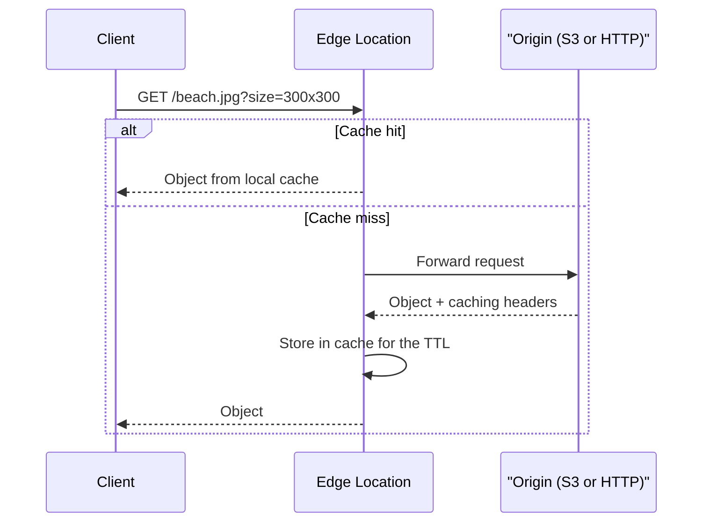
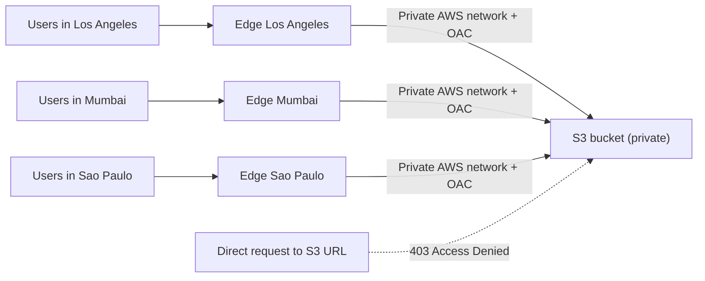
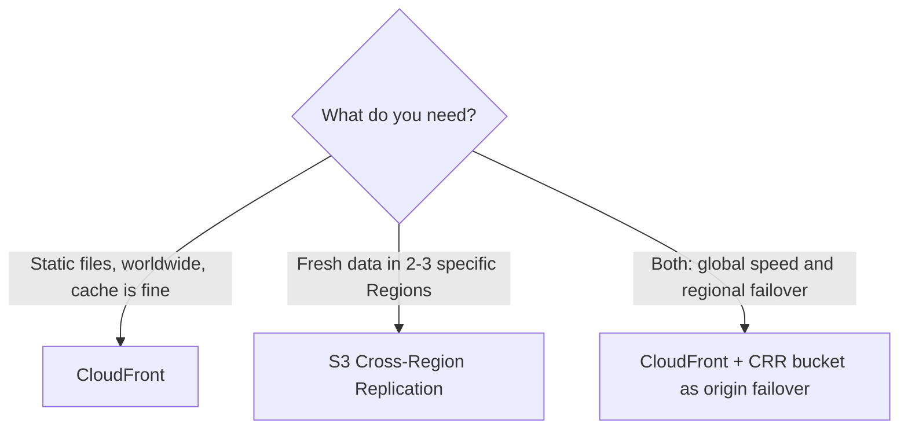

# CloudFront

## Lecture 153: 🌍 CloudFront - Overview

> **Overview**: Amazon CloudFront is AWS's Content Delivery Network (CDN). It caches your content at hundreds of edge locations around the world, so users are served from a location near them instead of from your origin, which lowers latency and the load on your backend. This lecture covers what a CDN does, the kinds of origins CloudFront can pull from (S3, VPC origins, custom HTTP origins), how an S3 bucket is kept private with Origin Access Control, and how CloudFront differs from S3 Cross-Region Replication.

### 🧭 What Is CloudFront?

- A **Content Delivery Network (CDN)**: a global network of servers that keeps **copies of your content close to your users**.
- **Improves read performance**: content is **cached at the edge**, so repeat requests never reach your origin.
- **Better user experience**: lower latency and faster page loads everywhere in the world.
- **Hundreds of Points of Presence (PoPs)**: 400+ edge locations plus 10+ **regional edge caches** in 90+ cities across 40+ countries.
- **Security at the edge**: because traffic is spread across the whole global network, CloudFront absorbs DDoS attacks well. It includes **AWS Shield Standard** at no extra cost and integrates with **AWS WAF** (Web Application Firewall) and **Shield Advanced**.
- CloudFront is a **global service**: you create a **distribution** (not tied to a Region) and it gets a domain like `d111111abcdef8.cloudfront.net`. You can add your own domain name (alternate domain / CNAME) with a TLS certificate.

> **Analogy**: Your origin is a central warehouse. CloudFront is a chain of local convenience stores. The first customer in a town who asks for a product makes the store order it from the warehouse; after that, everyone in that town picks it up from the local shelf until it expires.

#### 🧩 Key Vocabulary

| Term | Meaning |
| --- | --- |
| **Distribution** | Your CloudFront configuration: origins, cache behaviors, domain names, certificate, logging, price class |
| **Origin** | Where CloudFront fetches the original content (S3 bucket, ALB, EC2, any HTTP server) |
| **Edge location** | A PoP that serves users and holds the cache |
| **Regional edge cache** | A larger mid-tier cache between edge locations and your origin; keeps less popular objects longer |
| **Cache hit / miss** | Hit = object served from the edge cache. Miss = edge must fetch from origin (or regional cache) |
| **TTL** | How long an object stays in the cache before CloudFront checks the origin again |
| **Cache behavior** | Per-path-pattern settings (`/images/*`, `/api/*`, default `*`) |

### 🗂️ CloudFront Origins

CloudFront can pull content from three families of origins:

#### 🪣 S3 Bucket

- For **distributing files and caching them at the edge** (static websites, images, videos, downloads, JS/CSS bundles).
- Also for **uploading files to S3 through CloudFront** (PUT/POST through the edge network, which speeds up uploads from far away).
- The bucket stays **private** and is secured with **Origin Access Control (OAC)** plus an S3 bucket policy (details below).

#### 🔒 VPC Origin

- For applications hosted in **private subnets** of a VPC: **private ALB, private NLB or EC2 instances**.
- CloudFront reaches them without the backend having a public IP or public load balancer, so CloudFront becomes the only way in from the internet.

#### 🌐 Custom Origin (HTTP)

- **S3 static website endpoint** (the bucket must first be configured as a static website). This is treated as a custom HTTP origin, **not** an S3 origin.
- **Any public HTTP backend**: a public ALB, an EC2 instance with a public IP, an on-premises server, API Gateway, another CDN, and so on.

| Origin type | Typical content | How the origin is protected |
| --- | --- | --- |
| S3 bucket (REST endpoint) | Static files, uploads | **OAC** + bucket policy, bucket fully private |
| VPC origin | Private ALB / NLB / EC2 apps | Lives in private subnets, no public exposure |
| S3 website endpoint | Static site with S3 redirect rules / index docs | Bucket must be **public** (OAC not supported); can restrict with a secret custom header |
| Public HTTP (ALB, EC2, on-prem) | Dynamic apps, APIs | Security groups allowing CloudFront IP ranges, custom header check |

> **Important**: An S3 **website endpoint** (`bucket.s3-website-<region>.amazonaws.com`) only speaks **HTTP** to CloudFront and cannot use OAC. If you want a private bucket behind CloudFront, point CloudFront at the bucket's **REST endpoint** (`bucket.s3.<region>.amazonaws.com`) and use OAC instead.

### 🔄 How CloudFront Works at a High Level

1. A client sends a request (e.g. `GET /beach.jpg?size=300x300`) to the distribution's domain. DNS routes it to the **nearest edge location**.
2. The edge checks its **local cache** for that object.
3. **Cache hit**: the object is returned straight from the edge.
4. **Cache miss**: the edge forwards the request to the origin (via the regional edge cache), stores the response in its cache for the TTL, and returns it to the client.
5. Later requests from users near that edge are served from the cache until the TTL expires.



- What gets forwarded to the origin (headers, cookies, query strings) and what makes up the cache key is controlled by **cache policies** and **origin request policies**.
- Default TTL is **24 hours** (86,400 s) unless the origin sends `Cache-Control` / `Expires` headers or a cache policy says otherwise.

### 🔐 S3 as an Origin with Origin Access Control (OAC)

- The goal: users anywhere reach your files **only through CloudFront**, never directly from S3. The bucket remains **private**.
- **Origin Access Control (OAC)** lets CloudFront sign its requests to S3 (SigV4) as the CloudFront service principal.
- The **S3 bucket policy** then allows `s3:GetObject` only for `cloudfront.amazonaws.com` **and only for your distribution** (checked with `AWS:SourceArn`).



The bucket policy CloudFront proposes when you create an OAC looks like this:

```json
{
  "Version": "2012-10-17",
  "Statement": [
    {
      "Sid": "AllowCloudFrontServicePrincipalReadOnly",
      "Effect": "Allow",
      "Principal": { "Service": "cloudfront.amazonaws.com" },
      "Action": "s3:GetObject",
      "Resource": "arn:aws:s3:::my-static-site-bucket/*",
      "Condition": {
        "StringEquals": {
          "AWS:SourceArn": "arn:aws:cloudfront::111122223333:distribution/EDFDVBD6EXAMPLE"
        }
      }
    }
  ]
}
```

Applying it from Node.js:

```javascript
import { S3Client, PutBucketPolicyCommand } from "@aws-sdk/client-s3";

const s3 = new S3Client({ region: "us-east-1" });

const policy = {
  Version: "2012-10-17",
  Statement: [
    {
      Sid: "AllowCloudFrontServicePrincipalReadOnly",
      Effect: "Allow",
      Principal: { Service: "cloudfront.amazonaws.com" },
      Action: "s3:GetObject",
      Resource: "arn:aws:s3:::my-static-site-bucket/*",
      Condition: {
        StringEquals: {
          "AWS:SourceArn": "arn:aws:cloudfront::111122223333:distribution/EDFDVBD6EXAMPLE",
        },
      },
    },
  ],
};

await s3.send(
  new PutBucketPolicyCommand({
    Bucket: "my-static-site-bucket",
    Policy: JSON.stringify(policy),
  })
);
```

#### 🆚 OAC vs OAI (Legacy)

| Feature | Origin Access Control (OAC) | Origin Access Identity (OAI) |
| --- | --- | --- |
| Status | **Recommended** | Legacy, still works |
| Bucket policy principal | `cloudfront.amazonaws.com` service + `AWS:SourceArn` condition | A special CloudFront OAI user |
| SSE-KMS encrypted objects | **Supported** (add `kms:Decrypt` for CloudFront in the key policy) | Not supported |
| All S3 Regions (incl. opt-in Regions) | Yes | No |
| Dynamic requests (PUT, DELETE) to S3 | Yes | Limited |

> **Exam Tip**: "Users must access S3 content only through CloudFront, not via the S3 URL" → **OAC + bucket policy** (with Block Public Access left ON). If the objects are **SSE-KMS** encrypted, the KMS key policy must also allow the CloudFront service principal to `kms:Decrypt`.

### 🆚 CloudFront vs S3 Cross-Region Replication

| Aspect | CloudFront | S3 Cross-Region Replication (CRR) |
| --- | --- | --- |
| Footprint | Global edge network (hundreds of PoPs) | Only the Regions you configure, one rule per destination |
| Freshness | Cached copies live for a **TTL** (e.g. a day), so may be stale | Updated in **near real time** |
| Writes | Caches reads (uploads can pass through to origin) | Replicas are effectively **read-only** copies |
| Best for | **Static content** that must be fast **everywhere** | **Dynamic content** that must be low-latency in **a few Regions** |
| Setup | One distribution | Versioning on both buckets + replication rule + IAM role |



### 🛠️ Creating a Distribution (Quick CLI Look)

Useful commands to inspect a distribution once it exists:

```bash
# List distributions with their domain names and status
aws cloudfront list-distributions \
  --query "DistributionList.Items[].{Id:Id,Domain:DomainName,Status:Status}" \
  --output table

# Show the full config of one distribution (origins, behaviors, price class)
aws cloudfront get-distribution-config --id EDFDVBD6EXAMPLE

# Check that a response came from the cache: look for "X-Cache: Hit from cloudfront"
curl -sI https://d111111abcdef8.cloudfront.net/index.html | grep -i "x-cache"
```

- `X-Cache: Miss from cloudfront` on the first request and `Hit from cloudfront` on the next one shows caching at work.
- A new or updated distribution shows `InProgress` while it deploys to all edge locations, then `Deployed`.

### 🎯 DVA-C02 Exam Tips

- **"Reduce latency for global users of static content" / "offload the origin" / "improve read performance worldwide"** → CloudFront.
- **"Keep the S3 bucket private but serve it publicly"** → CloudFront + **OAC** + bucket policy. OAI is the older answer; prefer OAC when both appear.
- **"Content must be fresh in a couple of Regions with low latency"** → S3 CRR, not CloudFront.
- **Custom domain with HTTPS on CloudFront** → the ACM certificate must be issued in **us-east-1 (N. Virginia)**, whatever Region your origin is in. A certificate in another Region won't appear in the CloudFront console.
- **Viewer protocol policy**: `HTTP and HTTPS`, `Redirect HTTP to HTTPS`, or `HTTPS only`. "Force users onto HTTPS" → **Redirect HTTP to HTTPS** (or HTTPS only). Origin protocol policy separately controls CloudFront-to-origin traffic.
- **Route 53 + CloudFront** → use an **Alias record** (free, works at the zone apex), not a CNAME, for `example.com`.
- **DDoS protection** → Shield Standard is automatic on CloudFront; add **WAF** on the distribution for Layer 7 rules (SQL injection, rate limiting, IP blocks).
- **Updated files but users still see old content** → it's cached until the TTL expires; use a **cache invalidation** (`CreateInvalidation`) or versioned file names (`app.v2.js`).
- **Private backend in a VPC behind CloudFront** → **VPC origin**. Older answer: public ALB whose security group allows only the CloudFront managed prefix list.
- **S3 website endpoint as origin** → HTTP only and no OAC; the bucket must be public.
- CloudFront also runs code at the edge (**CloudFront Functions** and **Lambda@Edge**). CloudFront Functions are lightweight JavaScript for header and URL manipulation; Lambda@Edge handles heavier logic.

### 📝 Key Exam Takeaways

- CloudFront = AWS's global **CDN**; it caches content at **400+ edge locations** and regional edge caches to cut latency and origin load.
- Built-in **DDoS protection** with Shield Standard, plus integration with **AWS WAF** and Shield Advanced.
- Origins: **S3 bucket** (secured with **OAC**), **VPC origin** (private ALB / NLB / EC2), and **custom HTTP origins** (S3 website endpoint, public ALB, any HTTP server).
- Request flow: edge cache hit → served immediately; miss → fetched from origin, cached for the **TTL** (default 24 h), then served.
- **OAC** + a bucket policy allowing `cloudfront.amazonaws.com` with `AWS:SourceArn` = your distribution keeps the bucket private. OAC supports SSE-KMS; legacy OAI does not.
- **CloudFront vs CRR**: CloudFront = static content, global, cached for a TTL; CRR = dynamic content, a few Regions, near real-time, read-only replicas.
- ACM certificates for CloudFront must be in **us-east-1**.

---
