# CloudFront

## Lecture 153: 🌍 CloudFront - Overview

> **Overview**: Amazon CloudFront is AWS's Content Delivery Network (CDN). It caches your content at hundreds of edge locations around the world, so users are served from a location near them instead of from your origin, which lowers latency and the load on your backend. This lecture covers what a CDN does, the kinds of origins CloudFront can pull from (S3, VPC origins, custom HTTP origins), how an S3 bucket is kept private with Origin Access Control, and how CloudFront differs from S3 Cross-Region Replication.

### 🧭 What Is CloudFront?

- A **Content Delivery Network (CDN)**: a global network of servers that keeps **copies of your content close to your users**.
- **Improves read performance**: content is **cached at the edge**, so repeat requests never reach your origin.
- **Better user experience**: lower latency and faster page loads everywhere in the world.
- **Hundreds of Points of Presence (PoPs)**: 400+ edge locations plus 10+ **regional edge caches** in 90+ cities across 40+ countries.
- **Security at the edge**: because traffic is spread across the whole global network, CloudFront absorbs DDoS attacks well. It includes **AWS Shield Standard** at no extra cost and integrates with **AWS WAF** (Web Application Firewall) and **Shield Advanced**.
- CloudFront is a **global service**: you create a **distribution** (not tied to a Region) and it gets a domain like `d111111abcdef8.cloudfront.net`. You can add your own domain name (alternate domain / CNAME) with a TLS certificate.

> **Analogy**: Your origin is a central warehouse. CloudFront is a chain of local convenience stores. The first customer in a town who asks for a product makes the store order it from the warehouse; after that, everyone in that town picks it up from the local shelf until it expires.

#### 🧩 Key Vocabulary

| Term | Meaning |
| --- | --- |
| **Distribution** | Your CloudFront configuration: origins, cache behaviors, domain names, certificate, logging, price class |
| **Origin** | Where CloudFront fetches the original content (S3 bucket, ALB, EC2, any HTTP server) |
| **Edge location** | A PoP that serves users and holds the cache |
| **Regional edge cache** | A larger mid-tier cache between edge locations and your origin; keeps less popular objects longer |
| **Cache hit / miss** | Hit = object served from the edge cache. Miss = edge must fetch from origin (or regional cache) |
| **TTL** | How long an object stays in the cache before CloudFront checks the origin again |
| **Cache behavior** | Per-path-pattern settings (`/images/*`, `/api/*`, default `*`) |

### 🗂️ CloudFront Origins

CloudFront can pull content from three families of origins:

#### 🪣 S3 Bucket

- For **distributing files and caching them at the edge** (static websites, images, videos, downloads, JS/CSS bundles).
- Also for **uploading files to S3 through CloudFront** (PUT/POST through the edge network, which speeds up uploads from far away).
- The bucket stays **private** and is secured with **Origin Access Control (OAC)** plus an S3 bucket policy (details below).

#### 🔒 VPC Origin

- For applications hosted in **private subnets** of a VPC: **private ALB, private NLB or EC2 instances**.
- CloudFront reaches them without the backend having a public IP or public load balancer, so CloudFront becomes the only way in from the internet.

#### 🌐 Custom Origin (HTTP)

- **S3 static website endpoint** (the bucket must first be configured as a static website). This is treated as a custom HTTP origin, **not** an S3 origin.
- **Any public HTTP backend**: a public ALB, an EC2 instance with a public IP, an on-premises server, API Gateway, another CDN, and so on.

| Origin type | Typical content | How the origin is protected |
| --- | --- | --- |
| S3 bucket (REST endpoint) | Static files, uploads | **OAC** + bucket policy, bucket fully private |
| VPC origin | Private ALB / NLB / EC2 apps | Lives in private subnets, no public exposure |
| S3 website endpoint | Static site with S3 redirect rules / index docs | Bucket must be **public** (OAC not supported); can restrict with a secret custom header |
| Public HTTP (ALB, EC2, on-prem) | Dynamic apps, APIs | Security groups allowing CloudFront IP ranges, custom header check |

> **Important**: An S3 **website endpoint** (`bucket.s3-website-<region>.amazonaws.com`) only speaks **HTTP** to CloudFront and cannot use OAC. If you want a private bucket behind CloudFront, point CloudFront at the bucket's **REST endpoint** (`bucket.s3.<region>.amazonaws.com`) and use OAC instead.

### 🔄 How CloudFront Works at a High Level

1. A client sends a request (e.g. `GET /beach.jpg?size=300x300`) to the distribution's domain. DNS routes it to the **nearest edge location**.
2. The edge checks its **local cache** for that object.
3. **Cache hit**: the object is returned straight from the edge.
4. **Cache miss**: the edge forwards the request to the origin (via the regional edge cache), stores the response in its cache for the TTL, and returns it to the client.
5. Later requests from users near that edge are served from the cache until the TTL expires.

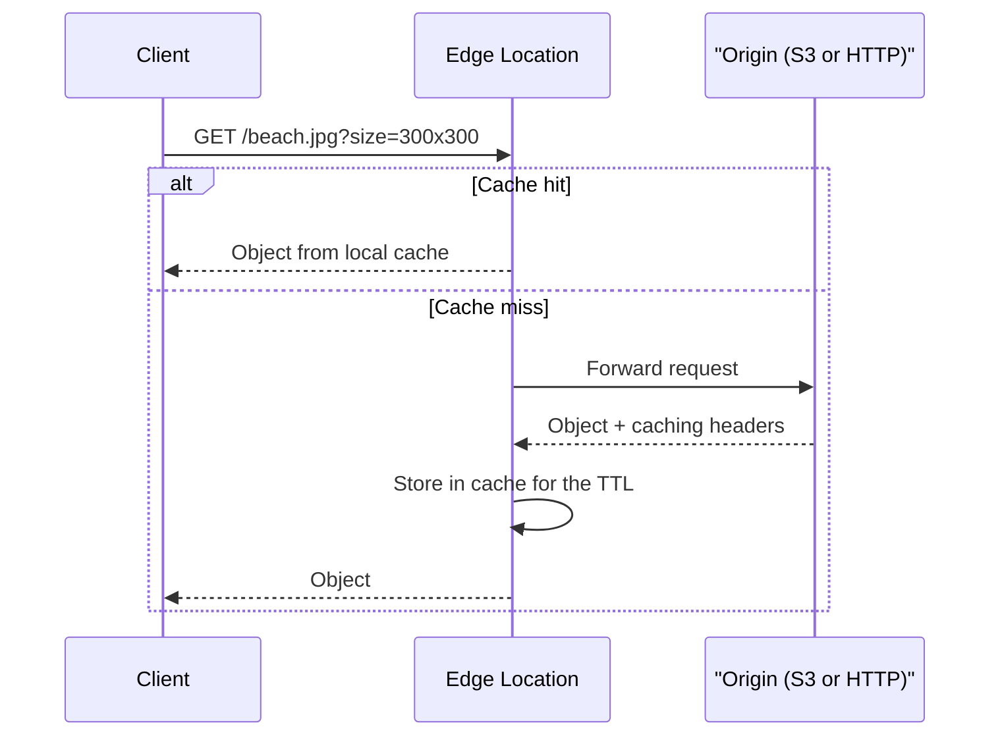

- What gets forwarded to the origin (headers, cookies, query strings) and what makes up the cache key is controlled by **cache policies** and **origin request policies**.
- Default TTL is **24 hours** (86,400 s) unless the origin sends `Cache-Control` / `Expires` headers or a cache policy says otherwise.

### 🔐 S3 as an Origin with Origin Access Control (OAC)

- The goal: users anywhere reach your files **only through CloudFront**, never directly from S3. The bucket remains **private**.
- **Origin Access Control (OAC)** lets CloudFront sign its requests to S3 (SigV4) as the CloudFront service principal.
- The **S3 bucket policy** then allows `s3:GetObject` only for `cloudfront.amazonaws.com` **and only for your distribution** (checked with `AWS:SourceArn`).

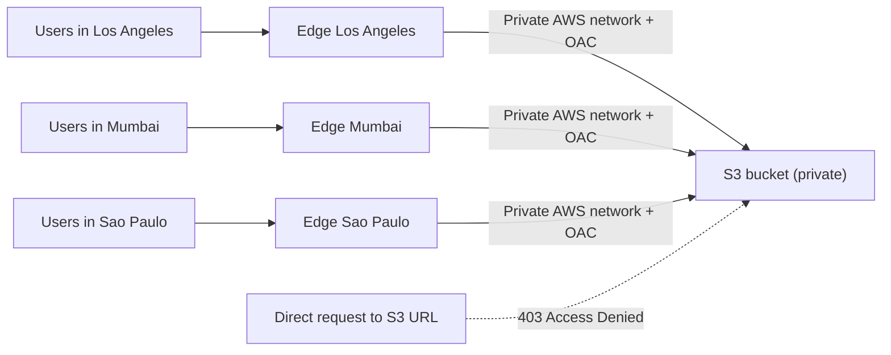

The bucket policy CloudFront proposes when you create an OAC looks like this:

```json
{
  "Version": "2012-10-17",
  "Statement": [
    {
      "Sid": "AllowCloudFrontServicePrincipalReadOnly",
      "Effect": "Allow",
      "Principal": { "Service": "cloudfront.amazonaws.com" },
      "Action": "s3:GetObject",
      "Resource": "arn:aws:s3:::my-static-site-bucket/*",
      "Condition": {
        "StringEquals": {
          "AWS:SourceArn": "arn:aws:cloudfront::111122223333:distribution/EDFDVBD6EXAMPLE"
        }
      }
    }
  ]
}
```

Applying it from Node.js:

```javascript
import { S3Client, PutBucketPolicyCommand } from "@aws-sdk/client-s3";

const s3 = new S3Client({ region: "us-east-1" });

const policy = {
  Version: "2012-10-17",
  Statement: [
    {
      Sid: "AllowCloudFrontServicePrincipalReadOnly",
      Effect: "Allow",
      Principal: { Service: "cloudfront.amazonaws.com" },
      Action: "s3:GetObject",
      Resource: "arn:aws:s3:::my-static-site-bucket/*",
      Condition: {
        StringEquals: {
          "AWS:SourceArn": "arn:aws:cloudfront::111122223333:distribution/EDFDVBD6EXAMPLE",
        },
      },
    },
  ],
};

await s3.send(
  new PutBucketPolicyCommand({
    Bucket: "my-static-site-bucket",
    Policy: JSON.stringify(policy),
  })
);
```

#### 🆚 OAC vs OAI (Legacy)

| Feature | Origin Access Control (OAC) | Origin Access Identity (OAI) |
| --- | --- | --- |
| Status | **Recommended** | Legacy, still works |
| Bucket policy principal | `cloudfront.amazonaws.com` service + `AWS:SourceArn` condition | A special CloudFront OAI user |
| SSE-KMS encrypted objects | **Supported** (add `kms:Decrypt` for CloudFront in the key policy) | Not supported |
| All S3 Regions (incl. opt-in Regions) | Yes | No |
| Dynamic requests (PUT, DELETE) to S3 | Yes | Limited |

> **Exam Tip**: "Users must access S3 content only through CloudFront, not via the S3 URL" → **OAC + bucket policy** (with Block Public Access left ON). If the objects are **SSE-KMS** encrypted, the KMS key policy must also allow the CloudFront service principal to `kms:Decrypt`.

### 🆚 CloudFront vs S3 Cross-Region Replication

| Aspect | CloudFront | S3 Cross-Region Replication (CRR) |
| --- | --- | --- |
| Footprint | Global edge network (hundreds of PoPs) | Only the Regions you configure, one rule per destination |
| Freshness | Cached copies live for a **TTL** (e.g. a day), so may be stale | Updated in **near real time** |
| Writes | Caches reads (uploads can pass through to origin) | Replicas are effectively **read-only** copies |
| Best for | **Static content** that must be fast **everywhere** | **Dynamic content** that must be low-latency in **a few Regions** |
| Setup | One distribution | Versioning on both buckets + replication rule + IAM role |

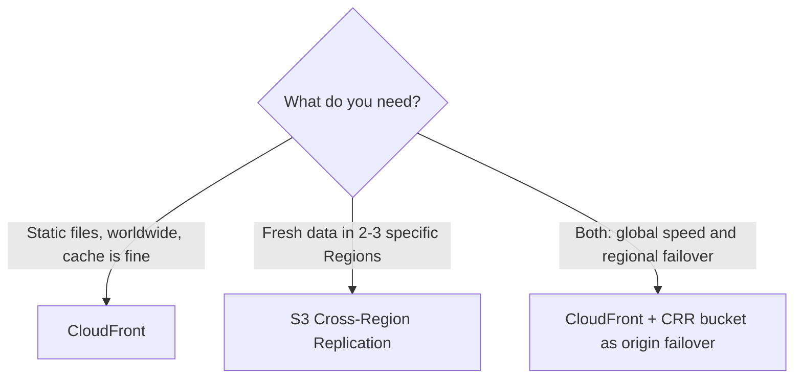

### 🛠️ Creating a Distribution (Quick CLI Look)

Useful commands to inspect a distribution once it exists:

```bash
# List distributions with their domain names and status
aws cloudfront list-distributions \
  --query "DistributionList.Items[].{Id:Id,Domain:DomainName,Status:Status}" \
  --output table

# Show the full config of one distribution (origins, behaviors, price class)
aws cloudfront get-distribution-config --id EDFDVBD6EXAMPLE

# Check that a response came from the cache: look for "X-Cache: Hit from cloudfront"
curl -sI https://d111111abcdef8.cloudfront.net/index.html | grep -i "x-cache"
```

- `X-Cache: Miss from cloudfront` on the first request and `Hit from cloudfront` on the next one shows caching at work.
- A new or updated distribution shows `InProgress` while it deploys to all edge locations, then `Deployed`.

### 🎯 DVA-C02 Exam Tips

- **"Reduce latency for global users of static content" / "offload the origin" / "improve read performance worldwide"** → CloudFront.
- **"Keep the S3 bucket private but serve it publicly"** → CloudFront + **OAC** + bucket policy. OAI is the older answer; prefer OAC when both appear.
- **"Content must be fresh in a couple of Regions with low latency"** → S3 CRR, not CloudFront.
- **Custom domain with HTTPS on CloudFront** → the ACM certificate must be issued in **us-east-1 (N. Virginia)**, whatever Region your origin is in. A certificate in another Region won't appear in the CloudFront console.
- **Viewer protocol policy**: `HTTP and HTTPS`, `Redirect HTTP to HTTPS`, or `HTTPS only`. "Force users onto HTTPS" → **Redirect HTTP to HTTPS** (or HTTPS only). Origin protocol policy separately controls CloudFront-to-origin traffic.
- **Route 53 + CloudFront** → use an **Alias record** (free, works at the zone apex), not a CNAME, for `example.com`.
- **DDoS protection** → Shield Standard is automatic on CloudFront; add **WAF** on the distribution for Layer 7 rules (SQL injection, rate limiting, IP blocks).
- **Updated files but users still see old content** → it's cached until the TTL expires; use a **cache invalidation** (`CreateInvalidation`) or versioned file names (`app.v2.js`).
- **Private backend in a VPC behind CloudFront** → **VPC origin**. Older answer: public ALB whose security group allows only the CloudFront managed prefix list.
- **S3 website endpoint as origin** → HTTP only and no OAC; the bucket must be public.
- CloudFront also runs code at the edge (**CloudFront Functions** and **Lambda@Edge**). CloudFront Functions are lightweight JavaScript for header and URL manipulation; Lambda@Edge handles heavier logic.

### 📝 Key Exam Takeaways

- CloudFront = AWS's global **CDN**; it caches content at **400+ edge locations** and regional edge caches to cut latency and origin load.
- Built-in **DDoS protection** with Shield Standard, plus integration with **AWS WAF** and Shield Advanced.
- Origins: **S3 bucket** (secured with **OAC**), **VPC origin** (private ALB / NLB / EC2), and **custom HTTP origins** (S3 website endpoint, public ALB, any HTTP server).
- Request flow: edge cache hit → served immediately; miss → fetched from origin, cached for the **TTL** (default 24 h), then served.
- **OAC** + a bucket policy allowing `cloudfront.amazonaws.com` with `AWS:SourceArn` = your distribution keeps the bucket private. OAC supports SSE-KMS; legacy OAI does not.
- **CloudFront vs CRR**: CloudFront = static content, global, cached for a TTL; CRR = dynamic content, a few Regions, near real-time, read-only replicas.
- ACM certificates for CloudFront must be in **us-east-1**.

---

## Lecture 154: 🧪 CloudFront Hands On

> **Overview**: In this hands-on you put a small static website (an `index.html` page plus two images) in a **private S3 bucket** and serve it worldwide through a **CloudFront distribution** secured with **Origin Access Control (OAC)**. You see the bucket policy CloudFront needs, confirm the site loads from the `cloudfront.net` domain while the direct S3 URL is refused, and learn how to tear everything down cleanly.

### 🎯 What You Build

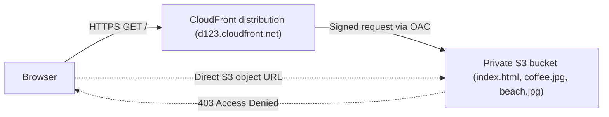

- **Origin**: an S3 bucket using its **REST endpoint**, with **Block Public Access left ON**.
- **Access**: only the CloudFront distribution may read objects, enforced by OAC plus a bucket policy.
- **Files**: `index.html`, `coffee.jpg` and `beach.jpg` from the course `code/s3/` folder. `index.html` shows a heading and embeds `coffee.jpg` with a relative path, so the image is fetched through CloudFront too.

### 🪜 Step 1: Create the Private Bucket and Upload Files

1. **S3 console → Create bucket**. Pick a globally unique name (e.g. `demo-cloudfront-bp-2026`) and any Region.
2. Keep **Block all public access** ticked. You do not need a public bucket, and you do **not** enable static website hosting.
3. Upload `index.html`, `coffee.jpg` and `beach.jpg`.
4. Open `index.html` → copy its **Object URL** and open it in a browser. You should get an **AccessDenied** XML error. That's expected: the bucket is private.

The same with the CLI:

```bash
BUCKET=demo-cloudfront-bp-2026
aws s3 mb s3://$BUCKET --region us-east-1
aws s3 cp code/s3/index.html s3://$BUCKET/
aws s3 cp code/s3/coffee.jpg s3://$BUCKET/
aws s3 cp code/s3/beach.jpg  s3://$BUCKET/

# Direct access is refused (403) because the bucket is private
curl -s -o /dev/null -w "%{http_code}\n" https://$BUCKET.s3.amazonaws.com/index.html
```

### 🪜 Step 2: Create the CloudFront Distribution

1. **CloudFront console → Create distribution**. The console layout changes often (newer versions start with a short wizard and a pricing-plan choice), but the settings that matter are the same.
2. **Origin domain**: pick your bucket from the drop-down. It must be the `bucket.s3.<region>.amazonaws.com` form, **not** the `s3-website` endpoint.
3. **Origin access**: choose **Origin access control settings (recommended)** → **Create new OAC** → keep the defaults (sign requests, SigV4).
4. **Default cache behavior**: viewer protocol policy **Redirect HTTP to HTTPS**, allowed methods **GET, HEAD**, cache policy **CachingOptimized** (managed).
5. **WAF**: for the demo, choose not to enable security protections (WAF costs money).
6. **Settings → Default root object**: `index.html`. Without it, `https://d123.cloudfront.net/` returns an error instead of the home page.
7. **Create distribution**. Status shows **Deploying** (`InProgress`) for a few minutes while the config is pushed to all edge locations.

> **Important**: The **default root object** only applies to the root URL (`/`). It does not make `/about/` serve `/about/index.html`. For sub-folder index pages with an S3 REST origin you need a **CloudFront Function** that rewrites the URI.

### 🪜 Step 3: Update the Bucket Policy

After creation, the console shows a banner saying the S3 bucket policy needs to be updated, with a **Copy policy** button.

1. Click **Copy policy**.
2. Go to the bucket → **Permissions → Bucket policy → Edit** → paste → **Save**.
3. The policy allows the principal `cloudfront.amazonaws.com` to call `s3:GetObject`, with a condition `AWS:SourceArn` = this distribution's ARN (the same shape as in Lecture 153).

> **Important**: If you skip this step, CloudFront itself gets **403 Access Denied** from S3 and passes that error to the browser. "OAC configured but still 403" almost always means a missing or wrong bucket policy (wrong distribution ID, missing `/*` on the resource) or, for SSE-KMS objects, a key policy that doesn't allow CloudFront to `kms:Decrypt`.

### 🪜 Step 4: Test the Distribution

1. Copy the **Distribution domain name** (e.g. `d1a2b3c4d5e6f7.cloudfront.net`) and open it in a browser.
2. You should see the "I really love coffee" page with the coffee image. Opening `/beach.jpg` shows the other image.
3. The direct S3 object URL still returns **AccessDenied**: content is reachable **only through CloudFront**.

```bash
CF=d1a2b3c4d5e6f7.cloudfront.net

# First request: usually "Miss from cloudfront"; repeat it and you should see "Hit from cloudfront"
curl -sI https://$CF/coffee.jpg | grep -i -E "x-cache|^age|x-amz-cf-pop"
curl -sI https://$CF/coffee.jpg | grep -i -E "x-cache|^age|x-amz-cf-pop"

# HTTP is redirected to HTTPS (301) because of the viewer protocol policy
curl -sI http://$CF/ | head -1
```

- `X-Amz-Cf-Pop` tells you which edge location answered (e.g. `FRA56-P1`).
- `Age` tells you how many seconds the object has been in that edge's cache.

### 🪜 Step 5: Clean Up

A distribution cannot be deleted while it is enabled, so this takes two passes:

1. **CloudFront → select the distribution → Disable**. Wait until the status is **Deployed** again (several minutes).
2. **Delete** the distribution.
3. **CloudFront → Origin access → delete the OAC** (only possible once no distribution uses it).
4. **Empty** the bucket, then **delete** it.

```bash
# Deletes need the current ETag (optimistic locking); the distribution must already be disabled
aws cloudfront get-distribution-config --id EDFDVBD6EXAMPLE --query ETag
aws cloudfront delete-distribution --id EDFDVBD6EXAMPLE --if-match E2QWRUHEXAMPLE

aws s3 rb s3://$BUCKET --force
```

> **Exam Tip**: CloudFront config updates use an **ETag + `If-Match`** pattern. A `PreconditionFailed` error means your ETag is stale: fetch the config again and retry with the new ETag.

### 🧑‍💻 The Same Distribution with the SDK

Creating a distribution from code is mostly one large config object. This is the minimal shape for an S3 origin with OAC:

```javascript
import {
  CloudFrontClient,
  CreateOriginAccessControlCommand,
  CreateDistributionCommand,
} from "@aws-sdk/client-cloudfront";

// CloudFront is global; its API endpoint lives in us-east-1
const cf = new CloudFrontClient({ region: "us-east-1" });
const bucket = "demo-cloudfront-bp-2026";

const { OriginAccessControl } = await cf.send(
  new CreateOriginAccessControlCommand({
    OriginAccessControlConfig: {
      Name: `${bucket}-oac`,
      OriginAccessControlOriginType: "s3",
      SigningBehavior: "always",
      SigningProtocol: "sigv4",
    },
  })
);

const { Distribution } = await cf.send(
  new CreateDistributionCommand({
    DistributionConfig: {
      CallerReference: `demo-${Date.now()}`, // idempotency token
      Comment: "CloudFront hands-on",
      Enabled: true,
      DefaultRootObject: "index.html",
      Origins: {
        Quantity: 1,
        Items: [
          {
            Id: "s3-origin",
            DomainName: `${bucket}.s3.us-east-1.amazonaws.com`,
            OriginAccessControlId: OriginAccessControl.Id,
            S3OriginConfig: { OriginAccessIdentity: "" }, // empty when using OAC
          },
        ],
      },
      DefaultCacheBehavior: {
        TargetOriginId: "s3-origin",
        ViewerProtocolPolicy: "redirect-to-https",
        CachePolicyId: "658327ea-f89d-4fab-a63d-7e88639e58f6", // managed CachingOptimized
      },
    },
  })
);

console.log(Distribution.Id, Distribution.DomainName, Distribution.Status);
```

- You still have to attach the bucket policy (see Lecture 153) using `Distribution.ARN`.
- Required IAM permissions: `cloudfront:CreateOriginAccessControl`, `cloudfront:CreateDistribution`, and `s3:PutBucketPolicy` for the policy step.

### 🛠️ In Practice

- **Infrastructure as code**: real teams define the bucket, OAC, distribution and bucket policy together in CloudFormation, SAM or CDK, so the `AWS:SourceArn` always matches. Clicking it together by hand is fine for learning only.
- **Deploying a front end** (React, Vue, a static site generator): `aws s3 sync ./dist s3://bucket --delete`, then invalidate `/index.html`. Fingerprinted asset names (`app.3f9a1c.js`) can be cached for a year.
- **SPA routing**: with a private S3 origin, a deep link like `/dashboard` returns **403**, because CloudFront has no `s3:ListBucket` permission and S3 reports a missing key as 403. Map 403/404 to `/index.html` with status 200 using **custom error responses**, or rewrite with a CloudFront Function.
- **Debugging**: check the `X-Cache`, `Age` and `X-Amz-Cf-Pop` response headers first; then enable standard logs or real-time logs if needed.
- **Cost**: the demo is effectively free (the always-free tier covers 1 TB of data out and 10 million requests per month), but delete the distribution afterwards; WAF on a distribution costs money.

### 🎯 DVA-C02 Exam Tips

- **"Serve a private S3 bucket through CloudFront"** → S3 REST endpoint as origin + **OAC** + bucket policy granting `cloudfront.amazonaws.com` with `AWS:SourceArn`. Block Public Access stays on.
- **"Users get 403 from CloudFront after setting up OAC"** → bucket policy missing or wrong; for SSE-KMS objects also the **KMS key policy**.
- **"Visiting the root URL returns an error"** → set the **Default root object** (`index.html`).
- **"Force HTTPS"** → viewer protocol policy **Redirect HTTP to HTTPS** or **HTTPS only**.
- **Custom domain on the distribution** → alternate domain name (CNAME) + ACM certificate in **us-east-1** + Route 53 **Alias** record.
- Distribution changes take minutes to propagate (`InProgress` → `Deployed`); deleting requires **disabling first**.
- S3 **website endpoint** as origin → custom origin, HTTP only, no OAC, bucket must be public. Choose the REST endpoint when the question wants the bucket private.

### 📝 Key Exam Takeaways

- A private S3 bucket + CloudFront + **OAC** is the standard way to serve static content securely and globally.
- CloudFront proposes the bucket policy; you must **paste it into the bucket** or CloudFront gets 403.
- The direct S3 URL keeps returning **AccessDenied**: access is only through the distribution.
- **Default root object** maps `/` to `index.html`.
- `X-Cache: Miss from cloudfront` then `Hit from cloudfront` proves the edge cache is working.
- Clean-up order: **disable → wait → delete distribution → delete OAC → empty and delete bucket**.

---

## Lecture 155: 🗝️ CloudFront - Caching & Caching Policies

> **Overview**: Each CloudFront edge location keeps its own cache, and every object in it is identified by a **cache key**. By default that key is just the hostname plus the URL path, but a **Cache Policy** can add specific headers, cookies and query strings to it and sets the TTLs. A separate **Origin Request Policy** forwards extra values to the origin *without* putting them in the cache key, so you keep a high cache hit ratio.

### 🧠 How the CloudFront Cache Works

- The cache lives **at each edge location** (with regional edge caches behind them). An object cached in Paris is not automatically cached in Tokyo.
- On each request the edge builds the **cache key** and looks it up:
    - **Hit** → served straight from the edge.
    - **Miss** → fetched from the origin, stored for the TTL, then served.
- When the TTL expires, the edge **revalidates** with the origin (a conditional request using `If-Modified-Since` / `If-None-Match`). If nothing changed, the origin answers `304 Not Modified` and the cached copy is reused.
- Your goal is to **maximise the cache hit ratio** so as few requests as possible reach the origin.
- You can force removal before the TTL ends with a **cache invalidation** (`CreateInvalidation`, Lecture 156).

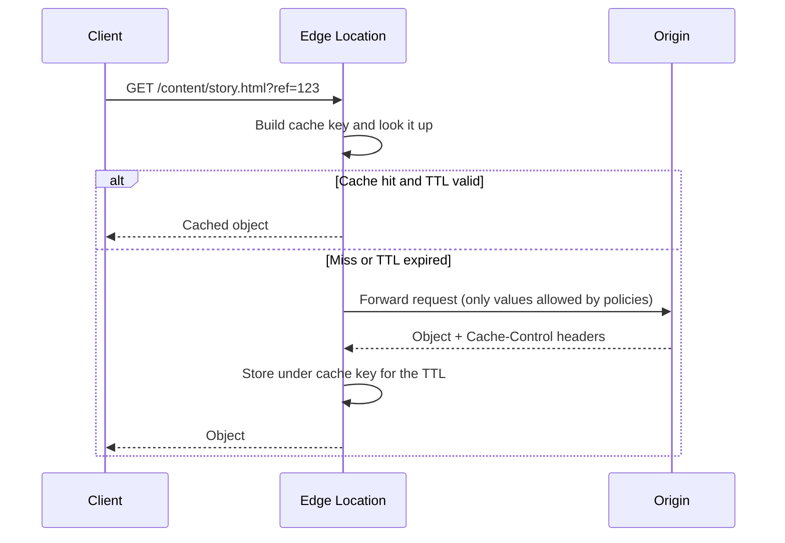

### 🔑 What Is the Cache Key?

- A **unique identifier for each object** in the cache.
- **Default**: hostname + resource path of the URL, e.g. `mywebsite.com` + `/content/stories/example-story.html`. Query strings, headers and cookies are **not** part of it by default.
- If your content **varies by user, device, language or location**, you add the relevant elements (headers, cookies, query strings) to the cache key with a **Cache Policy**.
- Every element you add **splits the cache**: one cached copy per distinct value. Add only what really changes the response.

> **Analogy**: The cache key is the label on a storage box. Labelled just "story.html", everyone shares the same box. Add "language" to the label and you need a box per language. Add "session_id" and you need a box per user, and the storage room stops being a cache.

### 📜 Cache Policy

A Cache Policy defines **what goes into the cache key** and **how long objects are cached**.

| Element | Options | Notes |
| --- | --- | --- |
| **HTTP headers** | None, Whitelist | You list headers by name; there is no "all headers" option in a cache policy |
| **Cookies** | None, Whitelist, Include All-Except, All | Cookies such as `session_id` destroy cacheability if included |
| **Query strings** | None, Whitelist, Include All-Except, All | Only the listed or included names count; tracking parameters are best left out |
| **TTL** | Minimum, Default, Maximum (0 seconds to 1 year) | Origin headers can set the TTL within the min/max bounds |
| **Compression** | Gzip and/or Brotli | Normalises `Accept-Encoding` in the key so compressed objects are cached |

- **Everything you include in the cache key is automatically forwarded to the origin.** That is how the origin can vary its response on those values.
- You can create your own cache policy or use **managed policies**.

#### 🏷️ Common Managed Cache Policies

| Managed policy | What it does | Typical use |
| --- | --- | --- |
| **CachingOptimized** | No headers, cookies or query strings in the key, gzip + brotli, default TTL 1 day | S3 static content |
| **CachingDisabled** | TTL 0, nothing cached | Dynamic APIs, pass-through behaviors |
| **CachingOptimizedForUncompressedObjects** | Like CachingOptimized without compression | Already-compressed media |
| **UseOriginCacheControlHeaders** | Honours the origin's `Cache-Control` headers | Origins that set their own caching rules |
| **UseOriginCacheControlHeaders-QueryStrings** | Same, plus query strings in the key | Dynamic sites varying on query strings |

### ⏱️ TTL and Origin Headers

CloudFront combines the policy's TTL settings with what the origin sends:

| Origin response | Resulting TTL at the edge |
| --- | --- |
| No `Cache-Control` / `Expires` header | **Default TTL** (1 day unless changed) |
| `Cache-Control: max-age=N` or `s-maxage=N` | N, clamped between **Minimum TTL** and **Maximum TTL** |
| Both `max-age` and `s-maxage` | **`s-maxage`** wins for CloudFront; `max-age` still guides browsers |
| `Cache-Control: no-cache`, `no-store` or `private` | Not cached, **unless Minimum TTL > 0** (then cached for the minimum TTL) |
| `Expires` with a date | Time until that date, clamped by min/max |

- Default TTL **86,400 s (1 day)**, maximum TTL default **31,536,000 s (1 year)**, minimum TTL default **0**.
- Set caching headers on the origin, e.g. when uploading to S3:

```bash
# Fingerprinted asset: cache for a year at the edge and in browsers
aws s3 cp dist/app.3f9a1c.js s3://my-site/app.3f9a1c.js \
  --cache-control "public, max-age=31536000, immutable"

# HTML that must stay fresh: browsers revalidate, CloudFront caches 60 s
aws s3 cp dist/index.html s3://my-site/index.html \
  --cache-control "public, max-age=0, s-maxage=60"
```

### 📨 Cache Policy: HTTP Headers in Detail

- **None**
    - No headers in the cache key (except the defaults).
    - Headers are **not forwarded** to the origin (except the defaults).
    - **Best caching performance.**
- **Whitelist**
    - Only the **named headers** are added to the cache key, e.g. `Accept-Language` so French and English pages are cached separately.
    - Those headers are also **forwarded** to the origin.

### ❓ Cache Policy: Query Strings in Detail

Example request: `GET /image/cat.jpg?border=red&size=large`

| Setting | Cache key | Forwarded to origin | Caching performance |
| --- | --- | --- | --- |
| **None** | No query strings | None | Best |
| **Whitelist** (`size`) | Only `size` | Only `size` | Good |
| **Include All-Except** (`border`) | All except `border` | All except `border` | Medium |
| **All** | All query strings | All | **Worst** |

- Tracking parameters (`utm_source`, `fbclid`, `ref`) are the classic reason to use **Whitelist** or **All-Except**: they change on every link but not the response.

### 📮 Origin Request Policy

- Specifies values to **include in requests to the origin without adding them to the cache key**, so you don't create duplicate cached copies.
- What you can include:
    - **HTTP headers**: None, Whitelist, All viewer headers (plus "all viewer headers except" variants).
    - **Cookies**: None, Whitelist, All.
    - **Query strings**: None, Whitelist, All.
- You can also add **CloudFront headers** (e.g. `CloudFront-Viewer-Country`, `CloudFront-Is-Mobile-Viewer`) and **custom headers** that were not in the viewer request (e.g. a secret `X-Origin-Verify` header so the origin can reject traffic that bypassed CloudFront).
- Create your own or use **managed policies** such as `AllViewer`, `AllViewerExceptHostHeader`, `CORS-S3Origin`, `CORS-CustomOrigin` and `UserAgentRefererHeaders`.

### 🆚 Cache Policy vs Origin Request Policy

| Aspect | Cache Policy | Origin Request Policy |
| --- | --- | --- |
| Question it answers | "What makes two requests return **different cached objects**?" | "What does the **origin need to see** to process the request?" |
| Affects cache key | **Yes** | **No** |
| Forwarded to origin | Yes, automatically | Yes |
| Controls TTL | **Yes** (min / default / max) | No |
| Can add CloudFront or custom headers | No | **Yes** |
| Attached to | A cache behavior | A cache behavior |

Example from the lecture: the viewer request carries the `ref` and `split-pages` query strings, `User-Agent`, `Authorization`, a `session_id` cookie and other headers.

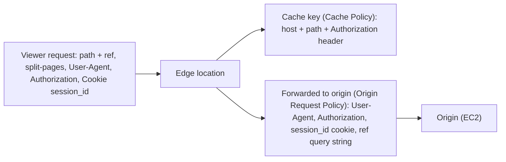

- The **cache key** contains only host, path and `Authorization`, so a cached response is reused for every request with the same authorization.
- The **origin** also receives `User-Agent`, the `session_id` cookie and the `ref` query string (for logging or analytics) without each value creating its own cached copy.
- `split-pages` and the other headers are dropped because neither policy includes them.

> **Important**: To forward the `Authorization` header for cached GET/HEAD requests, put it in the **cache policy**; an origin request policy can't include it. Keeping it in the cache key stops one user's authorised response being served to someone else.

### 🧑‍💻 Creating a Cache Policy with the SDK

```javascript
import { CloudFrontClient, CreateCachePolicyCommand } from "@aws-sdk/client-cloudfront";

const cf = new CloudFrontClient({ region: "us-east-1" });

const { CachePolicy } = await cf.send(
  new CreateCachePolicyCommand({
    CachePolicyConfig: {
      Name: "vary-on-language-and-size",
      MinTTL: 0,
      DefaultTTL: 3600, // 1 hour when the origin sends no Cache-Control
      MaxTTL: 86400,
      ParametersInCacheKeyAndForwardedToOrigin: {
        EnableAcceptEncodingGzip: true,
        EnableAcceptEncodingBrotli: true,
        HeadersConfig: {
          HeaderBehavior: "whitelist",
          Headers: { Quantity: 1, Items: ["Accept-Language"] },
        },
        CookiesConfig: { CookieBehavior: "none" },
        QueryStringsConfig: {
          QueryStringBehavior: "whitelist",
          QueryStrings: { Quantity: 1, Items: ["size"] },
        },
      },
    },
  })
);

console.log("Cache policy id:", CachePolicy.Id); // reference it as CachePolicyId in a cache behavior
```

- IAM permission: `cloudfront:CreateCachePolicy`, then `cloudfront:UpdateDistribution` to attach it to a behavior.

### 🛠️ In Practice

- **Start from managed policies**: `CachingOptimized` for static S3 content, and `CachingDisabled` + `AllViewerExceptHostHeader` for APIs on ALB or API Gateway, cover most needs.
- **Never put session cookies or `User-Agent` in the cache key** unless you mean to; the hit ratio drops to almost zero. For device variants use `CloudFront-Is-Mobile-Viewer` (a few values) rather than `User-Agent` (thousands).
- **Separate static and dynamic paths** with different cache behaviors, each with its own cache policy.
- **Watch the cache hit ratio** in the CloudFront console reports (or the `CacheHitRate` metric with additional metrics enabled). A low ratio usually means too many values in the cache key or very short TTLs.
- **Let the origin decide freshness** with `Cache-Control`, and use the policy's min/max TTL as guard rails.
- **API Gateway and S3 origins** expect their own `Host` header; forwarding the viewer's `Host` breaks them. Use `AllViewerExceptHostHeader`.

### 🎯 DVA-C02 Exam Tips

- **"Low cache hit ratio" / "origin overloaded despite CloudFront"** → remove unneeded headers, cookies and query strings from the **cache key**; move values the origin needs into an **Origin Request Policy**.
- **"Origin needs a header or cookie but caching must not vary on it"** → **Origin Request Policy**.
- **"Serve different content per language / device / country"** → add `Accept-Language` / `CloudFront-Is-Mobile-Viewer` / `CloudFront-Viewer-Country` to the **cache policy**.
- **"Content varies on a query string but CloudFront returns the same object"** → the default cache key has no query strings; whitelist it in the cache policy.
- **TTL range** is 0 s to 1 year; default TTL 1 day. **`s-maxage` beats `max-age`** for CloudFront.
- **"Disable caching for an API path"** → cache behavior with the managed **CachingDisabled** policy.
- **Legacy cache settings** (forwarding headers, cookies and query strings directly on the behavior) still appear in older questions; cache and origin request policies are the modern equivalent.
- Adding headers to **responses** (CORS, HSTS, security headers) is a third policy type: the **Response Headers Policy**.

### 📝 Key Exam Takeaways

- Each **edge location** has its own cache; objects are identified by the **cache key**.
- Default cache key = **hostname + URL path**; headers, cookies and query strings are excluded unless a **Cache Policy** adds them.
- **Cache Policy** = cache key contents + **TTL** (0 s to 1 year, default 1 day); everything in the key is also forwarded to the origin.
- Header options: **None / Whitelist**. Cookies and query strings: **None / Whitelist / All-Except / All**. "All" gives the **worst** cache performance.
- **Origin Request Policy** = forward values to the origin **without** changing the cache key; it can also add CloudFront and custom headers.
- Maximise the **cache hit ratio** by keeping the cache key minimal.

---

## Lecture 156: 🧹 CloudFront - Cache Invalidations

> **Overview**: CloudFront doesn't know when you change files at the origin; it keeps serving the cached copy until the TTL expires. A **cache invalidation** (`CreateInvalidation`) forces edge locations to drop cached objects for specific paths or wildcards (`/index.html`, `/images/*`, `/*`), so the next request fetches the fresh version. This lecture covers when to invalidate, how paths work, cost and limits, and the versioned-filename alternative.

### ❗ The Problem: Stale Content

- You update `index.html` in the S3 bucket (or deploy a new app version behind an ALB).
- Edge locations still hold the old object and keep serving it until the **TTL expires** (1 day by default).
- CloudFront does **not** watch the origin for changes.

### 🧹 The Fix: Invalidation

- An invalidation tells **every edge location** (and regional edge cache) to remove the matching objects, **bypassing the TTL**.
- You can invalidate:
    - **Specific files**: `/index.html`, `/css/site.css`
    - **A path with a wildcard**: `/images/*`
    - **Everything**: `/*`
- The next request for an invalidated object is a cache miss, so CloudFront fetches the current version from the origin.
- Invalidation **removes** objects; it doesn't pre-load them. The first user after an invalidation pays the miss latency.

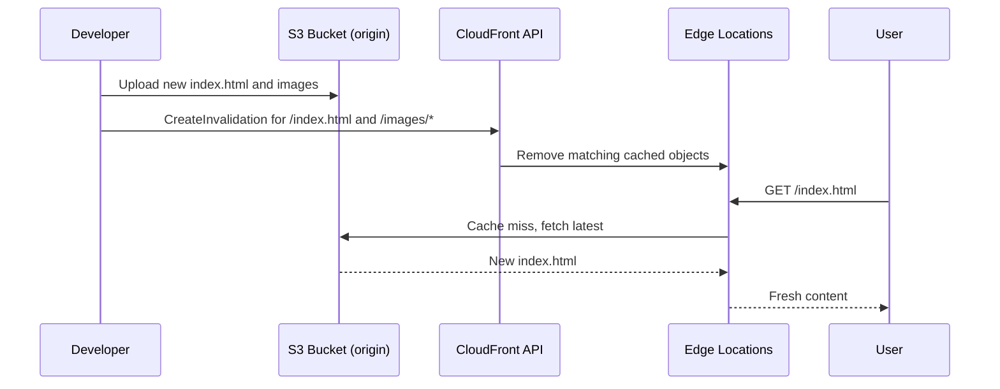

### 📏 Path Rules, Cost and Limits

| Topic | Detail |
| --- | --- |
| Path format | Must start with `/`; **case-sensitive**; the `*` wildcard goes at the **end** of the path |
| Query-string variants | To remove every query-string variant of an object, use a trailing wildcard, e.g. `/images/cat.jpg*` |
| Cost | First **1,000 paths per month free** (per account), then a small charge per path |
| Wildcards | `/images/*` or `/*` counts as **one path** for billing, even if it removes thousands of files |
| Concurrency limits | Up to **3,000 individual file paths** in progress at a time, or up to **15 wildcard paths** in progress |
| Duration | Usually seconds to a few minutes; status goes `InProgress` → `Completed` |
| Permission | `cloudfront:CreateInvalidation` on the distribution |

> **Important**: `/*` is one path for billing, so invalidating everything is cheap, but it throws away your **whole cache** and causes a burst of traffic to the origin. Invalidate only what changed when you can.

### 💻 CLI and SDK

```bash
# Invalidate the home page and all images (always quote paths so the shell doesn't expand *)
aws cloudfront create-invalidation \
  --distribution-id EDFDVBD6EXAMPLE \
  --paths "/index.html" "/images/*"

# Check status
aws cloudfront get-invalidation --distribution-id EDFDVBD6EXAMPLE --id I2J0I21PCUYOIK
aws cloudfront list-invalidations --distribution-id EDFDVBD6EXAMPLE

# Wait in a deploy script until it finishes
aws cloudfront wait invalidation-completed \
  --distribution-id EDFDVBD6EXAMPLE --id I2J0I21PCUYOIK
```

```javascript
import { CloudFrontClient, CreateInvalidationCommand } from "@aws-sdk/client-cloudfront";

const cf = new CloudFrontClient({ region: "us-east-1" });

const { Invalidation } = await cf.send(
  new CreateInvalidationCommand({
    DistributionId: "EDFDVBD6EXAMPLE",
    InvalidationBatch: {
      CallerReference: `deploy-${Date.now()}`, // unique per invalidation (idempotency)
      Paths: { Quantity: 2, Items: ["/index.html", "/images/*"] },
    },
  })
);

console.log(Invalidation.Id, Invalidation.Status); // e.g. "I2J0I21PCUYOIK", "InProgress"
```

- `CallerReference` makes the call **idempotent**: resending the same reference with the same paths returns the existing invalidation instead of creating a new one.
- `Quantity` must equal the number of `Items`.

#### ⚡ Automatic Invalidation on S3 Upload

A common pattern is a Lambda function triggered by S3 event notifications that invalidates the uploaded keys:

```javascript
import { CloudFrontClient, CreateInvalidationCommand } from "@aws-sdk/client-cloudfront";

const cf = new CloudFrontClient({ region: "us-east-1" });

export const handler = async (event) => {
  // S3 keys arrive URL-encoded, with spaces as "+"
  const paths = event.Records.map(
    (r) => "/" + decodeURIComponent(r.s3.object.key.replace(/\+/g, " "))
  );

  await cf.send(
    new CreateInvalidationCommand({
      DistributionId: process.env.DISTRIBUTION_ID,
      InvalidationBatch: {
        CallerReference: `s3-${event.Records[0].eventTime}-${paths.length}`,
        Paths: { Quantity: paths.length, Items: paths },
      },
    })
  );
};
```

- The Lambda execution role needs `cloudfront:CreateInvalidation`. For frequent uploads, batch paths (or use versioned names) rather than one invalidation per object, to stay inside the free 1,000 paths and the concurrency limits.

### 🔁 Alternative: Versioned File Names

| Approach | How | Pros | Cons |
| --- | --- | --- | --- |
| **Invalidation** | Same filename, call `CreateInvalidation` | No HTML changes needed | Cost beyond 1,000 paths, limits, short propagation delay, cache flushed |
| **Versioned / fingerprinted names** | `app.v2.js`, `logo.3f9a1c.png`, referenced from HTML | Instant, free, old and new versions coexist, browsers update too | Needs a build step to rename files and update references |
| **Short TTL** | `Cache-Control: max-age=60` | Simple, self-healing | More origin traffic, lower hit ratio |

- Best practice: **version your static assets** and give them long TTLs; only **invalidate the small entry points** (`index.html`) on each deploy.
- Invalidation only affects CloudFront. **Browsers** may still hold the old file in their own cache; versioned names fix that too.

### 🛠️ In Practice

- A typical front-end deploy step: `aws s3 sync ./dist s3://bucket --delete`, then `aws cloudfront create-invalidation --paths "/index.html"` (or `"/*"` for small sites). Run it from CodeBuild or GitHub Actions with a role that only allows `cloudfront:CreateInvalidation` on that distribution.
- If users still see old content after an invalidation: check it is `Completed`, check the path's case and leading slash, then suspect **browser caching** (`max-age`) or a service worker.
- Invalidation is not a security tool: purging a file from the cache doesn't help against anyone who already downloaded it. Delete it at the origin, then invalidate.

### 🎯 DVA-C02 Exam Tips

- **"Updated content at the origin but users still see the old version"** → **cache invalidation** (or wait for the TTL); the cleanest long-term answer is **versioned file names**.
- **"Refresh content immediately without waiting for the TTL"** → `CreateInvalidation`.
- **"Invalidate all files"** → path `/*`; **"all images"** → `/images/*`.
- **"Reduce invalidation cost"** → wildcards (one path each) or versioned filenames.
- **Invalidation vs TTL**: TTL is passive expiry; invalidation is an active, on-demand purge.
- Don't confuse with **S3 Versioning**: a new S3 object version keeps the same URL, so it doesn't refresh CloudFront's cache by itself.

### 📝 Key Exam Takeaways

- CloudFront **doesn't detect origin changes**; it serves cached content until the **TTL** expires.
- A **CloudFront invalidation** forces a full or partial refresh, **bypassing the TTL**.
- Invalidate everything with `/*` or a path such as `/images/*`; paths start with `/` and are case-sensitive.
- First **1,000 paths per month free**; a wildcard counts as one path.
- API: `CreateInvalidation` (CLI `aws cloudfront create-invalidation`), permission `cloudfront:CreateInvalidation`, requires a unique `CallerReference`.
- **Versioned file names** are the preferred alternative for frequently changing static assets.

---

## Lecture 157: 🧭 CloudFront - Cache Behaviors

> **Overview**: A **cache behavior** is a set of rules that CloudFront applies to requests whose URL matches a **path pattern** (`/images/*`, `/api/*`, `/login`). Each behavior picks its own **origin**, cache policy, allowed methods, viewer access restrictions and edge functions, so one distribution can serve static files from S3 and dynamic API calls from an ALB. Every distribution has a **default behavior** (`*`), which is always evaluated last and catches everything else.

### 🧩 What a Cache Behavior Is

- A distribution has **one or more origins** (S3 bucket, ALB, EC2, API Gateway, any HTTP server) and an **ordered list of cache behaviors**.
- For every request, CloudFront compares the URL path against the behaviors **in order** and uses the **first match**.
- The **default cache behavior** (`*`, shown in the console as "Default (*)") always exists, can't be deleted and is **always processed last**.
- Behaviors let you treat different parts of the site differently: long caching for images, no caching for the API, authentication only for premium content.

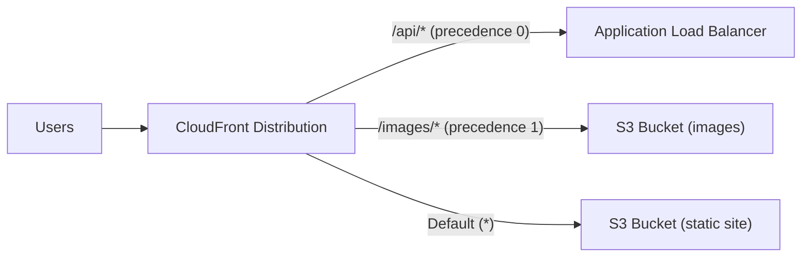

### ⚙️ Settings You Can Set Per Behavior

| Setting | What it controls | Typical choice |
| --- | --- | --- |
| **Path pattern** | Which URLs the behavior applies to | `/api/*`, `/images/*.jpg`, `/login` |
| **Origin or origin group** | Where cache misses are sent | ALB for `/api/*`, S3 for static files |
| **Viewer protocol policy** | HTTP and HTTPS, Redirect HTTP to HTTPS, or HTTPS only | Redirect HTTP to HTTPS |
| **Allowed HTTP methods** | `GET, HEAD` / `GET, HEAD, OPTIONS` / all seven methods incl. `POST, PUT, PATCH, DELETE` | All methods for APIs, `GET, HEAD` for static |
| **Cache policy** | TTLs and the cache key (headers, cookies, query strings) | `CachingOptimized` for static, `CachingDisabled` for APIs |
| **Origin request policy** | Extra values forwarded to the origin without entering the cache key | `AllViewerExceptHostHeader` for APIs |
| **Response headers policy** | Headers added to responses (CORS, security headers) | `SimpleCORS`, `SecurityHeadersPolicy` |
| **Restrict viewer access** | Require **signed URLs or signed cookies** (trusted key groups) | On for premium content |
| **Function associations** | CloudFront Functions or Lambda@Edge on viewer/origin request/response | URL rewrites, auth checks, header changes |
| **Compress objects** | Automatic Gzip/Brotli | On |
| **Real-time logs** | Send logs for this behavior to Kinesis Data Streams | Per behavior if needed |

> **Important**: Because the cache policy is attached **per behavior**, the cache key can be different for each path. The API can forward the `Authorization` header and every query string while the images path caches on the URL only.

### 🔀 Path Patterns and Precedence

- Patterns are **case-sensitive** and may use `*` (zero or more characters) and `?` (exactly one character).
- A leading `/` is optional: `images/*.jpg` and `/images/*.jpg` are the same.
- Examples: `/images/*.jpg` (all JPEGs under images), `*.gif` (every GIF anywhere), `/api/v?/*` (`/api/v1/...`, `/api/v2/...`).
- **Order matters**: put the **most specific** patterns first. If `/images/*` comes before `/images/thumbs/*`, the thumbs behavior is never used.
- Behaviors have a **precedence number** (0 = evaluated first). You reorder them in the console (Behaviors tab, "Move up/down") or by changing the order in the distribution config.
- Default quota: **25 cache behaviors per distribution** (adjustable).

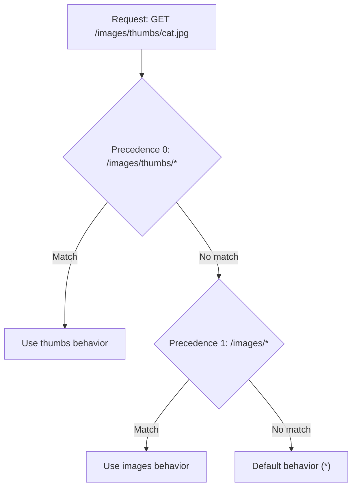

### 🔐 Pattern: Sign-In Page with Signed Cookies

A common use of behaviors is protecting a whole site while leaving the login page open:

- **`/login` behavior** → origin is an **EC2 instance or ALB** running the app; viewer access is **not restricted**, and caching is disabled.
- **Default `*` behavior** → origin is the **S3 bucket** with the content; **Restrict viewer access** is on, so requests need valid **signed cookies**.
- Flow: the user opens `/login`, authenticates, and the app returns **`Set-Cookie`** headers with CloudFront signed cookies. From then on, requests to `/*` carry the cookies and CloudFront serves the content.

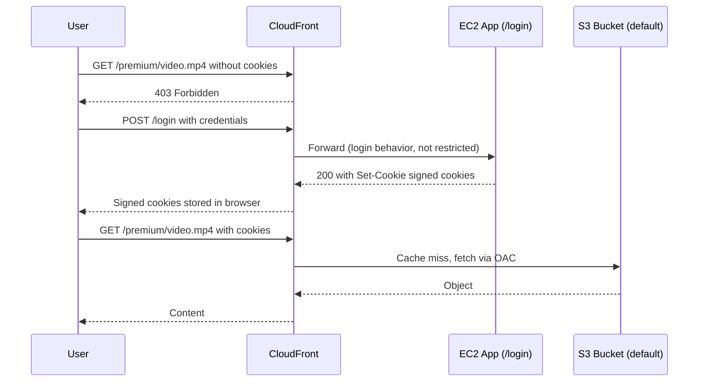

### ⚡ Pattern: Separate Static and Dynamic Content

- **Static content** (S3): no headers, no cookies, no session data in the cache key → very high cache hit ratio.
- **Dynamic content** (ALB + EC2, API Gateway, Lambda function URLs): the cache key and forwarded values include only the headers, cookies and query strings the app really needs, or caching is disabled.
- Mixing them in one behavior with "forward all headers and cookies" makes every request unique, so nothing gets cached. Splitting them by path (or into two distributions) is how you **maximise cache hits**.

### 💻 CLI and SDK: Adding a Behavior

Cache behaviors are part of the **distribution config**, so you change them with `UpdateDistribution`. The update replaces the whole config and needs the current **ETag** (optimistic locking).

```bash
# 1. Get the current config and its ETag
aws cloudfront get-distribution-config --id EDFDVBD6EXAMPLE > dist.json

# 2. Copy DistributionConfig into new-config.json, add an /api/* entry
#    to CacheBehaviors.Items and update CacheBehaviors.Quantity

# 3. Push the full config back, passing the ETag from step 1
aws cloudfront update-distribution --id EDFDVBD6EXAMPLE \
  --if-match E2QWRUHEXAMPLE \
  --distribution-config file://new-config.json
```

```javascript
import {
  CloudFrontClient,
  GetDistributionConfigCommand,
  UpdateDistributionCommand,
} from "@aws-sdk/client-cloudfront";

const cf = new CloudFrontClient({ region: "us-east-1" });
const Id = "EDFDVBD6EXAMPLE";

const { DistributionConfig, ETag } = await cf.send(new GetDistributionConfigCommand({ Id }));

const apiBehavior = {
  PathPattern: "/api/*",
  TargetOriginId: "my-alb-origin", // must match an Id in DistributionConfig.Origins
  ViewerProtocolPolicy: "https-only",
  AllowedMethods: {
    Quantity: 7,
    Items: ["GET", "HEAD", "OPTIONS", "PUT", "PATCH", "POST", "DELETE"],
    CachedMethods: { Quantity: 2, Items: ["GET", "HEAD"] },
  },
  CachePolicyId: "4135ea2d-6df8-44a3-9df3-4b5a84be39ad", // managed CachingDisabled
  OriginRequestPolicyId: "b689b0a8-53d0-40ab-baf2-68738e2966ac", // managed AllViewerExceptHostHeader
  Compress: true,
};

// Most specific first: put the new behavior at the front of the list
const items = [apiBehavior, ...(DistributionConfig.CacheBehaviors.Items ?? [])];
DistributionConfig.CacheBehaviors = { Quantity: items.length, Items: items };

await cf.send(new UpdateDistributionCommand({ Id, IfMatch: ETag, DistributionConfig }));
```

- If someone else changed the distribution after your `Get`, the update fails with **`PreconditionFailed`** (stale ETag); fetch again and retry.
- Changes propagate to all edge locations in a few minutes; the distribution status goes `InProgress` → `Deployed`.
- Required permissions: `cloudfront:GetDistributionConfig` and `cloudfront:UpdateDistribution`.

### 🛠️ In Practice

- A standard SPA layout: default `*` → S3 with `CachingOptimized`; `/api/*` → ALB or API Gateway with `CachingDisabled` and `AllViewerExceptHostHeader`. The browser calls the API on the **same domain**, so you avoid CORS entirely.
- CloudFront forwards the **full path** to the origin. A request to `/api/users` reaches the ALB as `/api/users`, not `/users`; the backend must expect the prefix, or a CloudFront Function must rewrite it.
- When a path "isn't working", check precedence first: an earlier, broader pattern (`*.js`, `/static/*`) often swallows the request. The `X-Cache` response header shows whether the request hit the cache.
- Manage distributions as code (CloudFormation `AWS::CloudFront::Distribution`, CDK, SAM). Hand-editing the full config through the API is error-prone.

### 🎯 DVA-C02 Exam Tips

- **"Route `/api/*` to an ALB and everything else to S3 behind one domain"** → multiple origins + **cache behaviors** by path pattern.
- **"Different caching/TTL for different file types or paths"** → separate cache behaviors, each with its own **cache policy**.
- **"Protect all content except the login page"** → `/login` behavior without restrictions, default behavior with **signed cookies** (trusted key group).
- **"Maximise cache hit ratio for a site with static and dynamic content"** → split static and dynamic into separate behaviors (or distributions); keep the static cache key minimal.
- The **default behavior is `*`** and is evaluated **last**; patterns are matched in precedence order, first match wins.
- A behavior that only allows `GET, HEAD` rejects `POST` with a **403**; APIs need all methods allowed.
- Don't confuse **cache behaviors** (path-based routing inside CloudFront) with **origin groups** (primary/secondary failover origins). A behavior can point to an origin group.

### 📝 Key Exam Takeaways

- **Cache behaviors** apply settings per **URL path pattern** and can route each pattern to a **different origin or origin group**.
- The **default cache behavior** (`*`) always exists and is **processed last**; more specific patterns get lower precedence numbers.
- Per-behavior settings include origin, viewer protocol policy, allowed methods, cache and origin request policies, signed URL/cookie restriction and edge functions.
- Classic patterns: `/api/*` → ALB, `/*` → S3; `/login` open, the rest protected by **signed cookies**.
- Separating **static** and **dynamic** content maximises cache hits.
- Behaviors are changed through `UpdateDistribution` with the config's **ETag** (`IfMatch`).

---

## Lecture 158: 🧪 CloudFront - Caching & Caching Invalidations - Hands On

> **Overview**: This hands-on goes back to the distribution from Lecture 154 (private S3 bucket + OAC) and tours the **Policies** pages: managed and custom **cache policies**, **origin request policies** and **response headers policies**, and how they attach to a **cache behavior**. You then change `index.html` at the origin, prove that CloudFront keeps serving the **stale cached copy**, and fix it with a **cache invalidation**.

### 🎯 What You Do

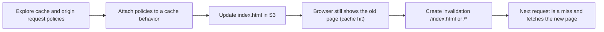

- **Starting point**: the distribution from Lecture 154 (default behavior → private S3 bucket, cache policy `CachingOptimized`, default root object `index.html`).
- **Files**: `index.html`, `coffee.jpg` and `beach.jpg` from the course `code/s3/` folder.

### 🪜 Step 1: Explore the Cache Policies

**CloudFront console → Policies → Cache** tab. You see two lists: **Managed policies** (provided by AWS, read-only) and **Custom policies** (yours).

| Managed cache policy | What it does | Typical use |
| --- | --- | --- |
| `CachingOptimized` | No headers, cookies or query strings in the key; TTLs min 1 s, default 1 day, max 1 year; Gzip and Brotli on | Static content from S3 (the default) |
| `CachingOptimizedForUncompressedObjects` | Same, but without the compression settings | Origins that serve pre-compressed or binary files |
| `CachingDisabled` | All TTLs 0, nothing cached | APIs and per-user dynamic content |
| `UseOriginCacheControlHeaders` | Honours the origin's `Cache-Control`/`Expires`; host header in the key | Origins that set their own caching headers |
| `UseOriginCacheControlHeaders-QueryStrings` | As above, plus all query strings in the key | Dynamic origins whose output varies by query string |
| `Amplify`, `Elemental-MediaPackage` | Tuned for those services | Amplify Hosting, video streaming |

Then **Create cache policy** to see every option you can control:

- **TTL settings**: minimum, default and maximum TTL (0 seconds to 1 year). The **default TTL** applies when the origin sends no `Cache-Control` or `Expires` header; min and max **clamp** whatever the origin asks for.
- **Cache key settings**:
    - **Headers**: None or Include the following headers (whitelist).
    - **Query strings**: None, Include specified, All except, All.
    - **Cookies**: None, Include specified, All except, All.
- **Compression support**: Gzip and Brotli (adds the normalised `Accept-Encoding` to the key).

> **Important**: Everything you add to the cache key is **also forwarded to the origin** automatically. You never need to repeat it in the origin request policy.

The same custom policy from the CLI, caching on the `size` query string only:

```json
{
  "Name": "images-by-size",
  "Comment": "Cache images per size query string",
  "MinTTL": 1,
  "DefaultTTL": 86400,
  "MaxTTL": 31536000,
  "ParametersInCacheKeyAndForwardedToOrigin": {
    "EnableAcceptEncodingGzip": true,
    "EnableAcceptEncodingBrotli": true,
    "HeadersConfig": { "HeaderBehavior": "none" },
    "CookiesConfig": { "CookieBehavior": "none" },
    "QueryStringsConfig": {
      "QueryStringBehavior": "whitelist",
      "QueryStrings": { "Quantity": 1, "Items": ["size"] }
    }
  }
}
```

```bash
aws cloudfront create-cache-policy --cache-policy-config file://images-by-size.json

# List only your own policies (use --type managed to see the AWS ones and their IDs)
aws cloudfront list-cache-policies --type custom
```

### 🪜 Step 2: Origin Request and Response Headers Policies

**Policies → Origin request** tab. These policies forward values to the origin **without** adding them to the cache key.

| Managed origin request policy | Forwards |
| --- | --- |
| `AllViewer` | Every viewer header, cookie and query string |
| `AllViewerExceptHostHeader` | Everything except `Host` (needed for API Gateway and Lambda function URL origins, which expect their own hostname) |
| `AllViewerAndCloudFrontHeaders-2022-06` | Everything plus CloudFront headers such as `CloudFront-Viewer-Country` |
| `CORS-S3Origin` | `Origin`, `Access-Control-Request-Method`, `Access-Control-Request-Headers` |
| `CORS-CustomOrigin` | `Origin` only |
| `UserAgentRefererHeaders` | `User-Agent` and `Referer` |

- A custom origin request policy can also add **CloudFront-generated headers** (viewer country, device type, viewer address) that the viewer never sent.
- **Policies → Response headers** tab: managed policies such as `SimpleCORS`, `CORS-With-Preflight` and `SecurityHeadersPolicy` add headers to the response on the way back to the viewer, without touching the origin.

### 🪜 Step 3: Attach the Policies to a Behavior

1. Open the distribution → **Behaviors** tab → select **Default (*)** → **Edit**.
2. Under **Cache key and origin requests**, choose **Cache policy and origin request policy (recommended)**. The older **Legacy cache settings** option still exists but is not the recommended path.
3. Pick a **cache policy** (keep `CachingOptimized` for this S3 site), optionally an **origin request policy** and a **response headers policy**.
4. **Save changes**. The distribution goes to **Deploying** for a few minutes.

> **Exam Tip**: Policies are reusable objects attached **per cache behavior**. One distribution can use `CachingOptimized` on `*` and `CachingDisabled` on `/api/*`.

### 🪜 Step 4: Update the Origin and See Stale Content

1. Load `https://d1a2b3c4d5e6f7.cloudfront.net/` so the page is cached at your edge location.
2. Edit `index.html` locally: change the heading from "I really love coffee" to something new and switch the image from `coffee.jpg` to `beach.jpg`.
3. Upload the new `index.html` to the bucket (same key, overwrite).
4. Reload the CloudFront URL. You still see the **old page**: the edge has a valid cached copy and does not check S3 for changes.

```bash
BUCKET=demo-cloudfront-bp-2026
CF=d1a2b3c4d5e6f7.cloudfront.net

aws s3 cp index.html s3://$BUCKET/index.html

# Still served from the edge cache: X-Cache is a hit and Age keeps growing
curl -sI https://$CF/ | grep -i -E "x-cache|^age"

# The bucket really has the new version (read it with your IAM credentials)
aws s3 cp s3://$BUCKET/index.html - | grep h1
```

- With `CachingOptimized` and no `Cache-Control` on the S3 object, the **default TTL of 24 hours** applies, so without action users could see the old page for up to a day.
- Test with `curl` or a private window. A normal browser reload can also show a **browser-cached** copy, which confuses the result.

### 🪜 Step 5: Create the Invalidation

1. Distribution → **Invalidations** tab → **Create invalidation**.
2. **Add object paths**: `/index.html` (just the changed file) or `/*` (everything). One path per line, each starting with `/`.
3. **Create invalidation**. Status shows **In progress**, then **Completed**, usually within a minute.
4. Reload the CloudFront URL: you now see the **new heading and the beach image**. `curl` shows `Miss from cloudfront` once, then hits again.

```bash
ID=$(aws cloudfront create-invalidation \
  --distribution-id EDFDVBD6EXAMPLE \
  --paths "/index.html" \
  --query Invalidation.Id --output text)

aws cloudfront wait invalidation-completed --distribution-id EDFDVBD6EXAMPLE --id "$ID"

curl -sI https://$CF/ | grep -i x-cache   # Miss from cloudfront, then Hit on the next call
```

> **Important**: With a **default root object**, the root URL and the file itself can be cached under different keys. Invalidate both `/` and `/index.html` (two paths), or use `/*`, which clears everything and still counts as **one path**.

### 🧑‍💻 Deploy and Invalidate from Node.js

A deploy script does steps 4 and 5 together: upload, invalidate, wait.

```javascript
import { readFile } from "node:fs/promises";
import { S3Client, PutObjectCommand } from "@aws-sdk/client-s3";
import {
  CloudFrontClient,
  CreateInvalidationCommand,
  waitUntilInvalidationCompleted,
} from "@aws-sdk/client-cloudfront";

const s3 = new S3Client({ region: "us-east-1" });
const cf = new CloudFrontClient({ region: "us-east-1" });
const DistributionId = "EDFDVBD6EXAMPLE";

await s3.send(
  new PutObjectCommand({
    Bucket: "demo-cloudfront-bp-2026",
    Key: "index.html",
    Body: await readFile("index.html"),
    ContentType: "text/html",
    CacheControl: "max-age=60", // short TTL for the entry point (within the policy's min/max)
  })
);

const { Invalidation } = await cf.send(
  new CreateInvalidationCommand({
    DistributionId,
    InvalidationBatch: {
      CallerReference: `deploy-${Date.now()}`,
      Paths: { Quantity: 2, Items: ["/", "/index.html"] },
    },
  })
);

await waitUntilInvalidationCompleted(
  { client: cf, maxWaitTime: 600 },
  { DistributionId, Id: Invalidation.Id }
);
console.log("Invalidation", Invalidation.Id, "completed");
```

- IAM permissions: `s3:PutObject` on the bucket, `cloudfront:CreateInvalidation` and `cloudfront:GetInvalidation` (used by the waiter) on the distribution.
- Setting `Cache-Control` on the object lets the origin pick the TTL; the cache policy's min and max TTL still clamp it.

### 🧹 Clean Up

- Custom cache and origin request policies can only be deleted once **no behavior uses them** (`aws cloudfront delete-cache-policy --id ... --if-match <ETag>`).
- Invalidations need no clean-up; they are kept in the history automatically.
- If you are done with CloudFront, follow the Lecture 154 order: **disable → wait → delete distribution → delete OAC → empty and delete bucket**.

### 🛠️ In Practice

- Prefer **managed policies** unless you need something specific; they are tested, documented and referenced by stable IDs in CloudFormation/CDK.
- Keep the cache key minimal. A whitelist of one query string beats "All", and adding `User-Agent` or all cookies to the key usually destroys the hit ratio.
- Give fingerprinted assets (`app.3f9a1c.js`) a long `Cache-Control: max-age=31536000, immutable` and the entry point (`index.html`) a short TTL or an invalidation on each deploy.
- Debug caching with response headers: `X-Cache` (Hit, Miss, RefreshHit, Error), `Age`, and `Cache-Control` from the origin. The distribution's **cache statistics** and **popular objects** reports show hit ratio over time.

### 🎯 DVA-C02 Exam Tips

- **"Changed a file in S3 but CloudFront still serves the old one"** → content is cached until the TTL ends; run a **CreateInvalidation** (or use versioned filenames).
- **"Cache content per query string / header / cookie"** → put it in the **cache policy**; **"origin needs a value but caching should not vary on it"** → **origin request policy**.
- **"Don't cache API responses"** → `CachingDisabled` on that behavior.
- **"Origin controls how long objects stay cached"** → `Cache-Control: max-age` / `s-maxage` or `Expires` from the origin, bounded by the policy's **min and max TTL**; the **default TTL** applies when the origin sends nothing.
- **"API Gateway or Lambda function URL origin returns 403 through CloudFront"** → forwarding the viewer `Host` header; use `AllViewerExceptHostHeader`.
- Invalidation is per distribution and covers **all edge locations**; it doesn't clear **browser** caches.

### 📝 Key Exam Takeaways

- **Cache policies** set the TTLs and the cache key (headers, cookies, query strings); managed ones include `CachingOptimized` and `CachingDisabled`.
- **Origin request policies** forward extra values to the origin **without** changing the cache key; **response headers policies** add headers to responses.
- Policies are attached **per cache behavior** (Behaviors tab → Edit).
- Updating an object at the origin does **not** refresh CloudFront; users get the cached copy until the TTL expires.
- **Invalidations tab → Create invalidation** with `/index.html` or `/*` forces the refresh; CLI `aws cloudfront create-invalidation`, then `wait invalidation-completed`.
- Verify with `X-Cache` and `Age` headers, using `curl` or a private window to rule out the browser cache.

---
