# RDS + Aurora + ElastiCache

## Lecture 77: 🗄️ Amazon RDS Overview

> 📌 **Section 8 — AWS Fundamentals: RDS + Aurora + ElastiCache**<br>Amazon RDS (Relational Database Service) is AWS's managed relational database service. It lets you run SQL-based databases in the cloud without managing the underlying server infrastructure.

### 🧠 What is Amazon RDS?

- **RDS** = **Relational Database Service**
- It is a **managed** database service — AWS handles provisioning, patching, backups, monitoring, and hardware
- Uses **SQL** as the query language
- Designed for **OLTP** (Online Transaction Processing) workloads

#### 🛢️ Supported Database Engines

| Engine | Notes |
| --- | --- |
| **PostgreSQL** | Popular open-source RDBMS |
| **MySQL** | Most widely used open-source DB |
| **MariaDB** | Community fork of MySQL |
| **Oracle** | Enterprise-grade, requires license |
| **Microsoft SQL Server** | Windows-based enterprise DB |
| **IBM Db2** | IBM's enterprise relational DB |
| **Aurora** | AWS-proprietary, covered separately |

> 💡 **Exam Tip**: Aurora is NOT listed alongside the others in the same category — it's a cloud-native engine built by AWS and is significantly more performant. It's covered in its own lecture.

### ✅ Why Use RDS Instead of Self-Managed DB on EC2?

> If you run a database engine on EC2 yourself, you manage *everything*. RDS abstracts all of that away.

| Feature | RDS (Managed) | DIY on EC2 |
| --- | --- | --- |
| OS patching | ✅ AWS handles | ❌ You handle |
| DB patching | ✅ AWS handles | ❌ You handle |
| Automated backups | ✅ Built-in | ❌ Manual setup |
| Point-in-time restore | ✅ Up to 35 days | ❌ Not available by default |
| Monitoring dashboards | ✅ CloudWatch integration | ❌ Manual setup |
| Read Replicas | ✅ Supported | ❌ Manual setup |
| Multi-AZ for HA | ✅ Easy toggle | ❌ Complex to configure |
| Vertical / horizontal scaling | ✅ Storage auto-scaling | ❌ Manual |
| EBS-backed storage | ✅ gp2 or io1 | ✅ But managed by you |

> ⚠️ **Limitation**: You **cannot SSH into** an RDS instance — AWS manages the underlying EC2 host entirely.

### 🚀 RDS Key Features

#### 🔄 Automated Backups

- Automated backups are **enabled by default**
- Daily full backup of the database (during maintenance window)
- **Transaction logs** are backed up every **5 minutes**
- This allows **Point-In-Time Restore (PITR)** — restore to any point in the last **1 to 35 days**
- Backups are stored in **S3** (internally managed by AWS)

#### 📸 Manual DB Snapshots

- Triggered manually by the user
- **No expiration** — retained as long as you want
- Useful for long-term data retention or cloning environments

> 💡 **Tip**: If you stop an RDS instance, you're still charged for storage. To save cost for long periods of inactivity, take a **snapshot** and **delete** the instance, then restore later.

#### 📈 Storage Auto Scaling

- RDS can automatically scale storage up when it's running out of free space
- You set a **Maximum Storage Threshold** (upper limit)
- Scaling triggers when:

    - Free storage is less than **10%** of allocated storage
    - Low-storage condition lasts at least **5 minutes**
    - 6 hours have passed since last modification
- Supports **gp2**, **gp3**, **io1**, **io2** storage types
- Useful for **unpredictable workloads** — no manual intervention needed

```bash
# Example: Create an RDS instance with storage auto-scaling
aws rds create-db-instance \
  --db-instance-identifier mydb \
  --db-instance-class db.t3.micro \
  --engine mysql \
  --master-username admin \
  --master-user-password secret99 \
  --allocated-storage 20 \
  --max-allocated-storage 100
```

### 🏗️ RDS Architecture Overview

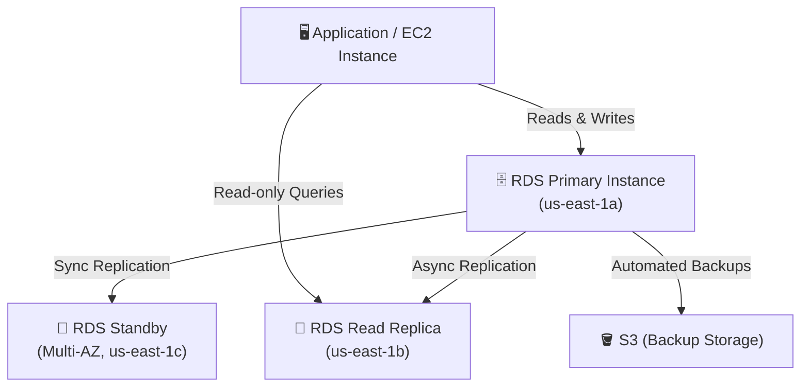

### 🌍 RDS Multi-AZ vs Read Replicas — Quick Preview

> These are covered in depth in **Lecture 78**, but here's a quick primer:

#### 📖 Read Replicas

- Up to **15 Read Replicas** (within AZ, cross-AZ, or cross-region)
- **Asynchronous** replication → eventually consistent
- Replicas can be **promoted** to their own DB
- Use case: **Scale read workloads** (SELECT queries), reporting, analytics

#### 🔁 Multi-AZ (Disaster Recovery)

- One **standby** instance in another AZ
- **Synchronous** replication
- Automatic **failover** if primary goes down (60–120 seconds)
- Not used for reads — standby is only for failover
- Use case: **High availability** and **disaster recovery**

### 🔒 RDS Security

> Full security details are in **Lecture 82**, but key points:

- **Encryption at rest**: Using **AWS KMS** (AES-256)

    - Must be enabled at creation time
    - Unencrypted DBs cannot be encrypted directly — must snapshot → copy encrypted → restore
- **Encryption in transit**: SSL/TLS connections enforced
- **Network isolation**: RDS is deployed within a **VPC**

    - Use **Security Groups** to control which EC2 instances or IPs can connect
- **IAM authentication**: Supported for MySQL and PostgreSQL (short-lived tokens via IAM)
- **Secrets Manager**: Recommended for storing and rotating DB credentials

### 🌐 RDS Subnet Groups

- A **DB Subnet Group** defines which subnets in your VPC can host RDS instances
- Best practice: place RDS in **private subnets** (not publicly accessible)
- Multi-AZ deployments span subnets across multiple AZs within the group

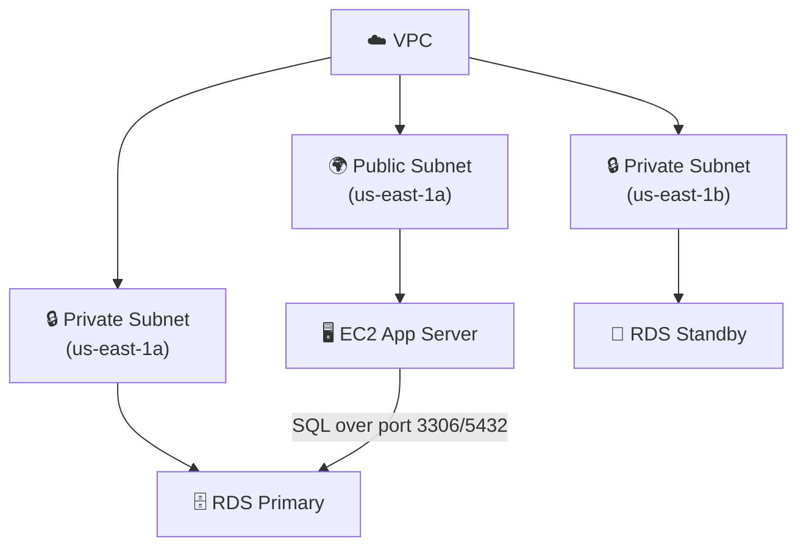

### 📊 RDS Instance Classes

| Class | Use Case |
| --- | --- |
| **db.t3 / db.t4g** | Dev/test, burstable performance |
| **db.m5 / db.m6g** | General purpose production workloads |
| **db.r5 / db.r6g** | Memory-optimized, high RAM workloads |
| **db.x2g** | Extreme memory for large databases |

> 💡 For the exam: `db.t3.micro` is the **free-tier eligible** instance class

### ⚙️ Maintenance & Updates

- AWS applies OS and DB engine patches during a **maintenance window**
- You can configure the preferred maintenance window (day + time)
- Minor version upgrades can be applied automatically
- Major version upgrades require **manual approval**

### 🏷️ RDS Pricing Dimensions

| Dimension | Description |
| --- | --- |
| **Instance hours** | Based on class and region (On-Demand or Reserved) |
| **Storage (GB/month)** | gp2/gp3/io1/io2 pricing differs |
| **I/O requests** | For magnetic storage (legacy) |
| **Backup storage** | Free up to 100% of DB size; charged beyond that |
| **Data transfer** | Egress charges apply |

> 💰 **Cost Tip**: Use **Reserved Instances** for RDS to save up to **60-70%** vs On-Demand for steady-state, predictable workloads (1-year or 3-year terms).

### 🆚 RDS vs Aurora (Quick Comparison)

| Feature | RDS | Aurora |
| --- | --- | --- |
| Engines | MySQL, PostgreSQL, Oracle, SQL Server, MariaDB, Db2 | MySQL-compatible, PostgreSQL-compatible |
| Storage scaling | Manual + auto-scaling | Auto-scales up to **128 TB** automatically |
| Replication | Up to 5 read replicas | Up to 15 read replicas |
| Failover time | ~60–120 seconds | ~30 seconds |
| Cost | Lower | ~20% more than RDS |
| Performance | Standard | **5x MySQL**, **3x PostgreSQL** |

### 📝 Key Takeaways

- RDS = fully managed relational database in AWS (you cannot SSH in)
- Supports: **PostgreSQL, MySQL, MariaDB, Oracle, SQL Server, IBM Db2, Aurora**
- Automated backups → **PITR up to 35 days**; manual snapshots → **no expiry**
- **Storage Auto Scaling** for unpredictable workloads
- Deployed inside a **VPC** with **Security Groups** for network control
- Use **Multi-AZ** for HA/DR, **Read Replicas** for read scaling
- Always place in **private subnets** in production
- **KMS encryption** must be configured at creation time
- Aurora is a separate, cloud-native engine — significantly more capable

---

## Lecture 78: 🔁 RDS Read Replicas vs Multi AZ

> 📌 **Section 8 — AWS Fundamentals: RDS + Aurora + ElastiCache**<br>This lecture deep-dives into two of the most important RDS features for the exam: **Read Replicas** (for scalability) and **Multi-AZ** (for high availability and disaster recovery). Understanding the distinction between them is critical for the DVA-C02 exam.

### 📖 RDS Read Replicas

#### 🧠 What Are Read Replicas?

- Read Replicas allow you to **scale your read workload** by creating one or more copies of your database
- Your application routes **SELECT (read-only) queries** to Read Replicas
- All **writes (INSERT, UPDATE, DELETE)** still go to the **primary** (master) instance
- Up to **15 Read Replicas** supported
- Can be created:

    - **Within the same AZ**
    - **Across different AZs** (cross-AZ)
    - **Across different Regions** (cross-region)

#### 🔄 Replication Type: Asynchronous

> ⚠️ Read Replicas use **ASYNC** replication — meaning there is a **slight lag** between the primary and replicas. Reads from replicas are **eventually consistent**.

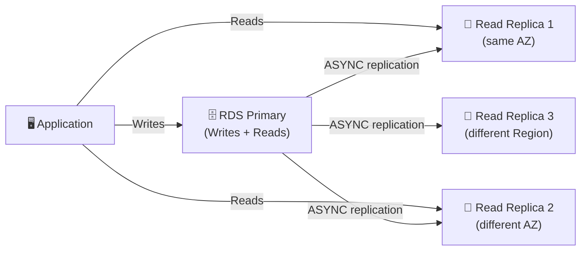

#### 🚀 Common Use Cases

| Use Case | Description |
| --- | --- |
| **Reporting / Analytics** | Heavy SELECT queries offloaded to a replica so the primary isn't affected |
| **Read Scaling** | Handle 10× more read traffic by distributing across replicas |
| **Disaster Recovery** | Replicas in other regions for cross-region DR |
| **Replica Promotion** | A replica can be **promoted** to become a standalone writable DB |

#### 💡 Promoting a Read Replica

- A Read Replica can be **promoted** to a standalone DB instance
- After promotion, it **breaks the replication link** and becomes its own writable master
- Useful for: database migrations, creating a separate dev/test environment from production data

```bash
# Promote a Read Replica to standalone DB
aws rds promote-read-replica \
  --db-instance-identifier my-read-replica
```

#### 💰 Network Cost for Read Replicas

> 📌 AWS normally charges for data transfer between AZs. RDS has a special exception:

| Scenario | Cost |
| --- | --- |
| Read Replica in the **same region, different AZ** | ✅ **FREE** (no replication network cost) |
| Read Replica in a **different region** | ❌ **Charged** (cross-region data transfer fees apply) |

> 💡 **Exam Tip**: Cross-AZ Read Replicas within the **same region** do NOT incur replication data transfer costs. Cross-**region** replicas DO.

### 🔁 RDS Multi-AZ (Disaster Recovery)

#### 🧠 What is Multi-AZ?

- Multi-AZ keeps a **synchronous standby** instance in a **different Availability Zone**
- The standby is **NOT used for reads or writes** — it exists purely for failover
- AWS manages automatic failover: if the primary fails, RDS automatically promotes the standby
- Both primary and standby share the **same DNS endpoint** — the app doesn't need to change its connection string

#### 🔄 Replication Type: Synchronous

> Multi-AZ uses **SYNC** replication — every write to primary is **simultaneously** written to the standby before acknowledging success. This guarantees **zero data loss** on failover.

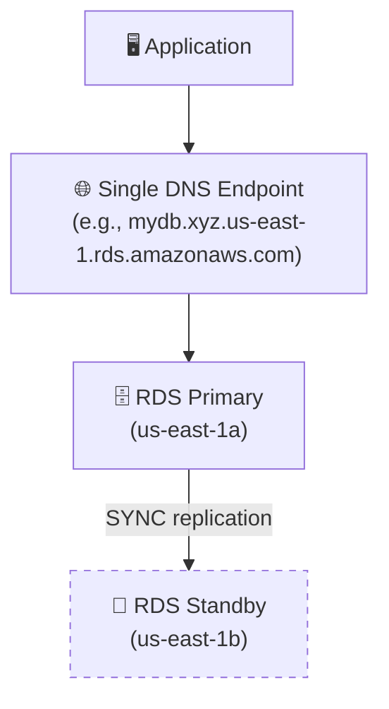

#### ⚡ Failover Process

- Failover is **automatic** — no manual intervention required
- Triggers:

    - Primary DB instance fails
    - AZ outage
    - DB instance class modification
    - OS patching / maintenance
- Failover time: typically **60–120 seconds**
- After failover, the **DNS CNAME is switched** from the old primary to the standby (now promoted to new primary)
- A new standby is then automatically provisioned to replace the old primary

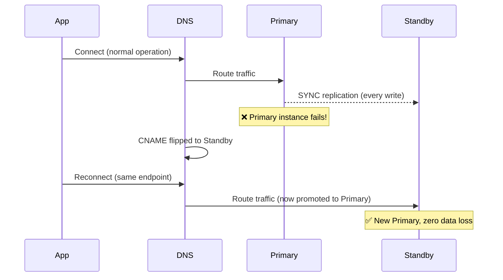

#### ⚠️ Key Characteristics

- The **standby is NOT a Read Replica** — you cannot read from it
- It serves **only as a hot standby** for automatic failover
- Provides protection against:

    - Instance failure
    - AZ failure
    - Network failure
    - Storage failure
- FQDN (DNS name) stays the same — application connection string doesn't change

### ⚖️ Read Replicas vs Multi-AZ — Side-by-Side Comparison

| Feature | 📖 Read Replicas | 🔁 Multi-AZ |
| --- | --- | --- |
| **Primary purpose** | Scalability (read scale-out) | High Availability / DR |
| **Replication type** | **Asynchronous** (eventual consistency) | **Synchronous** (strong consistency) |
| **Number of copies** | Up to 15 replicas | 1 standby instance |
| **Readable?** | ✅ Yes — for SELECT queries | ❌ No — standby only |
| **Automatic failover?** | ❌ No — must be promoted manually | ✅ Yes — automatic |
| **Same DNS endpoint?** | ❌ Each replica has its own endpoint | ✅ Yes — app connects to one DNS |
| **Cross-region?** | ✅ Yes | ❌ No (same region, different AZ) |
| **Use case** | Reporting, analytics, read scaling | Production HA, zero-downtime maintenance |
| **Data loss on failure?** | Possible (async lag) | None (sync replication) |

> 💡 **Exam Scenario — Common Trick Question**: "A company wants to run analytics queries without affecting the production database." → **Read Replica** ✅<br>"A company needs the database to survive an AZ failure automatically." → **Multi-AZ** ✅

### 🔀 Can You Use Both?

Yes! You can enable **both Multi-AZ AND Read Replicas** simultaneously:

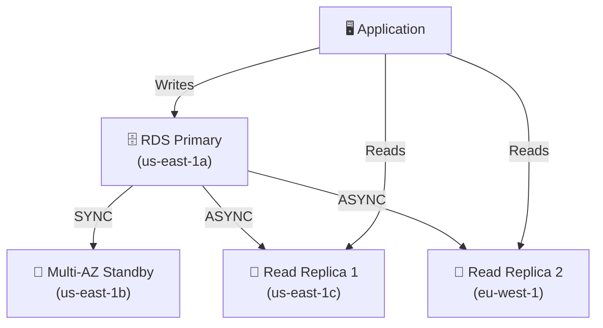

- Multi-AZ handles **HA/failover** automatically
- Read Replicas handle **read scaling** and analytics
- This is the **recommended production architecture** for high-traffic applications

### 🔧 Creating a Read Replica (CLI)

```bash
# Create a Read Replica from an existing DB instance
aws rds create-db-instance-read-replica \
  --db-instance-identifier my-read-replica \
  --source-db-instance-identifier my-primary-db \
  --db-instance-class db.t3.micro \
  --availability-zone us-east-1b
```

### 🔧 Enabling Multi-AZ (CLI)

```bash
# Enable Multi-AZ on an existing single-AZ instance
# This causes a brief downtime during conversion
aws rds modify-db-instance \
  --db-instance-identifier my-db \
  --multi-az \
  --apply-immediately
```

> ⚠️ Converting from Single-AZ to Multi-AZ does **NOT** require downtime in most cases — AWS does it live using a snapshot + restore mechanism internally.

### 🔑 Converting Single-AZ → Multi-AZ Internally

When you enable Multi-AZ on an existing Single-AZ RDS instance:

1. A **snapshot** is taken of the primary
1. The snapshot is **restored** in the standby AZ
1. **Synchronous replication** is established between primary and new standby
1. **No downtime** during this process (for most scenarios)

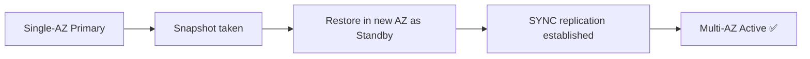

### 🌍 Cross-Region Read Replicas

- Supported for: **MySQL, MariaDB, PostgreSQL, Oracle, SQL Server**
- Useful for:

    - **Disaster recovery** across regions
    - **Latency reduction** for users in different geographies
    - **Data locality** compliance requirements
- Replication is **asynchronous** (cross-region)
- Network charges apply for cross-region data transfer
- Can be promoted independently if the source region fails

```bash
# Create a cross-region Read Replica
aws rds create-db-instance-read-replica \
  --db-instance-identifier cross-region-replica \
  --source-db-instance-identifier arn:aws:rds:us-east-1:123456789012:db:my-primary-db \
  --db-instance-class db.t3.micro \
  --region eu-west-1
```

### 🎯 Exam Tips & Tricky Scenarios

> 🧠 **Scenario 1**: Your app is getting slow because too many users are running reports. What do you do?<br>→ Create a **Read Replica** and point reporting queries there. This offloads SELECT pressure from the primary.

> 🧠 **Scenario 2**: Your RDS primary crashes. You want automatic recovery with no manual intervention.<br>→ Enable **Multi-AZ**. Failover is automatic, and the DNS endpoint stays the same.

> 🧠 **Scenario 3**: Your disaster recovery plan requires a full database copy in another AWS Region.<br>→ Create a **Cross-Region Read Replica**. It can be promoted to a full primary if the source region goes down.

> 🧠 **Scenario 4**: You have Multi-AZ. Can you use the standby for read queries to reduce load?<br>→ **No**. The standby in Multi-AZ is **not accessible** for reads. For read scaling, you need Read Replicas.

> 🧠 **Scenario 5**: Is there a cost for replicating data from primary to a Read Replica in a different AZ, same region?<br>→ **No cost** — AWS waives the cross-AZ data transfer fee for RDS replication within the same region.

### 📝 Key Takeaways

- **Read Replicas** = scale reads, async replication, up to 15, separate endpoints, can be promoted
- **Multi-AZ** = high availability, sync replication, 1 standby, same DNS endpoint, automatic failover
- Read from replicas → **eventual consistency** (slight lag possible)
- Multi-AZ standby → **not readable**, only for failover
- Cross-AZ replica in same region → **free network transfer**
- Cross-region replica → **paid network transfer**
- You can combine **both** Multi-AZ and Read Replicas for maximum resilience and scalability
- Converting Single-AZ → Multi-AZ uses an internal snapshot/restore mechanism with **no downtime**

---

## Lecture 79: 🖥️ Amazon RDS Hands On

> 📌 **Section 8 — AWS Fundamentals: RDS + Aurora + ElastiCache**<br>This is a hands-on lecture where we walk through creating and configuring an RDS database instance via the AWS Console. The goal is to get familiar with the real-world options, settings, and configurations you'll encounter when provisioning RDS in production.

### 🧭 Overview of What We'll Do

- Create an **RDS MySQL** database instance
- Configure key settings: instance class, storage, networking, security
- Understand every major option in the RDS creation wizard
- Connect to the database from an EC2 instance or local machine
- Explore the RDS console: monitoring, snapshots, replicas, and maintenance

### 🚀 Step 1: Navigate to RDS in the AWS Console

- Go to **AWS Console → RDS**
- Click **"Create database"**
- You'll be presented with two creation methods:

| Method | Description |
| --- | --- |
| **Standard Create** | Full control over all settings — recommended for learning |
| **Easy Create** | Simplified wizard with AWS-recommended best practices pre-filled |

> 💡 Always use **Standard Create** in the course to understand all available options.

### 🛠️ Step 2: Choose a Database Creation Method & Engine

#### Engine Options

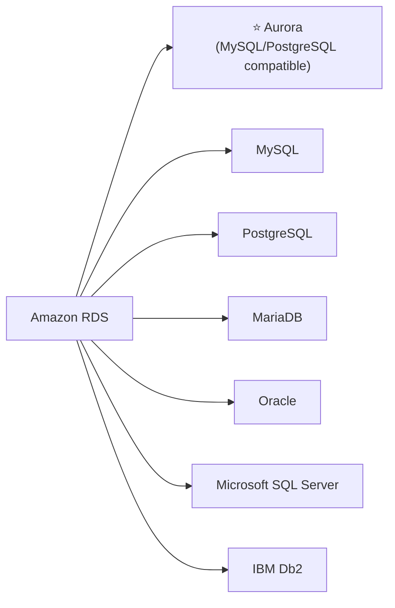

- For this hands-on: select **MySQL**
- Select the **engine version** (e.g., MySQL 8.0.x)

#### Templates

| Template | Description |
| --- | --- |
| **Production** | Enables Multi-AZ + provisioned IOPS (higher cost) |
| **Dev/Test** | Reduced defaults, suitable for development environments |
| **Free Tier** | Single-AZ, db.t3.micro, 20GB gp2 storage — great for learning |

> 💡 Select **Free Tier** for the hands-on to avoid charges.

### ⚙️ Step 3: Settings

#### DB Instance Identifier

- Unique name for your DB instance within a region
- Example: `database-1`

#### Master Credentials

- **Master username**: e.g., `admin`
- **Master password**: Set a strong password (or use **Secrets Manager** for rotation)
- These are the root-level credentials for the database

```bash
# You'll use these credentials to connect later:
# Host: <rds-endpoint>
# Port: 3306 (MySQL default)
# Username: admin
# Password: <your-password>
```

### 💻 Step 4: Instance Configuration

#### DB Instance Class

| Class Family | Use Case |
| --- | --- |
| **db.t3.micro / db.t4g.micro** | Free tier, dev/test — burstable |
| **db.m5 / db.m6g** | General purpose production |
| **db.r5 / db.r6g** | Memory optimized, large datasets |

- For hands-on: **db.t3.micro** (Free Tier eligible)

#### Storage

- **Storage type**: `gp2` (General Purpose SSD) — default for Free Tier
- **Allocated storage**: 20 GiB (minimum for Free Tier)
- **Enable storage autoscaling**: Optional checkbox

    - Set **Maximum storage threshold** (e.g., 1000 GiB)
    - Automatically expands storage without downtime

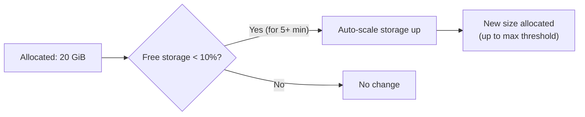

### 🌐 Step 5: Connectivity (Networking)

This is one of the most important sections — it determines who can connect to your database.

#### VPC & Subnet Group

- Select the **VPC** where your RDS instance will live
- A **DB Subnet Group** specifies which subnets within the VPC are available for RDS
- Best practice: use **private subnets** in production

#### Public Access

| Option | Description |
| --- | --- |
| **Yes** | Assigns a public IP — accessible from the internet (only for Dev/Test!) |
| **No** | Only accessible from within the VPC — recommended for production |

> ⚠️ **Security Warning**: Never enable public access in production environments. Your database should only be reachable from within your VPC (e.g., from your EC2 instances or Lambda functions).

#### VPC Security Group

- Controls inbound/outbound traffic to the RDS instance
- For hands-on: create a new security group that **allows port 3306 (MySQL)** from your EC2 instance's security group or your IP

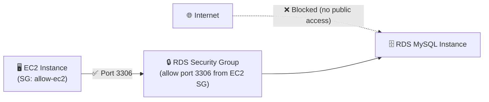

#### Availability Zone

- For single-AZ: choose a specific AZ or let AWS decide
- For Multi-AZ: AWS manages the standby placement automatically

#### RDS Proxy

- Optional — covered in Lecture 83
- Pools and shares database connections — useful for Lambda-heavy architectures

#### Port

- MySQL default: **3306**
- PostgreSQL default: **5432**

### 🔐 Step 6: Database Authentication

| Method | Description |
| --- | --- |
| **Password authentication** | Traditional username + password — most common |
| **Password + IAM** | Also allows IAM-based short-lived token auth |
| **Password + Kerberos** | For Microsoft Active Directory environments |

- For hands-on: **Password authentication**

### 📊 Step 7: Additional Configuration

#### Initial Database Name

- Optionally create a database (schema) on launch
- Example: `myappdb`
- If left blank, you'll create schemas yourself after connecting

#### Parameter Groups

- A **DB Parameter Group** is a collection of DB engine configuration values
- Think of it as the `my.cnf` / `postgresql.conf` for your RDS instance
- Default parameter group is fine for hands-on
- Custom parameter groups allow fine-tuning (e.g., `max_connections`, `slow_query_log`)

#### Option Groups

- Specific to certain engines (e.g., Oracle, SQL Server)
- Enables additional features like Oracle TDE, SQL Server SSRS
- MySQL/PostgreSQL don't typically need custom option groups

#### Backup Settings

| Setting | Description |
| --- | --- |
| **Automated backups** | Enabled by default |
| **Backup retention period** | 1–35 days (default: 7 days) |
| **Backup window** | Preferred UTC time window for backups |
| **Copy tags to snapshots** | Useful for cost allocation tagging |

#### Monitoring

- **Enhanced Monitoring**: Provides OS-level metrics (CPU, memory, disk I/O) at up to 1-second intervals

    - Standard CloudWatch metrics are at 1-minute granularity
    - Enhanced Monitoring uses a CloudWatch agent inside the DB host
- **Performance Insights**: Visual query performance monitoring — identifies slow queries, wait events

#### Maintenance

- **Auto minor version upgrade**: Automatically upgrades to new minor engine versions
- **Maintenance window**: Define a weekly window for patches and maintenance tasks
- AWS will apply patches during this window with minimal disruption

#### Deletion Protection

- **Enable deletion protection**: Prevents accidental deletion of the RDS instance
- You must **explicitly disable** this before deleting
- ✅ Always enable in production!

### ✅ Step 8: Review & Create

- Review the **estimated monthly cost** shown at the bottom
- For Free Tier (db.t3.micro + 20GiB gp2 + 7-day backup): **$0/month** within limits
- Click **"Create database"**
- DB status will show **"Creating"** → transitions to **"Available"** in ~5–10 minutes

### 🔗 Step 9: Connecting to the RDS Instance

#### Finding the Endpoint

After the DB is available, find the connection endpoint:

- In RDS Console → Select your DB → **Connectivity & security** tab
- Copy the **Endpoint** (e.g., `database-1.cxyz123.us-east-1.rds.amazonaws.com`)

#### Connecting from EC2 (Same VPC)

```bash
# SSH into your EC2 instance first, then:
# Install MySQL client
sudo yum install mysql -y   # Amazon Linux
# OR
sudo apt install mysql-client -y  # Ubuntu

# Connect to RDS
mysql -h database-1.cxyz123.us-east-1.rds.amazonaws.com \
      -P 3306 \
      -u admin \
      -p
# Enter your password when prompted
```

#### Connecting from Local Machine (Public Access Enabled)

```bash
# Only works if public access is enabled AND your IP is in the security group
mysql -h database-1.cxyz123.us-east-1.rds.amazonaws.com \
      -P 3306 \
      -u admin \
      -p
```

#### Verify Connection & Basic SQL

```sql
-- List databases
SHOW DATABASES;

-- Create a database
CREATE DATABASE myappdb;

-- Use it
USE myappdb;

-- Create a table
CREATE TABLE users (
    id INT AUTO_INCREMENT PRIMARY KEY,
    name VARCHAR(100),
    email VARCHAR(100),
    created_at TIMESTAMP DEFAULT CURRENT_TIMESTAMP
);

-- Insert data
INSERT INTO users (name, email) VALUES ('Alice', 'alice@example.com');

-- Query data
SELECT * FROM users;
```

#### Connecting with Python (boto3 / pymysql)

```python
import pymysql

connection = pymysql.connect(
    host='database-1.cxyz123.us-east-1.rds.amazonaws.com',
    port=3306,
    user='admin',
    password='your-password',
    database='myappdb',
    ssl_ca='/path/to/rds-ca-bundle.pem'  # Use SSL in production
)

cursor = connection.cursor()
cursor.execute("SELECT * FROM users")
rows = cursor.fetchall()
for row in rows:
    print(row)

connection.close()
```

#### Connecting with Node.js

```javascript
const mysql = require('mysql2/promise');

const connection = await mysql.createConnection({
  host: 'database-1.cxyz123.us-east-1.rds.amazonaws.com',
  port: 3306,
  user: 'admin',
  password: 'your-password',
  database: 'myappdb',
  ssl: { rejectUnauthorized: true }
});

const [rows] = await connection.execute('SELECT * FROM users');
console.log(rows);
await connection.end();
```

### 🔍 Step 10: Exploring the RDS Console

#### Connectivity & Security Tab

- **Endpoint & port** for connection
- VPC, subnet group, security groups
- Certificate authority (for SSL)

#### Monitoring Tab

- CloudWatch metrics: CPU Utilization, DB Connections, Read/Write IOPS, Freeable Memory
- Enhanced Monitoring (OS-level metrics, if enabled)
- Performance Insights dashboard

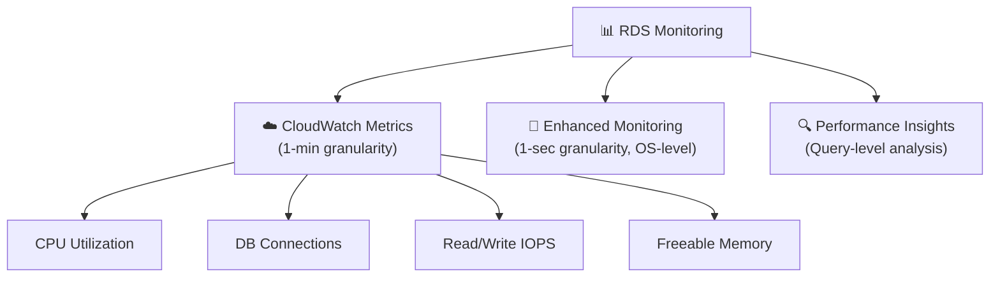

#### Maintenance & Backups Tab

- View automated backup schedule and retention period
- Manually create a **snapshot** anytime
- Restore to a **point in time** (PITR) within the retention window

#### Logs & Events Tab

- View database error logs, slow query logs, general logs
- Export logs to **CloudWatch Logs** for long-term retention and alerting

### 🗑️ Step 11: Cleanup (Cost Management)

> ⚠️ **Important**: Delete your RDS instance after the hands-on if you are done to avoid ongoing charges (even db.t3.micro incurs cost beyond Free Tier limits).

```bash
# Delete via CLI (must first disable deletion protection if enabled)
aws rds modify-db-instance \
  --db-instance-identifier database-1 \
  --no-deletion-protection \
  --apply-immediately

aws rds delete-db-instance \
  --db-instance-identifier database-1 \
  --skip-final-snapshot
  # Use --final-db-snapshot-identifier my-final-snap if you want a snapshot
```

Or via Console:

1. Select the DB instance
1. Actions → **Delete**
1. Optionally create a final snapshot
1. Confirm by typing `delete me`

### 🏷️ RDS Console — Key Sections Summary

| Console Tab | What You'll Find |
| --- | --- |
| **Connectivity & Security** | Endpoint, port, VPC, SGs, SSL certificate |
| **Configuration** | Engine version, instance class, storage, parameter group |
| **Monitoring** | CloudWatch metrics, Enhanced Monitoring, Performance Insights |
| **Logs & Events** | Error logs, slow query logs, recent events |
| **Maintenance & Backups** | Backup window, automated backups, snapshots, PITR |
| **Tags** | Cost allocation tags |

### 📝 Key Takeaways

- RDS creation involves configuring **engine, instance class, storage, networking, security, and backups**
- Always use **private subnets** + **Security Groups** to control access — never expose RDS publicly in production
- The **endpoint** is how your application connects — it looks like a DNS hostname
- **Security Groups** must allow the correct port (3306 for MySQL, 5432 for PostgreSQL) from trusted sources
- **Automated backups** are enabled by default with a 7-day retention window
- **Storage autoscaling** prevents running out of disk space during unexpected growth
- **Enhanced Monitoring** and **Performance Insights** are powerful tools for diagnosing performance issues
- Always enable **deletion protection** in production environments
- Take a **final snapshot** before deleting a DB — manual snapshots never expire

---

## Lecture 80: ⭐ Amazon Aurora

> 📌 **Section 8 — AWS Fundamentals: RDS + Aurora + ElastiCache**<br>Amazon Aurora is AWS's **cloud-native, proprietary** relational database engine. It is fully compatible with MySQL and PostgreSQL but delivers dramatically superior performance, availability, and scalability. Aurora is not just another RDS engine — it was built from the ground up for the cloud.

### 🧠 What is Amazon Aurora?

- Aurora is a **proprietary** database engine developed by AWS
- **Not open source** — but fully compatible with:

    - **MySQL** (Aurora MySQL)
    - **PostgreSQL** (Aurora PostgreSQL)
- Your existing MySQL/PostgreSQL apps can connect to Aurora with **no code changes** — just point to the Aurora endpoint
- Aurora is **not in the AWS Free Tier** — it costs slightly more than standard RDS (~20% premium)
- Despite the cost premium, Aurora is the **recommended choice** for production workloads due to its performance and resilience

### 🚀 Aurora Performance

| Metric | Aurora vs Standard RDS |
| --- | --- |
| **vs MySQL RDS** | **5× faster** throughput |
| **vs PostgreSQL RDS** | **3× faster** throughput |
| **Storage auto-grow** | Automatically grows in **10 GiB increments** up to **128 TB** |
| **Read replicas** | Up to **15 replicas** (vs 5 for MySQL RDS) |
| **Failover** | **Instantaneous** (~30 seconds, vs 60–120s for RDS) |
| **High Availability** | Native, built-in — not an optional add-on |

> 💡 Aurora achieves its performance gains through its **distributed, fault-tolerant storage layer** — the data is stored across multiple AZs at the storage level itself, not just the compute level.

### 🏗️ Aurora Storage Architecture

Aurora's most unique characteristic is its **shared distributed storage** subsystem — separate from the database compute instances.

#### How Aurora Storage Works

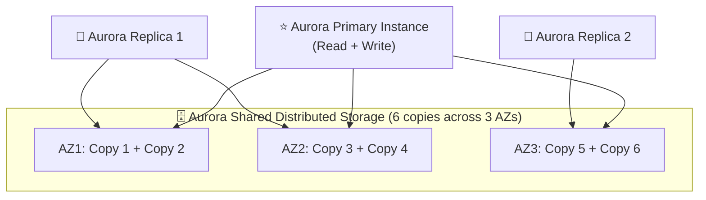

#### 🔑 Key Storage Facts

- Aurora automatically maintains **6 copies** of your data across **3 Availability Zones**
- **4 out of 6 copies** needed for writes → tolerates loss of 1 AZ for writes
- **3 out of 6 copies** needed for reads → tolerates loss of 2 AZs for reads
- Storage is **self-healing**: data blocks are continuously scanned and repaired
- Aurora storage grows automatically in **10 GiB increments** — you never need to pre-provision
- Starts at **10 GiB**, scales up to **128 TB** automatically with zero downtime

> 💡 **Exam Insight**: Aurora's 6-copy replication happens at the **storage layer**, not at the application layer. This is fundamentally different from RDS Multi-AZ which replicates at the instance level.

### 🌐 Aurora Cluster Architecture

Aurora separates **compute** (DB instances) from **storage** (shared volume). The compute layer consists of one or more DB instances.

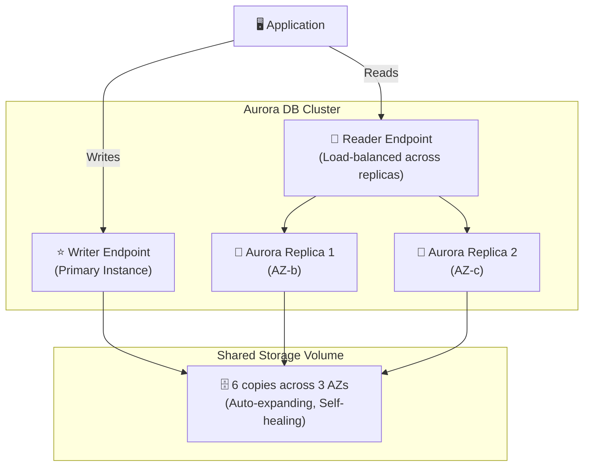

#### 📌 Writer Endpoint

- **Single DNS name** that always points to the current **primary (master)** instance
- In case of failover, the writer endpoint **automatically** redirects to the new primary
- Your application writes to this endpoint — no manual DNS change needed

#### 📌 Reader Endpoint

- **Single DNS name** that **load-balances** reads across all available Aurora Replicas
- Distributes SELECT queries across replicas automatically
- As you add more replicas, the reader endpoint distributes more efficiently
- If you have 0 replicas, the reader endpoint points to the primary

### ⚡ Aurora High Availability & Failover

Aurora was built with HA as a first-class feature — not an add-on.

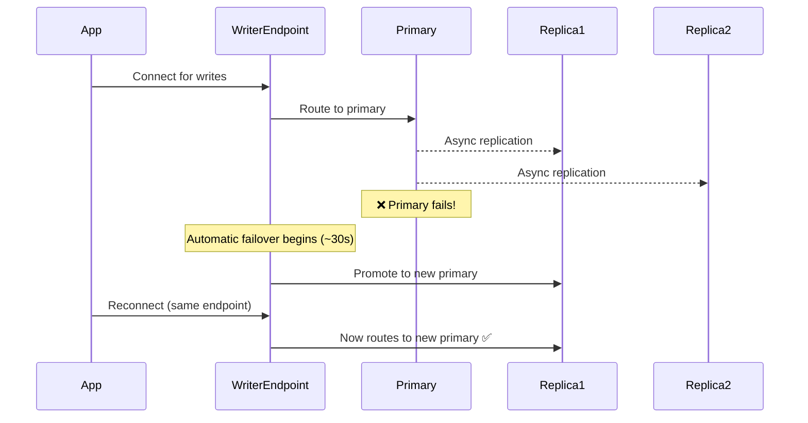

#### Failover Priority Tiers

- Each Aurora Replica has a **failover priority tier** (0–15, lower = higher priority)
- Aurora promotes the replica with the **lowest tier number** on failover
- If two replicas share the same tier, Aurora promotes the one with the **largest storage size**
- You can configure priority via the console or CLI

```bash
# Modify replica failover priority
aws rds modify-db-instance \
  --db-instance-identifier my-aurora-replica-1 \
  --promotion-tier 0 \
  --apply-immediately
```

### 🔄 Aurora Replicas vs MySQL Read Replicas

| Feature | Aurora Replicas | MySQL Read Replicas |
| --- | --- | --- |
| **Max count** | 15 | 5 |
| **Replication type** | Async (but uses shared storage — near-instant) | Async |
| **Replica lag** | Typically &lt; 100ms | Seconds to minutes |
| **Failover support** | ✅ Yes — automatic promotion | ❌ No — manual promotion only |
| **Cross-region support** | ✅ Yes (Aurora Global Database) | ✅ Yes |
| **Shared storage** | ✅ Yes — replicas read from same storage | ❌ No — separate storage per replica |

### 🌍 Aurora Global Database

- Designed for **globally distributed** applications
- **1 primary region** handles all writes
- Up to **5 secondary read-only regions**
- Up to **16 read replicas per secondary region**
- Replication lag across regions: typically **&lt; 1 second**
- Promotes a secondary region to primary in **&lt; 1 minute** (RTO) for disaster recovery

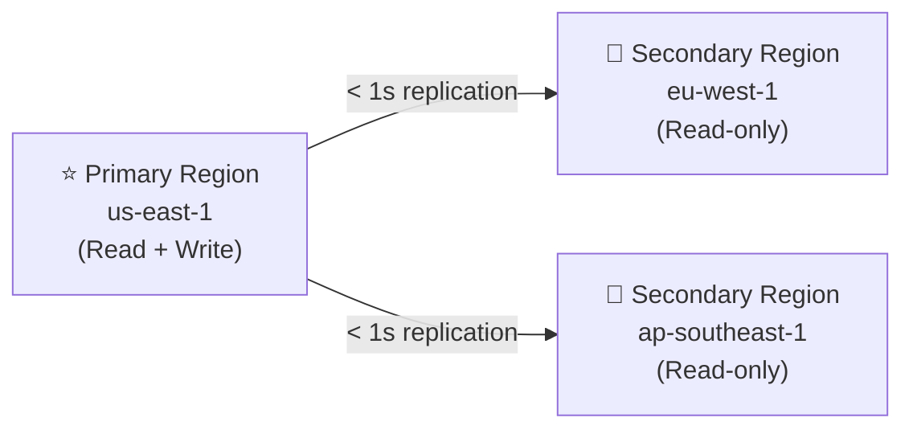

> 💡 **Use case**: A global application where users in Europe and Asia need low-latency reads but all writes go to a single US region.

### 🤖 Aurora Auto Scaling (Replicas)

Aurora can **automatically add or remove Read Replicas** based on load:

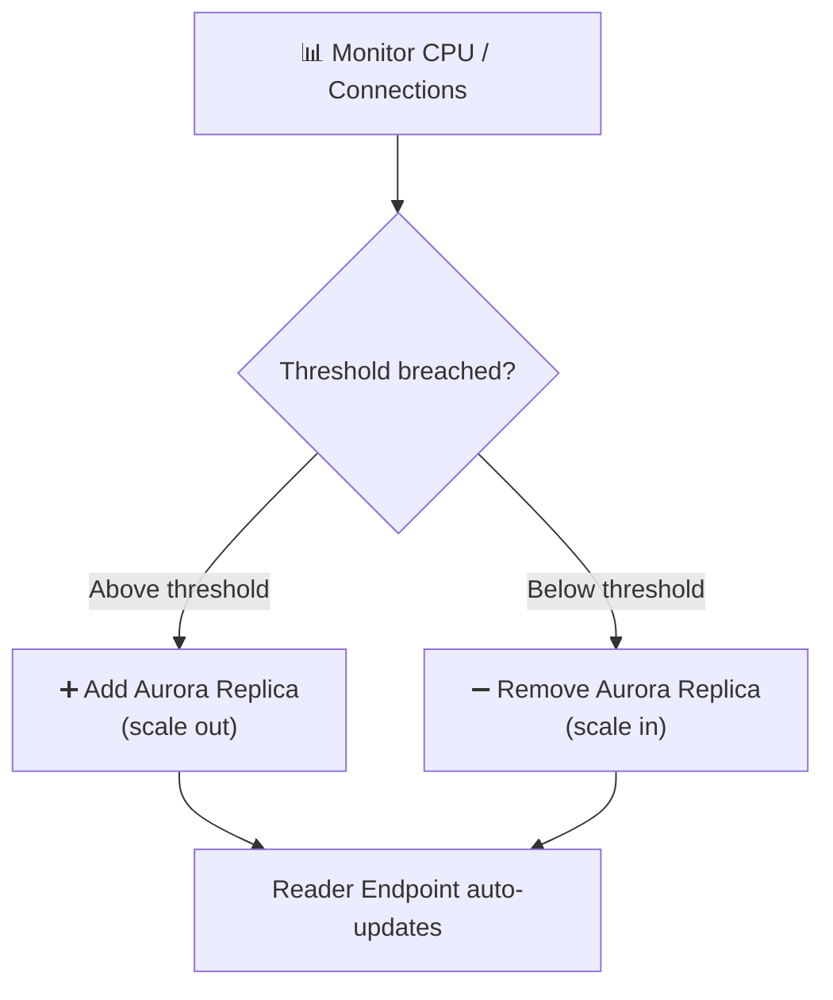

- Configure a **scaling policy** with min/max replica count
- Metrics: **Average CPU Utilization** or **Average Connections**
- New replicas are registered with the Reader Endpoint automatically

```bash
# Register Aurora as a scalable target
aws application-autoscaling register-scalable-target \
  --service-namespace rds \
  --scalable-dimension rds:cluster:ReadReplicaCount \
  --resource-id cluster:my-aurora-cluster \
  --min-capacity 1 \
  --max-capacity 5

# Create a target-tracking scaling policy
aws application-autoscaling put-scaling-policy \
  --policy-name AuroraReadScalingPolicy \
  --service-namespace rds \
  --scalable-dimension rds:cluster:ReadReplicaCount \
  --resource-id cluster:my-aurora-cluster \
  --policy-type TargetTrackingScaling \
  --target-tracking-scaling-policy-configuration '{
    "TargetValue": 70.0,
    "PredefinedMetricSpecification": {
      "PredefinedMetricType": "RDSReaderAverageCPUUtilization"
    }
  }'
```

### 🔵 Aurora Serverless

> A separate Aurora deployment model — **no need to provision or manage DB instances**.

- **Automatic scaling** of compute capacity based on actual database load
- Scales from **0 ACUs** (Aurora Capacity Units) when idle (paused) to the maximum you configure
- Billed **per second** for compute used — pay only for what you use
- Ideal for:

    - Infrequently used applications
    - Variable / unpredictable workloads
    - Dev/test environments
    - New applications with unknown scale requirements

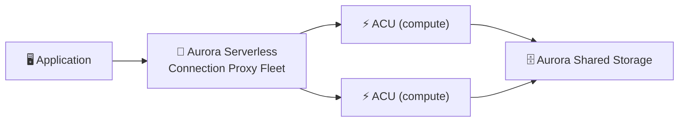

#### Aurora Serverless v2 (Recommended)

- Fine-grained scaling in **0.5 ACU increments**
- Can scale to **hundreds of ACUs** within seconds
- Supports Multi-AZ, Read Replicas, Aurora Global Database
- Preferred over v1 for most new workloads

### 📊 Aurora Backtrack

- **Rewind** your Aurora database cluster to a previous point in time **without restoring from a backup**
- Backtrack window: up to **72 hours** back
- Does **NOT create a new DB cluster** — it modifies the existing one in place
- Extremely fast compared to PITR restore from snapshot
- Currently available for **Aurora MySQL** only
- Useful for recovering from accidental `DROP TABLE` or `DELETE` without WHERE clause

```bash
# Backtrack a cluster to a specific time
aws rds backtrack-db-cluster \
  --db-cluster-identifier my-aurora-cluster \
  --backtrack-to "2024-01-15T10:00:00Z"
```

> 💡 **Exam Tip**: Backtrack ≠ PITR restore. Backtrack rewinds in-place (same cluster, same endpoint). PITR creates a new cluster. Backtrack is faster but only supported on Aurora MySQL.

### 🔀 Aurora Multi-Master

- Every DB instance can **read AND write**
- Provides **continuous write availability** — if one writer fails, another immediately takes over
- No single point of failure for writes
- Used for applications that cannot tolerate even 30 seconds of write downtime during failover

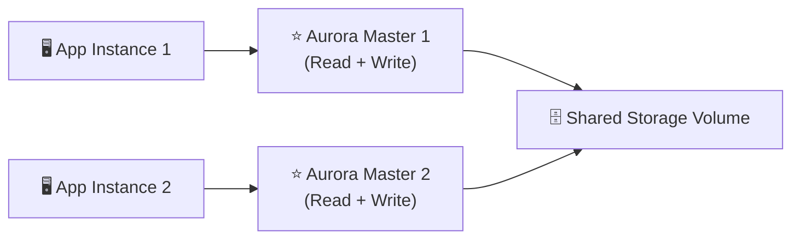

### 🔍 Aurora Machine Learning Integration

Aurora can directly call **AWS ML services** from SQL queries:

| ML Service | Use Case |
| --- | --- |
| **Amazon SageMaker** | Run custom ML models from SQL |
| **Amazon Comprehend** | Sentiment analysis on text columns |

```sql
-- Example: Sentiment analysis using Aurora ML + Comprehend
SELECT
  product_id,
  review_text,
  aws_comprehend_detect_sentiment(review_text, 'en') AS sentiment
FROM product_reviews
WHERE created_at > '2024-01-01';
```

> No ML expertise required — Aurora handles the integration transparently.

### 🆚 Aurora vs Standard RDS — Full Comparison

| Feature | Standard RDS | Amazon Aurora |
| --- | --- | --- |
| **Engines** | MySQL, PostgreSQL, Oracle, SQL Server, MariaDB, Db2 | MySQL-compatible, PostgreSQL-compatible |
| **Storage copies** | 1 primary + 1 standby (Multi-AZ) | 6 copies across 3 AZs always |
| **Max storage** | 64 TB (depends on engine) | **128 TB** auto-scaling |
| **Read replicas** | Up to 5 (MySQL) | Up to **15** |
| **Replica lag** | Seconds to minutes | Typically **&lt; 100ms** |
| **Failover time** | 60–120 seconds | **~30 seconds** |
| **Performance** | Standard | **3–5× faster** |
| **Backtrack** | ❌ Not supported | ✅ Yes (MySQL, 72hr window) |
| **Serverless** | ❌ Not supported | ✅ Aurora Serverless v2 |
| **Global database** | Read Replicas only | ✅ Native, &lt; 1s replication |
| **Multi-Master** | ❌ Not supported | ✅ Supported |
| **Free Tier** | ✅ Yes (db.t3.micro) | ❌ No |
| **Cost** | Lower | ~20% more than RDS |

### 💰 Aurora Pricing Model

| Dimension | Details |
| --- | --- |
| **DB instance hours** | Per-hour charge for each instance (writer + replicas) |
| **Storage** | Per GB-month, billed in 10 GiB increments |
| **I/O requests** | Per million I/O requests (for standard Aurora, not Serverless) |
| **Backup storage** | Free up to 100% of DB storage |
| **Data transfer** | Standard AWS egress charges |
| **Aurora Serverless** | Per ACU-hour (compute only when active) |

> 💡 **Cost optimization**: Aurora I/O-Optimized pricing mode (no I/O charges, higher storage rate) — good for I/O-intensive workloads.

### 🎯 Exam Tips & Key Scenarios

> 🧠 **Scenario 1**: You need a managed relational database with the highest availability, up to 15 read replicas, and automatic failover in ~30 seconds. → **Amazon Aurora**

> 🧠 **Scenario 2**: You need a database that can span multiple AWS regions with &lt; 1 second replication lag for global users. → **Aurora Global Database**

> 🧠 **Scenario 3**: An application has unpredictable, bursty database traffic and the team wants to minimize costs by paying only for actual usage. → **Aurora Serverless v2**

> 🧠 **Scenario 4**: A developer accidentally deleted critical data. The team needs to recover without restoring from backup. → **Aurora Backtrack** (MySQL only, up to 72 hours)

> 🧠 **Scenario 5**: You need a database cluster where all nodes can accept write operations with no single write master. → **Aurora Multi-Master**

> 🧠 **Scenario 6**: Aurora stores 6 copies of data across how many AZs? → **3 AZs**. Needs 4/6 for writes, 3/6 for reads.

### 📝 Key Takeaways

- Aurora = AWS-proprietary, **MySQL and PostgreSQL compatible** cloud-native DB
- **5× MySQL performance**, **3× PostgreSQL performance** vs standard RDS
- **6 copies across 3 AZs** at storage layer — always, not optional
- **Auto-scales storage** from 10 GiB to **128 TB** in 10 GiB increments
- Up to **15 Read Replicas** with &lt; 100ms lag, auto-failover in ~30 seconds
- **Writer Endpoint** = always points to current primary (survives failover automatically)
- **Reader Endpoint** = load-balances reads across all replicas
- **Aurora Serverless v2** = pay-per-use, auto-scaling compute, 0.5 ACU increments
- **Aurora Global Database** = cross-region, &lt; 1 second replication, &lt; 1 minute failover
- **Backtrack** = rewind in-place up to 72 hours (MySQL only)
- **Multi-Master** = all nodes writable, zero write downtime
- **NOT in Free Tier** — ~20% more expensive than standard RDS but far more capable

---

## Lecture 81: 🌟 Amazon Aurora – Hands On

> **Course**: Ultimate AWS Certified Developer Associate DVA-C02 2026 \| Stephane Maarek<br>**Section**: 8 – AWS Fundamentals: RDS + Aurora + ElastiCache<br>**Lecture**: 81 – Amazon Aurora – Hands On

### 🎯 Overview

> This hands-on lecture walks through creating and exploring an **Amazon Aurora** database cluster in the AWS Console. You'll understand the Aurora-specific UI differences compared to standard RDS, including cluster topology, reader/writer endpoints, and how failover is handled. No application is connected — the goal is familiarity with the Aurora console experience.

### 🏗️ Aurora Architecture Recap (Before Hands-On)

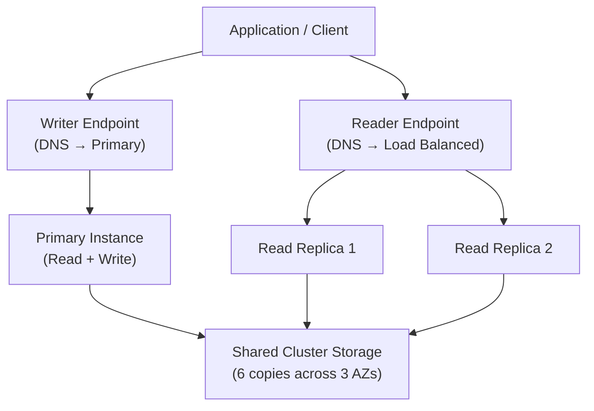

- **Writer Endpoint** always points to the primary (read/write) instance
- **Reader Endpoint** automatically load-balances across all read replicas
- All instances share the **same underlying distributed storage** — no data replication lag between them

### 🖥️ Creating an Aurora Cluster – Step by Step

#### \## Step 1: Navigate to RDS → Create Database

- Go to **AWS Console → RDS → Databases → Create database**
- Choose **Standard Create** for full control over options

#### \## Step 2: Engine Selection

- Select **Amazon Aurora**
- Choose engine edition:

    - ✅ **Aurora (MySQL-Compatible)** — most common, compatible with MySQL 8.x
    - ✅ **Aurora (PostgreSQL-Compatible)** — compatible with PostgreSQL 15.x
- For the hands-on, **MySQL-compatible** is typically used

#### \## Step 3: Cluster Configuration

| Setting | Recommended Value (Hands-On) |
| --- | --- |
| DB Cluster Identifier | `database-aurora` |
| Engine Version | Aurora MySQL 8.0 (latest) |
| Template | Dev/Test (to minimize cost) |
| DB Instance Class | `db.t3.medium` (burstable, cost-effective) |
| Multi-AZ | Leave default (1 writer + optional reader) |
| DB Instance Identifier | `database-aurora-instance-1` |

> **💡 Note**: Aurora does **not** use `db.t2.micro` (Free Tier) — Aurora is **not eligible** for Free Tier. Always use the smallest burstable instance (`db.t3.medium`) for practice.

#### \## Step 4: Connectivity Settings

- **VPC**: Use the default VPC
- **Subnet Group**: Use the default subnet group
- **Public Access**: Yes (for testing/hands-on only — ❌ never in production)
- **VPC Security Group**: Create a new SG or use an existing one that allows port `3306` (MySQL)
- **Database Port**: `3306` (MySQL) or `5432` (PostgreSQL)

#### \## Step 5: Authentication

- **DB Authentication**: Password authentication
- Set a **master username** (e.g., `admin`) and a secure **master password**

#### \## Step 6: Additional Configuration

- **Initial Database Name**: Optionally set (e.g., `mydb`)
- **Backup Retention**: 1 day (minimum for dev)
- **Encryption**: Enabled by default in Aurora (cannot be disabled after creation)
- **Enhanced Monitoring**: Can be disabled for cost savings in dev
- **Auto Minor Version Upgrade**: Enabled (Aurora manages this)

#### \## Step 7: Create the Cluster

- Click **Create database**
- Aurora will provision:

    - 1 **Writer instance** (primary)
    - Optionally 1+ **Reader instances** (replicas)
    - The **shared cluster volume** (auto-managed, no size specification needed)

> ⚠️ Cluster creation takes **5–10 minutes**. The cluster appears as a **regional resource** under "Databases".

### 🗂️ Exploring the Aurora Cluster in the Console

#### \## Cluster View vs Instance View

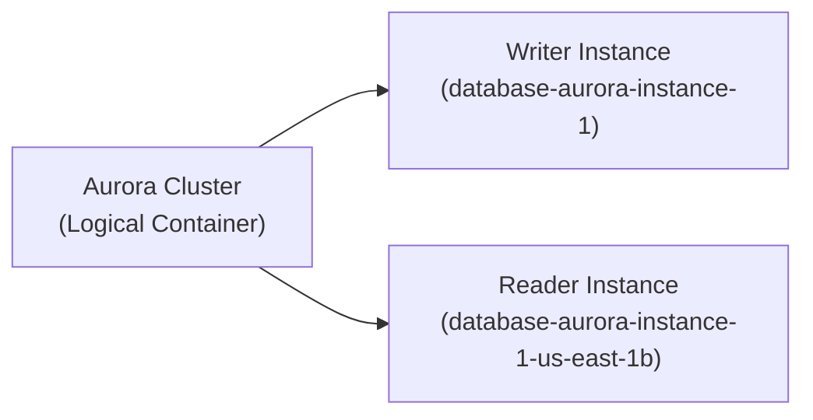

- The **cluster** entry acts as the top-level logical entity
- Each **instance** is listed separately underneath (you'll see two rows if both writer and reader exist)
- **Role column** shows: `Writer` / `Reader`

#### \## Cluster Endpoints (Critical for Exam!)

> **Two types of endpoints are provided by Aurora:**

| Endpoint Type | DNS Name Example | Purpose |
| --- | --- | --- |
| **Cluster (Writer) Endpoint** | `database-aurora.cluster-xxxx.us-east-1.rds.amazonaws.com` | Connects to the **primary** (read/write) |
| **Reader Endpoint** | `database-aurora.cluster-ro-xxxx.us-east-1.rds.amazonaws.com` | Load-balances across **all read replicas** |

- Notice the reader endpoint URL contains `ro-` (read-only)
- Applications should **always use these DNS endpoints**, never individual instance endpoints — this enables automatic failover

#### \## Instance-Level Endpoints

- Each instance also has its **own individual endpoint**
- These are useful for debugging or direct connection but **not recommended** for production traffic
- If an instance is replaced during failover, its endpoint changes — but the **cluster endpoint never changes**

### 🔄 Aurora Failover – How It Works

```mermaid
sequenceDiagram
    participant App as Application
    participant WE as Writer Endpoint (DNS)
    participant P as Primary Instance
    participant R as Read Replica

    App->>WE: Connects via Writer Endpoint
    WE->>P: Routes to Primary
    Note over P: Primary FAILS 🔴
    P-->>R: Aurora promotes Replica to Primary
    WE->>R: DNS automatically updates (~30s)
    App->>WE: Reconnects (same endpoint!)
    WE->>R: Routes to new Primary ✅
```

- Failover is **automatic** — no manual intervention needed
- DNS TTL propagation typically takes **~30 seconds**
- The **Writer Endpoint DNS** silently updates to point to the promoted replica
- This is why connecting via the **cluster endpoint** (not the instance endpoint) is critical

### ➕ Adding a Read Replica to an Existing Cluster

1. Select the cluster → **Actions → Add reader**
1. Choose instance class (should match or be similar to the writer for failover compatibility)
1. Assign to a different AZ for High Availability
1. Aurora automatically adds this instance to the **Reader Endpoint** load balancer

```bash
# You can also add a reader via CLI
aws rds create-db-instance \
  --db-instance-identifier database-aurora-reader-1 \
  --db-cluster-identifier database-aurora \
  --db-instance-class db.t3.medium \
  --engine aurora-mysql
```

### 🔍 Aurora-Specific Console Features

#### \## Monitoring Tab

- **Per-instance metrics**: CPU, connections, read/write IOPS
- Aurora storage metrics are **cluster-level**, not per-instance (since storage is shared)
- Key metrics to watch:

    - `AuroraReplicaLag` — lag between writer and reader
    - `DatabaseConnections` — active connections per instance
    - `VolumeReadIOPs` / `VolumeWriteIOPs` — cluster storage I/O

#### \## Logs & Events Tab

- View slow query logs, error logs, general logs
- Can export logs to **CloudWatch Logs** for long-term retention and alerting

#### \## Maintenance & Backups

- **Automated Backups**: Continuous, point-in-time recovery (PITR) — restore to any second within the retention window
- **Manual Snapshots**: Taken at cluster level — restores to a **new cluster**
- Aurora backups **do not impact performance** (unlike standard RDS)

### 🔁 Restoring an Aurora Cluster

```mermaid
flowchart LR
    S["Aurora Snapshot\nor PITR Backup"]
    NewCluster["New Aurora Cluster\n(Restored)"]
    NewInstances["New Instances\nadded to cluster"]

    S --> NewCluster --> NewInstances
```

- Restoring a snapshot creates a **brand new Aurora cluster**
- You then add instances to the restored cluster
- You **cannot** restore to an existing cluster — always creates a new one

### 🌐 Aurora Global Databases (Bonus Context)

> Not covered in this hands-on, but important for exam awareness:

- **Aurora Global Database**: Spans **multiple AWS regions**
- **1 Primary Region** (read/write) + up to **5 secondary regions** (read-only)
- Replication lag: typically **&lt; 1 second** cross-region
- Use case: **disaster recovery** and **low-latency global reads**

```mermaid
graph LR
    PrimaryRegion["Primary Region\nus-east-1\nRead + Write"]
    SecondaryRegion1["Secondary Region\neu-west-1\nRead Only"]
    SecondaryRegion2["Secondary Region\nap-southeast-1\nRead Only"]

    PrimaryRegion -->|"< 1 second replication"| SecondaryRegion1
    PrimaryRegion -->|"< 1 second replication"| SecondaryRegion2
```

### 🧹 Cleanup – Deleting the Aurora Cluster

> ⚠️ **Always clean up** after hands-on to avoid charges. Aurora charges per instance per hour.

#### Steps to Delete:

1. **Delete all Reader instances first**

    - Select reader instance → Actions → Delete
    - Skip final snapshot for dev/test
1. **Delete the Writer instance**

    - Select writer instance → Actions → Delete
1. **Delete the Cluster** (if it still exists after deleting all instances)

    - Select cluster → Actions → Delete
    - Optionally create a final cluster snapshot

```bash
# CLI: Delete all instances then cluster
aws rds delete-db-instance \
  --db-instance-identifier database-aurora-reader-1 \
  --skip-final-snapshot

aws rds delete-db-instance \
  --db-instance-identifier database-aurora-instance-1 \
  --skip-final-snapshot

aws rds delete-db-cluster \
  --db-cluster-identifier database-aurora \
  --skip-final-snapshot
```

> 💡 You must delete **all instances** before you can delete the **cluster**.

### 📌 Key Takeaways & Exam Tips

- **Aurora is NOT Free Tier eligible** — minimum instance is `db.t3.medium`
- Always connect via **cluster endpoints**, not instance endpoints
- Writer endpoint → **primary (read/write)** \| Reader endpoint → **load-balanced read replicas**
- Aurora storage is **auto-scaling** — you don't specify a storage size at creation
- Failover is **automatic** and takes ~30 seconds — DNS updates silently
- Deleting Aurora: delete instances first, then the cluster
- Aurora backups are **continuous** and **do not degrade performance**
- Aurora stores **6 copies of data across 3 AZs** — this is managed by AWS, not you

---

## Lecture 82: 🔐 RDS & Aurora Security

> **Course**: Ultimate AWS Certified Developer Associate DVA-C02 2026 \| Stephane Maarek<br>**Section**: 8 – AWS Fundamentals: RDS + Aurora + ElastiCache<br>**Lecture**: 82 – RDS & Aurora Security

### 🎯 Overview

> Security for RDS and Aurora spans multiple layers — from network-level isolation using VPCs and Security Groups, to data-at-rest encryption with KMS, to data-in-transit encryption with SSL/TLS, to access control with IAM authentication. Understanding all these layers is critical for both production deployments and the AWS Developer Associate exam.

### 🏛️ Security Layers at a Glance

```mermaid
graph TD
    subgraph "Security Layers"
        L1["🌐 Network Layer\n(VPC + Subnets + Security Groups)"]
        L2["🔑 Authentication Layer\n(Username/Password OR IAM Auth)"]
        L3["🔒 Encryption at Rest\n(KMS – AES-256)"]
        L4["🔗 Encryption in Transit\n(SSL/TLS)"]
        L5["📋 Access Control\n(IAM Policies for API calls)"]
    end

    L1 --> L2 --> L3 --> L4 --> L5
```

- All five layers work **together** — each addresses a different threat vector
- Misconfiguring **any** layer creates a potential vulnerability

### 🌐 Network Security – VPC, Subnets & Security Groups

#### \## VPC Isolation

- RDS / Aurora instances are **always deployed inside a VPC**
- Use **private subnets** for database instances — never expose them directly to the internet
- The database is only reachable from within the VPC (or via VPN/Direct Connect for on-prem)

```mermaid
graph LR
    Internet["🌍 Internet"]
    ALB["Application Load Balancer\nPublic Subnet"]
    EC2["EC2 / Lambda\nPrivate Subnet"]
    RDS["RDS / Aurora\nPrivate Subnet"]
    SG_RDS["Security Group: RDS\nInbound: port 3306\nfrom EC2 SG only"]

    Internet --> ALB --> EC2 --> RDS
    SG_RDS -. "controls access" .-> RDS
```

#### \## Security Groups (SG)

- Security Groups act as a **virtual firewall** for RDS instances
- Best practice: allow inbound traffic on the DB port **only from the application's Security Group**, not from a specific IP
- Example Security Group rule for MySQL/Aurora:

| Rule Direction | Type | Port | Source |
| --- | --- | --- | --- |
| Inbound | MySQL/Aurora | 3306 | sg-xxxxxxxx (App SG) |
| Outbound | All traffic | All | 0.0.0.0/0 |

> ✅ **Exam Tip**: Never allow `0.0.0.0/0` (all IPs) inbound on a DB Security Group. Always restrict to the application layer's SG.

#### \## DB Subnet Groups

- A **DB Subnet Group** is a collection of subnets in different AZs that RDS can use
- Must span **at least 2 AZs** to support Multi-AZ deployments
- RDS places instances in these subnets — you cannot directly SSH into or access the underlying EC2

> ⚠️ **Important**: AWS manages the underlying infrastructure of RDS/Aurora — you do **not** have OS-level (SSH) access to the database servers. This is a shared responsibility boundary.

### 🔐 Encryption at Rest – KMS

#### \## How At-Rest Encryption Works

```mermaid
flowchart LR
    Data["Database Data\n(Tables, Indexes, Logs)"]
    KMS["AWS KMS\nAES-256 Key"]
    EncData["Encrypted Data\non EBS/Aurora Storage"]

    Data -->|"Encrypted by"| KMS --> EncData
```

- RDS and Aurora use **AWS KMS (Key Management Service)** to encrypt data at rest
- Encryption covers:

    - Database storage volumes
    - Automated backups
    - Read replicas
    - Snapshots
- You can use **AWS-managed keys** (`aws/rds`) or **customer-managed keys (CMK)**

#### \## Enabling Encryption

- Encryption must be enabled **at creation time** — you **cannot** enable encryption on an existing unencrypted DB
- To encrypt an existing unencrypted database:

```mermaid
flowchart LR
    Unencrypted["Unencrypted RDS/Aurora\nInstance"]
    Snapshot["Take Unencrypted\nSnapshot"]
    EncSnapshot["Copy Snapshot\nwith Encryption Enabled"]
    NewDB["Restore Encrypted\nDB from Snapshot"]

    Unencrypted --> Snapshot --> EncSnapshot --> NewDB
```

> 💡 This is a common exam scenario — **snapshot → copy with encryption → restore** is the only way to encrypt an existing unencrypted DB.

#### \## Read Replicas & Encryption

- If the **master DB is encrypted**, all read replicas are **also encrypted**
- If the **master DB is NOT encrypted**, you cannot create an encrypted read replica directly
- Read replicas can use the **same KMS key** or a **different key** (e.g., in a different region)

| Master State | Read Replica State |
| --- | --- |
| Encrypted | Must also be encrypted |
| Unencrypted | Must also be unencrypted |

#### \## Snapshots & Encryption

- **Unencrypted snapshot** of unencrypted DB → restored as unencrypted
- **Copying a snapshot** gives you the option to **enable encryption during the copy**
- **Encrypted snapshot** → can only restore to **encrypted DB**
- You can **share encrypted snapshots** with other AWS accounts if using a CMK (not AWS-managed key)

### 🔗 Encryption in Transit – SSL/TLS

#### \## What SSL/TLS Protects

- Encrypts **data traveling between your application and the database**
- Prevents man-in-the-middle attacks and eavesdropping on the network
- SSL is enabled **by default** on RDS/Aurora — but the application must be configured to use it

#### \## Enforcing SSL Connections

**For PostgreSQL (RDS & Aurora):**

```sql
-- Check current SSL status
SHOW ssl;

-- Force SSL via Parameter Group
rds.force_ssl = 1
```

**For MySQL (RDS & Aurora):**

```sql
-- Check SSL status for current user
SHOW STATUS LIKE 'Ssl_cipher';

-- Force SSL via Parameter Group or GRANT
GRANT USAGE ON *.* TO 'myuser'@'%' REQUIRE SSL;
```

#### \## Connecting with SSL from Application

```bash
# MySQL CLI with SSL
mysql -h mydb.cluster-xxxx.us-east-1.rds.amazonaws.com \
      -u admin -p \
      --ssl-ca=/path/to/rds-combined-ca-bundle.pem

# PostgreSQL CLI with SSL
psql "host=mydb.cluster-xxxx.us-east-1.rds.amazonaws.com \
      dbname=mydb user=admin sslmode=verify-full \
      sslrootcert=/path/to/rds-combined-ca-bundle.pem"
```

> 📥 Download the RDS SSL certificate bundle from:<br>`https://s3.amazonaws.com/rds-downloads/rds-combined-ca-bundle.pem`

#### \## SSL Parameter Group Settings

| Parameter | Engine | Effect |
| --- | --- | --- |
| `rds.force_ssl = 1` | PostgreSQL | Rejects non-SSL connections |
| `require_secure_transport = ON` | MySQL 8.x | Rejects non-SSL connections |

> ✅ **Exam Tip**: To **force** SSL, set the appropriate parameter group value. Simply enabling SSL does not prevent non-SSL connections — you must **enforce** it.

### 👤 Authentication – IAM Database Authentication

#### \## Two Authentication Methods

```mermaid
graph LR
    App["Application"]
    subgraph "Method 1: Traditional"
        PW["Username + Password\nStored in Secrets Manager or env"]
    end
    subgraph "Method 2: IAM Auth"
        Token["IAM Auth Token\n(15-minute TTL)"]
        IAM["AWS IAM\n(generates token)"]
    end
    DB["RDS / Aurora\nMySQL or PostgreSQL"]

    App --> PW --> DB
    App --> IAM --> Token --> DB
```

#### \## IAM Database Authentication

> **IAM authentication** allows you to authenticate to RDS MySQL or RDS PostgreSQL using an **IAM-generated auth token** instead of a password. The token is valid for **15 minutes**.

**Supported databases:**

- ✅ RDS MySQL
- ✅ RDS PostgreSQL
- ✅ Aurora MySQL
- ✅ Aurora PostgreSQL

**How it works:**

```mermaid
sequenceDiagram
    participant App as Application / EC2
    participant IAM as AWS IAM
    participant RDS as RDS / Aurora

    App->>IAM: Request auth token (using IAM Role)
    IAM-->>App: Returns auth token (valid 15 min)
    App->>RDS: Connect using username + auth token (over SSL)
    RDS->>IAM: Validates token via API call
    IAM-->>RDS: Token valid ✅
    RDS-->>App: Connection established
```

#### \## Setting Up IAM DB Authentication

**Step 1: Enable IAM authentication on the DB**

```bash
aws rds modify-db-instance \
  --db-instance-identifier mydb \
  --enable-iam-database-authentication \
  --apply-immediately
```

**Step 2: Create a DB user mapped to IAM**

```sql
-- MySQL
CREATE USER 'iamuser'@'%' IDENTIFIED WITH AWSAuthenticationPlugin AS 'RDS';
GRANT ALL PRIVILEGES ON mydb.* TO 'iamuser'@'%';

-- PostgreSQL
CREATE USER iamuser;
GRANT rds_iam TO iamuser;
```

**Step 3: Attach IAM Policy to the application role**

```json
{
  "Version": "2012-10-17",
  "Statement": [
    {
      "Effect": "Allow",
      "Action": "rds-db:connect",
      "Resource": "arn:aws:rds-db:us-east-1:123456789012:dbuser:db-XXXXXX/iamuser"
    }
  ]
}
```

**Step 4: Generate auth token and connect**

```bash
# Generate the auth token (AWS CLI)
TOKEN=$(aws rds generate-db-auth-token \
  --hostname mydb.cluster-xxxx.us-east-1.rds.amazonaws.com \
  --port 3306 \
  --region us-east-1 \
  --username iamuser)

# Connect using the token as the password (over SSL required)
mysql -h mydb.cluster-xxxx.us-east-1.rds.amazonaws.com \
      -u iamuser \
      --password="$TOKEN" \
      --ssl-ca=/path/to/rds-combined-ca-bundle.pem
```

**Python SDK example (boto3):**

```python
import boto3
import pymysql

client = boto3.client('rds', region_name='us-east-1')

token = client.generate_db_auth_token(
    DBHostname='mydb.cluster-xxxx.us-east-1.rds.amazonaws.com',
    Port=3306,
    DBUsername='iamuser'
)

conn = pymysql.connect(
    host='mydb.cluster-xxxx.us-east-1.rds.amazonaws.com',
    user='iamuser',
    password=token,
    db='mydb',
    ssl={'ca': '/path/to/rds-combined-ca-bundle.pem'}
)
```

#### \## Benefits of IAM Authentication

| Benefit | Description |
| --- | --- |
| **No password storage** | No hardcoded credentials in your code |
| **Centralized access control** | Managed via IAM policies |
| **Automatic token rotation** | Tokens expire every 15 minutes automatically |
| **Audit trail** | All auth events logged in CloudTrail |
| **Works with EC2 Instance Profiles** | No credentials stored anywhere |

> ✅ **Exam Tip**: IAM DB Authentication requires **SSL** — the connection must use SSL/TLS. The token is useless without SSL because it could be intercepted.

### 📋 IAM Policies – Controlling the AWS API

> **IAM Policies** control who can call **AWS API actions** on RDS (creating/deleting/modifying databases), NOT who can query the database itself.

```mermaid
graph LR
    subgraph "IAM Controls (AWS API)"
        Dev["Developer IAM User"]
        Policy["IAM Policy:\nrds:CreateDBInstance\nrds:DeleteDBInstance\nrds:DescribeDBInstances"]
    end
    subgraph "DB-Level Controls (Inside DB)"
        App["Application User"]
        DBUser["DB Username + Password\nor IAM Token"]
        Grants["SQL GRANT statements\nSELECT, INSERT, DELETE..."]
    end
    RDS["RDS / Aurora DB"]

    Dev --> Policy --> RDS
    App --> DBUser --> RDS
    DBUser --> Grants
```

- **IAM**: controls creation, deletion, modification of RDS resources
- **DB-level**: controls which tables/schemas a user can query

### 🔑 Secrets Manager Integration

> For traditional username/password authentication, **AWS Secrets Manager** is the recommended way to store and rotate DB credentials automatically.

```mermaid
flowchart LR
    App["Application\n(Lambda / EC2)"]
    SM["AWS Secrets Manager\nStores DB credentials"]
    Lambda_Rotate["Rotation Lambda\n(auto-rotates every N days)"]
    RDS["RDS / Aurora"]

    App -->|"GetSecretValue API"| SM
    SM -->|"Returns credentials"| App
    App -->|"Connects with credentials"| RDS
    Lambda_Rotate -->|"Updates password in DB + Secret"| SM
    Lambda_Rotate --> RDS
```

```python
import boto3
import json

def get_db_credentials():
    client = boto3.client('secretsmanager', region_name='us-east-1')
    response = client.get_secret_value(SecretId='prod/mydb/credentials')
    secret = json.loads(response['SecretString'])
    return secret['username'], secret['password']

username, password = get_db_credentials()
# Connect to DB using username and password
```

- Secrets Manager can **automatically rotate** credentials on a schedule (e.g., every 30 days)
- Rotation is handled by a **Lambda function** that updates both the Secret and the DB
- Supports native rotation for RDS MySQL, PostgreSQL, Aurora MySQL, Aurora PostgreSQL

### 🛡️ Shared Responsibility Model for RDS

| AWS Responsibility | Customer Responsibility |
| --- | --- |
| Managing underlying EC2 infrastructure | Setting up VPC, subnets, security groups |
| Applying OS patches to DB servers | Enabling encryption at rest |
| Database software patching (minor versions) | Enforcing SSL/TLS connections |
| Physical security of data centers | Managing IAM users and policies |
| Automated backups infrastructure | Configuring DB user permissions |
| Network infrastructure | Enabling IAM DB authentication |

> ⚠️ You do **NOT** have SSH access to the underlying DB instances — AWS manages that entirely. Your security responsibility starts at the network and application layer.

### 📊 Complete Security Architecture Diagram

```mermaid
graph TD
    Internet["🌍 Internet"]

    subgraph "VPC"
        subgraph "Public Subnet"
            ALB["Application Load Balancer"]
        end

        subgraph "Private Subnet – App Tier"
            EC2["EC2 / Lambda\nIAM Role attached"]
        end

        subgraph "Private Subnet – DB Tier"
            RDS["RDS / Aurora\n🔒 Encrypted at rest (KMS)\n🔗 SSL/TLS in transit\n👤 IAM Auth or Password"]
        end

        SM["AWS Secrets Manager\n(Stores DB credentials)"]
        KMS["AWS KMS\n(Encryption key)"]
        SG["Security Group\nPort 3306 from App SG only"]
    end

    Internet --> ALB --> EC2
    EC2 -->|"SSL/TLS"| RDS
    EC2 --> SM
    SM -->|"Credentials"| EC2
    KMS -->|"Encrypts"| RDS
    SG -. "guards" .-> RDS
```

### 📌 Key Takeaways & Exam Tips

- **At-rest encryption**: Must be enabled at **creation time** using KMS; to encrypt existing DB → snapshot → copy with encryption → restore
- **In-transit encryption**: SSL/TLS is available by default but must be **enforced** via parameter group settings (`rds.force_ssl = 1` for PG, `require_secure_transport = ON` for MySQL)
- **IAM DB Authentication**: Supported on MySQL and PostgreSQL (RDS & Aurora); uses a **15-minute token** generated via `generate-db-auth-token`; **requires SSL**
- **IAM Policies** control AWS API calls (create/modify/delete databases); **DB-level grants** control SQL access inside the database — these are two separate systems
- **No SSH access** to underlying DB EC2 instances — AWS manages the OS layer
- **Security Groups** should always restrict DB access to the **application layer's SG**, not to broad IP ranges
- **Secrets Manager** is the recommended solution for **automatic credential rotation** for traditional username/password auth
- **Encrypted snapshots** can only be shared with other accounts using a **customer-managed KMS key** (not AWS-managed)

---

## Lecture 83: 🔀 RDS Proxy

> **Course**: Ultimate AWS Certified Developer Associate DVA-C02 2026 \| Stephane Maarek<br>**Section**: 8 – AWS Fundamentals: RDS + Aurora + ElastiCache<br>**Lecture**: 83 – RDS Proxy

### 🎯 Overview

> **Amazon RDS Proxy** is a fully managed, highly available database proxy that sits between your application and your RDS/Aurora database. It pools and shares database connections, dramatically reducing the overhead of constantly opening and closing connections — a critical problem when using **serverless** architectures like AWS Lambda at scale.

### 🤔 The Problem RDS Proxy Solves

#### \## The Connection Bottleneck Problem

```mermaid
graph TD
    subgraph "Without RDS Proxy – The Problem"
        L1["Lambda fn 1\n🔌 New connection"]
        L2["Lambda fn 2\n🔌 New connection"]
        L3["Lambda fn 3\n🔌 New connection"]
        LN["Lambda fn N\n🔌 New connection"]
        RDS_OLD["RDS / Aurora\n❌ Too many connections!\nMemory exhausted\nCPU spikes\nConnections refused"]

        L1 --> RDS_OLD
        L2 --> RDS_OLD
        L3 --> RDS_OLD
        LN --> RDS_OLD
    end
```

- **Lambda scales rapidly** — hundreds or thousands of concurrent invocations each open their OWN database connection
- Databases have a **hard limit** on concurrent connections based on instance memory (e.g., `db.t3.micro` supports ~66 connections)
- Each connection consumes **RAM + CPU** on the DB server
- Opening/closing a connection takes **time** (~5-50ms) — at scale this is wasted compute
- **Result**: `Too many connections` errors, DB OOM (out of memory), performance degradation

#### \## The Connection Math Problem

| Instance Type | Max Connections (approx) | Concurrent Lambdas (default limit) |
| --- | --- | --- |
| db.t3.micro | ~66 | Up to 1,000 |
| db.t3.small | ~150 | Up to 1,000 |
| db.t3.medium | ~300 | Up to 1,000 |

> ⚠️ The mismatch between Lambda concurrency (1,000+) and DB max connections is the **core problem** RDS Proxy solves.

### ✅ How RDS Proxy Fixes It – Connection Pooling

```mermaid
graph TD
    subgraph "With RDS Proxy – The Solution"
        L1["Lambda fn 1"]
        L2["Lambda fn 2"]
        L3["Lambda fn 3"]
        LN["Lambda fn N"]

        PROXY["RDS Proxy\n🔀 Connection Pool\n(maintains ~10-20 long-lived\nDB connections)"]

        RDS_NEW["RDS / Aurora\n✅ Only sees ~10-20\nconnections\nHealthy & performant"]

        L1 -->|"borrow connection"| PROXY
        L2 -->|"borrow connection"| PROXY
        L3 -->|"borrow connection"| PROXY
        LN -->|"borrow connection"| PROXY
        PROXY -->|"pool of persistent\nconnections"| RDS_NEW
    end
```

- RDS Proxy **maintains a warm pool** of long-lived connections to the database
- Applications/Lambda functions connect to the **proxy endpoint** instead of directly to the DB
- The proxy **multiplexes** thousands of application connections over a small number of DB connections
- Applications get a connection from the pool, use it, then **return it** (not close it)
- **Result**: DB sees far fewer connections, reduces stress significantly

### 🏗️ RDS Proxy Architecture

```mermaid
graph LR
    subgraph "Application Layer"
        App["Application\nor Lambda"]
    end

    subgraph "VPC – Private Subnet"
        Proxy["RDS Proxy\n(Fully Managed)\nProxy Endpoint\n*.proxy-xxxx.rds.amazonaws.com"]

        subgraph "DB Layer"
            Writer["RDS / Aurora\nWriter"]
            Reader["Aurora\nReader"]
        end
    end

    SM["Secrets Manager\n(stores DB credentials\nfor proxy)"]

    App -->|"connects to proxy\nendpoint"| Proxy
    Proxy -->|"pooled connections"| Writer
    Proxy -.->|"optionally routes\nread traffic"| Reader
    Proxy -->|"retrieves creds"| SM
```

- RDS Proxy is a **VPC-only resource** — it is **never publicly accessible**
- Applications must be in the same VPC (or connected via VPC peering/Transit Gateway)
- The proxy has its **own DNS endpoint** — your app connects to the proxy endpoint, not the DB endpoint
- Proxy credentials are stored in and retrieved from **AWS Secrets Manager**

### ⚡ Key Features & Benefits

#### \## 1. Connection Pooling & Multiplexing

- Maintains a configurable pool of persistent connections to the DB
- **Connection Borrow Timeout**: How long the proxy waits for a connection from the pool before timing out
- **Idle Client Connection Timeout**: How long an idle client connection to the proxy is maintained before being closed
- **Max Connections**: Set as a % of the DB's `max_connections` parameter (e.g., 50% of max\_connections)

#### \## 2. Reduced Failover Time

```mermaid
sequenceDiagram
    participant App as Application
    participant Proxy as RDS Proxy
    participant Writer as Primary DB
    participant Reader as Read Replica

    App->>Proxy: Connected to Proxy Endpoint
    Note over Writer: ❌ Primary FAILS
    Proxy->>Reader: Detects failure, routes to Replica
    Note over Proxy: Failover handled internally
    App->>Proxy: Still connected to same endpoint!
    Proxy->>Reader: Routes requests to new Primary

    Note over App,Reader: App never reconnects — Proxy absorbs failover
```

- With direct DB connections: failover takes **~30 seconds** (DNS TTL) — app must reconnect
- With RDS Proxy: failover is **up to 66% faster** for Aurora, **up to 40% faster** for RDS
- The proxy maintains the client's connection and transparently reroutes to the new primary
- **Application doesn't need to implement retry logic** for failover

#### \## 3. IAM Authentication Enforcement

- RDS Proxy can **enforce IAM authentication** for all connections
- Proxy authenticates to the DB using credentials from **Secrets Manager**
- Applications authenticate to the **proxy** using **IAM** — no DB credentials in app code
- This centralizes authentication and improves security posture

#### \## 4. Preserved Secrets Manager Integration

- The proxy itself fetches DB credentials from **Secrets Manager**
- When Secrets Manager rotates credentials → proxy automatically uses the new credentials
- Applications connecting to the proxy via IAM are **completely decoupled** from DB credential rotation

### 🔧 Supported Database Engines

| Engine | Supported |
| --- | --- |
| RDS MySQL | ✅ |
| RDS PostgreSQL | ✅ |
| RDS MariaDB | ✅ |
| Aurora MySQL | ✅ |
| Aurora PostgreSQL | ✅ |
| RDS SQL Server | ✅ |
| RDS Oracle | ❌ (Not supported) |

> ✅ **Exam Tip**: RDS Proxy supports MySQL, PostgreSQL, MariaDB, SQL Server, and Aurora variants. **Oracle is not supported.**

### 🚀 Primary Use Cases

#### \## Use Case 1: AWS Lambda + RDS/Aurora (Most Important!)

```mermaid
flowchart LR
    Trigger["Event Trigger\n(API Gateway, S3, etc.)"]
    Lambda["AWS Lambda\n(scales to 1000+\nconcurrent invocations)"]
    Proxy["RDS Proxy\n(pools connections)"]
    Aurora["Aurora\n(sees only ~10-50\nconnections)"]

    Trigger -->|"invokes"| Lambda
    Lambda -->|"connects to proxy"| Proxy
    Proxy -->|"pooled"| Aurora
```

- **The #1 use case** — serverless functions that scale to high concurrency
- Without proxy: 1,000 Lambda invocations = 1,000 simultaneous DB connections → DB crash
- With proxy: 1,000 Lambda invocations → all share a pool of ~50 connections → DB healthy

#### \## Use Case 2: Applications with Unpredictable Traffic Spikes

- E-commerce apps during flash sales
- APIs that experience sudden traffic bursts
- Microservices architectures where many services connect to the same DB

#### \## Use Case 3: Security-First Applications

- Enforce **IAM-only authentication** — no passwords in Lambda environment variables
- Rotate credentials seamlessly via Secrets Manager without application changes
- Reduce attack surface by keeping DB credentials entirely in AWS managed services

### ⚙️ RDS Proxy Configuration Details

#### \## Creating an RDS Proxy (Console / CLI)

```bash
# Create an RDS Proxy via CLI
aws rds create-db-proxy \
  --db-proxy-name my-rds-proxy \
  --engine-family MYSQL \
  --auth '[
    {
      "AuthScheme": "SECRETS",
      "SecretArn": "arn:aws:secretsmanager:us-east-1:123456789012:secret:mydb-creds",
      "IAMAuth": "REQUIRED"
    }
  ]' \
  --role-arn arn:aws:iam::123456789012:role/rds-proxy-role \
  --vpc-subnet-ids subnet-xxxx subnet-yyyy \
  --vpc-security-group-ids sg-xxxx \
  --require-tls true
```

#### \## Key Configuration Parameters

| Parameter | Description | Recommended |
| --- | --- | --- |
| `Engine Family` | MYSQL or POSTGRESQL | Match your DB engine |
| `IAM Auth` | REQUIRED or DISABLED | REQUIRED (enforce IAM) |
| `Require TLS` | Force SSL connections | true |
| `Idle Client Timeout` | Seconds before idle client disconnects | 1800 (30 min) |
| `Max Connections %` | % of DB max\_connections for pool | 50-75% |
| `Connection Borrow Timeout` | Seconds to wait for pool connection | 120 |
| `Secrets Manager ARN` | ARN of the secret holding DB creds | Your secret ARN |

#### \## IAM Policy for Lambda to Use RDS Proxy

```json
{
  "Version": "2012-10-17",
  "Statement": [
    {
      "Effect": "Allow",
      "Action": "rds-db:connect",
      "Resource": "arn:aws:rds-db:us-east-1:123456789012:dbuser:prx-XXXXXXXXXX/lambda_user"
    }
  ]
}
```

#### \## Lambda Connecting to RDS Proxy with IAM Auth

```python
import boto3
import pymysql
import os

def get_auth_token():
    client = boto3.client('rds', region_name=os.environ['AWS_REGION'])
    token = client.generate_db_auth_token(
        DBHostname=os.environ['PROXY_ENDPOINT'],
        Port=3306,
        DBUsername='lambda_user'
    )
    return token

def lambda_handler(event, context):
    token = get_auth_token()

    conn = pymysql.connect(
        host=os.environ['PROXY_ENDPOINT'],  # Proxy endpoint, NOT DB endpoint
        user='lambda_user',
        password=token,                      # IAM auth token as password
        database='mydb',
        ssl={'ca': '/var/task/rds-combined-ca-bundle.pem'},
        connect_timeout=5
    )

    try:
        with conn.cursor() as cursor:
            cursor.execute("SELECT COUNT(*) FROM orders")
            result = cursor.fetchone()
            return {'count': result[0]}
    finally:
        conn.close()  # Returns connection to pool, doesn't truly close DB connection
```

> 💡 **Important**: When your app calls `conn.close()`, the proxy **does not actually close** the underlying DB connection — it returns it to the pool for reuse. This is the core of connection pooling.

### 🔁 RDS Proxy & Failover Deep Dive

```mermaid
graph TD
    subgraph "Before Failover"
        Proxy1["RDS Proxy\n(connected to Primary)"]
        Primary["Primary Writer\n🟢 Healthy"]
        Replica["Read Replica\n🟢 Healthy"]
        Proxy1 --> Primary
    end

    subgraph "During Failover"
        Proxy2["RDS Proxy\n(detects failure, rerouting)"]
        PrimaryFail["Primary Writer\n🔴 FAILED"]
        NewPrimary["Promoted Replica\n🟡 Becoming Primary"]
        Proxy2 -.->|"old connection broken"| PrimaryFail
        Proxy2 -->|"new connection established"| NewPrimary
    end

    subgraph "After Failover"
        Proxy3["RDS Proxy\n(connected to new Primary)"]
        NewPrimary2["New Primary Writer\n🟢 Healthy"]
        Proxy3 --> NewPrimary2
    end
```

- RDS Proxy **buffers** in-flight queries during failover where possible
- Client connections to the proxy **remain open** throughout the failover
- Only **non-transactional** idle connections can be seamlessly failed over
- Active transactions may be rolled back and need to be retried by the application

### 🔒 Security Architecture with RDS Proxy

```mermaid
graph TD
    Lambda["Lambda Function\n(IAM Role attached)"]

    subgraph "VPC"
        Proxy["RDS Proxy\n🔐 IAM Auth enforced\n🔗 TLS required\n📍 Never publicly accessible"]
        RDS["RDS / Aurora\n🔒 Encrypted\n🛡️ Private subnet\nSG: allows only Proxy SG"]
    end

    SM["Secrets Manager\n(DB credentials\nstored here)"]
    IAM["AWS IAM\n(validates Lambda\nauth token)"]

    Lambda -->|"1. Generate IAM token"| IAM
    IAM -->|"2. Return token"| Lambda
    Lambda -->|"3. Connect with IAM token (TLS)"| Proxy
    Proxy -->|"4. Fetch DB credentials"| SM
    SM -->|"5. Return credentials"| Proxy
    Proxy -->|"6. Connect with password (pooled)"| RDS
```

**Security chain summary:**

- Application → Proxy: **IAM authentication** (no DB password needed in app)
- Proxy → Secrets Manager: **IAM role** (proxy's role has permission to read the secret)
- Proxy → Database: **Username + Password** (proxy handles this transparently)
- All connections: **TLS enforced**
- Proxy: **VPC-only**, never publicly accessible

### 📊 RDS Proxy vs Direct Connection – Comparison

| Feature | Direct DB Connection | Via RDS Proxy |
| --- | --- | --- |
| Connection overhead | High (new TCP + auth per connection) | Low (reuses pooled connections) |
| Max concurrent connections | Limited by DB memory | Scales to thousands via multiplexing |
| Failover time | ~30 seconds (DNS propagation) | Up to 66% faster |
| Lambda compatibility | Poor (connection storms) | Excellent |
| Credential management | App stores credentials | Proxy fetches from Secrets Manager |
| IAM auth enforcement | Optional (app must implement) | Enforced at proxy level |
| Public accessibility | Configurable | ❌ Always VPC-only |
| Additional cost | None | Yes (per vCPU per hour of DB) |
| Latency added | None | Minimal (~1ms) |

### 💰 Pricing

- **Charged per vCPU** of the underlying RDS/Aurora database instance per hour
- Price is approximately **same cost as the DB instance itself** (doubles DB cost)
- No charge for the number of connections or data transferred through the proxy
- Free Tier: **Not eligible** — RDS Proxy is a paid feature

> 💡 For **Lambda + Aurora Serverless** architectures, the connection savings and operational benefits typically justify the additional cost.

### 📌 Key Takeaways & Exam Tips

- **Primary purpose**: Reduce DB connection count and improve connection efficiency — especially critical for **Lambda** workloads
- **Connection pooling**: Proxy maintains a small pool of DB connections shared across many application connections
- **Failover improvement**: Up to **66% faster** failover for Aurora, **40% faster** for RDS — app doesn't need to reconnect
- **Always in VPC**: RDS Proxy is **never publicly accessible** — must be accessed from within the VPC
- **IAM Auth**: Proxy can enforce IAM authentication; uses **Secrets Manager** to store and retrieve actual DB credentials
- **Supported engines**: MySQL, PostgreSQL, MariaDB, SQL Server, Aurora MySQL, Aurora PostgreSQL — **NOT Oracle**
- **Lambda pattern**: Lambda connects to proxy endpoint → proxy maintains pooled connections to DB → solves the "too many connections" problem
- **TLS**: Can enforce TLS for all connections to the proxy
- When asked "how to handle too many DB connections from Lambda" on the exam → answer is **RDS Proxy**
- Credentials rotation via Secrets Manager works **seamlessly** with RDS Proxy — proxy automatically picks up rotated credentials

---

## Lecture 84: ⚡ ElastiCache Overview

> **Course**: Ultimate AWS Certified Developer Associate DVA-C02 2026 \| Stephane Maarek<br>**Section**: 8 – AWS Fundamentals: RDS + Aurora + ElastiCache<br>**Lecture**: 84 – ElastiCache Overview

### 🎯 Overview

> **Amazon ElastiCache** is a fully managed, in-memory caching service that supports two popular open-source caching engines: **Redis** and **Memcached**. It dramatically improves application performance by allowing you to retrieve data from a fast, in-memory cache instead of making repeated, slow disk-based database queries. It is AWS's answer to the need for ultra-low-latency, high-throughput data retrieval.

### 🤔 Why In-Memory Caching?

#### \## The Database Bottleneck

```mermaid
graph LR
    subgraph "Without Cache – Slow Path"
        App1["Application"]
        RDS1["RDS Database\n🐢 ~1-10ms query time\nDisk I/O bound\nCPU intensive"]
        App1 -->|"Same query\nrepeated 1000x"| RDS1
    end

    subgraph "With ElastiCache – Fast Path"
        App2["Application"]
        Cache["ElastiCache\n⚡ ~sub-millisecond\nIn-memory\nNo disk I/O"]
        RDS2["RDS Database\n(only for cache misses)"]
        App2 -->|"Cache HIT\n~0.1-1ms"| Cache
        App2 -.->|"Cache MISS\nfirst time only"| RDS2
        RDS2 -.->|"populate cache"| Cache
    end
```

- **RAM is 1000x faster** than disk — in-memory lookups return in microseconds vs milliseconds for disk-based queries
- Reduces **read load** on the primary database dramatically
- Helps make applications **stateless** by storing shared session data externally
- AWS manages the underlying infrastructure: OS patching, setup, configuration, monitoring, failure recovery, backups

### 🏗️ ElastiCache Architecture

```mermaid
graph TD
    App["Application Layer\n(EC2 / Lambda / ECS)"]

    subgraph "ElastiCache"
        direction LR
        Redis["Redis Cluster\n- Replication\n- Persistence\n- Pub/Sub\n- Sorted Sets"]
        Memcached["Memcached Cluster\n- Pure cache\n- Multi-threaded\n- No persistence"]
    end

    DB["Amazon RDS / Aurora\n(Source of truth)"]

    App -->|"1. Check cache"| Redis
    App -->|"1. Check cache"| Memcached
    Redis -.->|"Cache MISS: read from DB\nthen write to cache"| DB
    Memcached -.->|"Cache MISS: read from DB\nthen write to cache"| DB
```

### 🔴 Redis vs 🟡 Memcached – The Core Comparison

> This is one of the **most important comparisons for the exam**. Know it thoroughly.

#### \## Feature Comparison Table

| Feature | 🔴 Redis | 🟡 Memcached |
| --- | --- | --- |
| **Data Persistence** | ✅ Yes (AOF + RDB snapshots) | ❌ No (pure in-memory, data lost on restart) |
| **Replication** | ✅ Yes (primary + replicas) | ❌ No |
| **High Availability** | ✅ Yes (Multi-AZ with automatic failover) | ❌ No |
| **Read Replicas** | ✅ Yes (up to 5 per shard) | ❌ No |
| **Backup & Restore** | ✅ Yes | ❌ No |
| **Pub/Sub Messaging** | ✅ Yes | ❌ No |
| **Sorted Sets** | ✅ Yes (Leaderboards!) | ❌ No |
| **Geospatial Data** | ✅ Yes | ❌ No |
| **Multi-threaded Architecture** | ❌ Single-threaded | ✅ Yes |
| **Horizontal Scaling** | ✅ Cluster mode (sharding) | ✅ Yes (multi-node sharding) |
| **Data Structures** | Strings, Lists, Sets, Sorted Sets, Hashes, Bitmaps, HyperLogLog | Strings only |
| **Transactions** | ✅ Yes (MULTI/EXEC) | ❌ No |
| **Lua Scripting** | ✅ Yes | ❌ No |
| **Use Case** | Rich features, durability, HA | Simple, pure caching at scale |

#### \## When to Choose Redis

- Need **high availability** and **failover**
- Need **data persistence** (data survives restarts)
- Need **complex data structures** (sorted sets for leaderboards, lists, hashes)
- Need **Pub/Sub** messaging
- Need **backup and restore** capability
- Need **read replicas** for scaling reads
- Building a **gaming leaderboard**, **real-time analytics**, **session store with HA**

#### \## When to Choose Memcached

- Need **simple, pure caching** — no complex features needed
- Need **maximum throughput** (multi-threaded, can use all CPU cores)
- Need to **scale out horizontally** with simple node addition
- Data loss on restart is **acceptable**
- Use case: simple **object caching**, **database query result caching**

> ✅ **Exam Memory Trick**: If the exam mentions **persistence, HA, backup, Pub/Sub, sorted sets, or replication** → **Redis**. If it mentions pure caching with multi-threading or partitioning → **Memcached**.

### 🧩 Core ElastiCache Use Cases

#### \## Use Case 1: Database Query Result Caching (Read-Through / Cache-Aside)

```mermaid
sequenceDiagram
    participant App as Application
    participant Cache as ElastiCache
    participant DB as RDS / Aurora

    App->>Cache: GET user:123
    alt Cache HIT
        Cache-->>App: Return cached user data ⚡
    else Cache MISS
        Cache-->>App: nil (not found)
        App->>DB: SELECT * FROM users WHERE id=123
        DB-->>App: User data (slow 🐢)
        App->>Cache: SET user:123 <data> EX 3600
        App-->>App: Use data
    end
```

```python
import redis
import json

cache = redis.Redis(host='my-cluster.xxxx.cache.amazonaws.com', port=6379)

def get_user(user_id):
    cache_key = f"user:{user_id}"

    # 1. Try cache first
    cached = cache.get(cache_key)
    if cached:
        return json.loads(cached)  # Cache HIT ⚡

    # 2. Cache MISS — query the database
    user = db.query(f"SELECT * FROM users WHERE id = {user_id}")

    # 3. Store in cache with 1-hour TTL
    cache.setex(cache_key, 3600, json.dumps(user))

    return user
```

#### \## Use Case 2: User Session Store (Stateless Applications)

```mermaid
graph LR
    User["👤 User"]
    ALB["Application Load Balancer"]
    EC2_1["EC2 Instance 1"]
    EC2_2["EC2 Instance 2"]
    EC2_3["EC2 Instance 3"]
    Cache["ElastiCache\n(Session Store)\nKey: session_id\nValue: user_data"]

    User --> ALB
    ALB --> EC2_1
    ALB --> EC2_2
    ALB --> EC2_3
    EC2_1 <-->|"read/write session"| Cache
    EC2_2 <-->|"read/write session"| Cache
    EC2_3 <-->|"read/write session"| Cache
```

- Any EC2 instance can serve any user because session data is stored **externally in ElastiCache**
- Makes the application layer **stateless** — instances can be added/removed freely
- ALB doesn't need sticky sessions when using ElastiCache for session management

```python
# Writing a session
session_id = generate_session_id()
cache.setex(f"session:{session_id}", 1800, json.dumps({
    "user_id": 42,
    "username": "alice",
    "role": "admin"
}))

# Reading a session on any instance
session = cache.get(f"session:{session_id}")
user_data = json.loads(session) if session else None
```

#### \## Use Case 3: Gaming Leaderboards with Redis Sorted Sets

```mermaid
graph LR
    Players["Players\n(Game Events)"]
    Redis["Redis\nSorted Set: leaderboard\nAuto-ranked by score"]

    Players -->|"ZADD leaderboard 9500 alice"| Redis
    Players -->|"ZADD leaderboard 8200 bob"| Redis
    Redis -->|"ZREVRANGE leaderboard 0 9\n→ Top 10 players"| Players
```

```bash
# Redis Sorted Set for leaderboard
# Add/update scores
ZADD leaderboard 9500 "alice"
ZADD leaderboard 8200 "bob"
ZADD leaderboard 11000 "charlie"

# Get top 10 players (descending by score)
ZREVRANGE leaderboard 0 9 WITHSCORES
# Returns: charlie(11000), alice(9500), bob(8200)

# Get a player's rank
ZREVRANK leaderboard "alice"
# Returns: 1 (0-indexed, so rank #2)

# Increment a score atomically
ZINCRBY leaderboard 500 "bob"
```

> ✅ **Redis Sorted Sets are unique** — they maintain **real-time ranking** with automatic ordering. This is a classic exam question: "Gaming leaderboard → Redis Sorted Set"

### 🏛️ ElastiCache Cluster Modes

#### \## Redis – Cluster Mode Disabled (Single Shard)

```mermaid
graph TD
    Primary["Primary Node\n(Read + Write)"]
    Replica1["Read Replica 1\n(Read Only)"]
    Replica2["Read Replica 2\n(Read Only)"]

    Primary -->|"Async Replication"| Replica1
    Primary -->|"Async Replication"| Replica2
```

- **1 primary node** + up to **5 read replicas** in the same shard
- All data lives in a **single shard** (no partitioning)
- Automatic **Multi-AZ failover** if a replica is in a different AZ
- **Scale reads** by adding replicas; **scale writes** only by upgrading instance type

#### \## Redis – Cluster Mode Enabled (Multiple Shards)

```mermaid
graph TD
    subgraph "Shard 1 (Keys: A-H)"
        P1["Primary 1"]
        R1["Replica 1a"]
        P1 --> R1
    end

    subgraph "Shard 2 (Keys: I-P)"
        P2["Primary 2"]
        R2["Replica 2a"]
        P2 --> R2
    end

    subgraph "Shard 3 (Keys: Q-Z)"
        P3["Primary 3"]
        R3["Replica 3a"]
        P3 --> R3
    end

    Client["Client"] --> P1
    Client --> P2
    Client --> P3
```

- Data is **partitioned (sharded)** across multiple shards using **hash slots** (16,384 total slots)
- Each shard handles a subset of the key space
- **Scales both reads AND writes** horizontally
- Up to **500 nodes** per cluster
- **Online resharding** — add/remove shards without downtime
- All data is replicated within each shard

#### \## Memcached – Cluster

```mermaid
graph LR
    Client["Client\n(uses consistent hashing)"]
    N1["Node 1\n(subset of data)"]
    N2["Node 2\n(subset of data)"]
    N3["Node 3\n(subset of data)"]

    Client --> N1
    Client --> N2
    Client --> N3
```

- Multiple nodes that **partition data** across them (each node holds a portion of data)
- No replication — if a node fails, its data is **lost**
- Adding nodes = more memory + more throughput

### 🔒 ElastiCache Security

#### \## Network Security

- ElastiCache clusters are **VPC-bound** — deployed in private subnets
- Access controlled via **Security Groups** (allow port `6379` for Redis, `11211` for Memcached)
- **Not publicly accessible** — only reachable from within the VPC

#### \## Redis Authentication

```bash
# Redis AUTH command (password protection)
AUTH <password>

# Connect with authentication
redis-cli -h my-cluster.cache.amazonaws.com -p 6379 -a mysecretpassword

# In-transit encryption (TLS) can be enabled
redis-cli -h my-cluster.cache.amazonaws.com -p 6379 \
          --tls --cacert /path/to/ca.pem \
          -a mysecretpassword
```

- **Redis AUTH**: Set a password token that clients must pass when connecting
- **SSL/TLS in-transit encryption**: Available for Redis (enable at cluster creation)
- **At-rest encryption**: Available for Redis using KMS
- **IAM Authentication**: **Not supported** for ElastiCache Redis/Memcached connections (IAM only controls AWS API calls, not in-cluster auth)
- **Memcached**: Supports SASL-based authentication

> ✅ **Exam Tip**: ElastiCache does **NOT** support IAM Authentication for the cache connection itself (unlike RDS). You authenticate to Redis using **Redis AUTH** (a password/token). IAM controls who can manage the ElastiCache cluster via AWS API, not who connects to it.

#### \## Encryption Summary

| Security Feature | Redis | Memcached |
| --- | --- | --- |
| In-transit (TLS/SSL) | ✅ Supported | ✅ Supported |
| At-rest encryption | ✅ Supported (KMS) | ❌ Not supported |
| AUTH (password) | ✅ Supported | ❌ (SASL only) |
| IAM Auth (DB conn) | ❌ Not supported | ❌ Not supported |

### ⚙️ Caching Patterns – How to Use ElastiCache

#### \## Pattern 1: Cache-Aside (Lazy Loading)

```mermaid
flowchart TD
    Request["Application Request"]
    CheckCache{"Cache\nHIT?"}
    ReturnCached["Return cached data ⚡"]
    QueryDB["Query Database 🐢"]
    WriteCache["Write result to cache\n(with TTL)"]
    ReturnFresh["Return fresh data"]

    Request --> CheckCache
    CheckCache -->|"Yes"| ReturnCached
    CheckCache -->|"No"| QueryDB --> WriteCache --> ReturnFresh
```

- **Only cache data that is actually requested** — lazy population
- ✅ **Pros**: Cache only holds data that's actually needed; resilient to cache failures (app falls back to DB)
- ❌ **Cons**: First request always slow (cache miss); stale data possible if DB updated without cache invalidation

#### \## Pattern 2: Write-Through

```mermaid
flowchart LR
    Write["Application Write\n(UPDATE data)"]
    DB["Database"]
    Cache["ElastiCache"]

    Write -->|"1. Write to DB"| DB
    Write -->|"2. Write to cache"| Cache
```

- **Every write to the DB also writes to the cache** — cache is always up-to-date
- ✅ **Pros**: Data in cache is never stale; reads are always fast
- ❌ **Cons**: Write penalty (2 writes per update); cache may be populated with data never read; cache churn on write-heavy workloads

#### \## Pattern 3: Cache Eviction & TTL

- **TTL (Time To Live)**: Set an expiry on cached items — after TTL expires, next read triggers a fresh DB query
- **Eviction Policies** (what Redis does when memory is full):

| Policy | Behavior |
| --- | --- |
| `noeviction` | Returns error when memory full (default) |
| `allkeys-lru` | Evicts least recently used keys from all keys |
| `volatile-lru` | Evicts LRU keys that have an expiry set |
| `allkeys-lfu` | Evicts least frequently used keys |
| `allkeys-random` | Evicts random keys |
| `volatile-ttl` | Evicts keys with shortest TTL first |

```bash
# Setting TTL on a Redis key
SET user:123 '{"name": "Alice"}' EX 3600    # Expires in 1 hour
SETEX session:abc 1800 '{"user_id": 42}'    # Expires in 30 minutes

# Checking remaining TTL
TTL user:123    # Returns seconds remaining (-1 = no expiry, -2 = key doesn't exist)
```

### 📊 ElastiCache vs RDS – When to Use What

| Scenario | Solution |
| --- | --- |
| Relational data with complex SQL queries | RDS / Aurora |
| Session management, frequently read data | ElastiCache |
| Data that changes frequently & must be consistent | RDS |
| Read-heavy workload with tolerable staleness | ElastiCache |
| Leaderboards, real-time counters | ElastiCache Redis |
| Sub-millisecond read latency required | ElastiCache |
| ACID transactions required | RDS |

### 📌 Key Takeaways & Exam Tips

- **ElastiCache** = fully managed in-memory data store; supports **Redis** and **Memcached**
- **Redis** = rich features (persistence, HA, Multi-AZ, replication, sorted sets, Pub/Sub, backup) — think "Redis = everything"
- **Memcached** = simple, fast, multi-threaded, pure caching, no persistence, no HA — think "Memcached = simple cache only"
- **Leaderboard use case** → always **Redis Sorted Sets**
- **Session store** → ElastiCache (makes application stateless)
- **IAM Auth does NOT apply** to ElastiCache connections — Redis uses **Redis AUTH** (password token)
- Redis supports **at-rest encryption (KMS)** and **in-transit encryption (TLS)**; Memcached only supports in-transit TLS
- **Cache-Aside (Lazy Loading)** = only cache what's requested; **Write-Through** = always keep cache in sync with DB
- **TTL** is critical — always set appropriate expiry to prevent stale data and control memory usage
- ElastiCache is **VPC-bound** — never publicly accessible; secured with Security Groups
- **Cluster Mode Enabled** (Redis) = horizontal write scaling via sharding; **Cluster Mode Disabled** = single shard, scale reads with replicas

---

## Lecture 85: 🖥️ ElastiCache Hands On

> **Course**: Ultimate AWS Certified Developer Associate DVA-C02 2026 \| Stephane Maarek<br>**Section**: 8 – AWS Fundamentals: RDS + Aurora + ElastiCache<br>**Lecture**: 85 – ElastiCache Hands On

### 🎯 Overview

> This hands-on lecture walks through creating an **ElastiCache Redis cluster** in the AWS Console. You'll explore the configuration options, understand the key settings that matter for production deployments, and learn what to pay attention to when setting up ElastiCache for real-world use. No application is connected — the goal is comfort with the ElastiCache console experience and understanding what each option means.

### 🏁 Getting Started – Navigating to ElastiCache

- Go to **AWS Console → ElastiCache** (search "ElastiCache" in the services search bar)
- The ElastiCache dashboard shows:

    - **Redis OSS caches** (previously called "Redis clusters")
    - **Memcached caches**
    - **Redis Global Datastores** (cross-region replication)
    - **Reserved nodes**, **Events**, **Parameter Groups**, **Subnet Groups**

> 💡 In the updated AWS Console, ElastiCache uses the term **"caches"** rather than "clusters" in some places — both refer to the same thing.

### 🔴 Creating a Redis Cache – Step by Step

#### \## Step 1: Choose Cache Creation Method

- Navigate to **Redis OSS caches → Create Redis OSS cache**
- Choose between:

    - **Easy create** — AWS pre-selects best-practice configurations
    - **Standard create** — Full control over every setting (used in the lecture)

> ✅ Always use **Standard create** for learning — it exposes all the options you need to understand for the exam.

#### \## Step 2: Cluster Configuration

```mermaid
graph TD
    Config["Cluster Configuration"]
    ClusterMode["Cluster Mode\nEnabled or Disabled?"]
    Name["Cluster Name\ne.g. my-redis"]
    Desc["Description\n(optional)"]
    Location["Location\nAWS Cloud or On-premises"]

    Config --> ClusterMode
    Config --> Name
    Config --> Desc
    Config --> Location
```

| Setting | Option | Notes |
| --- | --- | --- |
| **Cluster Mode** | Disabled | Single shard — simpler, adequate for most use cases |
| **Cluster Mode** | Enabled | Multiple shards — needed for very large datasets |
| **Name** | `my-redis` | Lowercase, alphanumeric, hyphens allowed |
| **Location** | AWS Cloud | Standard choice for cloud deployments |
| **Multi-AZ** | Enabled/Disabled | Enable for HA in production |
| **Auto-failover** | Enabled/Disabled | Automatically promotes replica on primary failure |

> ⚠️ **Cluster Mode Disabled** = 1 shard with 1 primary + up to 5 read replicas. All data on one node — simpler but limits write scalability.<br>**Cluster Mode Enabled** = data partitioned across multiple shards — higher scalability but more complex.

#### \## Step 3: Location & Engine

- **Engine**: Redis (version is pre-selected, e.g., Redis 7.x)
- **Engine Version Compatibility**: Choose the Redis version

    - Newer versions (7.x) = more features, better performance
    - Consider version compatibility with your client library
- **Port**: Default is `6379` — rarely need to change this

#### \## Step 4: Node Type Selection

```mermaid
graph LR
    NodeTypes["ElastiCache Node Types"]

    Cache_t["cache.t3 / cache.t4g\n(Burstable)\n🟡 Dev/Test\nLow cost"]
    Cache_m["cache.m6g / cache.m7g\n(General Purpose)\n🟢 Production\nBalanced"]
    Cache_r["cache.r6g / cache.r7g\n(Memory Optimized)\n🔵 Large datasets\nHigh memory"]

    NodeTypes --> Cache_t
    NodeTypes --> Cache_m
    NodeTypes --> Cache_r
```

| Node Family | Use Case | Memory |
| --- | --- | --- |
| `cache.t3.micro` | Dev/Test only, Free Tier | 0.5 GB |
| `cache.t3.small` | Dev/Test | 1.37 GB |
| `cache.t3.medium` | Small production | 3.09 GB |
| `cache.m6g.large` | Production baseline | 6.38 GB |
| `cache.r6g.large` | Memory-intensive | 13.07 GB |
| `cache.r6g.4xlarge` | Very large datasets | 105 GB |

> 💡 **Free Tier**: `cache.t3.micro` or `cache.t2.micro` with 1 node is eligible for the ElastiCache Free Tier (750 hours/month for 12 months). Use this for the hands-on to avoid charges.

#### \## Step 5: Replication & Availability

```mermaid
graph TD
    Primary["Primary Node\n(Read + Write)\nus-east-1a"]
    Replica1["Read Replica 1\n(Read Only)\nus-east-1b"]
    Replica2["Read Replica 2\n(Read Only)\nus-east-1c"]

    Primary -->|"Async Replication"| Replica1
    Primary -->|"Async Replication"| Replica2
```

| Setting | Value | Purpose |
| --- | --- | --- |
| **Number of Replicas** | 0 (dev) / 1-2 (prod) | Read scaling + failover |
| **Multi-AZ** | Enabled | Places replicas in different AZs |
| **Auto-failover** | Enabled | Auto-promotes replica if primary fails |

> ⚠️ **Auto-failover requires at least 1 replica**. If you set replicas to 0, you cannot enable auto-failover — your cluster has no HA.

#### \## Step 6: Subnet Group

- A **Subnet Group** defines which VPC subnets your ElastiCache nodes can be placed in
- Must be **private subnets** in at least 2 AZs for Multi-AZ support
- Create a new subnet group or select an existing one:

```bash
# Create subnet group via CLI
aws elasticache create-cache-subnet-group \
  --cache-subnet-group-name my-redis-subnet-group \
  --cache-subnet-group-description "Redis subnet group" \
  --subnet-ids subnet-aaaa subnet-bbbb subnet-cccc
```

> 💡 If you haven't created a subnet group before, the console will offer to create one using subnets from your **default VPC**. This is fine for dev/test.

#### \## Step 7: Security – Security Groups

- Assign a **Security Group** to control inbound access to Redis
- Create a dedicated Security Group:

| Direction | Type | Port | Source |
| --- | --- | --- | --- |
| Inbound | Custom TCP | 6379 | App layer Security Group |
| Outbound | All traffic | All | 0.0.0.0/0 |

> ✅ **Best Practice**: Never open port 6379 to `0.0.0.0/0`. Always restrict to the specific SG of your application servers or Lambda functions.

#### \## Step 8: Encryption Settings

```mermaid
graph LR
    EncSettings["Encryption Options"]
    Transit["In-Transit Encryption\nSSL/TLS\n(port 6380 when enabled)"]
    Rest["At-Rest Encryption\nKMS key"]
    Auth["Redis AUTH\n(password token)"]

    EncSettings --> Transit
    EncSettings --> Rest
    EncSettings --> Auth
```

| Encryption Option | Details |
| --- | --- |
| **Encryption in-transit** | Enables TLS; changes port from 6379 → 6380; requires client SSL support |
| **Encryption at-rest** | Uses KMS (AWS-managed or CMK); encrypts data on disk |
| **Redis AUTH** | Password token required for all connections; set a strong password |

> ⚠️ For the hands-on (dev), you can disable encryption to keep things simple. For production, **always enable all three**.

#### \## Step 9: Backup & Maintenance

**Backup Configuration:**

| Setting | Recommendation |
| --- | --- |
| **Enable automatic backups** | ✅ Yes (for production) |
| **Backup retention period** | 1–35 days (1 day for dev) |
| **Backup window** | Off-peak hours (e.g., 03:00-04:00 UTC) |
| **Final backup on deletion** | ✅ Yes (for production) |

```bash
# Manually trigger a backup (snapshot) via CLI
aws elasticache create-snapshot \
  --replication-group-id my-redis \
  --snapshot-name my-redis-manual-backup-2026-06-18
```

**Maintenance Window:**

- AWS performs minor version upgrades and patches during this window
- Choose an off-peak time for your application (e.g., Sunday 02:00-03:00 UTC)

#### \## Step 10: Advanced Settings – Parameter Groups

- A **Parameter Group** is a collection of Redis configuration parameters applied to your cluster
- Think of it as `redis.conf` managed by AWS
- Default parameter groups exist per engine version (e.g., `default.redis7`)
- Create a custom parameter group to override defaults:

```bash
# Create a custom parameter group
aws elasticache create-cache-parameter-group \
  --cache-parameter-group-name my-redis-params \
  --cache-parameter-group-family redis7 \
  --description "Custom Redis 7 parameters"

# Modify a parameter
aws elasticache modify-cache-parameter-group \
  --cache-parameter-group-name my-redis-params \
  --parameter-name-values \
    ParameterName=maxmemory-policy,ParameterValue=allkeys-lru \
    ParameterName=timeout,ParameterValue=300
```

**Key parameters to know:**

| Parameter | Default | Purpose |
| --- | --- | --- |
| `maxmemory-policy` | `noeviction` | What to evict when memory is full |
| `timeout` | 0 (no timeout) | Seconds before idle client disconnects |
| `maxmemory` | node memory | Hard memory limit |
| `hz` | 10 | Background task frequency (Hz) |
| `activerehashing` | yes | Enable rehashing of hash tables |
| `lazyfree-lazy-eviction` | no | Async eviction for better latency |

#### \## Step 11: Create the Cache

- Click **Create** — ElastiCache will provision the cluster
- Status goes through: `creating` → `available`
- Takes approximately **5-10 minutes** for a single-node cluster

### 🔍 Exploring the Redis Cluster in the Console

#### \## Cluster Dashboard

```mermaid
graph TD
    ClusterView["Redis Cluster View"]

    PrimaryNode["Primary Node\n✅ Status: Available\nEndpoint: xxxx.cache.amazonaws.com:6379"]
    ReplicaNode["Replica Node\n✅ Status: Available\nEndpoint: xxxx.cache.amazonaws.com:6379"]

    ClusterView --> PrimaryNode
    ClusterView --> ReplicaNode
```

- **Primary Endpoint**: Used for **write** operations → points to the primary node
- **Reader Endpoint**: Used for **read** operations → load-balances across replicas
- **Node Endpoints**: Individual endpoint per node (useful for debugging)

> ✅ **Always use Primary/Reader endpoints**, not node-level endpoints. If failover occurs, node endpoints change — but cluster-level endpoints update automatically.

#### \## Endpoint Types (Critical for Exam!)

| Endpoint Type | Format | Use For |
| --- | --- | --- |
| **Primary Endpoint** | `my-redis.xxxx.ng.0001.use1.cache.amazonaws.com:6379` | Write operations |
| **Reader Endpoint** | `my-redis-ro.xxxx.ng.0001.use1.cache.amazonaws.com:6379` | Read operations |
| **Node Endpoint** | `my-redis-0001-001.xxxx.cache.amazonaws.com:6379` | Direct node access (debug only) |

#### \## Monitoring Tab – CloudWatch Metrics

Key metrics to monitor for a Redis cluster:

| Metric | What It Means | Alert Threshold |
| --- | --- | --- |
| `CacheHits` | Number of successful cache lookups | Should be high |
| `CacheMisses` | Number of failed cache lookups | Should be low |
| `CacheHitRate` | `CacheHits / (CacheHits + CacheMisses)` | Should be &gt; 80% |
| `CurrConnections` | Current client connections | Monitor for spikes |
| `EngineCPUUtilization` | Redis engine CPU usage | Alert if &gt; 90% |
| `DatabaseMemoryUsagePercentage` | RAM used by stored data | Alert if &gt; 80% |
| `ReplicationLag` | How far replica is behind primary | Should be near 0 |
| `Evictions` | Items evicted due to memory pressure | Should be 0 or very low |
| `SwapUsage` | Disk swap used (bad for Redis!) | Should be 0 |

```bash
# Get cache hit rate via CLI
aws cloudwatch get-metric-statistics \
  --namespace AWS/ElastiCache \
  --metric-name CacheHitRate \
  --dimensions Name=ReplicationGroupId,Value=my-redis \
  --start-time 2026-06-18T00:00:00Z \
  --end-time 2026-06-18T12:00:00Z \
  --period 3600 \
  --statistics Average
```

### 🔌 Connecting to ElastiCache Redis

> ⚠️ ElastiCache is **VPC-only** — you cannot connect from your local machine directly. You need an EC2 instance or a resource **inside the same VPC** (or via VPC peering/VPN).

#### \## Connecting from EC2 via redis-cli

```bash
# Install redis-cli on Amazon Linux
sudo yum install -y redis

# Connect to Redis (no auth, no TLS — for dev only)
redis-cli -h my-redis.xxxx.ng.0001.use1.cache.amazonaws.com -p 6379

# Connect with AUTH token
redis-cli -h my-redis.xxxx.ng.0001.use1.cache.amazonaws.com -p 6379 -a mysecretpassword

# Connect with TLS enabled (port 6380)
redis-cli -h my-redis.xxxx.ng.0001.use1.cache.amazonaws.com -p 6380 \
          --tls --no-auth-warning -a mysecretpassword

# Test connectivity
PING   # Should return PONG ✅
```

#### \## Basic Redis Commands (From Within the Cluster)

```bash
# --- String Operations ---
SET mykey "Hello ElastiCache"          # Set a key
GET mykey                               # Get a value → "Hello ElastiCache"
SETEX session:abc 1800 "user_data"     # Set with TTL (1800 seconds)
TTL session:abc                         # Check remaining TTL → 1799
DEL mykey                               # Delete a key

# --- Hash Operations ---
HSET user:42 name "Alice" age "30" email "alice@example.com"
HGET user:42 name                       # → "Alice"
HGETALL user:42                         # → all fields

# --- List Operations (e.g., activity feed) ---
LPUSH activity:user42 "logged_in"
LPUSH activity:user42 "viewed_item_123"
LRANGE activity:user42 0 -1             # Get all items

# --- Sorted Set Operations (e.g., leaderboard) ---
ZADD leaderboard 9500 "alice"
ZADD leaderboard 8200 "bob"
ZADD leaderboard 11000 "charlie"
ZREVRANGE leaderboard 0 9 WITHSCORES   # Top 10 with scores

# --- Increment counter atomically ---
INCR page_views:homepage               # Atomic increment
INCRBY page_views:homepage 5           # Increment by 5

# --- Cache info & memory ---
INFO memory                             # Memory usage stats
INFO stats                             # Hit/miss statistics
DBSIZE                                  # Number of keys in database
```

#### \## Connecting from Python (boto3 + redis-py)

```python
import redis

# Basic connection (no auth, no TLS)
r = redis.Redis(
    host='my-redis.xxxx.ng.0001.use1.cache.amazonaws.com',
    port=6379,
    decode_responses=True  # Return strings, not bytes
)

# Connection with AUTH and TLS
r = redis.Redis(
    host='my-redis.xxxx.ng.0001.use1.cache.amazonaws.com',
    port=6380,
    password='mysecretpassword',
    ssl=True,
    ssl_cert_reqs='required',
    decode_responses=True
)

# Test connection
print(r.ping())  # → True

# Cache-aside pattern
def get_product(product_id):
    cache_key = f"product:{product_id}"

    cached = r.get(cache_key)
    if cached:
        print("Cache HIT ⚡")
        return cached

    print("Cache MISS 🐢 — querying DB")
    product = db.get_product(product_id)  # Slow DB query

    r.setex(cache_key, 3600, product)     # Cache for 1 hour
    return product
```

### 🧹 Cleanup – Deleting the ElastiCache Cluster

> ⚠️ ElastiCache charges by the hour per node. Always delete when done with hands-on practice.

#### \## Steps to Delete via Console:

1. Navigate to **ElastiCache → Redis OSS caches**
1. Select your cluster → **Actions → Delete**
1. Choose whether to take a **final backup** (No for dev)
1. Type `delete` to confirm
1. Click **Delete**

```bash
# Delete cluster via CLI (without final snapshot)
aws elasticache delete-replication-group \
  --replication-group-id my-redis \
  --no-retain-primary-cluster
```

> 💡 Deleting a replication group deletes **all nodes** in the cluster (primary + all replicas) at once.

### 🔧 Creating a Memcached Cache (Quick Overview)

For comparison, creating a Memcached cluster is simpler:

```bash
# Create Memcached cluster via CLI
aws elasticache create-cache-cluster \
  --cache-cluster-id my-memcached \
  --cache-node-type cache.t3.micro \
  --engine memcached \
  --engine-version 1.6.17 \
  --num-cache-nodes 3 \
  --cache-subnet-group-name my-subnet-group \
  --security-group-ids sg-xxxxxxxx
```

| Memcached Setting | Notes |
| --- | --- |
| `num-cache-nodes` | Each node is independent (no replication) |
| No replication group | Memcached nodes are standalone |
| No read replicas | All nodes are equals — data is sharded across them |
| Configuration Endpoint | Used by client to discover all nodes |

### 📌 Key Takeaways & Exam Tips

- **ElastiCache is VPC-only** — you cannot access it from your local machine without a bastion/VPN
- **Free Tier**: `cache.t3.micro` or `cache.t2.micro` — always use this for hands-on to avoid charges
- **Primary Endpoint** → writes; **Reader Endpoint** → load-balanced reads across replicas
- **Auto-failover requires at least 1 replica** — 0 replicas = no HA, no failover
- **Subnet Groups** must include subnets in multiple AZs for Multi-AZ support
- **Parameter Groups** manage Redis engine configuration (like `redis.conf`) — key parameter: `maxmemory-policy`
- **Evictions = 0** is the goal — if you see evictions, your instance is undersized or TTLs are too long
- **SwapUsage** should always be 0 for Redis — if Redis is using swap, it's severely undersized and performance will degrade drastically
- **CacheHitRate** is the most important operational metric — if it's below 70-80%, the caching strategy needs review
- **ReplicationLag** should be near 0 — high lag means the replica is falling behind the primary
- Always use **cluster-level endpoints** (Primary/Reader), not individual node endpoints, in production

---

## Lecture 86: ⚡ ElastiCache Strategies

> 📘 **Course**: Ultimate AWS Certified Developer Associate DVA-C02 2026 \| Instructor: Stephane Maarek<br>🗂️ **Section**: AWS Fundamentals — RDS + Aurora + ElastiCache

### 🧠 Why Caching Matters

- Applications frequently query databases for the **same data** repeatedly
- Databases can become bottlenecks under heavy read load
- **ElastiCache** sits between your application and the database as a high-speed in-memory cache
- The goal: reduce latency, reduce database load, improve scalability

> ⚠️ **Important Caveat**: Caching is not a silver bullet — it comes with trade-offs around **data freshness**, **consistency**, and **implementation complexity**. Choosing the right strategy is critical.

### 🗺️ The Core Question: Is Caching Effective for Your Use Case?

Before caching, ask yourself:

- **Is the data safe to cache?** — Is eventual consistency acceptable?
- **Is the cache effective?** — Is the data accessed frequently enough to justify caching?
- **How structured is the data?** — Key-value pairs are ideal; complex queries are harder

```mermaid
flowchart TD
    A["Incoming Read Request"] --> B{"Data in Cache?\n(Cache Hit)"}
    B -- Yes --> C["Return Cached Data ✅"]
    B -- No --> D["Cache Miss — Query DB"]
    D --> E["Store Result in Cache"]
    E --> F["Return Data to App"]
```

### 🔵 Strategy 1: Lazy Loading (Cache-Aside / Lazy Population)

> Also called **Read-Through with Miss Handling** — the most common ElastiCache pattern

#### How It Works

1. Application requests data
1. Check the cache first
1. **Cache Hit** → return data immediately ✅
1. **Cache Miss** → read from RDS, write result to cache, return data

```mermaid
sequenceDiagram
    participant App
    participant ElastiCache
    participant RDS

    App->>ElastiCache: GET user:42
    ElastiCache-->>App: Cache Miss (null)
    App->>RDS: SELECT * FROM users WHERE id=42
    RDS-->>App: Row Data
    App->>ElastiCache: SET user:42 = {data} TTL=300
    App-->>App: Return Data to Client
```

#### Node.js Implementation (AWS SDK v3)

```javascript
import { ElastiCacheClient } from "@aws-sdk/client-elasticache";
import { createClient } from "redis";

const redis = createClient({ url: "redis://my-elasticache-endpoint:6379" });
await redis.connect();

async function getUserById(userId) {
  const cacheKey = `user:${userId}`;

  // Step 1: Try cache first
  const cached = await redis.get(cacheKey);
  if (cached) {
    console.log("✅ Cache HIT");
    return JSON.parse(cached);
  }

  // Step 2: Cache miss — query RDS
  console.log("❌ Cache MISS — querying DB");
  const user = await queryDatabaseForUser(userId); // your DB call

  // Step 3: Populate cache with TTL (e.g. 5 minutes)
  await redis.setEx(cacheKey, 300, JSON.stringify(user));

  return user;
}
```

#### ✅ Pros of Lazy Loading

- Only requested data is ever cached (no wasted memory)
- Cache failures are not fatal — app falls back to DB
- Resilient to ElastiCache node failures

#### ❌ Cons of Lazy Loading

- **Cache miss penalty**: 3 round trips (cache → DB → cache write) on first access
- **Stale data**: DB updates don't automatically invalidate the cache — cache may serve outdated data until TTL expires

### 🟢 Strategy 2: Write-Through

> Proactively update the cache **every time data is written to the database**

#### How It Works

1. Application writes data to RDS
1. **Simultaneously** write the same data to ElastiCache
1. Future reads will always be a **cache hit**

```mermaid
sequenceDiagram
    participant App
    participant RDS
    participant ElastiCache

    App->>RDS: UPDATE users SET name='Alice' WHERE id=42
    RDS-->>App: OK
    App->>ElastiCache: SET user:42 = {updated data}
    ElastiCache-->>App: OK

    Note over App, ElastiCache: Future reads hit cache directly — no DB needed
```

#### Node.js Implementation

```javascript
async function updateUser(userId, newData) {
  // Step 1: Write to database
  await updateDatabaseUser(userId, newData); // your DB update call

  // Step 2: Immediately update cache
  const cacheKey = `user:${userId}`;
  await redis.setEx(cacheKey, 3600, JSON.stringify(newData));

  console.log("✅ DB and cache both updated");
}
```

#### ✅ Pros of Write-Through

- Cache is **always up-to-date** — no stale data problem
- Reads are always fast (cache hits after initial warm-up)
- Great for **read-heavy workloads** where data doesn't change often

#### ❌ Cons of Write-Through

- **Write penalty**: every DB write requires an extra cache write (latency)
- **Cache churn**: data is written to cache even if it's never read again (wasted memory)
- On **cache node failure** or new node, cache is cold — must warm up via reads (combine with Lazy Loading to mitigate)
- **Missing data on startup**: New cache nodes have no data until a write triggers population

> 💡 **Best Practice**: Combine Write-Through with Lazy Loading for maximum resilience. Use write-through to keep hot data fresh, and lazy loading as a fallback.

### ⏳ Cache Eviction & TTL (Time-to-Live)

> Controlling how long data lives in the cache is essential for correctness and memory management

#### Three Ways Data Leaves the Cache

| Method | Description |
| --- | --- |
| **Explicit Deletion** | Application deletes the key manually (e.g. on logout) |
| **LRU Eviction** | ElastiCache evicts least-recently-used keys when memory is full |
| **TTL Expiration** | Key automatically deleted after N seconds |

#### TTL Guidelines

- **Session tokens**: 1–2 hours (or match session timeout)
- **Leaderboards / rankings**: seconds to minutes (frequently changing)
- **User profiles**: hours to days (infrequently changing)
- **API responses**: depends on API update frequency

```javascript
// Setting TTL when writing to cache
await redis.setEx("leaderboard:global", 60, JSON.stringify(leaderboard));    // 60 sec
await redis.setEx("user:profile:42", 86400, JSON.stringify(userProfile));    // 24 hours
await redis.setEx("session:abc123", 3600, JSON.stringify(sessionData));      // 1 hour

// Checking TTL on a key
const ttlRemaining = await redis.ttl("user:profile:42");
console.log(`TTL remaining: ${ttlRemaining} seconds`);
```

> ⚠️ **Exam Tip**: TTL is usually **not a problem** for most use cases. Setting TTL even to a large value is still better than no TTL. If data is **very sensitive** to freshness (e.g. stock prices), use very short TTLs or no caching at all.

### 🏋️ Cache Eviction Policies in ElastiCache (Valkey/Redis)

When memory is full, ElastiCache uses eviction policies to decide what to remove:

| Policy | Behavior |
| --- | --- |
| `noeviction` | Returns errors when memory is full (not recommended for caches) |
| `allkeys-lru` | Evicts least recently used key from **all** keys |
| `volatile-lru` | Evicts LRU key from keys **with TTL set** |
| `allkeys-lfu` | Evicts least frequently used key from all keys |
| `volatile-lfu` | Evicts LFU key from keys with TTL set |
| `allkeys-random` | Randomly evict any key |
| `volatile-random` | Randomly evict keys with TTL set |
| `volatile-ttl` | Evict keys with shortest TTL first |

> 💡 For general caching use cases: `allkeys-lru` is most commonly recommended.

### 📊 Lazy Loading vs Write-Through — Comparison

| Feature | Lazy Loading | Write-Through |
| --- | --- | --- |
| **Cache Miss on First Read** | Yes (3 trips) | No (always cached after first write) |
| **Data Freshness** | Can be stale until TTL | Always up-to-date |
| **Write Overhead** | None | Extra write on every DB write |
| **Memory Usage** | Efficient (only requested data) | Potentially wasteful (unused data cached) |
| **Cold Start** | Cache fills gradually via reads | Cache empty on new nodes until writes occur |
| **Resilience** | App works even if cache fails | App works but cache is bypassed |

### 🏗️ Architecture: Caching in a 3-Tier App

```mermaid
graph TD
    Client["👤 Client / Browser"]
    App["🖥️ Application Server\n(EC2 / Lambda)"]
    Cache["⚡ ElastiCache\n(Valkey/Redis)"]
    DB["🗄️ Amazon RDS / Aurora"]

    Client --> App
    App -->|"1. Check cache"| Cache
    Cache -->|"Cache HIT → return data"| App
    App -->|"Cache MISS → query DB"| DB
    DB -->|"Return rows"| App
    App -->|"Populate cache"| Cache
    App --> Client
```

### 🔑 Session Store Pattern (Stateless Applications)

> A very common exam scenario: **storing user session state in ElastiCache**

- Applications that scale horizontally (multiple EC2 instances) need shared session state
- ElastiCache acts as a **centralized session store** — any app server can retrieve any session
- Session data includes: user ID, auth tokens, preferences, cart contents

```mermaid
graph LR
    U["👤 User"]
    LB["⚖️ Load Balancer"]
    A1["🖥️ App Server 1"]
    A2["🖥️ App Server 2"]
    A3["🖥️ App Server 3"]
    SC["⚡ ElastiCache\n(Session Store)"]

    U --> LB
    LB --> A1
    LB --> A2
    LB --> A3
    A1 <--> SC
    A2 <--> SC
    A3 <--> SC
```

```javascript
import { createClient } from "redis";

const redis = createClient({ url: process.env.ELASTICACHE_URL });
await redis.connect();

// Save session
async function saveSession(sessionId, userId, userData) {
  const key = `session:${sessionId}`;
  await redis.setEx(key, 3600, JSON.stringify({ userId, ...userData }));
}

// Retrieve session (any app server can do this)
async function getSession(sessionId) {
  const key = `session:${sessionId}`;
  const data = await redis.get(key);
  return data ? JSON.parse(data) : null;
}

// Delete session on logout
async function deleteSession(sessionId) {
  await redis.del(`session:${sessionId}`);
}
```

### 🎯 Key Exam Scenarios & What to Choose

| Scenario | Best Strategy |
| --- | --- |
| Read-heavy workload, occasional stale data is OK | **Lazy Loading** |
| Write-heavy workload, must always show latest data | **Write-Through** |
| Reduce DB load for repetitive identical queries | **Lazy Loading with TTL** |
| Store user sessions across multiple app servers | **ElastiCache as Session Store** |
| Leaderboard / real-time ranking | **Sorted Sets in Redis** |
| Cache data that is rarely written but often read | **Write-Through** |
| Minimize memory usage (only cache what's needed) | **Lazy Loading** |

### 📝 Key Takeaways

- **Lazy Loading**: Cache on read — easy to implement, handles cache misses gracefully, risk of stale data
- **Write-Through**: Cache on write — always fresh, more memory consumption, write penalty
- **TTL** is your safety net — always set a TTL to prevent serving stale data forever
- **ElastiCache as session store** = common DVA-C02 exam pattern — enables horizontal scaling of stateless apps
- In practice, combine **Lazy Loading + Write-Through + TTL** for the most robust caching strategy
- **Cache Eviction**: When memory is full, ElastiCache evicts keys per policy (`allkeys-lru` most common)
- Cache is **not a replacement** for a database — it's a complementary layer for performance

---

## Lecture 87: 🧠 Amazon MemoryDB for Redis - Overview

> **Course**: Ultimate AWS Certified Developer Associate DVA-C02 2026 \| Stephane Maarek

### 🗺️ What is Amazon MemoryDB for Redis?

> Amazon MemoryDB for Redis is a **fully managed, Redis-compatible, durable in-memory database service** designed to serve as your application's **primary database** — not just a cache.

- Built on **Redis** — fully compatible with Redis APIs, data structures, and commands
- Enables ultra-fast performance: **microsecond read latency**, **single-digit millisecond write latency**
- Designed for **modern microservices** architectures that demand speed AND durability
- Can handle **160+ million requests/second** at scale
- Data is stored **across multiple AZs** for high availability

### ⚡ Key Architecture: Distributed Transaction Log

The core differentiator of MemoryDB is its **Multi-AZ transactional log**:

```mermaid
graph TD
    App["🖥️ Application"]
    Primary["🔴 Primary Node\n(In-Memory)"]
    TxLog["📋 Distributed Transaction Log\n(Multi-AZ, Durable)"]
    Replica1["🟡 Read Replica (AZ-2)"]
    Replica2["🟡 Read Replica (AZ-3)"]

    App -->|"Write Request"| Primary
    Primary -->|"Sync Write"| TxLog
    TxLog -->|"Ack to App ✅"| App
    TxLog -->|"Async Replicate"| Replica1
    TxLog -->|"Async Replicate"| Replica2
```

> **Critical insight**: MemoryDB acknowledges a write **only after** it has been persisted to the transaction log — this guarantees **zero data loss** even if the primary node crashes.

### 🏗️ Core Features

#### 🔒 Durability & High Availability

- **Multi-AZ replication** — data replicated across multiple AZs automatically
- **Distributed transactional log** — all writes are durable before acknowledgment
- **Automatic failover** — sub-10-second recovery with **zero data loss**
- **Automatic snapshots** stored in S3 (daily by default, configurable)
- Manual backup/restore supported

#### 📈 Performance

- **Reads**: Microsecond latency (data served from in-memory)
- **Writes**: Single-digit millisecond latency (write must persist to transaction log first)
- Scales horizontally by **adding shards**
- Scales vertically by **changing node types**
- Supports **cluster mode** for horizontal scaling across up to 500 nodes

#### 🔧 Redis Compatibility

- Fully compatible with **Redis OSS** APIs, data structures, and commands
- Supports all Redis data types: Strings, Hashes, Lists, Sets, Sorted Sets, Streams, etc.
- Migrate existing Redis workloads with **little to no code changes**
- Redis **Cluster Mode** is always enabled in MemoryDB

#### 🛡️ Security

- **Encryption at rest** — using AWS KMS
- **Encryption in transit** — TLS enforced
- **Redis ACLs (Access Control Lists)** — fine-grained user authentication & authorization
- **IAM** integration for management-plane API access
- VPC support for network isolation

### 💡 When to Use MemoryDB (vs. ElastiCache)

> This is the **#1 exam differentiator**. Memorize this table!

| Feature | 🟢 Amazon MemoryDB | 🔵 Amazon ElastiCache |
| --- | --- | --- |
| **Primary Role** | Primary Database (source of truth) | Cache (ephemeral data layer) |
| **Durability** | ✅ Fully durable (transaction log) | ⚠️ Best-effort (async replication) |
| **Data Loss on Failover** | ❌ Zero data loss | ⚠️ Possible data loss |
| **Failover Time** | ~10 seconds | 1–2 minutes |
| **Read Latency** | Microseconds | Microseconds |
| **Write Latency** | Single-digit ms | Sub-ms |
| **Cost** | Higher (~1.5–2× more) | Lower |
| **Architecture Role** | Replaces both cache + DB | Sits in front of a DB |

#### ✅ Choose MemoryDB When:

- Redis should be the **primary data store** (source of truth)
- Data **cannot be lost** (financial transactions, leaderboards, inventory)
- You want to **simplify architecture** by eliminating a separate primary DB
- You need **durable, persistent** Redis with microservices

#### ✅ Choose ElastiCache When:

- You need a **fast cache** in front of RDS/Aurora/DynamoDB
- Data is **ephemeral** (can be regenerated or re-fetched)
- **Cost optimization** is a priority
- Absolute lowest latency is required and some data loss is acceptable

### 🧩 Architecture Patterns

#### Pattern 1: Traditional Cache Layer (ElastiCache)

```mermaid
graph LR
    App["🖥️ App"]
    EC["⚡ ElastiCache\n(Cache)"]
    RDS["🗄️ RDS/Aurora\n(Primary DB)"]

    App -->|"Read"| EC
    EC -->|"Cache Miss"| RDS
    RDS -->|"Data"| EC
    EC -->|"Cached Result"| App
```

#### Pattern 2: MemoryDB as Primary DB (Simplified)

```mermaid
graph LR
    App["🖥️ App"]
    MDB["🧠 MemoryDB\n(Primary DB + Cache)"]
    S3["📦 S3\n(Snapshots/Backups)"]

    App -->|"Read/Write"| MDB
    MDB -->|"Automatic Backups"| S3
```

> MemoryDB **eliminates** the need for a separate caching layer and primary DB — it handles both roles with Redis-native APIs.

### 💻 Code Example: Connecting to MemoryDB with Node.js

```javascript
import { createCluster } from "redis";

// MemoryDB uses Redis Cluster mode — always use createCluster
const client = createCluster({
  rootNodes: [
    {
      url: "rediss://clustercfg.my-memorydb-cluster.xxxxxx.memorydb.us-east-1.amazonaws.com:6379",
    },
  ],
  defaults: {
    // TLS is mandatory for MemoryDB
    socket: {
      tls: true,
    },
    // Authenticate with MemoryDB ACL user
    username: "my-acl-user",
    password: "my-acl-password",
  },
});

await client.connect();

// Use standard Redis commands — fully compatible
await client.set("order:12345", JSON.stringify({ status: "CONFIRMED", total: 199.99 }));
const order = await client.get("order:12345");
console.log("Order from MemoryDB:", JSON.parse(order));

// Sorted set — leaderboard use case
await client.zAdd("leaderboard", [
  { score: 9500, value: "player:alice" },
  { score: 8800, value: "player:bob" },
]);

const topPlayers = await client.zRange("leaderboard", 0, 9, { REV: true });
console.log("Top 10 Players:", topPlayers);

await client.disconnect();
```

> **Note**: Always use `rediss://` (with double `ss`) for TLS-enforced connections to MemoryDB. Plain `redis://` will be rejected.

### 🏆 Supported Use Cases

| Use Case | Why MemoryDB? |
| --- | --- |
| 🎮 **Gaming Leaderboards** | Real-time sorted sets, durable rankings that survive failures |
| 💰 **Financial Transactions** | Zero data loss guarantee, atomic operations |
| 📦 **Inventory Management** | Consistent, real-time stock counts |
| 💬 **Message Queues / Streams** | Redis Streams with durable delivery |
| 🔐 **Session Management** | Fast sessions that persist across server restarts |
| 📊 **Real-time Analytics** | Sub-millisecond read/write for live dashboards |

### ⚙️ Operational Details

#### Scaling

```mermaid
graph TD
    Shard1["🔴 Shard 1\n(Primary + Replicas)"]
    Shard2["🔴 Shard 2\n(Primary + Replicas)"]
    Shard3["🔴 Shard 3\n(Primary + Replicas)"]

    TxLog1["📋 TxLog AZ-1"]
    TxLog2["📋 TxLog AZ-2"]
    TxLog3["📋 TxLog AZ-3"]

    Shard1 --> TxLog1
    Shard2 --> TxLog2
    Shard3 --> TxLog3
```

- **Horizontal scaling**: Add/remove shards (data auto-redistributed)
- **Vertical scaling**: Change node instance type (e.g., `db.r6g.large` → `db.r6g.2xlarge`)
- Supports up to **500 nodes per cluster**
- Each shard can have up to **5 read replicas**

#### Backup & Restore

```bash
# Create a manual snapshot via AWS CLI
aws memorydb create-snapshot \
  --cluster-name my-memorydb-cluster \
  --snapshot-name my-manual-snapshot-2024

# List snapshots
aws memorydb describe-snapshots \
  --cluster-name my-memorydb-cluster

# Restore from snapshot (creates new cluster)
aws memorydb restore-cluster \
  --cluster-name restored-cluster \
  --snapshot-name my-manual-snapshot-2024 \
  --subnet-group-name my-subnet-group \
  --acl-name my-acl
```

### 🎓 Exam Tips & Tricks

> **Keyword triggers for the exam:**

- **"durable Redis"** → MemoryDB
- **"Redis as primary database"** → MemoryDB
- **"zero data loss with Redis"** → MemoryDB
- **"ultra-fast cache in front of Aurora/RDS"** → ElastiCache
- **"ephemeral cache"** → ElastiCache

> ⚠️ **Common Trap**: Questions might describe a use case where Redis stores critical financial data and ask which service to use. Even though ElastiCache also supports Redis, the answer is **MemoryDB** because ElastiCache can lose data during failover.

> ⚠️ **Write Latency Trade-off**: Because MemoryDB must persist writes to the transaction log before acknowledging, its write latency is **slightly higher** than ElastiCache (single-digit ms vs sub-ms). This is the price of durability.

### 📋 Summary

| Property | Value |
| --- | --- |
| **Service Type** | Fully managed, in-memory primary database |
| **Compatibility** | Redis OSS (APIs, commands, data structures) |
| **Durability Mechanism** | Multi-AZ distributed transaction log |
| **Read Latency** | Microseconds |
| **Write Latency** | Single-digit milliseconds |
| **Availability** | Multi-AZ by default |
| **Failover** | &lt;10 seconds, zero data loss |
| **Encryption** | At rest (KMS) + In transit (TLS) |
| **Auth** | Redis ACLs + IAM |
| **Backup** | Automatic + Manual snapshots → S3 |

---
