# Route 53

## Lecture 88: 🌐 What is a DNS?

> **Overview**: DNS (Domain Name System) is the backbone of the internet's naming infrastructure. It translates human-friendly hostnames like `www.google.com` into machine-readable IP addresses like `172.217.18.36`. Understanding DNS is essential before diving into AWS Route 53.

### 🧠 What is DNS?

- **DNS** = Domain Name System
- It is a **hierarchical and distributed** naming system for computers and services on the internet
- DNS acts like the **"phone book of the internet"** — you look up a name, get back an IP address
- Without DNS, you would need to memorize IP addresses to access every website

> **Analogy**: Just like how you search a contact name in your phone and it dials the number, DNS maps `www.example.com` → `93.184.216.34`

### 🏗️ DNS Terminology

| Term | Description |
| --- | --- |
| **Domain Registrar** | The company where you register your domain (e.g., Route 53, GoDaddy, Namecheap) |
| **DNS Records** | Instructions that tell DNS servers how to handle requests for a domain (A, AAAA, CNAME, NS, etc.) |
| **Zone File** | A file containing DNS records for a domain |
| **Name Server** | A server that resolves DNS queries (Authoritative or Non-Authoritative) |
| **TLD** | Top-Level Domain — the last part of a domain name (e.g., `.com`, `.org`, `.gov`) |
| **SLD** | Second-Level Domain — the domain name itself (e.g., `amazon` in `amazon.com`) |
| **FQDN** | Fully Qualified Domain Name — the complete domain (e.g., `api.www.example.com`) |

### 🗂️ Anatomy of a Domain Name

```text
<http://api.www.example.com>.
       │    │    │      │ │
       │    │    │      │ └── Root (implicit ".")
       │    │    │      └──── TLD (.com)
       │    │    └─────────── SLD (example)
       │    └──────────────── Sub-domain (www)
       └───────────────────── Sub-domain (api)
```

- **Root (**`.`**)** — The root of the DNS hierarchy, implied at the end of every FQDN
- **TLD** — `.com`, `.net`, `.org`, `.io`, `.gov`, `.uk`
- **SLD** — `google`, `amazon`, `example`
- **Sub-domain** — `www`, `api`, `mail` — can be stacked (e.g., `api.www.example.com`)

### 🔄 How DNS Resolution Works — Step by Step

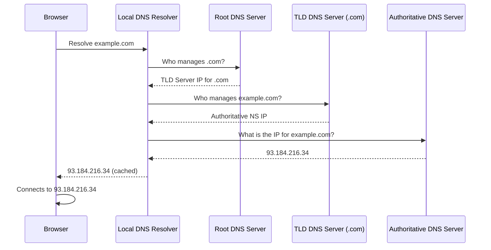

#### 📋 Step-by-Step Breakdown

1. **Browser** asks the **Local DNS Resolver** (provided by your ISP or custom e.g. `8.8.8.8`)
1. **Local DNS** checks its **cache** — if found, returns immediately
1. If not cached, Local DNS asks the **Root DNS Server** — there are 13 sets of root DNS servers managed by ICANN
1. **Root DNS** responds with the address of the **TLD DNS server** (for `.com`, `.net`, etc.)
1. **Local DNS** asks the **TLD DNS server** which is managed by IANA — it knows the authoritative name servers for that domain
1. **TLD DNS** responds with the address of the **Authoritative Name Server** for `example.com`
1. **Local DNS** queries the **Authoritative Name Server** (managed by your domain registrar, e.g., Route 53)
1. The **Authoritative NS** returns the final **IP address** (e.g., an A record)
1. **Local DNS caches** the result and returns it to the browser
1. The **browser connects** to the IP address

### 🖥️ DNS Server Types

#### 🌍 Root DNS Servers

- Managed by **ICANN** (Internet Corporation for Assigned Names and Numbers)
- 13 logical root name servers ([a.root-servers.net](http://a.root-servers.net/) through [m.root-servers.net](http://m.root-servers.net/))
- They don't know the final IP — they redirect to TLD servers

#### 📂 TLD DNS Servers

- Managed by **IANA** (Internet Assigned Numbers Authority) — a branch of ICANN
- Responsible for all domains with a specific TLD
- `.com` TLD servers, `.org` TLD servers, etc.

#### 🔑 Authoritative DNS Servers

- The **source of truth** for a specific domain
- Managed by you (via your domain registrar or AWS Route 53)
- Contains the actual DNS records (A, CNAME, MX, etc.)
- When DNS says "I am the authority" — this is the final answer

#### 🏠 Local DNS Resolver (Recursive Resolver)

- Lives close to you — run by your **ISP**, company, or a public DNS service
- Examples: Google `8.8.8.8`, Cloudflare `1.1.1.1`, your router
- **Caches** DNS responses to speed up future queries (respecting the TTL)

### 📦 Common DNS Record Types

| Record | Purpose | Example |
| --- | --- | --- |
| **A** | Maps hostname → IPv4 address | `example.com` → `93.184.216.34` |
| **AAAA** | Maps hostname → IPv6 address | `example.com` → `2606:2800::1` |
| **CNAME** | Maps hostname → another hostname | `www.example.com` → `example.com` |
| **NS** | Name Server records — delegates DNS zone | `example.com` NS → `ns1.route53.com` |
| **MX** | Mail exchange — used for email routing | `example.com` MX → `mail.example.com` |
| **TXT** | Arbitrary text — used for verification, SPF, DKIM | `"v=spf1 include:..."` |
| **SOA** | Start of Authority — metadata about the zone | Serial, refresh interval, etc. |

### 🔁 DNS Caching & TTL

- Every DNS record has a **TTL (Time To Live)** value — measured in **seconds**
- TTL tells resolvers how long to **cache** the DNS response before re-querying
- **High TTL** (e.g., 86400 = 24 hours) → fewer queries, but slow propagation on changes
- **Low TTL** (e.g., 60 seconds) → faster updates, but more DNS queries
- When you change a DNS record, old responses may persist until the TTL expires

> **Exam Tip**: TTL is controlled by YOU in your DNS records. When migrating or updating records, lower your TTL ahead of time so changes propagate faster.

### 🏢 Domain Registrar vs DNS Service

|  | Domain Registrar | DNS Service |
| --- | --- | --- |
| **Purpose** | Registers/owns your domain name | Hosts your DNS zone (records) |
| **Examples** | GoDaddy, Namecheap, Route 53 | Route 53, Cloudflare, NS1 |
| **AWS service** | Route 53 (also acts as registrar) | Route 53 (Hosted Zones) |

> **Important**: A domain registrar and a DNS service are **different things**. You can register a domain with GoDaddy but use **Route 53 as your DNS service** by updating the NS records at GoDaddy to point to Route 53 name servers.

### 🔐 DNS Resolution Flow — Full Architecture

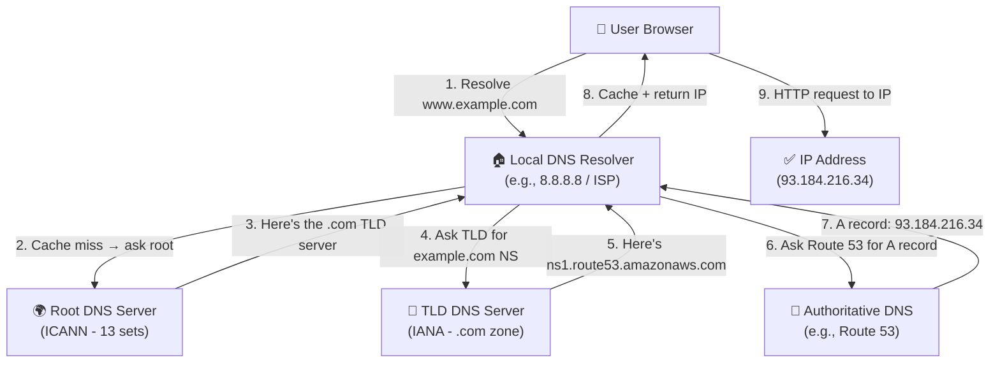

### 📝 Key Exam Takeaways

- **DNS** = translates domain names → IP addresses
- **Root DNS** → **TLD DNS** → **Authoritative DNS** is the resolution hierarchy
- **Local DNS Resolver** (recursive resolver) caches results per **TTL**
- **ICANN** manages root DNS; **IANA** manages TLDs
- **Authoritative DNS** = the final source of truth for a domain's records
- **Route 53** acts as both a **domain registrar** AND an **authoritative DNS service**
- You can register with a 3rd-party registrar (GoDaddy) but delegate DNS to Route 53 by updating **NS records**
- Common record types: **A** (IPv4), **AAAA** (IPv6), **CNAME** (alias), **NS** (name server)
- **TTL** controls caching — lower TTL = faster propagation but more DNS traffic

---

## Lecture 89: 🌐 Route 53 Overview

> **Course**: Ultimate AWS Certified Developer Associate DVA-C02 2026 \| Stephane Maarek<br>**Section 9**: Route 53

### 🧭 What is Amazon Route 53?

> Route 53 is a **highly available, scalable, fully managed, and Authoritative DNS** service provided by AWS.
>
> - **Authoritative** means YOU (the customer) can update the DNS records
> - **Route 53 is also a Domain Registrar** — you can register your own domains through it
> - It is the only AWS service with a **100% availability SLA**

- Routes end-user requests to internet applications — e.g., mapping `example.com` → an EC2 instance IP
- Name "Route 53" comes from **port 53**, which is the traditional DNS port
- Supports multiple record types, routing policies, and health checks

### 🗂️ Route 53 — DNS Records

Each DNS record in Route 53 defines how traffic for a domain should be routed. Every record contains:

| Field | Description |
| --- | --- |
| **Domain / Subdomain Name** | e.g., `example.com` |
| **Record Type** | e.g., `A`, `AAAA`, `CNAME`, `NS` |
| **Value** | e.g., `12.34.56.78` (an IP address) |
| **Routing Policy** | How Route 53 responds to queries |
| **TTL** | Time To Live — how long the record is cached at the DNS resolver |

### 📋 Supported Record Types

#### 🔵 Must-Know for the Exam

| Record | Description | Example |
| --- | --- | --- |
| **A** | Maps a hostname to an **IPv4** address | `example.com` → `1.2.3.4` |
| **AAAA** | Maps a hostname to an **IPv6** address | `example.com` → `2001:0db8::1` |
| **CNAME** | Maps a hostname to **another hostname** | `www.example.com` → `app.example.com` |
| **NS** | **Name Servers** for the hosted zone — controls DNS delegation | `ns-123.awsdns-45.com` |

#### 🟡 Advanced (Good to Know)

- **CAA** — Specifies which Certificate Authorities (CAs) are allowed to issue certificates for the domain
- **DS** — Used for DNSSEC delegation
- **MX** — Mail exchange record for email routing
- **NAPTR** — Used in telephony and other advanced lookups
- **PTR** — Reverse DNS lookups (IP → hostname)
- **SOA** — Start of Authority — metadata about the hosted zone
- **SPF** — Sender Policy Framework for email
- **SRV** — Specifies the location of services (host + port)
- **TXT** — General text records (used for verification, SPF, DKIM, etc.)

### 🏠 Hosted Zones

> A **Hosted Zone** is a container for DNS records that defines how to route traffic for a domain and its subdomains.

#### 🌍 Public Hosted Zone

- Answers queries from the **public internet**
- Example: `application1.mypublicdomain.com` → routes traffic publicly
- When you register a domain with Route 53 (or another registrar), a public hosted zone is created

#### 🔒 Private Hosted Zone

- Answers queries **only within one or more VPCs**
- Example: `application1.company.internal` — only accessible inside your private network
- Ideal for internal microservice resolution, internal APIs, etc.

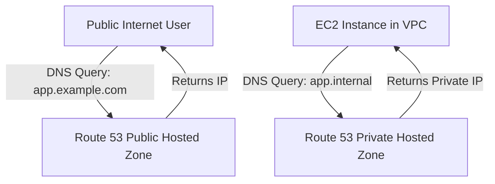

> 💰 **Cost**: $0.50 per hosted zone per month

### 🔁 Route 53 — High-Level Query Flow

How does a query resolve when using Route 53?

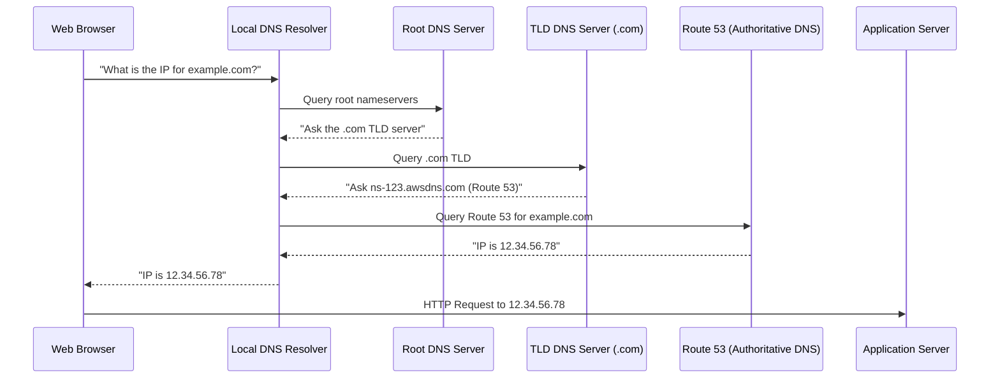

### 📦 Route 53 — Record Types Deep Dive

#### 🔷 A Record

- Maps a domain name to an **IPv4** address
- Most common record type for pointing domains to servers

```bash
# Query an A record using dig
dig A example.com
```

#### 🔷 CNAME vs Alias

> ⚠️ **IMPORTANT EXAM TOPIC**: CNAME and Alias records look similar but behave very differently.

| Feature | CNAME | Alias |
| --- | --- | --- |
| Points to | Another hostname | AWS resource OR another hostname |
| Works at root domain? | ❌ No (`example.com` can't be CNAME) | ✅ Yes (can be used for zone apex) |
| Charges | DNS query charges apply | **Free** for AWS resources |
| Health Check support | No | Yes |
| TTL | Configurable | Set by Route 53 (not configurable) |

- **CNAME** example: `www.example.com` → `app.example.com`
- **Alias** example: `example.com` → `my-load-balancer.us-east-1.elb.amazonaws.com`

> 🟢 **Alias targets** include: ELB, CloudFront, API Gateway, Elastic Beanstalk, S3 website endpoints, VPC endpoints, Global Accelerator, Route 53 records in the same zone

### 🛣️ Route 53 — Routing Policies (Overview)

> A **Routing Policy** defines how Route 53 responds to DNS queries. It does NOT route traffic like a load balancer — it only influences the DNS resolution response.

| Policy | Description |
| --- | --- |
| **Simple** | Route traffic to a single resource; can return multiple values |
| **Weighted** | Split traffic across multiple resources by percentage |
| **Latency** | Route to the region with the lowest latency for the user |
| **Failover** | Active-passive failover with health checks |
| **Geolocation** | Route based on user's geographic location |
| **Geoproximity** | Route based on geographic proximity with configurable bias |
| **IP-based** | Route based on the client's IP address (CIDR blocks) |
| **Multi-Value** | Return multiple records, with optional health checks |

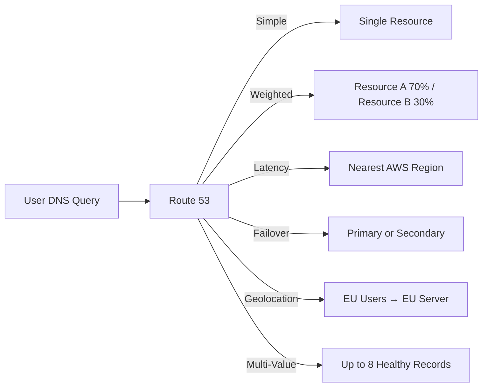

### 🏥 Route 53 — Health Checks (Overview)

> Route 53 **Health Checks** monitor the health of your endpoints and can trigger automatic DNS failover.

- Health checkers are located **outside your VPC** — they test from the public internet
- Route 53 has **~15 global health checkers** distributed worldwide
- Healthy threshold: **3 checks** (default) — 3 consecutive successes = healthy
- Unhealthy threshold: **3 checks** (default) — 3 consecutive failures = unhealthy
- Default check interval: **30 seconds** (can be reduced to **10 seconds** — higher cost)
- Protocols supported: **HTTP, HTTPS, TCP**

#### Types of Health Checks:

| Type | Description |
| --- | --- |
| **Endpoint** | Monitor a specific URL or IP |
| **Calculated** | Combine results of multiple health checks (parent + child) |
| **CloudWatch Alarm** | Trigger based on a CloudWatch alarm state |

> 📌 Health checks can be used with **Failover**, **Weighted**, **Latency**, **Geolocation**, and **Multi-Value** routing policies.

### 💻 CLI — Working with Route 53

```bash
# List all hosted zones
aws route53 list-hosted-zones

# List all DNS records in a hosted zone
aws route53 list-resource-record-sets \
  --hosted-zone-id Z1234567890ABC

# Create a DNS A record
aws route53 change-resource-record-sets \
  --hosted-zone-id Z1234567890ABC \
  --change-batch '{
    "Changes": [{
      "Action": "CREATE",
      "ResourceRecordSet": {
        "Name": "app.example.com",
        "Type": "A",
        "TTL": 300,
        "ResourceRecords": [{ "Value": "12.34.56.78" }]
      }
    }]
  }'
```

### 🧑‍💻 SDK — Query Route 53 with Node.js

```javascript
import { Route53Client, ListHostedZonesCommand, ListResourceRecordSetsCommand } from "@aws-sdk/client-route-53";

const client = new Route53Client({ region: "us-east-1" });

// List all hosted zones
const listZones = async () => {
  const command = new ListHostedZonesCommand({});
  const response = await client.send(command);
  console.log("Hosted Zones:", response.HostedZones);
};

// List DNS records in a specific hosted zone
const listRecords = async (hostedZoneId) => {
  const command = new ListResourceRecordSetsCommand({
    HostedZoneId: hostedZoneId,
  });
  const response = await client.send(command);
  response.ResourceRecordSets.forEach((record) => {
    console.log(`${record.Name} [${record.Type}]`, record.ResourceRecords);
  });
};

await listZones();
await listRecords("/hostedzone/Z1234567890ABC");
```

### 🏗️ Route 53 — Architecture Overview

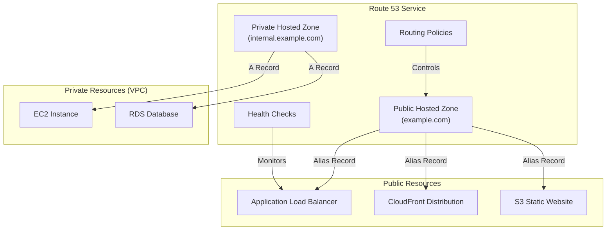

### 📌 Key Exam Takeaways

> **Remember these for the DVA-C02 exam:**

- Route 53 is AWS's **authoritative DNS + domain registrar**
- **Hosted zones** come in two flavors: **Public** (internet-facing) and **Private** (VPC-only)
- **Alias records** are Route 53-specific: they map to AWS resources, work at the **zone apex** (`example.com`), and are **free**
- **CNAME records** cannot be used at the root/apex domain (zone apex)
- Route 53 offers **100% availability SLA** — the highest of any AWS service
- DNS records always have a **TTL** that controls how long resolvers cache the answer
- Health checks operate from **outside the VPC** — they use the public internet to test endpoints
- **$0.50/month** per hosted zone is the pricing baseline

---

## Lecture 90: 🌍 Route 53 — Registering a Domain

> **Course**: Ultimate AWS Certified Developer Associate DVA-C02 2026 \| Stephane Maarek<br>**Section 9**: Route 53

### 🧭 Overview

> Route 53 is not just a DNS service — it is also a fully-featured **Domain Registrar**. You can purchase and manage domain names directly through AWS, without needing a third-party registrar like GoDaddy or Namecheap.

- A **domain name** is a human-readable address (e.g., `stephane-ccp.com`) that maps to an IP address via DNS
- Route 53 lets you **search, register, and manage** domain names from within the AWS console
- When you register a domain in Route 53, it **automatically creates a Hosted Zone** for that domain
- The Hosted Zone will contain default **NS (Name Server)** and **SOA (Start of Authority)** records

### 💳 Domain Registration — Key Concepts

#### 📋 What Happens When You Register a Domain?

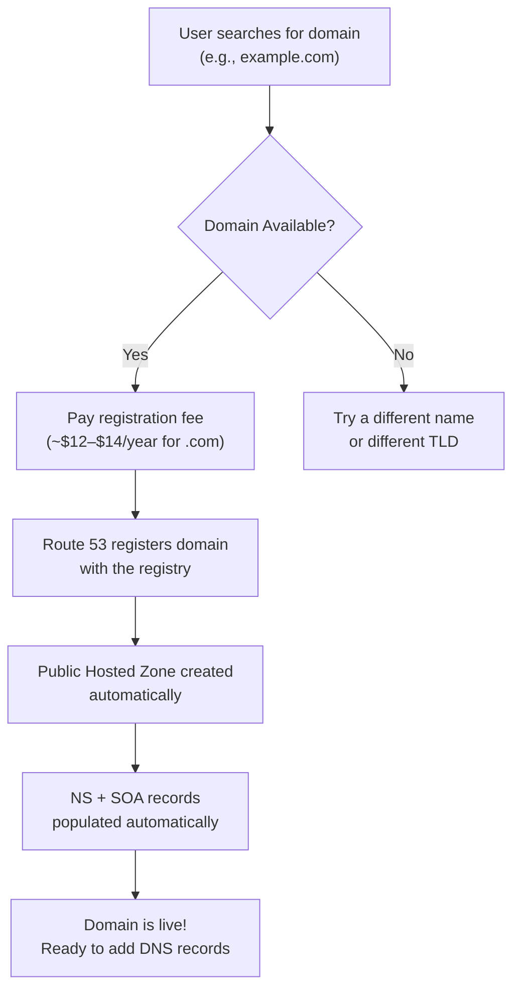

- Route 53 registers the domain with the **domain registry** (e.g., Verisign for `.com`, PIR for `.org`)
- A **Public Hosted Zone** is automatically created and linked to the domain
- AWS inserts **4 Name Server (NS) records** into the hosted zone — these point the world to Route 53 for DNS resolution of your domain
- The **SOA (Start of Authority)** record is also created automatically

#### 🏷️ TLD Pricing (Common Examples)

| TLD | Approx. Annual Price |
| --- | --- |
| `.com` | ~$14/year |
| `.net` | ~$11/year |
| `.org` | ~$12/year |
| `.io` | ~$39/year |
| `.co` | ~$25/year |
| `.info` | ~$12/year |

> 💡 Pricing varies — always check the [Route 53 pricing page](https://aws.amazon.com/route53/pricing/) for current domain registration costs.

### 🖥️ Step-by-Step: Registering a Domain via AWS Console

#### Step 1 — Navigate to Route 53

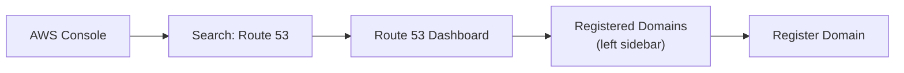

#### Step 2 — Search for Your Domain

- Type your desired domain name (e.g., `stephane-ccp`) in the search box
- Select the TLD (`.com`, `.net`, `.org`, etc.)
- Click **Check** — Route 53 shows availability and pricing

#### Step 3 — Add to Cart & Checkout

- If available → click **Add to Cart**
- Set the **registration period** (1–10 years)
- Toggle **Auto-Renew** (recommended to leave ON to prevent accidental expiry)
- Click **Continue**

#### Step 4 — Contact Details

- Fill in **Registrant Contact** details (name, address, email, phone)
- These are required by ICANN (Internet Corporation for Assigned Names and Numbers)
- Enable **Privacy Protection** (recommended): hides your personal details from WHOIS lookups — AWS registers the domain on your behalf

#### Step 5 — Review & Purchase

- Review domain + pricing
- Accept the Terms & Conditions
- Click **Complete Purchase**
- ⏱️ Registration takes **a few minutes to a few hours** to complete
- You'll receive a confirmation email from AWS

### 📂 What Gets Created Automatically

After registration completes:

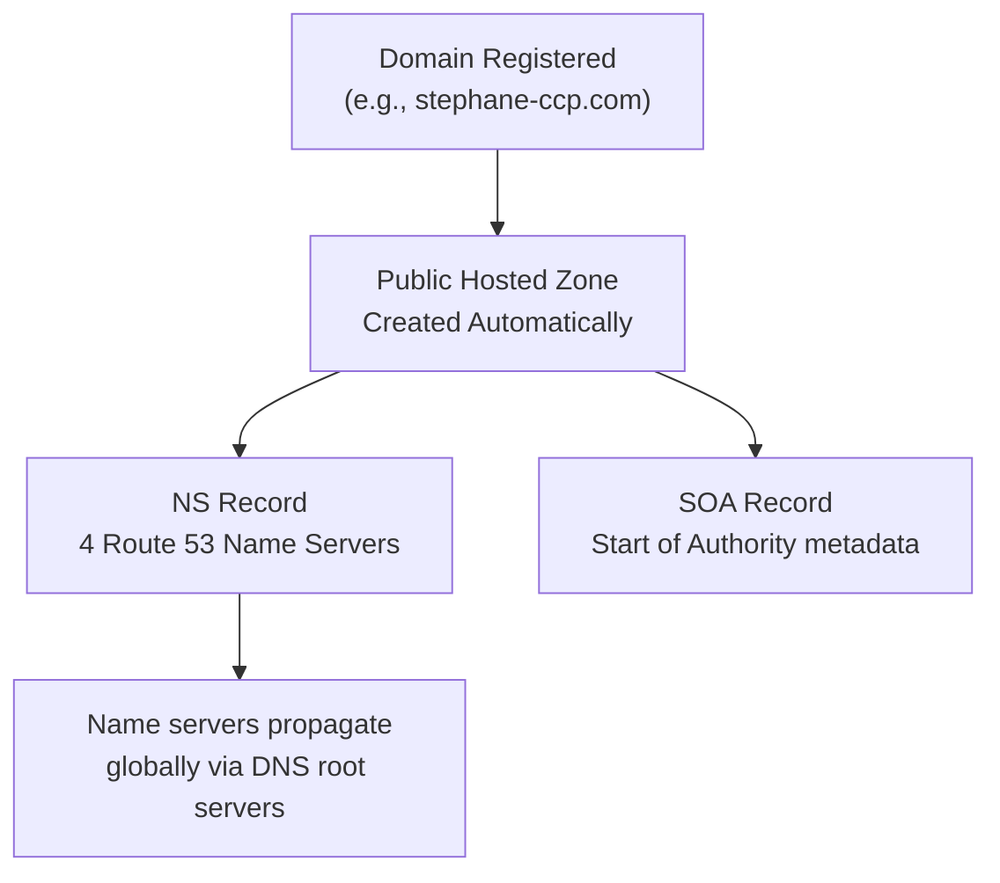

> ⚠️ **Important**: The Hosted Zone costs **$0.50/month** regardless of whether it has any records. This is separate from the domain registration fee.

#### 🔍 Auto-Created Records in the Hosted Zone

| Record Type | Purpose |
| --- | --- |
| **NS** | 4 AWS name servers that are authoritative for your domain |
| **SOA** | Administrative info about the zone (serial, refresh, retry, expire, TTL) |

Example NS record entries (auto-assigned by AWS):

```text
ns-123.awsdns-12.com
ns-456.awsdns-34.net
ns-789.awsdns-56.org
ns-012.awsdns-78.co.uk
```

> 📌 AWS always gives you **4 name servers** across **4 different TLDs** (`.com`, `.net`, `.org`, `.co.uk`) for maximum **redundancy and resilience**.

### 🔄 Domain Registration vs. Third-Party Registrar

> What if your domain is registered with GoDaddy, Namecheap, or another registrar but you want to use Route 53 for DNS?

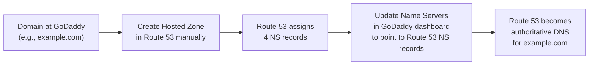

- You can use **Route 53 as DNS** even if the domain is registered elsewhere (Lecture 105 covers this in depth)
- This is done by updating the **nameserver (NS) records** at your registrar to point to Route 53's name servers
- Route 53 can also **transfer** domains from other registrars (though this is a separate process)

### 🌐 WHOIS — Understanding Domain Ownership

> **WHOIS** is a publicly accessible database that stores information about registered domain names.

- Contains: Registrant name, address, email, phone number, registrar details, expiry date
- With **Privacy Protection** enabled, Route 53 replaces your personal data with generic AWS contact info in WHOIS
- You can look up WHOIS records via tools like `whois.domaintools.com` or `who.is`

```bash
# Look up WHOIS from CLI (Linux/Mac)
whois stephane-ccp.com

# Alternatively, use dig to check NS records
dig NS stephane-ccp.com

# Check SOA record
dig SOA stephane-ccp.com
```

### 💻 CLI — Managing Registered Domains

```bash
# List all registered domains in your account
aws route53domains list-domains \
  --region us-east-1

# Check domain availability
aws route53domains check-domain-availability \
  --domain-name "mycooldomain.com" \
  --region us-east-1

# Get detailed info about a registered domain
aws route53domains get-domain-detail \
  --domain-name "stephane-ccp.com" \
  --region us-east-1

# List operations (pending registrations, transfers, etc.)
aws route53domains list-operations \
  --region us-east-1
```

> ⚠️ **Note**: Route 53 domain registration API calls must use the `us-east-1` region — domain registration is a global service but the API endpoint is fixed to `us-east-1`.

### 🧑‍💻 SDK — Check Domain Availability with Node.js

```javascript
import { Route53DomainsClient, CheckDomainAvailabilityCommand, ListDomainsCommand } from "@aws-sdk/client-route-53-domains";

// NOTE: Route 53 Domains API is only available in us-east-1
const client = new Route53DomainsClient({ region: "us-east-1" });

// Check if a domain name is available
const checkAvailability = async (domainName) => {
  const command = new CheckDomainAvailabilityCommand({
    DomainName: domainName,
  });

  const response = await client.send(command);
  console.log(`Domain: ${domainName}`);
  console.log(`Availability: ${response.Availability}`);
  // AVAILABLE | UNAVAILABLE | RESERVED | DONT_KNOW
};

// List all registered domains in the account
const listDomains = async () => {
  const command = new ListDomainsCommand({});
  const response = await client.send(command);

  response.Domains.forEach((domain) => {
    console.log(`Domain: ${domain.DomainName}`);
    console.log(`Expiry: ${domain.Expiry}`);
    console.log(`Auto-Renew: ${domain.AutoRenew}`);
    console.log("---");
  });
};

await checkAvailability("my-awesome-app.com");
await listDomains();
```

### 🔗 Connection Between Domain Registration & Hosted Zone

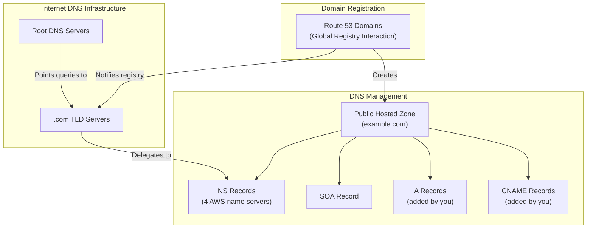

### 💡 Domain Registration — Best Practices

- **Enable Auto-Renew** — prevents losing your domain if you forget to renew manually
- **Enable Privacy Protection** — prevents spam and identity exposure via WHOIS
- **Use Route 53 for both registration AND DNS** — simplifies management (no need to update NS records at a third-party registrar)
- **Register domains well ahead** of going live — DNS propagation can take up to **48 hours** globally, though often much faster
- **Don't delete the Hosted Zone** if you still own the domain — it will break DNS resolution
- **Lock your domain** (Transfer Lock) — prevents unauthorized domain transfers; Route 53 enables this by default

### 📌 Key Exam Takeaways

> **Remember these for the DVA-C02 exam:**

- Route 53 is both a **DNS service** AND a **domain registrar** — you can do everything in one place
- When you register a domain in Route 53, a **Hosted Zone is automatically created** with NS + SOA records
- AWS always provides **4 name servers** (across 4 different TLDs) for redundancy
- Domain registration API must always target `us-east-1` region
- You can use Route 53 as your DNS provider **even if your domain is registered elsewhere** — just update the NS records at your registrar
- **Privacy Protection** hides WHOIS personal info — always recommended
- Domain registration fee (annual) is **separate** from the Hosted Zone fee ($0.50/month)

---

## Lecture 91: 📝 Route 53 — Creating Our First Records

> **Course**: Ultimate AWS Certified Developer Associate DVA-C02 2026 \| Stephane Maarek<br>**Section 9**: Route 53

### 🧭 Overview

> Now that we have a registered domain and a Hosted Zone (from Lecture 90), it's time to **create DNS records**. This is the hands-on lecture where we learn how to map domain names to IP addresses and other targets using Route 53.

- DNS records tell Route 53 **how to respond** when someone queries your domain
- We'll create **A records**, explore the **record creation workflow**, and understand each field in a record
- This is the foundation for all routing policies covered in later lectures

### 📋 Anatomy of a Route 53 DNS Record

> Every DNS record you create in Route 53 has these core fields:

| Field | Description | Example |
| --- | --- | --- |
| **Record Name** | The subdomain or root domain | `app.example.com` or `example.com` |
| **Record Type** | The type of DNS record | `A`, `AAAA`, `CNAME`, `NS`, etc. |
| **Value** | The target the record resolves to | `12.34.56.78` (for A record) |
| **TTL** | Time To Live — how long resolvers cache the answer | `300` seconds |
| **Routing Policy** | How Route 53 selects the response | Simple, Weighted, Latency, etc. |

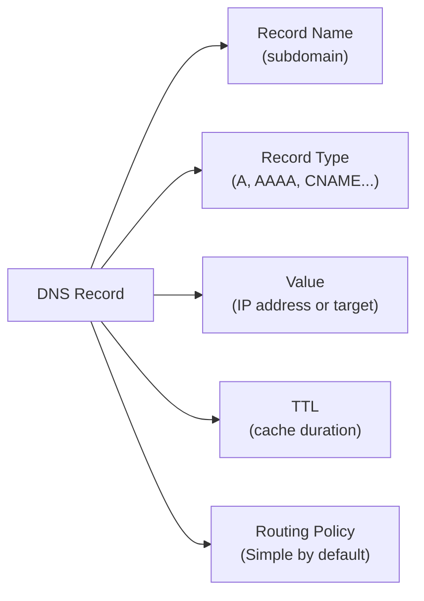

### 🖥️ Hands-On: Creating an A Record

#### 🔹 Step 1 — Navigate to Your Hosted Zone

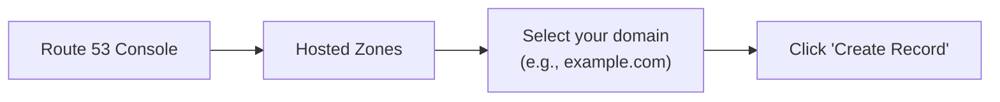

- Go to **Route 53** → **Hosted Zones** → click your domain name
- You should already see the **NS** and **SOA** records that were auto-created during domain registration
- Click **"Create Record"**

#### 🔹 Step 2 — Fill in Record Details

> Route 53 provides a **Quick Create** wizard and a **Wizard** mode. Both work — Quick Create is faster for simple records.

**Example — Creating an A record for the root domain:**

| Field | Value |
| --- | --- |
| Record Name | *(leave blank for root domain)* |
| Record Type | `A — Routes traffic to an IPv4 address` |
| Value | `11.22.33.44` (your EC2 instance public IP) |
| TTL | `300` (5 minutes — default) |
| Routing Policy | `Simple routing` |

**Example — Creating an A record for a subdomain:**

| Field | Value |
| --- | --- |
| Record Name | `test` (becomes `test.example.com`) |
| Record Type | `A` |
| Value | `55.66.77.88` |
| TTL | `300` |
| Routing Policy | `Simple routing` |

#### 🔹 Step 3 — Click "Create Records"

- Route 53 creates the record instantly
- DNS propagation begins immediately but caching means global resolution can take up to **TTL** seconds

### 🔍 Understanding Each Record Type in Practice

#### 📌 A Record (IPv4)

> Maps a domain name directly to an **IPv4 address**.

```text
example.com      A      11.22.33.44      TTL: 300
test.example.com A      55.66.77.88      TTL: 300
```

- Most common record type for web applications
- Points directly to an EC2 instance, on-premise server, or any IPv4 endpoint

#### 📌 AAAA Record (IPv6)

> Maps a domain name to an **IPv6 address**.

```text
example.com      AAAA   2001:0db8:85a3::8a2e:0370:7334      TTL: 300
```

- Used when your infrastructure supports IPv6
- Same workflow as creating an A record, just select `AAAA` as the type

#### 📌 CNAME Record

> Maps a domain name to **another domain name** (hostname-to-hostname).

```text
www.example.com    CNAME    example.com    TTL: 300
api.example.com    CNAME    my-alb-123.us-east-1.elb.amazonaws.com    TTL: 300
```

> ⚠️ **Critical Rule**: CNAME records **CANNOT** be created for the **root domain** (zone apex). You cannot create a CNAME for `example.com` — only for subdomains like `www.example.com`.

#### 📌 Multiple Values in a Single Record

> You can specify **multiple IP addresses** in a single A record. Route 53 returns ALL values to the client — the **client (browser) decides** which one to use (client-side load balancing).

```text
example.com    A    11.22.33.44
                    55.66.77.88
                    99.00.11.22
                    TTL: 300
```

- When a client gets multiple values, it **randomly picks one**
- This is the simplest form of DNS-level load distribution
- Covered more in the **Simple Routing Policy** lecture (Lecture 95)

### 🛠️ Creating Records — Console Walkthrough

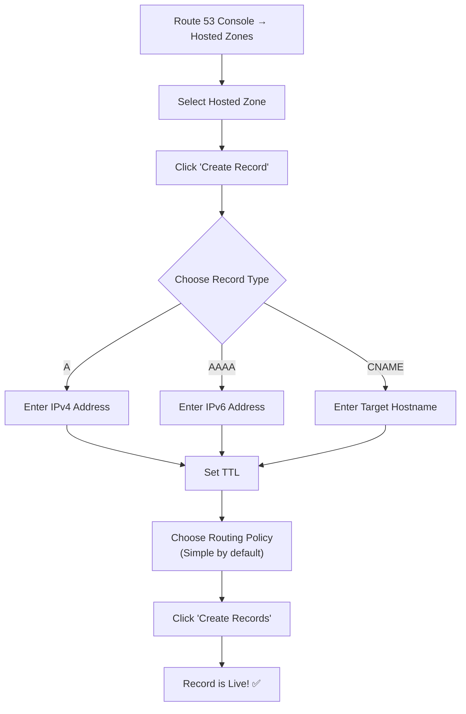

### 💻 CLI — Creating DNS Records

> Route 53 uses a **change batch** JSON structure for all record modifications via CLI. This is the same for CREATE, UPDATE (UPSERT), and DELETE operations.

#### 🔹 Create an A Record

```bash
aws route53 change-resource-record-sets \
  --hosted-zone-id Z1234567890ABC \
  --change-batch '{
    "Changes": [{
      "Action": "CREATE",
      "ResourceRecordSet": {
        "Name": "test.example.com",
        "Type": "A",
        "TTL": 300,
        "ResourceRecords": [
          { "Value": "11.22.33.44" }
        ]
      }
    }]
  }'
```

#### 🔹 UPSERT an A Record (Create or Update)

> `UPSERT` is the safest action — it **creates** the record if it doesn't exist, or **updates** it if it does.

```bash
aws route53 change-resource-record-sets \
  --hosted-zone-id Z1234567890ABC \
  --change-batch '{
    "Changes": [{
      "Action": "UPSERT",
      "ResourceRecordSet": {
        "Name": "app.example.com",
        "Type": "A",
        "TTL": 300,
        "ResourceRecords": [
          { "Value": "11.22.33.44" },
          { "Value": "55.66.77.88" }
        ]
      }
    }]
  }'
```

#### 🔹 Create a CNAME Record

```bash
aws route53 change-resource-record-sets \
  --hosted-zone-id Z1234567890ABC \
  --change-batch '{
    "Changes": [{
      "Action": "CREATE",
      "ResourceRecordSet": {
        "Name": "www.example.com",
        "Type": "CNAME",
        "TTL": 300,
        "ResourceRecords": [
          { "Value": "example.com" }
        ]
      }
    }]
  }'
```

#### 🔹 Delete a Record

```bash
aws route53 change-resource-record-sets \
  --hosted-zone-id Z1234567890ABC \
  --change-batch '{
    "Changes": [{
      "Action": "DELETE",
      "ResourceRecordSet": {
        "Name": "test.example.com",
        "Type": "A",
        "TTL": 300,
        "ResourceRecords": [
          { "Value": "11.22.33.44" }
        ]
      }
    }]
  }'
```

> ⚠️ **DELETE requires you to specify the EXACT same values** (Name, Type, TTL, ResourceRecords) as the existing record. If any field doesn't match, the deletion will fail.

#### 🔹 Create Multiple Records at Once

```bash
aws route53 change-resource-record-sets \
  --hosted-zone-id Z1234567890ABC \
  --change-batch '{
    "Changes": [
      {
        "Action": "CREATE",
        "ResourceRecordSet": {
          "Name": "api.example.com",
          "Type": "A",
          "TTL": 300,
          "ResourceRecords": [{ "Value": "10.0.0.1" }]
        }
      },
      {
        "Action": "CREATE",
        "ResourceRecordSet": {
          "Name": "admin.example.com",
          "Type": "A",
          "TTL": 300,
          "ResourceRecords": [{ "Value": "10.0.0.2" }]
        }
      }
    ]
  }'
```

### 🧑‍💻 SDK — Creating Records with Node.js

```javascript
import {
  Route53Client,
  ChangeResourceRecordSetsCommand,
  ListResourceRecordSetsCommand,
} from "@aws-sdk/client-route-53";

const client = new Route53Client({ region: "us-east-1" });
const HOSTED_ZONE_ID = "Z1234567890ABC";

// Create an A record
const createARecord = async (subdomain, domain, ipAddress, ttl = 300) => {
  const recordName = subdomain ? `${subdomain}.${domain}` : domain;

  const command = new ChangeResourceRecordSetsCommand({
    HostedZoneId: HOSTED_ZONE_ID,
    ChangeBatch: {
      Changes: [
        {
          Action: "UPSERT", // Creates or updates
          ResourceRecordSet: {
            Name: recordName,
            Type: "A",
            TTL: ttl,
            ResourceRecords: [{ Value: ipAddress }],
          },
        },
      ],
    },
  });

  const response = await client.send(command);
  console.log("Change ID:", response.ChangeInfo.Id);
  console.log("Status:", response.ChangeInfo.Status); // PENDING → INSYNC
};

// Create a CNAME record
const createCnameRecord = async (subdomain, domain, target, ttl = 300) => {
  const command = new ChangeResourceRecordSetsCommand({
    HostedZoneId: HOSTED_ZONE_ID,
    ChangeBatch: {
      Changes: [
        {
          Action: "UPSERT",
          ResourceRecordSet: {
            Name: `${subdomain}.${domain}`,
            Type: "CNAME",
            TTL: ttl,
            ResourceRecords: [{ Value: target }],
          },
        },
      ],
    },
  });

  const response = await client.send(command);
  console.log("CNAME created:", response.ChangeInfo.Id);
};

// Create A record with multiple IPs (multi-value simple)
const createMultiValueARecord = async (name, ipAddresses, ttl = 300) => {
  const command = new ChangeResourceRecordSetsCommand({
    HostedZoneId: HOSTED_ZONE_ID,
    ChangeBatch: {
      Changes: [
        {
          Action: "UPSERT",
          ResourceRecordSet: {
            Name: name,
            Type: "A",
            TTL: ttl,
            ResourceRecords: ipAddresses.map((ip) => ({ Value: ip })),
          },
        },
      ],
    },
  });

  const response = await client.send(command);
  console.log("Multi-value A record created:", response.ChangeInfo.Status);
};

// List all records in the hosted zone
const listAllRecords = async () => {
  const command = new ListResourceRecordSetsCommand({
    HostedZoneId: HOSTED_ZONE_ID,
  });

  const response = await client.send(command);
  response.ResourceRecordSets.forEach((record) => {
    const values = record.ResourceRecords?.map((r) => r.Value).join(", ") || "Alias";
    console.log(`${record.Name.padEnd(35)} ${record.Type.padEnd(8)} TTL:${record.TTL || "N/A"}  →  ${values}`);
  });
};

// Usage examples
await createARecord("test", "example.com", "11.22.33.44");
await createCnameRecord("www", "example.com", "example.com");
await createMultiValueARecord("demo.example.com", ["10.0.0.1", "10.0.0.2", "10.0.0.3"]);
await listAllRecords();
```

### 🔄 Record Change Status: PENDING vs INSYNC

> When you create or modify a record, Route 53 returns a **Change Status**.

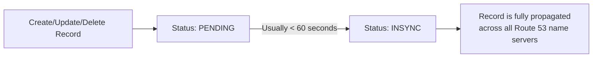

| Status | Meaning |
| --- | --- |
| **PENDING** | The change has been submitted and is propagating across Route 53's name servers |
| **INSYNC** | The change is fully propagated and live on all 4 name servers |

- Propagation within Route 53 is usually very fast (**&lt; 60 seconds**)
- However, **DNS resolvers worldwide** may still cache the old record until the old TTL expires

```bash
# Check change status
aws route53 get-change --id /change/C1234567890ABC
```

### 🧪 Verifying Your Records

#### Using `nslookup`

```bash
# Query A record
nslookup test.example.com

# Query with a specific DNS server
nslookup test.example.com ns-123.awsdns-12.com
```

#### Using `dig`

```bash
# Query A record with full details
dig test.example.com

# Query specific record type
dig A test.example.com
dig AAAA test.example.com
dig CNAME www.example.com

# Query against a specific name server
dig @ns-123.awsdns-12.com test.example.com

# Short output (just the answer)
dig +short test.example.com
```

#### Expected Output Example

```bash
$ dig +short test.example.com
11.22.33.44

$ dig +short demo.example.com
10.0.0.1
10.0.0.2
10.0.0.3
```

### 📊 Hosted Zone Record View — What You'll See

After creating records, your Hosted Zone will look something like this:

| Record Name | Type | Routing Policy | Value | TTL |
| --- | --- | --- | --- | --- |
| `example.com` | NS | Simple | 4 AWS name servers | 172800 |
| `example.com` | SOA | Simple | SOA metadata | 900 |
| `example.com` | A | Simple | `11.22.33.44` | 300 |
| `test.example.com` | A | Simple | `55.66.77.88` | 300 |
| `www.example.com` | CNAME | Simple | `example.com` | 300 |

> 📌 The **NS** and **SOA** records are auto-created and should **never be deleted**. Doing so breaks DNS resolution entirely.

### ⚠️ Common Mistakes to Avoid

| Mistake | Consequence | Fix |
| --- | --- | --- |
| Deleting NS records | Domain becomes unresolvable | Re-create NS records with correct name servers |
| Creating CNAME at root domain | Route 53 rejects the record | Use an **Alias** record instead |
| Setting TTL too high | Changes take very long to propagate | Use lower TTL (e.g., 60–300) during active development |
| Setting TTL too low | Increased DNS query costs + latency | Increase TTL once records are stable |
| Wrong IP in A record | Traffic routes to wrong server | Use UPSERT to update with correct IP |

### 📌 Key Exam Takeaways

> **Remember these for the DVA-C02 exam:**

- DNS records are created inside **Hosted Zones** — each record has a Name, Type, Value, TTL, and Routing Policy
- **A records** map to IPv4 addresses; **AAAA records** map to IPv6 addresses
- **CNAME records** cannot be used at the **zone apex** (root domain like `example.com`)
- Use **UPSERT** action in the CLI/SDK to safely create-or-update records
- A single A record can hold **multiple IP addresses** — the client picks one randomly
- Route 53 record changes are **PENDING** → **INSYNC** (usually within 60 seconds inside Route 53)
- Always verify records with `dig` or `nslookup` after creation
- **NS** and **SOA** records are auto-created — never delete them

---

## Lecture 92: 🖥️ Route 53 - EC2 Setup

> 📘 This lecture walks through setting up EC2 instances across multiple AWS regions so they can be used as targets for Route 53 DNS routing policy demonstrations in upcoming lectures.

### 🎯 Purpose of This Setup

- The goal is to launch **multiple EC2 instances in different AWS regions** (e.g., `us-east-1`, `eu-west-1`, `ap-southeast-1`)
- Each instance will run a simple web server that displays information about the instance (region, AZ, instance ID)
- These instances will later be used to demonstrate Route 53 **routing policies** such as Simple, Weighted, Latency, Failover, Geolocation, and Geoproximity
- This is a **hands-on prerequisite** lecture — setting the stage for DNS routing experiments

### 🏗️ Architecture Overview

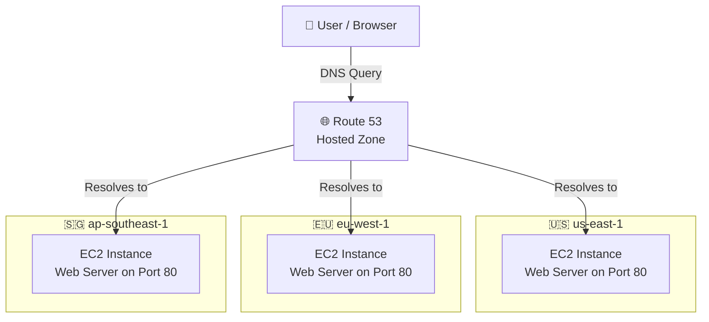

### 🔧 Step-by-Step: Launching EC2 Instances

#### 📌 Step 1: Choose a Region

- Navigate to the **EC2 Console**
- Switch to the first region (e.g., **us-east-1 / N. Virginia**)
- You will repeat this process for **each region** you want to test with

#### 📌 Step 2: Launch an EC2 Instance

- Click **"Launch Instance"**
- **Name**: Give it a descriptive name like `Route53-Demo-us-east-1`
- **AMI**: Select **Amazon Linux 2023** (or Amazon Linux 2) — Free Tier eligible
- **Instance Type**: `t2.micro` (Free Tier eligible)
- **Key Pair**: Proceed without a key pair (we only need HTTP access, not SSH for this demo)

#### 📌 Step 3: Configure Security Group

- Create a **new security group** or select an existing one
- Add an **Inbound Rule**:

| Type | Protocol | Port Range | Source |
| --- | --- | --- | --- |
| HTTP | TCP | 80 | 0.0.0.0/0 |

- This allows anyone on the internet to access the web server on port 80

#### 📌 Step 4: Add User Data Script

- Expand **"Advanced Details"** at the bottom
- In the **User Data** text area, paste a bash script that installs and starts a web server displaying instance metadata

```bash
#!/bin/bash
# Install httpd (Apache web server)
yum update -y
yum install -y httpd

# Start the web server
systemctl start httpd
systemctl enable httpd

# Get instance metadata using IMDSv2
TOKEN=$(curl -s -X PUT "<http://169.254.169.254/latest/api/token>" \
  -H "X-aws-ec2-metadata-token-ttl-seconds: 21600")

INSTANCE_ID=$(curl -s -H "X-aws-ec2-metadata-token: $TOKEN" \
  <http://169.254.169.254/latest/meta-data/instance-id>)

AZ=$(curl -s -H "X-aws-ec2-metadata-token: $TOKEN" \
  <http://169.254.169.254/latest/meta-data/placement/availability-zone>)

REGION=$(curl -s -H "X-aws-ec2-metadata-token: $TOKEN" \
  <http://169.254.169.254/latest/meta-data/placement/region>)

# Create a simple HTML page
cat > /var/www/html/index.html <<EOF
<html>
<head><title>EC2 Instance - Route 53 Demo</title></head>
<body style="font-family: Arial; text-align: center; padding: 50px;">
  <h1>Hello from EC2!</h1>
  <p><strong>Instance ID:</strong> $INSTANCE_ID</p>
  <p><strong>Availability Zone:</strong> $AZ</p>
  <p><strong>Region:</strong> $REGION</p>
</body>
</html>
EOF
```

> 💡 **IMDSv2 (Instance Metadata Service v2)**: The script uses a **token-based approach** (`PUT` to get a session token, then `GET` with the token header). This is the secure, recommended way to access EC2 instance metadata.

#### 📌 Step 5: Launch the Instance

- Review the configuration and click **"Launch Instance"**
- Wait for the instance to enter the **"Running"** state
- Copy the **Public IPv4 address**
- Open it in a browser: `http://<public-ip>` — you should see the HTML page with instance details

#### 📌 Step 6: Repeat for Other Regions

- Switch to another region in the AWS Console (e.g., **eu-west-1 / Ireland**)
- Repeat Steps 2–5 with a new instance
- Do the same for a third region (e.g., **ap-southeast-1 / Singapore**)

> ⚠️ **Important**: Each region has its own security groups. You must create a new security group with HTTP (port 80) access in **each region** you launch an instance.

### 🌐 Verifying the Setup

After launching instances in multiple regions, verify each one:

| Region | Public IP Example | Expected Response |
| --- | --- | --- |
| us-east-1 | `3.91.x.x` | Hello from EC2! Region: us-east-1 |
| eu-west-1 | `54.78.x.x` | Hello from EC2! Region: eu-west-1 |
| ap-southeast-1 | `13.212.x.x` | Hello from EC2! Region: ap-southeast-1 |

- Open each public IP in your browser to confirm the web page loads correctly
- Each page should show a **different region** and **availability zone**

### 📡 Using the EC2 IPs with Route 53

Once all instances are running, you can:

- Go to **Route 53 → Hosted Zones → Your Domain**
- Create **A records** pointing to the public IPs of each EC2 instance
- Apply different **routing policies** (Simple, Weighted, Latency, etc.) to control how traffic is distributed

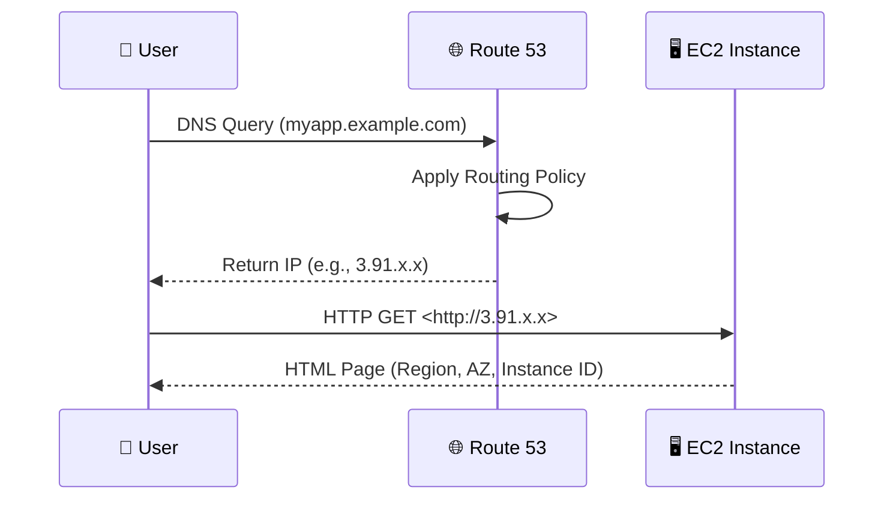

### 🔑 Key Concepts Covered

#### 🛡️ Security Group Configuration

- Security groups are **region-specific** — you need one per region
- For this demo, only **port 80 (HTTP)** inbound from **0.0.0.0/0** is required
- No SSH access is needed since we're only testing HTTP responses

#### 📋 EC2 User Data

- **User Data** scripts run **only once** at instance **first launch**
- They execute as the `root` user
- Commonly used to install packages, configure services, and set up applications
- The script must start with `#!/bin/bash`

#### 🔒 Instance Metadata Service v2 (IMDSv2)

- IMDSv2 requires a **session token** obtained via a `PUT` request
- The token is passed as a header (`X-aws-ec2-metadata-token`) in subsequent `GET` requests
- This is more secure than IMDSv1 (which allowed simple `GET` without authentication)
- Metadata endpoint: `http://169.254.169.254/latest/meta-data/`

### 💻 Programmatic EC2 Launch (Optional)

You can also launch these instances using the AWS SDK:

```javascript
import { EC2Client, RunInstancesCommand } from "@aws-sdk/client-ec2";

const userData = `#!/bin/bash
yum update -y
yum install -y httpd
systemctl start httpd
systemctl enable httpd
TOKEN=$(curl -s -X PUT "<http://169.254.169.254/latest/api/token>" -H "X-aws-ec2-metadata-token-ttl-seconds: 21600")
REGION=$(curl -s -H "X-aws-ec2-metadata-token: $TOKEN" <http://169.254.169.254/latest/meta-data/placement/region>)
echo "<h1>Hello from $REGION</h1>" > /var/www/html/index.html`;

const regions = ["us-east-1", "eu-west-1", "ap-southeast-1"];

for (const region of regions) {
  const client = new EC2Client({ region });

  const command = new RunInstancesCommand({
    ImageId: "ami-0abcdef1234567890", // Replace with region-specific AMI ID
    InstanceType: "t2.micro",
    MinCount: 1,
    MaxCount: 1,
    UserData: Buffer.from(userData).toString("base64"),
    TagSpecifications: [
      {
        ResourceType: "instance",
        Tags: [{ Key: "Name", Value: `Route53-Demo-${region}` }],
      },
    ],
  });

  const response = await client.send(command);
  console.log(`Launched in ${region}: ${response.Instances[0].InstanceId}`);
}
```

> 💡 **Note**: User Data must be **Base64-encoded** when passed via the API/SDK. The console handles this automatically, but programmatically you need `Buffer.from(userData).toString("base64")`.

### ⚠️ Cost & Cleanup Reminders

- `t2.micro` instances are **Free Tier eligible** (750 hours/month for the first 12 months)
- Running instances in **3 regions** simultaneously counts toward your Free Tier hours
- **Don't forget to terminate** these instances after completing the Route 53 routing policy labs
- Also **release any Elastic IPs** if allocated (Elastic IPs cost money when not attached to a running instance)

### 🎯 Key Exam Takeaways

- **EC2 User Data** runs only on the **first boot** and executes as `root`
- **IMDSv2** is the recommended, token-based method for accessing instance metadata
- **Security groups are stateful** — if you allow inbound HTTP, the response traffic is automatically allowed out
- Security groups are **region-scoped** — they don't transfer across regions
- EC2 **public IPs change** when an instance is stopped and started — use **Elastic IPs** for a fixed address (or use Route 53 Alias records with an ALB)
- The metadata endpoint `169.254.169.254` is a **link-local address** available only from within the instance

---

## Lecture 93: ⏱️ Route 53 - TTL

> 📘 TTL (Time To Live) is a critical DNS concept that controls how long a DNS record is cached by clients and resolvers. Understanding TTL is essential for managing DNS propagation, performance, and cost in Route 53.

### 🔍 What is DNS TTL?

- **TTL (Time To Live)** is a value (in seconds) set on each DNS record that tells DNS resolvers and clients **how long to cache** the DNS response before requesting a fresh answer
- When a client queries Route 53 for a domain name, the response includes the TTL value
- The client/resolver **caches the result** for that duration and does **not** query Route 53 again until the TTL expires
- After the TTL expires, the next DNS query goes back to Route 53 to fetch the latest record

### 🔄 How TTL Works — End to End

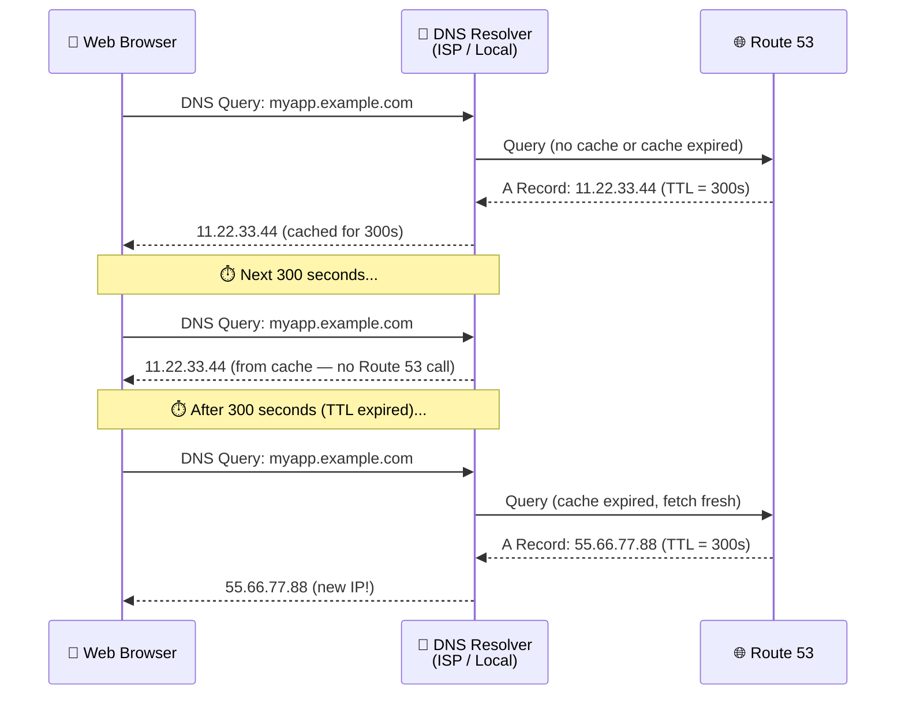

### ⚖️ High TTL vs Low TTL

| Aspect | 🔼 High TTL (e.g., 86400s / 24 hours) | 🔽 Low TTL (e.g., 60s / 1 minute) |
| --- | --- | --- |
| **DNS Queries to Route 53** | Fewer queries → **lower cost** | More queries → **higher cost** |
| **Record Change Propagation** | Slow — clients use stale cache for hours | Fast — clients pick up changes within seconds |
| **Performance** | Better — fewer DNS lookups needed | Slightly worse — frequent DNS lookups |
| **Use Case** | Stable records that rarely change | Before planned DNS changes or migrations |
| **Risk** | Outdated records served if IP changes | More Route 53 traffic and cost |

> 💡 **Route 53 charges per query**. High TTL means fewer queries and lower bills. Low TTL means faster propagation but more queries and higher bills.

### 📐 TTL Values in Practice

#### 🟢 Common TTL Settings

| Scenario | Recommended TTL | Reasoning |
| --- | --- | --- |
| Production website (stable) | `86400` (24h) or `3600` (1h) | IP rarely changes, minimize queries |
| Before a planned migration | `60` (1 min) or `300` (5 min) | Need fast propagation when IP changes |
| During active development | `300` (5 min) | Balance between cost and flexibility |
| Health check failover records | `60` (1 min) | Quick failover response needed |
| After migration is complete | Increase back to `3600`+ | Stabilize and reduce query costs |

#### 🎯 The Migration Strategy Pattern

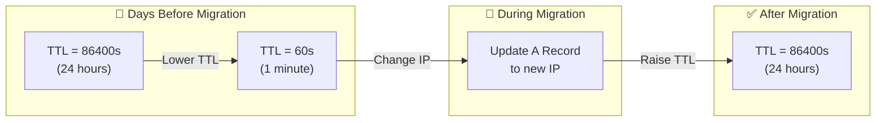

> ⚠️ **Best Practice**: Lower your TTL **well before** making a DNS change (at least 24–48 hours in advance). This ensures all cached records with the old high TTL have expired before you switch IPs.

### 🛠️ Setting TTL in Route 53

#### 📌 Via the AWS Console

- Navigate to **Route 53 → Hosted Zones → Your Domain**
- Select a record or create a new one
- Set the **TTL (in seconds)** field — e.g., `300` for 5 minutes
- Save the record

#### 📌 Via AWS CLI

```bash
# Create/update an A record with TTL of 300 seconds
aws route53 change-resource-record-sets \
  --hosted-zone-id Z1234567890 \
  --change-batch '{
    "Changes": [{
      "Action": "UPSERT",
      "ResourceRecordSet": {
        "Name": "myapp.example.com",
        "Type": "A",
        "TTL": 300,
        "ResourceRecords": [{"Value": "11.22.33.44"}]
      }
    }]
  }'
```

#### 📌 Via AWS SDK (Node.js)

```javascript
import { Route53Client, ChangeResourceRecordSetsCommand } from "@aws-sdk/client-route-53";

const client = new Route53Client({ region: "us-east-1" });

const command = new ChangeResourceRecordSetsCommand({
  HostedZoneId: "Z1234567890",
  ChangeBatch: {
    Changes: [
      {
        Action: "UPSERT",
        ResourceRecordSet: {
          Name: "myapp.example.com",
          Type: "A",
          TTL: 300, // 5 minutes
          ResourceRecords: [{ Value: "11.22.33.44" }],
        },
      },
    ],
  },
});

const response = await client.send(command);
console.log("Change Info:", response.ChangeInfo);
```

### 🔬 Testing TTL with `dig` and `nslookup`

#### Using `dig` (Linux/Mac)

```bash
# Query a DNS record and observe the TTL
dig myapp.example.com

# Look for the ANSWER SECTION:
# myapp.example.com.  300  IN  A  11.22.33.44
#                      ^^^
#                      TTL (seconds remaining in cache)

# Run it again after a few seconds — TTL will count down
dig myapp.example.com
# myapp.example.com.  275  IN  A  11.22.33.44
#                      ^^^
#                      Decreased! (was cached 25 seconds ago)
```

#### Using `nslookup` (Windows)

```bash
nslookup myapp.example.com

# To see TTL details, use:
nslookup -debug myapp.example.com
```

> 💡 The TTL value you see in `dig` output **counts down** from the original TTL. If you set TTL = 300 and query after 100 seconds, you'll see TTL = 200 remaining.

### 🚫 TTL and Alias Records

- **Alias records** in Route 53 do **NOT** have a user-configurable TTL
- Route 53 **automatically sets the TTL** for Alias records to match the TTL of the target resource (e.g., ALB, CloudFront, S3 website)
- You **cannot** override or customize TTL on Alias records
- This is an important distinction from standard (non-Alias) records

| Record Type | TTL Configurable? | Notes |
| --- | --- | --- |
| A (standard) | ✅ Yes | You set the TTL value |
| AAAA (standard) | ✅ Yes | You set the TTL value |
| CNAME | ✅ Yes | You set the TTL value |
| **Alias** | ❌ No | Auto-set by Route 53 based on target |

### 📊 TTL's Impact on Route 53 Cost

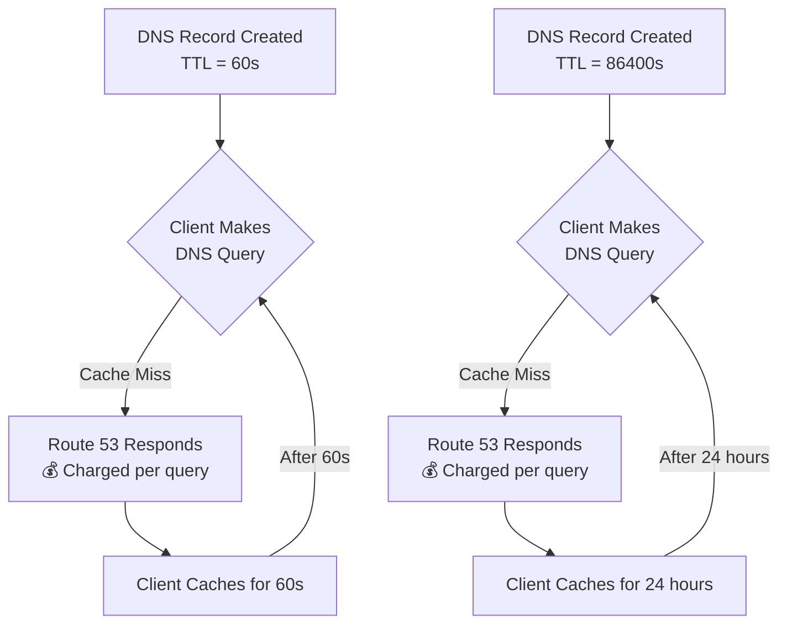

> 💡 **Cost Example**: If 1,000 users visit your site per hour:
>
> - **TTL = 60s**: Up to ~60,000 Route 53 queries/hour (each user queries every minute)
> - **TTL = 3600s**: Up to ~1,000 Route 53 queries/hour (each user queries once per hour)
> - Route 53 pricing: **$0.40 per million queries** for standard records

### 🧠 TTL Caching Layers

DNS responses are cached at **multiple levels**, and TTL applies to all of them:

```mermaid
graph TD
    A["👤 Web Browser<br/>(Browser DNS Cache)"] -->|TTL expired?| B["💻 Operating System<br/>(OS DNS Cache)"]
    B -->|TTL expired?| C["🔄 Local DNS Resolver<br/>(Router / ISP)"]
    C -->|TTL expired?| D["🌐 Route 53<br/>(Authoritative DNS)"]

    style A fill:#4a90d9,color:#fff
    style B fill:#7b68ee,color:#fff
    style C fill:#e67e22,color:#fff
    style D fill:#27ae60,color:#fff
```

- **Browser Cache**: Chrome, Firefox, etc. maintain their own DNS cache
- **OS Cache**: The operating system caches DNS lookups
- **Resolver Cache**: Your ISP or corporate DNS resolver caches responses
- Each layer respects the TTL, but some may have **minimum TTL floors** (e.g., some resolvers enforce a minimum of 30s even if you set TTL = 0)

### 🎯 Key Exam Takeaways

- **TTL is mandatory** on all Route 53 records **except Alias records** (where it's auto-managed)
- **High TTL** = fewer DNS queries = **lower cost** but **slower propagation** of changes
- **Low TTL** = more DNS queries = **higher cost** but **faster propagation** of changes
- **Before changing a DNS record**, lower the TTL first and wait for the old TTL to expire, then make the change
- TTL is set in **seconds** — common values: `60`, `300`, `3600`, `86400`
- **Alias records** have their TTL automatically set by Route 53 — you **cannot** customize it
- DNS TTL is **not a guarantee** — some resolvers may ignore very low TTLs or cache longer than specified
- Route 53 charges **per DNS query** — TTL directly affects your DNS query costs

---

## Lecture 94: 🔀 Route 53 CNAME vs Alias

> 📘 Understanding the difference between CNAME records and Alias records is one of the most important Route 53 concepts for the AWS Developer Associate exam. This lecture covers when to use each, their limitations, and why Alias is often the preferred choice in AWS.

### 🧩 The Problem: Pointing to AWS Resources

- AWS resources like **ELB**, **CloudFront**, **S3 Websites**, etc. expose an **AWS hostname** (e.g., `my-alb-1234567890.us-east-1.elb.amazonaws.com`)
- You want your users to access these via your own domain: `myapp.example.com`
- You need a DNS record that maps your domain name to the AWS resource hostname
- There are **two ways** to do this in Route 53: **CNAME** and **Alias**

### 📖 CNAME Records

#### 🔍 What is a CNAME?

- **CNAME (Canonical Name)** maps one hostname to another hostname
- Example: `app.example.com` → `my-alb-1234567890.us-east-1.elb.amazonaws.com`
- The client first resolves the CNAME, then resolves the target hostname to get the final IP address
- It's a **standard DNS record type** — not AWS-specific

#### ⚠️ CNAME Limitations

- **Cannot be used at the Zone Apex** (the root domain)

    - ❌ `example.com` → CNAME is **NOT allowed**
    - ✅ `app.example.com` → CNAME is allowed
- The **Zone Apex** (also called the **naked domain** or **root domain**) is the top-level of your domain without any subdomain prefix
- This is a **DNS protocol restriction**, not an AWS limitation

```mermaid
graph TD
    subgraph Allowed["✅ CNAME Allowed"]
        A["app.example.com"] -->|CNAME| B["my-alb.elb.amazonaws.com"]
        C["www.example.com"] -->|CNAME| D["my-cdn.cloudfront.net"]
        E["api.example.com"] -->|CNAME| F["my-alb.elb.amazonaws.com"]
    end

    subgraph Blocked["❌ CNAME NOT Allowed"]
        G["example.com"] -.->|CNAME ⛔| H["my-alb.elb.amazonaws.com"]
    end

    style Blocked fill:#ffcccc,color:#333
    style Allowed fill:#ccffcc,color:#333
```

#### 💰 CNAME Cost

- Route 53 **charges for CNAME queries** — each DNS query incurs a cost
- Requires **two DNS lookups**: one for the CNAME, then one for the target hostname

### 🌟 Alias Records (Route 53 Specific)

#### 🔍 What is an Alias Record?

- **Alias** is a Route 53-specific extension to DNS
- Maps a hostname to an **AWS resource** directly
- Example: `example.com` → `my-alb-1234567890.us-east-1.elb.amazonaws.com`
- Works like a CNAME but with **major advantages**

#### ✅ Alias Advantages

- **Works at the Zone Apex!** — Can map `example.com` (root domain) to an AWS resource
- **Free of charge** — Route 53 does **NOT charge** for Alias queries to AWS resources
- **Native health check** integration — automatically inherits health checks
- **Single DNS lookup** — Route 53 resolves the Alias internally and returns the final IP address directly
- **Automatically recognizes changes** in the resource's IP addresses

```mermaid
graph TD
    subgraph Alias["🌟 Alias Record"]
        A["example.com"] -->|Alias| B["my-alb.elb.amazonaws.com"]
        C["app.example.com"] -->|Alias| D["my-cdn.cloudfront.net"]
    end

    subgraph Resolution["🔄 Internal Resolution"]
        B -->|Route 53 resolves internally| E["52.23.45.67<br/>54.12.78.90"]
        D -->|Route 53 resolves internally| F["13.224.10.55"]
    end

    style Alias fill:#d4edda,color:#333
    style Resolution fill:#cce5ff,color:#333
```

#### 🎯 Alias Target Resources

Alias records can **only point to** the following AWS resources:

| AWS Resource | Example Hostname |
| --- | --- |
| **Elastic Load Balancer (ELB)** | `my-alb-123.us-east-1.elb.amazonaws.com` |
| **CloudFront Distribution** | `d111111abcdef8.cloudfront.net` |
| **API Gateway** | `abc123.execute-api.us-east-1.amazonaws.com` |
| **Elastic Beanstalk Environment** | `myenv.us-east-1.elasticbeanstalk.com` |
| **S3 Website Endpoint** | `my-bucket.s3-website-us-east-1.amazonaws.com` |
| **VPC Interface Endpoint** | `vpce-0123456789abcdef.execute-api.us-east-1.vpce.amazonaws.com` |
| **Global Accelerator** | `a1b2c3d4e5f6.awsglobalaccelerator.com` |
| **Another Route 53 Record** | Another record in the **same hosted zone** |

> ⛔ **You CANNOT set an Alias target to an EC2 DNS name!** For example, you cannot Alias to `ec2-52-23-45-67.compute-1.amazonaws.com`. Use a standard A record with the IP instead.

### ⚖️ CNAME vs Alias — Complete Comparison

| Feature | CNAME | Alias |
| --- | --- | --- |
| **Type** | Standard DNS | Route 53 extension |
| **Zone Apex support** | ❌ No | ✅ Yes |
| **Cost** | 💰 Charged per query | 🆓 Free for AWS resources |
| **Target** | Any hostname (AWS or non-AWS) | Only specific AWS resources |
| **TTL** | ✅ You set it | ❌ Auto-set by Route 53 |
| **Health Checks** | Must configure separately | Built-in for supported targets |
| **DNS Lookups** | 2 lookups (CNAME → target) | 1 lookup (resolved internally) |
| **Record Types** | Always type `CNAME` | Can be type `A` or `AAAA` |
| **Non-AWS targets** | ✅ Yes | ❌ No |

### 🔄 How Resolution Differs

#### CNAME Resolution Flow

```mermaid
sequenceDiagram
    participant Client as 👤 Client
    participant Resolver as 🔄 DNS Resolver
    participant R53 as 🌐 Route 53
    participant Target as 🌐 Target DNS

    Client->>Resolver: Resolve app.example.com
    Resolver->>R53: Query app.example.com
    R53-->>Resolver: CNAME → my-alb.elb.amazonaws.com
    Resolver->>Target: Query my-alb.elb.amazonaws.com
    Target-->>Resolver: A → 52.23.45.67
    Resolver-->>Client: 52.23.45.67

    Note over Client,Target: 2 DNS lookups required
```

#### Alias Resolution Flow

```mermaid
sequenceDiagram
    participant Client as 👤 Client
    participant Resolver as 🔄 DNS Resolver
    participant R53 as 🌐 Route 53

    Client->>Resolver: Resolve example.com
    Resolver->>R53: Query example.com
    R53->>R53: Internally resolve ALB IP
    R53-->>Resolver: A → 52.23.45.67
    Resolver-->>Client: 52.23.45.67

    Note over Client,R53: Only 1 DNS lookup!
```

### 🛠️ Creating Alias vs CNAME in Route 53

#### 📌 Via AWS Console

**CNAME Record:**

- Record name: `app.example.com`
- Record type: **CNAME**
- Value: `my-alb-123.us-east-1.elb.amazonaws.com`
- TTL: `300`
- Toggle "Alias": **OFF**

**Alias Record:**

- Record name: `example.com` (or `app.example.com`)
- Record type: **A** (or **AAAA** for IPv6)
- Toggle "Alias": **ON**
- Route traffic to: Select **"Alias to Application and Classic Load Balancer"** → Choose region → Choose ALB
- TTL: Auto-set (cannot be changed)

#### 📌 Via AWS CLI

```bash
# Create a CNAME record
aws route53 change-resource-record-sets \
  --hosted-zone-id Z1234567890 \
  --change-batch '{
    "Changes": [{
      "Action": "UPSERT",
      "ResourceRecordSet": {
        "Name": "app.example.com",
        "Type": "CNAME",
        "TTL": 300,
        "ResourceRecords": [
          {"Value": "my-alb-123.us-east-1.elb.amazonaws.com"}
        ]
      }
    }]
  }'

# Create an Alias record (note: no TTL field!)
aws route53 change-resource-record-sets \
  --hosted-zone-id Z1234567890 \
  --change-batch '{
    "Changes": [{
      "Action": "UPSERT",
      "ResourceRecordSet": {
        "Name": "example.com",
        "Type": "A",
        "AliasTarget": {
          "DNSName": "my-alb-123.us-east-1.elb.amazonaws.com",
          "HostedZoneId": "Z35SXDOTRQ7X7K",
          "EvaluateTargetHealth": true
        }
      }
    }]
  }'
```

> 💡 **Note**: Alias records require the **HostedZoneId** of the target AWS resource (e.g., the ALB's hosted zone ID), not your own hosted zone ID. Each AWS service has a predefined hosted zone ID per region.

#### 📌 Via AWS SDK (Node.js)

```javascript
import { Route53Client, ChangeResourceRecordSetsCommand } from "@aws-sdk/client-route-53";

const client = new Route53Client({ region: "us-east-1" });

// Create an Alias record pointing to an ALB
const command = new ChangeResourceRecordSetsCommand({
  HostedZoneId: "Z1234567890", // Your hosted zone
  ChangeBatch: {
    Changes: [
      {
        Action: "UPSERT",
        ResourceRecordSet: {
          Name: "example.com",
          Type: "A",
          AliasTarget: {
            DNSName: "my-alb-123.us-east-1.elb.amazonaws.com",
            HostedZoneId: "Z35SXDOTRQ7X7K", // ALB's hosted zone ID
            EvaluateTargetHealth: true,
          },
        },
      },
    ],
  },
});

const response = await client.send(command);
console.log("Change Status:", response.ChangeInfo.Status);
```

### 🧠 Decision Flowchart: CNAME or Alias?

```mermaid
flowchart TD
    A["Need to map a hostname<br/>to another hostname?"] --> B{"Is the target<br/>an AWS resource?"}
    B -->|No| C["Use CNAME<br/>(only option)"]
    B -->|Yes| D{"Is it the<br/>Zone Apex?"}
    D -->|Yes| E["✅ Use Alias<br/>(CNAME not allowed)"]
    D -->|No| F{"Do you want<br/>free queries?"}
    F -->|Yes| G["✅ Use Alias<br/>(free + faster)"]
    F -->|"Need custom TTL"| H["Use CNAME<br/>(you control TTL)"]

    style E fill:#27ae60,color:#fff
    style G fill:#27ae60,color:#fff
    style C fill:#e67e22,color:#fff
    style H fill:#e67e22,color:#fff
```

### 📋 Common Exam Scenarios

| Scenario | Answer |
| --- | --- |
| Map `example.com` (root) to an ALB | **Alias** (CNAME can't be used at Zone Apex) |
| Map `app.example.com` to an ALB | **Alias** preferred (free queries) or CNAME |
| Map `cdn.example.com` to CloudFront | **Alias** preferred (free + faster) |
| Map `api.example.com` to a non-AWS server | **CNAME** (Alias only works with AWS resources) |
| Map `example.com` to an EC2 public IP | **A record** (neither CNAME nor Alias — use a standard A record with the IP) |
| Need custom TTL on a DNS record | **CNAME** (Alias TTL is auto-managed) |

### 🎯 Key Exam Takeaways

- **CNAME** maps hostname → hostname, but **cannot be used at the Zone Apex** (`example.com`)
- **Alias** is a Route 53-specific record that maps hostname → **AWS resource**, and **works at the Zone Apex**
- Alias queries pointing to AWS resources are **free of charge** — CNAME queries are **not free**
- Alias records **cannot have a custom TTL** — Route 53 sets it automatically
- Alias can target: **ELB, CloudFront, S3 Website, API Gateway, Elastic Beanstalk, VPC Endpoint, Global Accelerator, another Route 53 record in the same zone**
- Alias **cannot target an EC2 DNS name** — this is a common exam trick
- When the exam says "Zone Apex" or "naked domain" or "root domain" — the answer is almost always **Alias**
- Alias records have their record type set to **A** (IPv4) or **AAAA** (IPv6), not "ALIAS" — there is no ALIAS record type in DNS
- `EvaluateTargetHealth` on Alias records enables **automatic health checking** of the target resource

---

## Lecture 95: 🟢 Routing Policy - Simple

> 📘 Simple Routing Policy is the most basic and default routing policy in Route 53. It's used when you have a single resource that performs a given function for your domain, or when you want to route traffic to multiple resources randomly without any intelligent routing logic.

### 🔍 What Are Routing Policies?

- Routing policies define **how Route 53 responds to DNS queries**
- They determine which resource(s) to return when a client queries a domain name
- Route 53 supports **7 routing policies**:

| Policy | Purpose |
| --- | --- |
| **Simple** | Route to a single resource (or random from multiple) |
| **Weighted** | Distribute traffic by assigned weights |
| **Latency** | Route to the lowest-latency region |
| **Failover** | Active-passive failover with health checks |
| **Geolocation** | Route based on user's geographic location |
| **Geoproximity** | Route based on geographic distance with bias |
| **Multi-Value** | Return multiple healthy IPs (up to 8) |
| **IP-based** | Route based on client's IP address/CIDR |

> 💡 **Note**: "Routing policy" is a Route 53 concept — it's NOT the same as load balancer routing. Route 53 only responds to DNS queries; it does **not** route traffic itself.

### 🟢 Simple Routing Policy — Overview

- The **default** routing policy when you create a record in Route 53
- Used when you want to route traffic to a **single resource**
- You can also specify **multiple values** (IP addresses) in the same record
- If multiple values are returned, the **client chooses one at random**
- **Cannot be associated with health checks** — this is a key limitation

### 📐 How Simple Routing Works

#### 🔹 Single Value (One IP)

```mermaid
sequenceDiagram
    participant Client as 👤 Client
    participant R53 as 🌐 Route 53
    participant EC2 as 🖥️ EC2 (11.22.33.44)

    Client->>R53: DNS Query: app.example.com
    R53-->>Client: A Record: 11.22.33.44
    Client->>EC2: HTTP Request
    EC2-->>Client: Response
```

- Route 53 returns the **single IP address**
- Client connects to that IP directly
- Straightforward, no decision-making involved

#### 🔹 Multiple Values (Multiple IPs)

```mermaid
sequenceDiagram
    participant Client as 👤 Client
    participant R53 as 🌐 Route 53
    participant EC2A as 🖥️ EC2-A (11.22.33.44)
    participant EC2B as 🖥️ EC2-B (55.66.77.88)
    participant EC2C as 🖥️ EC2-C (99.10.11.12)

    Client->>R53: DNS Query: app.example.com
    R53-->>Client: A Record: 11.22.33.44, 55.66.77.88, 99.10.11.12
    Note over Client: Client picks one at random
    Client->>EC2B: HTTP Request (randomly chose 55.66.77.88)
    EC2B-->>Client: Response
```

- Route 53 returns **all values** in the response
- The **client** (browser/application) randomly selects one IP to connect to
- This is **client-side random selection**, NOT server-side load balancing
- All values are returned in a **single DNS response**

### ⚠️ Key Characteristics

| Feature | Simple Routing Policy |
| --- | --- |
| **Number of records** | One record per name/type combination |
| **Multiple values** | ✅ Yes — multiple IPs in the same record |
| **Health checks** | ❌ NOT supported |
| **Use case** | Single resource or basic multi-value without health checking |
| **Selection logic** | Client-side random (when multiple values) |
| **Alias support** | ✅ Yes — but only ONE AWS resource per Alias record |

> ⚠️ **Critical Exam Point**: Simple routing policy **does NOT support health checks**. If you need health checks with multiple values, use **Multi-Value routing policy** instead.

### 🛠️ Creating a Simple Routing Record

#### 📌 Via AWS Console

**Single value:**

- Record name: `app.example.com`
- Record type: **A**
- Value: `11.22.33.44`
- TTL: `300`
- Routing policy: **Simple routing**

**Multiple values:**

- Record name: `app.example.com`
- Record type: **A**
- Value:

    ```text
    11.22.33.44
    55.66.77.88
    99.10.11.12
    ```
- TTL: `300`
- Routing policy: **Simple routing**

> 💡 When entering multiple values in the console, put each IP on a **new line** in the Value field.

#### 📌 Via AWS CLI

```bash
# Simple routing with a single IP
aws route53 change-resource-record-sets \
  --hosted-zone-id Z1234567890 \
  --change-batch '{
    "Changes": [{
      "Action": "UPSERT",
      "ResourceRecordSet": {
        "Name": "app.example.com",
        "Type": "A",
        "TTL": 300,
        "ResourceRecords": [
          {"Value": "11.22.33.44"}
        ]
      }
    }]
  }'

# Simple routing with multiple IPs
aws route53 change-resource-record-sets \
  --hosted-zone-id Z1234567890 \
  --change-batch '{
    "Changes": [{
      "Action": "UPSERT",
      "ResourceRecordSet": {
        "Name": "app.example.com",
        "Type": "A",
        "TTL": 300,
        "ResourceRecords": [
          {"Value": "11.22.33.44"},
          {"Value": "55.66.77.88"},
          {"Value": "99.10.11.12"}
        ]
      }
    }]
  }'
```

#### 📌 Via AWS SDK (Node.js)

```javascript
import { Route53Client, ChangeResourceRecordSetsCommand } from "@aws-sdk/client-route-53";

const client = new Route53Client({ region: "us-east-1" });

// Simple routing with multiple IPs
const command = new ChangeResourceRecordSetsCommand({
  HostedZoneId: "Z1234567890",
  ChangeBatch: {
    Changes: [
      {
        Action: "UPSERT",
        ResourceRecordSet: {
          Name: "app.example.com",
          Type: "A",
          TTL: 300,
          ResourceRecords: [
            { Value: "11.22.33.44" },
            { Value: "55.66.77.88" },
            { Value: "99.10.11.12" },
          ],
        },
      },
    ],
  },
});

const response = await client.send(command);
console.log("Status:", response.ChangeInfo.Status);
```

### 🔬 Testing Simple Routing with `dig`

```bash
# Query the record
dig app.example.com

# Expected output (multiple values):
;; ANSWER SECTION:
app.example.com.  300  IN  A  11.22.33.44
app.example.com.  300  IN  A  55.66.77.88
app.example.com.  300  IN  A  99.10.11.12

# Run it again — the ORDER may change (DNS randomization)
dig app.example.com

;; ANSWER SECTION:
app.example.com.  300  IN  A  99.10.11.12
app.example.com.  300  IN  A  11.22.33.44
app.example.com.  300  IN  A  55.66.77.88
```

> 💡 DNS servers often **rotate the order** of returned records (round-robin). The client typically picks the **first** IP in the response, so the rotation provides basic distribution.

### 🔄 Simple Routing with Alias Records

- When using an **Alias record** with Simple routing, you can only point to **one AWS resource**
- You **cannot** specify multiple Alias targets in a single Simple routing record
- For example: `example.com` → Alias to one ALB

```bash
# Simple routing with Alias to an ALB
aws route53 change-resource-record-sets \
  --hosted-zone-id Z1234567890 \
  --change-batch '{
    "Changes": [{
      "Action": "UPSERT",
      "ResourceRecordSet": {
        "Name": "example.com",
        "Type": "A",
        "AliasTarget": {
          "DNSName": "my-alb-123.us-east-1.elb.amazonaws.com",
          "HostedZoneId": "Z35SXDOTRQ7X7K",
          "EvaluateTargetHealth": true
        }
      }
    }]
  }'
```

### ⚖️ Simple vs Multi-Value Routing

This is a **very common exam comparison**:

| Feature | Simple | Multi-Value |
| --- | --- | --- |
| **Multiple values** | ✅ Yes (all in one record) | ✅ Yes (separate records) |
| **Health checks** | ❌ No | ✅ Yes |
| **Unhealthy resource handling** | Returns all IPs (including unhealthy) | Only returns healthy IPs |
| **Max values returned** | Unlimited | Up to 8 per query |
| **Client behavior** | Picks randomly from all returned | Picks randomly from healthy ones |

```mermaid
graph TD
    subgraph Simple["🟢 Simple Routing"]
        S1["Record: app.example.com"] --> S2["Returns ALL IPs<br/>11.22.33.44 ❌ unhealthy<br/>55.66.77.88 ✅ healthy<br/>99.10.11.12 ✅ healthy"]
        S2 --> S3["Client may pick<br/>the unhealthy one! 😬"]
    end

    subgraph Multi["🔵 Multi-Value Routing"]
        M1["Record: app.example.com"] --> M2["Returns ONLY healthy IPs<br/>55.66.77.88 ✅<br/>99.10.11.12 ✅"]
        M2 --> M3["Client always gets<br/>a healthy IP ✅"]
    end

    style Simple fill:#fff3cd,color:#333
    style Multi fill:#d4edda,color:#333
```

### 📋 When to Use Simple Routing

| ✅ Use Simple When | ❌ Don't Use Simple When |
| --- | --- |
| You have a **single resource** (one EC2, one ALB) | You need **health checks** |
| You want basic DNS without any logic | You need traffic **distributed by weight** |
| You're fine with **no failover** | You need **latency-based** routing |
| Quick setup, minimal configuration | You need **geographic** routing |
| Testing or development environments | Production workloads requiring high availability |

### 🎯 Key Exam Takeaways

- **Simple routing** is the **default** policy in Route 53
- You can specify **multiple values** (IPs) in a single record — the **client randomly chooses** one
- Simple routing **does NOT support health checks** — this is a critical exam point
- If you need multiple values **with health checks**, use **Multi-Value routing** instead
- With **Alias records**, Simple routing can only point to **one** AWS resource
- Simple routing is **not** load balancing — it's DNS-level record return; the client decides which IP to use
- When multiple values are returned, DNS resolvers may **rotate the order** (DNS round-robin)
- Simple routing works with both **standard records** (A, AAAA, CNAME, etc.) and **Alias records**
- There is **no failover** — if one of the returned IPs is down, the client may still connect to it and get an error

---

## Lecture 96: ⚖️ Routing Policy - Weighted

> 📘 Weighted Routing Policy allows you to control the **percentage of traffic** that goes to each resource by assigning relative weights to multiple DNS records. It's commonly used for load distribution, blue/green deployments, and gradual traffic shifting between environments.

### 🔍 What is Weighted Routing?

- Weighted routing lets you associate **multiple records** with the same domain name and assign a **relative weight** to each
- Route 53 responds to DNS queries by returning records based on the **proportion of each weight** relative to the total
- The weight determines what **fraction of traffic** gets routed to a specific resource
- It is **not** a load balancer — it controls DNS responses, and the client connects directly to the resolved IP

### 📐 How Weights Work

- Each record is assigned a **weight** (an integer from `0` to `255`)
- The **traffic percentage** to a given record = `(record weight) / (sum of all weights)`
- Weights are **relative**, not absolute — they don't have to add up to 100

#### 🧮 Weight Calculation Examples

| Record | Weight | Calculation | Traffic % |
| --- | --- | --- | --- |
| EC2-A (us-east-1) | **70** | 70 / (70+20+10) | **70%** |
| EC2-B (eu-west-1) | **20** | 20 / (70+20+10) | **20%** |
| EC2-C (ap-southeast-1) | **10** | 10 / (70+20+10) | **10%** |

```mermaid
graph TD
    Client["👤 DNS Query:<br/>app.example.com"] --> R53["🌐 Route 53<br/>Weighted Routing"]
    R53 -->|"70% of queries"| A["🖥️ EC2-A<br/>us-east-1<br/>Weight: 70"]
    R53 -->|"20% of queries"| B["🖥️ EC2-B<br/>eu-west-1<br/>Weight: 20"]
    R53 -->|"10% of queries"| C["🖥️ EC2-C<br/>ap-southeast-1<br/>Weight: 10"]

    style R53 fill:#4a90d9,color:#fff
    style A fill:#27ae60,color:#fff
    style B fill:#e67e22,color:#fff
    style C fill:#8e44ad,color:#fff
```

> 💡 **Key Insight**: Route 53 returns **one record at a time** (not all of them). Over many DNS queries, the distribution of responses will match the weight ratios.

### 🔧 How Weighted Routing Differs from Simple

| Feature | Simple Routing | Weighted Routing |
| --- | --- | --- |
| **Number of records** | 1 record with multiple values | Multiple records (one per resource) |
| **Traffic control** | No control — client picks randomly | Precise control via weights |
| **Health checks** | ❌ Not supported | ✅ Supported |
| **DNS response** | Returns ALL values | Returns ONE value per query |
| **Use case** | Basic, no-frills DNS | Controlled traffic distribution |

### 📋 Record Structure

Each weighted record must have:

- The **same record name** (e.g., `app.example.com`)
- The **same record type** (e.g., `A`)
- A unique **Record ID** (also called Set ID) to differentiate records
- A **Weight** value
- Optionally, a **Health Check** association

```mermaid
graph LR
    subgraph Records["📋 Route 53 Records for app.example.com"]
        R1["Record ID: us-east<br/>Type: A<br/>Value: 11.22.33.44<br/>Weight: 70<br/>Health Check: ✅"]
        R2["Record ID: eu-west<br/>Type: A<br/>Value: 55.66.77.88<br/>Weight: 20<br/>Health Check: ✅"]
        R3["Record ID: ap-southeast<br/>Type: A<br/>Value: 99.10.11.12<br/>Weight: 10<br/>Health Check: ✅"]
    end
```

### 🛠️ Creating Weighted Records

#### 📌 Via AWS Console

For **each** record, configure:

- **Record name**: `app.example.com`
- **Record type**: A
- **Value**: The IP address of the target resource
- **TTL**: `300` (or your preference)
- **Routing policy**: **Weighted**
- **Weight**: Your desired weight (e.g., 70, 20, 10)
- **Record ID**: A unique identifier (e.g., `us-east-1-record`)
- **Health check**: (Optional) Select an existing health check

> ⚠️ You create **separate records** for each resource — they share the same name but have different Record IDs and weights.

#### 📌 Via AWS CLI

```bash
# Record 1: 70% traffic to us-east-1
aws route53 change-resource-record-sets \
  --hosted-zone-id Z1234567890 \
  --change-batch '{
    "Changes": [{
      "Action": "UPSERT",
      "ResourceRecordSet": {
        "Name": "app.example.com",
        "Type": "A",
        "SetIdentifier": "us-east-1-record",
        "Weight": 70,
        "TTL": 300,
        "ResourceRecords": [{"Value": "11.22.33.44"}]
      }
    }]
  }'

# Record 2: 20% traffic to eu-west-1
aws route53 change-resource-record-sets \
  --hosted-zone-id Z1234567890 \
  --change-batch '{
    "Changes": [{
      "Action": "UPSERT",
      "ResourceRecordSet": {
        "Name": "app.example.com",
        "Type": "A",
        "SetIdentifier": "eu-west-1-record",
        "Weight": 20,
        "TTL": 300,
        "ResourceRecords": [{"Value": "55.66.77.88"}]
      }
    }]
  }'

# Record 3: 10% traffic to ap-southeast-1
aws route53 change-resource-record-sets \
  --hosted-zone-id Z1234567890 \
  --change-batch '{
    "Changes": [{
      "Action": "UPSERT",
      "ResourceRecordSet": {
        "Name": "app.example.com",
        "Type": "A",
        "SetIdentifier": "ap-southeast-1-record",
        "Weight": 10,
        "TTL": 300,
        "ResourceRecords": [{"Value": "99.10.11.12"}]
      }
    }]
  }'
```

#### 📌 Via AWS SDK (Node.js)

```javascript
import { Route53Client, ChangeResourceRecordSetsCommand } from "@aws-sdk/client-route-53";

const client = new Route53Client({ region: "us-east-1" });

// Create all three weighted records in a single batch
const command = new ChangeResourceRecordSetsCommand({
  HostedZoneId: "Z1234567890",
  ChangeBatch: {
    Changes: [
      {
        Action: "UPSERT",
        ResourceRecordSet: {
          Name: "app.example.com",
          Type: "A",
          SetIdentifier: "us-east-1-record",
          Weight: 70,
          TTL: 300,
          ResourceRecords: [{ Value: "11.22.33.44" }],
        },
      },
      {
        Action: "UPSERT",
        ResourceRecordSet: {
          Name: "app.example.com",
          Type: "A",
          SetIdentifier: "eu-west-1-record",
          Weight: 20,
          TTL: 300,
          ResourceRecords: [{ Value: "55.66.77.88" }],
        },
      },
      {
        Action: "UPSERT",
        ResourceRecordSet: {
          Name: "app.example.com",
          Type: "A",
          SetIdentifier: "ap-southeast-1-record",
          Weight: 10,
          TTL: 300,
          ResourceRecords: [{ Value: "99.10.11.12" }],
        },
      },
    ],
  },
});

const response = await client.send(command);
console.log("Status:", response.ChangeInfo.Status);
```

### 🏗️ Use Cases for Weighted Routing

#### 🔵🟢 Blue/Green Deployments

Gradually shift traffic from the old version (blue) to the new version (green):

```mermaid
graph LR
    subgraph Phase1["📅 Phase 1: Testing"]
        R53_1["Route 53"] -->|"95%"| Blue1["🔵 Blue (v1)<br/>Weight: 95"]
        R53_1 -->|"5%"| Green1["🟢 Green (v2)<br/>Weight: 5"]
    end

    subgraph Phase2["📅 Phase 2: Ramping Up"]
        R53_2["Route 53"] -->|"50%"| Blue2["🔵 Blue (v1)<br/>Weight: 50"]
        R53_2 -->|"50%"| Green2["🟢 Green (v2)<br/>Weight: 50"]
    end

    subgraph Phase3["📅 Phase 3: Complete"]
        R53_3["Route 53"] -->|"0%"| Blue3["🔵 Blue (v1)<br/>Weight: 0"]
        R53_3 -->|"100%"| Green3["🟢 Green (v2)<br/>Weight: 100"]
    end
```

#### 🧪 A/B Testing

- Send **90%** of users to the current version and **10%** to an experimental version
- Monitor metrics and gradually increase weight if the experiment succeeds

#### 🌍 Regional Load Distribution

- Distribute traffic across regions based on capacity or cost
- Example: Send 60% to `us-east-1` (larger fleet) and 40% to `eu-west-1` (smaller fleet)

#### 🔄 Gradual Migration

- Migrating from on-premises to AWS? Start with weight `10` for AWS and `90` for on-premises
- Gradually shift until AWS handles 100% of traffic

### ⚡ Special Weight Values

#### 🔹 Weight of `0`

- A record with weight `0` will receive **no traffic** — Route 53 will never return it
- **Exception**: If **ALL** records have weight `0`, then Route 53 returns them **equally** (all treated the same)
- Setting weight to `0` is useful to **temporarily stop** sending traffic to a resource without deleting the record

```mermaid
graph TD
    subgraph Normal["Normal: Some weights > 0"]
        A1["Weight: 70 → Gets 70%"]
        A2["Weight: 0 → Gets 0% ❌"]
        A3["Weight: 30 → Gets 30%"]
    end

    subgraph AllZero["Special: ALL weights = 0"]
        B1["Weight: 0 → Gets 33.3%"]
        B2["Weight: 0 → Gets 33.3%"]
        B3["Weight: 0 → Gets 33.3%"]
    end

    style AllZero fill:#fff3cd,color:#333
```

#### 🔹 Single Record with Any Weight

- If there is **only one** weighted record, 100% of traffic goes to it regardless of the weight value

### ✅ Health Checks with Weighted Routing

- Weighted routing **supports health checks** (unlike Simple routing)
- If a record's associated health check fails, Route 53 **stops returning** that record
- Traffic is redistributed among the **remaining healthy** records based on their weights

```mermaid
sequenceDiagram
    participant Client as 👤 Client
    participant R53 as 🌐 Route 53
    participant HC as ❤️ Health Checks

    Note over R53,HC: EC2-A (w:70) ✅ Healthy<br/>EC2-B (w:20) ❌ Unhealthy<br/>EC2-C (w:10) ✅ Healthy

    Client->>R53: DNS Query: app.example.com
    R53->>HC: Check health status
    HC-->>R53: EC2-B is unhealthy
    R53->>R53: Remove EC2-B from pool
    R53->>R53: Recalculate: A=70/(70+10)=87.5%, C=10/(70+10)=12.5%
    R53-->>Client: Returns EC2-A or EC2-C (87.5% / 12.5%)
```

> 💡 When an unhealthy record is removed, the remaining weights are **automatically recalculated** proportionally.

### 🔬 Testing Weighted Routing with `dig`

```bash
# Run multiple queries to observe the distribution
for i in $(seq 1 10); do
  dig +short app.example.com
done

# Expected output (approximately 70/20/10 distribution):
# 11.22.33.44    ← us-east-1
# 11.22.33.44
# 11.22.33.44
# 55.66.77.88    ← eu-west-1
# 11.22.33.44
# 11.22.33.44
# 11.22.33.44
# 11.22.33.44
# 99.10.11.12    ← ap-southeast-1
# 11.22.33.44
```

> ⚠️ Because of **DNS caching and TTL**, you may not see a perfect distribution in small sample sizes. The distribution is accurate **over many queries** from diverse clients.

### ⚖️ Weighted vs Other Routing Policies

| Feature | Weighted | Latency | Failover |
| --- | --- | --- | --- |
| **Selection criteria** | Assigned weights | Network latency | Health status |
| **Control** | Full manual control | Automatic (latency-based) | Automatic (active/passive) |
| **Health checks** | ✅ Optional | ✅ Optional | ✅ Required |
| **Use case** | Traffic shaping, A/B testing | Best performance | Disaster recovery |
| **Records returned** | 1 per query | 1 per query | 1 (primary or secondary) |

### 🎯 Key Exam Takeaways

- Weighted routing assigns a **relative weight** to each record — traffic is distributed proportionally
- Weights are integers from `0` **to** `255` — they don't need to add up to 100
- Each weighted record needs a unique **Set Identifier** (Record ID)
- A weight of `0` means no traffic is sent to that record — unless **all** records have weight `0`, in which case traffic is split equally
- Weighted routing **supports health checks** — unhealthy records are excluded and weights are recalculated
- Common use cases: **blue/green deployments**, **A/B testing**, **gradual traffic migration**
- Route 53 returns **one record per query** (not all records) — the record chosen is based on the weight ratio
- Weighted routing works with both **standard records** and **Alias records**
- This is **DNS-level** routing, not application-level load balancing — TTL and client caching affect the actual distribution
- Don't confuse **Weighted routing** (you control percentages) with **Latency routing** (Route 53 automatically picks the lowest latency)

---

## Lecture 97: 🚀 Routing Policy - Latency

> 📘 Latency-based Routing Policy routes users to the AWS region that provides the **lowest network latency** for them. This is one of the most useful routing policies for global applications where performance matters.

### 🔍 What is Latency-Based Routing?

- Latency routing directs users to the resource in the **AWS region that gives them the lowest latency**
- **Latency** here refers to the **network round-trip time** between the user and an AWS region — not processing time or server load
- Route 53 maintains an internal database of latency measurements between users' locations and AWS regions
- When a DNS query comes in, Route 53 evaluates where the user is coming from and returns the record for the **region with the lowest latency**
- This is extremely helpful when you have resources deployed in **multiple AWS regions** and want to give users the **best possible experience**

> 💡 **Important**: Latency is based on the traffic between the **user's DNS resolver location** and the AWS region — not the user's exact geographic location. A user in Germany may sometimes get routed to `us-east-1` instead of `eu-west-1` if network conditions make it faster.

### 📐 How Latency Routing Works

```mermaid
graph TD
    subgraph Users["🌍 Users Around the World"]
        U1["👤 User in New York"]
        U2["👤 User in Paris"]
        U3["👤 User in Tokyo"]
    end

    R53["🌐 Route 53<br/>Latency Routing"]

    subgraph Resources["🖥️ Resources in Multiple Regions"]
        EC2_US["🇺🇸 EC2 in us-east-1<br/>Latency Record"]
        EC2_EU["🇪🇺 EC2 in eu-west-1<br/>Latency Record"]
        EC2_AP["🇯🇵 EC2 in ap-northeast-1<br/>Latency Record"]
    end

    U1 -->|DNS Query| R53
    U2 -->|DNS Query| R53
    U3 -->|DNS Query| R53

    R53 -->|"Lowest latency: ~10ms"| EC2_US
    R53 -->|"Lowest latency: ~15ms"| EC2_EU
    R53 -->|"Lowest latency: ~8ms"| EC2_AP

    style R53 fill:#4a90d9,color:#fff
    style EC2_US fill:#27ae60,color:#fff
    style EC2_EU fill:#e67e22,color:#fff
    style EC2_AP fill:#8e44ad,color:#fff
```

### 🔄 Latency Resolution Flow

```mermaid
sequenceDiagram
    participant User as 👤 User in Paris
    participant Resolver as 🔄 DNS Resolver
    participant R53 as 🌐 Route 53

    User->>Resolver: Resolve app.example.com
    Resolver->>R53: DNS Query (from EU resolver)
    R53->>R53: Check latency to all regions:<br/>us-east-1: ~85ms<br/>eu-west-1: ~12ms ✅ Lowest<br/>ap-northeast-1: ~230ms
    R53-->>Resolver: A Record: 54.78.xx.xx (eu-west-1)
    Resolver-->>User: 54.78.xx.xx
    User->>User: Connects to eu-west-1 🇪🇺
```

> ⚠️ **Latency ≠ Geography**: Route 53 doesn't simply pick the geographically closest region. It uses actual **measured network latency** data. Usually the closest region has the lowest latency, but not always — network infrastructure, peering agreements, and routing paths all matter.

### 📋 Record Structure

Each latency-based record requires:

| Field | Description | Example |
| --- | --- | --- |
| **Record Name** | Same name for all records | `app.example.com` |
| **Record Type** | Same type for all records | `A` |
| **Value** | IP address or Alias target | `11.22.33.44` |
| **Region** | The AWS region this record is associated with | `us-east-1` |
| **Set Identifier** | Unique ID for this record | `us-east-1-latency` |
| **Health Check** | Optional health check | `hc-12345` |

> 💡 **Region field is critical**: You must specify the AWS region for each record. This tells Route 53 which region the resource is in, so it can calculate latency from the user to that region.

### 🛠️ Creating Latency-Based Records

#### 📌 Via AWS Console

For **each** region's resource:

- **Record name**: `app.example.com`
- **Record type**: A
- **Value**: The IP of the resource in that region
- **TTL**: `300`
- **Routing policy**: **Latency**
- **Region**: Select the AWS region where the resource is deployed
- **Record ID**: A unique identifier (e.g., `us-east-1-latency`)
- **Health check**: (Optional) Associate a health check

#### 📌 Via AWS CLI

```bash
# Record 1: us-east-1
aws route53 change-resource-record-sets \
  --hosted-zone-id Z1234567890 \
  --change-batch '{
    "Changes": [{
      "Action": "UPSERT",
      "ResourceRecordSet": {
        "Name": "app.example.com",
        "Type": "A",
        "SetIdentifier": "us-east-1-latency",
        "Region": "us-east-1",
        "TTL": 300,
        "ResourceRecords": [{"Value": "11.22.33.44"}]
      }
    }]
  }'

# Record 2: eu-west-1
aws route53 change-resource-record-sets \
  --hosted-zone-id Z1234567890 \
  --change-batch '{
    "Changes": [{
      "Action": "UPSERT",
      "ResourceRecordSet": {
        "Name": "app.example.com",
        "Type": "A",
        "SetIdentifier": "eu-west-1-latency",
        "Region": "eu-west-1",
        "TTL": 300,
        "ResourceRecords": [{"Value": "54.78.55.66"}]
      }
    }]
  }'

# Record 3: ap-northeast-1
aws route53 change-resource-record-sets \
  --hosted-zone-id Z1234567890 \
  --change-batch '{
    "Changes": [{
      "Action": "UPSERT",
      "ResourceRecordSet": {
        "Name": "app.example.com",
        "Type": "A",
        "SetIdentifier": "ap-northeast-1-latency",
        "Region": "ap-northeast-1",
        "TTL": 300,
        "ResourceRecords": [{"Value": "13.115.77.88"}]
      }
    }]
  }'
```

#### 📌 Via AWS SDK (Node.js)

```javascript
import { Route53Client, ChangeResourceRecordSetsCommand } from "@aws-sdk/client-route-53";

const client = new Route53Client({ region: "us-east-1" });

const regions = [
  { id: "us-east-1-latency", region: "us-east-1", ip: "11.22.33.44" },
  { id: "eu-west-1-latency", region: "eu-west-1", ip: "54.78.55.66" },
  { id: "ap-northeast-1-latency", region: "ap-northeast-1", ip: "13.115.77.88" },
];

const command = new ChangeResourceRecordSetsCommand({
  HostedZoneId: "Z1234567890",
  ChangeBatch: {
    Changes: regions.map((r) => ({
      Action: "UPSERT",
      ResourceRecordSet: {
        Name: "app.example.com",
        Type: "A",
        SetIdentifier: r.id,
        Region: r.region,
        TTL: 300,
        ResourceRecords: [{ Value: r.ip }],
      },
    })),
  },
});

const response = await client.send(command);
console.log("Status:", response.ChangeInfo.Status);
```

### 🌐 Latency Routing with Alias Records

Latency routing works seamlessly with **Alias records** to point to AWS resources like ALBs:

```bash
# Alias to ALB in us-east-1
aws route53 change-resource-record-sets \
  --hosted-zone-id Z1234567890 \
  --change-batch '{
    "Changes": [{
      "Action": "UPSERT",
      "ResourceRecordSet": {
        "Name": "app.example.com",
        "Type": "A",
        "SetIdentifier": "us-east-1-alb",
        "Region": "us-east-1",
        "AliasTarget": {
          "DNSName": "my-alb-us.us-east-1.elb.amazonaws.com",
          "HostedZoneId": "Z35SXDOTRQ7X7K",
          "EvaluateTargetHealth": true
        }
      }
    }]
  }'
```

```mermaid
graph TD
    User["👤 User"] -->|DNS Query| R53["🌐 Route 53<br/>Latency Routing"]

    R53 -->|Lowest Latency| ALB_US["🔄 ALB us-east-1<br/>Alias Record"]
    R53 -.->|Higher Latency| ALB_EU["🔄 ALB eu-west-1<br/>Alias Record"]
    R53 -.->|Higher Latency| ALB_AP["🔄 ALB ap-northeast-1<br/>Alias Record"]

    ALB_US --> EC2_1["🖥️ EC2"]
    ALB_US --> EC2_2["🖥️ EC2"]
    ALB_EU --> EC2_3["🖥️ EC2"]
    ALB_EU --> EC2_4["🖥️ EC2"]
    ALB_AP --> EC2_5["🖥️ EC2"]
    ALB_AP --> EC2_6["🖥️ EC2"]
```

### ✅ Health Checks with Latency Routing

- Latency routing **supports health checks**
- If the lowest-latency resource **fails its health check**, Route 53 routes to the **next-lowest latency** healthy resource
- This provides **automatic failover** combined with performance optimization

```mermaid
sequenceDiagram
    participant User as 👤 User in London
    participant R53 as 🌐 Route 53
    participant HC as ❤️ Health Checks

    Note over R53,HC: eu-west-1: ❌ Unhealthy (12ms latency)<br/>us-east-1: ✅ Healthy (85ms latency)<br/>ap-northeast-1: ✅ Healthy (230ms latency)

    User->>R53: DNS Query: app.example.com
    R53->>HC: Check health of eu-west-1
    HC-->>R53: eu-west-1 is UNHEALTHY
    R53->>R53: Skip eu-west-1, next lowest = us-east-1 (85ms)
    R53-->>User: A Record: 11.22.33.44 (us-east-1)

    Note over User: Routed to us-east-1 instead of eu-west-1<br/>because eu-west-1 failed health check
```

> 💡 Without health checks, Route 53 would still route to an unhealthy resource because it only considers latency. **Always use health checks** with latency routing in production.

### 🧠 Latency vs Geography — Understanding the Difference

| Scenario | Latency Routing | Geolocation Routing |
| --- | --- | --- |
| **Selection criteria** | Lowest network latency | User's geographic location |
| **User in Germany** | May route to `us-east-1` if latency is lower | Routes to Europe (always) |
| **Guarantee** | Best performance | Geographic compliance |
| **Data residency** | ❌ No guarantee | ✅ Can guarantee |
| **Use case** | Global apps prioritizing speed | Regulatory compliance, localization |

```mermaid
graph LR
    subgraph Latency["🚀 Latency Routing"]
        L1["User in Germany 🇩🇪"] -->|"Network test: us-east-1 faster!"| L2["Routed to us-east-1 🇺🇸"]
    end

    subgraph Geo["🌍 Geolocation Routing"]
        G1["User in Germany 🇩🇪"] -->|"Location: Europe"| G2["Routed to eu-west-1 🇪🇺"]
    end

    style Latency fill:#d4edda,color:#333
    style Geo fill:#cce5ff,color:#333
```

### ⚖️ Latency vs Weighted — When to Choose Which

| Feature | Latency | Weighted |
| --- | --- | --- |
| **Decision basis** | Automatic (network measurements) | Manual (you assign weights) |
| **Goal** | Best performance for users | Controlled traffic distribution |
| **Configuration** | Specify region per record | Specify weight per record |
| **Traffic split** | Dynamic based on user location | Fixed percentages |
| **A/B testing** | ❌ Not suitable | ✅ Ideal |
| **Global performance** | ✅ Ideal | ❌ Not designed for this |

### 🏗️ Real-World Architecture Example

A global SaaS application with latency-based routing:

```mermaid
graph TD
    subgraph DNS["🌐 Route 53 - Latency Routing"]
        R53["app.example.com"]
    end

    subgraph US["🇺🇸 us-east-1"]
        ALB_US["ALB"] --> ASG_US["Auto Scaling Group"]
        ASG_US --> EC2_US1["EC2"]
        ASG_US --> EC2_US2["EC2"]
        RDS_US["RDS Read Replica"]
    end

    subgraph EU["🇪🇺 eu-west-1"]
        ALB_EU["ALB"] --> ASG_EU["Auto Scaling Group"]
        ASG_EU --> EC2_EU1["EC2"]
        ASG_EU --> EC2_EU2["EC2"]
        RDS_EU["RDS Read Replica"]
    end

    subgraph AP["🇯🇵 ap-northeast-1"]
        ALB_AP["ALB"] --> ASG_AP["Auto Scaling Group"]
        ASG_AP --> EC2_AP1["EC2"]
        ASG_AP --> EC2_AP2["EC2"]
        RDS_AP["RDS Read Replica"]
    end

    R53 -->|"Alias + Latency"| ALB_US
    R53 -->|"Alias + Latency"| ALB_EU
    R53 -->|"Alias + Latency"| ALB_AP
```

### 🔬 Testing Latency Routing

You can test which region Route 53 resolves to using different DNS resolver locations:

```bash
# Query from your local machine
dig app.example.com +short
# Returns IP of the lowest-latency region for your location

# Use a specific DNS resolver to simulate different locations
# Google DNS (US-based)
dig @8.8.8.8 app.example.com +short

# Cloudflare DNS
dig @1.1.1.1 app.example.com +short
```

> 💡 **Tip**: Use online tools like **DNS Checker** or [**whatsmydns.net**](http://whatsmydns.net/) to see how your domain resolves from different locations worldwide.

### 📋 Latency Routing — Key Properties

| Property | Detail |
| --- | --- |
| **Records per domain** | Multiple (one per region) |
| **Set Identifier** | ✅ Required (unique per record) |
| **Region** | ✅ Required (which AWS region the resource is in) |
| **Health Checks** | ✅ Supported |
| **Alias Support** | ✅ Supported |
| **TTL** | ✅ Configurable (standard records), auto for Alias |
| **DNS Response** | Returns **one** record (lowest latency) |
| **Failover** | Automatic via health checks (next-lowest latency) |

### 🎯 Key Exam Takeaways

- Latency routing directs users to the region with the **lowest network latency** — not the geographically closest region
- You must specify the **AWS Region** for each latency record — this tells Route 53 where the resource is located
- Each record needs a unique **Set Identifier** (Record ID)
- **Health checks are supported** — if the lowest-latency resource is unhealthy, Route 53 routes to the next-best healthy resource
- Latency is measured between the **user's DNS resolver** and the AWS region, not the user's actual IP
- Latency routing **does not guarantee data residency** — use Geolocation routing for compliance requirements
- Works with both **standard records** (A, AAAA, CNAME) and **Alias records**
- Common exam distractor: "Which routing policy provides the best performance?" → **Latency-based routing**
- Don't confuse with **Weighted routing** — Latency is automatic (based on measurements), Weighted is manual (based on your assigned weights)
- Latency data is maintained by **AWS** and updated periodically — you don't need to configure or measure latency yourself

---

## Lecture 98: ❤️ Route 53 Health Checks

> 📘 Health Checks are a critical Route 53 feature that enable automated DNS failover by monitoring the health of your resources. They determine whether Route 53 should include a record in DNS responses, making them essential for building highly available architectures.

### 🔍 What Are Route 53 Health Checks?

- Health checks **monitor the health and availability** of your resources (endpoints, other health checks, or CloudWatch alarms)
- They are used by Route 53 routing policies to determine which records to return in DNS responses
- If a resource **fails** its health check, Route 53 **stops returning** that record — traffic is redirected to healthy resources
- Health checks are a **public AWS service** — they run from AWS health checkers distributed around the world
- Health checks are **not free** — they are billed per health check per month

### 🏗️ Three Types of Health Checks

```mermaid
graph TD
    HC["❤️ Route 53 Health Checks"]

    HC --> T1["🔹 Type 1:<br/>Endpoint Health Check<br/>Monitor an IP or domain"]
    HC --> T2["🔹 Type 2:<br/>Calculated Health Check<br/>Combine multiple checks"]
    HC --> T3["🔹 Type 3:<br/>CloudWatch Alarm<br/>Monitor a CloudWatch metric"]

    style HC fill:#4a90d9,color:#fff
    style T1 fill:#27ae60,color:#fff
    style T2 fill:#e67e22,color:#fff
    style T3 fill:#8e44ad,color:#fff
```

### 🔹 Type 1: Endpoint Health Checks

#### 📖 How It Works

- Route 53 sends requests to your endpoint to determine if it's healthy
- The endpoint can be identified by **IP address** or **domain name**
- About **15 global health checkers** will check the endpoint health
- Health checkers are distributed worldwide — your endpoint receives requests from multiple locations

```mermaid
sequenceDiagram
    participant HC1 as ❤️ Health Checker<br/>(US)
    participant HC2 as ❤️ Health Checker<br/>(EU)
    participant HC3 as ❤️ Health Checker<br/>(APAC)
    participant EP as 🖥️ Your Endpoint<br/>(EC2 / ALB)

    HC1->>EP: HTTP GET /health
    EP-->>HC1: 200 OK ✅
    HC2->>EP: HTTP GET /health
    EP-->>HC2: 200 OK ✅
    HC3->>EP: HTTP GET /health
    EP-->>HC3: 503 Error ❌

    Note over HC1,HC3: If > 18% of checkers report healthy<br/>→ Route 53 considers it HEALTHY
```

#### ⚙️ Configuration Options

| Setting | Options | Default |
| --- | --- | --- |
| **Protocol** | HTTP, HTTPS, TCP | — |
| **Port** | Any port (1–65535) | 80 (HTTP), 443 (HTTPS) |
| **Path** | URL path for HTTP/HTTPS checks | `/` |
| **Interval** | 30 seconds (standard) or 10 seconds (fast) | 30s |
| **Failure Threshold** | 1–10 consecutive failures before unhealthy | 3 |
| **Regions** | Choose which AWS regions send checks | All regions |
| **Request Interval** | Standard (30s) or Fast (10s — extra cost) | 30s |
| **String Matching** | Check if response body contains a specific string | Disabled |

#### 📝 HTTP/HTTPS Health Check Details

- Health checker sends an HTTP(S) request to the specified endpoint
- The endpoint is considered **healthy** if it returns a **2xx or 3xx** HTTP status code
- **String Matching** (optional): If enabled, Route 53 checks the **first 5,120 bytes** of the response body for a specified string
- If the string is found **and** the status code is 2xx/3xx → **Healthy**
- If the string is NOT found → **Unhealthy** (regardless of status code)

#### 🔌 TCP Health Check Details

- Route 53 attempts to establish a **TCP connection** to the endpoint
- If the connection succeeds within **10 seconds** → **Healthy**
- If the connection fails or times out → **Unhealthy**

#### 🌐 Health Checker IP Ranges

- Health checks originate from **known AWS IP ranges**
- You **must allow** these IPs in your security groups / firewall rules
- The IP ranges are published by AWS and can be fetched:

```bash
# Get the list of Route 53 health checker IP ranges
curl -s <https://ip-ranges.amazonaws.com/ip-ranges.json> | \
  jq '.prefixes[] | select(.service == "ROUTE53_HEALTHCHECKS") | .ip_prefix'
```

> ⚠️ **Critical**: If your endpoint is behind a security group (e.g., EC2), you must **allow inbound traffic** from Route 53 health checker IPs on the health check port. Otherwise, all health checks will fail!

```mermaid
graph LR
    HC["❤️ Route 53<br/>Health Checkers<br/>(Known IP Ranges)"] -->|"Must be allowed"| SG["🛡️ Security Group<br/>Inbound Rule"]
    SG -->|"Port 80 / 443"| EC2["🖥️ EC2 Instance"]

    style HC fill:#e74c3c,color:#fff
    style SG fill:#f39c12,color:#fff
```

### 🔹 Type 2: Calculated Health Checks

#### 📖 How It Works

- Combines the results of **multiple child health checks** into a single parent health check
- Uses boolean logic: **OR**, **AND**, or **NOT**
- You can monitor up to **256 child health checks**
- Useful for making a single health decision based on multiple endpoints

```mermaid
graph TD
    Parent["🔶 Calculated Health Check<br/>(Parent)"]

    Parent -->|"Child 1"| HC1["❤️ EC2 us-east-1<br/>✅ Healthy"]
    Parent -->|"Child 2"| HC2["❤️ EC2 eu-west-1<br/>❌ Unhealthy"]
    Parent -->|"Child 3"| HC3["❤️ EC2 ap-southeast-1<br/>✅ Healthy"]

    Parent -->|"Result"| Result["✅ HEALTHY<br/>(at least 2 of 3 are healthy)"]

    style Parent fill:#e67e22,color:#fff
    style Result fill:#27ae60,color:#fff
```

#### ⚙️ Calculated Health Check Conditions

| Condition | Description | Example |
| --- | --- | --- |
| **OR** | Healthy if **at least one** child is healthy | Any region up = healthy |
| **AND** | Healthy if **all** children are healthy | All regions must be up |
| **NOT** | Inverts a single child health check | Alert when a check passes |
| **At least N of M** | Healthy if **N out of M** children are healthy | 2 of 3 healthy = overall healthy |

> 💡 The **"at least N of M"** threshold is the most commonly used. You specify a number, and the parent is healthy if at least that many children report healthy.

### 🔹 Type 3: CloudWatch Alarm Health Checks

#### 📖 How It Works

- Instead of directly checking an endpoint, Route 53 monitors a **CloudWatch Alarm**
- When the alarm enters **ALARM** state → Health check is **Unhealthy**
- When the alarm is in **OK** state → Health check is **Healthy**
- When the alarm is in **INSUFFICIENT\_DATA** state → Health check status is configurable (healthy, unhealthy, or last known)

```mermaid
graph LR
    CW["📊 CloudWatch Metric<br/>(e.g., CPU, DynamoDB throttles)"] -->|"Triggers"| Alarm["🔔 CloudWatch Alarm<br/>(Threshold breached)"]
    Alarm -->|"ALARM state"| HC["❤️ Route 53<br/>Health Check<br/>= UNHEALTHY"]
    Alarm -->|"OK state"| HC2["❤️ Route 53<br/>Health Check<br/>= HEALTHY"]

    style CW fill:#3498db,color:#fff
    style Alarm fill:#e74c3c,color:#fff
    style HC fill:#e74c3c,color:#fff
    style HC2 fill:#27ae60,color:#fff
```

#### 🎯 Why Use CloudWatch Alarm Health Checks?

- **Private resources**: Health checkers cannot access **private endpoints** (VPC, private subnets) — but CloudWatch can monitor them internally
- **Custom metrics**: Monitor application-level metrics (e.g., error rates, queue depth, database connections) instead of just HTTP status
- **Complex conditions**: Trigger health check failures based on business logic, not just endpoint availability

> ⚠️ **Exam Tip**: Route 53 health checkers are **outside your VPC** — they are public and **cannot access private IP addresses**. To health-check a private resource, use a **CloudWatch Alarm** health check.

```mermaid
graph TD
    subgraph VPC["🔒 VPC (Private)"]
        EC2["🖥️ EC2 Instance<br/>(Private IP: 10.0.1.5)"]
        CW_Agent["📊 CloudWatch Agent"]
    end

    subgraph Public["🌐 Public"]
        HC["❤️ Route 53<br/>Health Checkers"]
    end

    HC -.->|"❌ Cannot reach<br/>private IP"| EC2
    CW_Agent -->|"Publishes metric"| CW["📊 CloudWatch Metric"]
    CW -->|"Triggers"| Alarm["🔔 CloudWatch Alarm"]
    Alarm -->|"Monitored by"| R53_HC["❤️ Route 53<br/>Health Check"]

    style HC fill:#e74c3c,color:#fff
    style R53_HC fill:#27ae60,color:#fff
```

### 🛠️ Creating Health Checks

#### 📌 Via AWS Console

1. Navigate to **Route 53 → Health Checks → Create Health Check**
1. Choose the health check type:

    - **Endpoint** → Enter IP/domain, port, path, protocol
    - **Status of other health checks** → Select child health checks
    - **State of CloudWatch alarm** → Select the alarm
1. Configure **failure threshold**, **request interval**, and **regions**
1. Optionally configure **SNS notification** for health check status changes
1. Click **Create**

#### 📌 Via AWS CLI

```bash
# Create an HTTP endpoint health check
aws route53 create-health-check \
  --caller-reference "my-app-hc-$(date +%s)" \
  --health-check-config '{
    "Type": "HTTP",
    "IPAddress": "11.22.33.44",
    "Port": 80,
    "ResourcePath": "/health",
    "RequestInterval": 30,
    "FailureThreshold": 3
  }'

# Create a health check with string matching
aws route53 create-health-check \
  --caller-reference "my-app-hc-string-$(date +%s)" \
  --health-check-config '{
    "Type": "HTTP_STR_MATCH",
    "IPAddress": "11.22.33.44",
    "Port": 80,
    "ResourcePath": "/health",
    "SearchString": "OK",
    "RequestInterval": 30,
    "FailureThreshold": 3
  }'
```

#### 📌 Via AWS SDK (Node.js)

```javascript
import { Route53Client, CreateHealthCheckCommand } from "@aws-sdk/client-route-53";

const client = new Route53Client({ region: "us-east-1" });

// Create an endpoint health check
const command = new CreateHealthCheckCommand({
  CallerReference: `my-app-hc-${Date.now()}`,
  HealthCheckConfig: {
    Type: "HTTP",
    IPAddress: "11.22.33.44",
    Port: 80,
    ResourcePath: "/health",
    RequestInterval: 30,
    FailureThreshold: 3,
    EnableSNI: false,
  },
});

const response = await client.send(command);
console.log("Health Check ID:", response.HealthCheck.Id);
```

```javascript
// Create a calculated health check
import { Route53Client, CreateHealthCheckCommand } from "@aws-sdk/client-route-53";

const client = new Route53Client({ region: "us-east-1" });

const command = new CreateHealthCheckCommand({
  CallerReference: `calculated-hc-${Date.now()}`,
  HealthCheckConfig: {
    Type: "CALCULATED",
    ChildHealthChecks: [
      "health-check-id-1",
      "health-check-id-2",
      "health-check-id-3",
    ],
    HealthThreshold: 2, // At least 2 of 3 must be healthy
  },
});

const response = await client.send(command);
console.log("Calculated HC ID:", response.HealthCheck.Id);
```

### 📊 Health Check Status Determination

#### 🔹 Endpoint Health Checks

```mermaid
flowchart TD
    Start["Health Check Request Sent"] --> Protocol{"Protocol?"}

    Protocol -->|HTTP/HTTPS| HTTP_Check["Send HTTP/HTTPS Request"]
    Protocol -->|TCP| TCP_Check["Attempt TCP Connection"]

    HTTP_Check --> Status{"Status Code<br/>2xx or 3xx?"}
    Status -->|No| Unhealthy1["❌ UNHEALTHY"]
    Status -->|Yes| String{"String Matching<br/>Enabled?"}
    String -->|No| Healthy1["✅ HEALTHY"]
    String -->|Yes| Found{"String found in<br/>first 5120 bytes?"}
    Found -->|Yes| Healthy2["✅ HEALTHY"]
    Found -->|No| Unhealthy2["❌ UNHEALTHY"]

    TCP_Check --> Connected{"Connection<br/>within 10s?"}
    Connected -->|Yes| Healthy3["✅ HEALTHY"]
    Connected -->|No| Unhealthy3["❌ UNHEALTHY"]

    style Healthy1 fill:#27ae60,color:#fff
    style Healthy2 fill:#27ae60,color:#fff
    style Healthy3 fill:#27ae60,color:#fff
    style Unhealthy1 fill:#e74c3c,color:#fff
    style Unhealthy2 fill:#e74c3c,color:#fff
    style Unhealthy3 fill:#e74c3c,color:#fff
```

#### 🔹 Overall Health Decision

- About **15 health checkers** from different regions poll the endpoint
- By default, if **more than 18%** of health checkers report the endpoint as healthy → Route 53 considers it **Healthy**
- If **18% or fewer** report healthy → **Unhealthy**
- You can choose **which regions** health checkers should operate from

### 🔗 Associating Health Checks with Records

Once created, associate health checks with DNS records:

```bash
# Create a weighted record WITH a health check
aws route53 change-resource-record-sets \
  --hosted-zone-id Z1234567890 \
  --change-batch '{
    "Changes": [{
      "Action": "UPSERT",
      "ResourceRecordSet": {
        "Name": "app.example.com",
        "Type": "A",
        "SetIdentifier": "us-east-1-record",
        "Weight": 70,
        "TTL": 300,
        "HealthCheckId": "abcdef12-3456-7890-abcd-ef1234567890",
        "ResourceRecords": [{"Value": "11.22.33.44"}]
      }
    }]
  }'
```

### 📋 Health Check Compatibility with Routing Policies

| Routing Policy | Health Checks Supported? | Notes |
| --- | --- | --- |
| **Simple** | ❌ No | Cannot associate health checks |
| **Weighted** | ✅ Yes | Unhealthy records excluded, weights recalculated |
| **Latency** | ✅ Yes | Falls back to next-lowest latency region |
| **Failover** | ✅ Yes (required) | Primary/secondary failover |
| **Geolocation** | ✅ Yes | Falls back to broader location or default |
| **Geoproximity** | ✅ Yes | Falls back to next-closest resource |
| **Multi-Value** | ✅ Yes | Only healthy records returned (up to 8) |
| **IP-based** | ✅ Yes | Falls back to default if unhealthy |

### 💰 Health Check Pricing

| Type | Cost |
| --- | --- |
| **Basic health check** (AWS endpoints) | ~$0.50/month |
| **Basic health check** (non-AWS endpoints) | ~$0.75/month |
| **Optional features** (HTTPS, String Matching, Fast Interval, Latency Measurement) | Additional charges per feature |

> 💡 Health checks are billed **per health check per month**, regardless of the number of requests made by health checkers.

### 🎯 Key Exam Takeaways

- **3 types** of health checks: Endpoint, Calculated, CloudWatch Alarm
- Endpoint health checks use **~15 global health checkers** — the endpoint is healthy if **&gt;18% of checkers** report healthy
- You **must allow** Route 53 health checker IP ranges in your security groups for endpoint checks to work
- **String matching** checks the **first 5,120 bytes** of the response body
- Health checks **cannot access private endpoints** directly — use **CloudWatch Alarm** health checks for private resources in a VPC
- **Calculated health checks** combine multiple child checks using OR, AND, or threshold logic (up to **256 children**)
- **Simple routing** is the only policy that **does NOT support** health checks
- Health check intervals: **30 seconds** (standard) or **10 seconds** (fast — costs more)
- The **failure threshold** (default 3) determines how many consecutive failures before marking unhealthy
- Health checks are **global** — they are not tied to a specific AWS region
- When a health check fails, Route 53 stops returning that record and **redistributes traffic** to healthy records

---

## Lecture 99: 🛠️ Route 53 - Health Checks Hands On

> 📘 This hands-on lecture walks through creating and configuring Route 53 health checks in the AWS Console — including endpoint health checks, monitoring their status, configuring SNS notifications for alerts, and associating them with DNS records.

### 🎯 What We'll Build

```mermaid
graph TD
    subgraph Setup["🏗️ Hands-On Architecture"]
        HC1["❤️ Health Check 1<br/>EC2 us-east-1"] -->|Monitors| EC2_US["🖥️ EC2 us-east-1<br/>Port 80 / /health"]
        HC2["❤️ Health Check 2<br/>EC2 eu-west-1"] -->|Monitors| EC2_EU["🖥️ EC2 eu-west-1<br/>Port 80 / /health"]
        HC3["❤️ Health Check 3<br/>EC2 ap-southeast-1"] -->|Monitors| EC2_AP["🖥️ EC2 ap-southeast-1<br/>Port 80 / /health"]

        CHC["🔶 Calculated Health Check<br/>(Parent)"] -->|Combines| HC1
        CHC -->|Combines| HC2
        CHC -->|Combines| HC3

        HC1 -.->|Status Change| SNS["📧 SNS Topic<br/>Email Notification"]
    end

    style HC1 fill:#27ae60,color:#fff
    style HC2 fill:#27ae60,color:#fff
    style HC3 fill:#27ae60,color:#fff
    style CHC fill:#e67e22,color:#fff
```

### 📌 Step 1: Create an Endpoint Health Check

#### 🔧 Navigate to Health Checks

- Open the **AWS Console** → **Route 53** → **Health checks** (left sidebar)
- Click **"Create health check"**

#### ⚙️ Configure the Health Check

| Field | Value |
| --- | --- |
| **Name** | `my-ec2-us-east-1-health-check` |
| **What to monitor** | Endpoint |
| **Specify endpoint by** | IP address |
| **Protocol** | HTTP |
| **IP address** | `<your EC2 public IP in us-east-1>` |
| **Port** | `80` |
| **Path** | `/` (or `/health` if you have a health endpoint) |

#### 📐 Advanced Configuration

- **Request interval**: Standard (30 seconds) — Fast (10 seconds) costs more
- **Failure threshold**: `3` — Number of consecutive failures before marking unhealthy
- **String matching**: Optional — enable if you want to verify specific content in the response
- **Latency graphs**: Enable to see latency measurements from health checkers
- **Health checker regions**: Leave as "All" or customize

> 💡 **Tip**: If you enable string matching, the health check type changes from `HTTP` to `HTTP_STR_MATCH`. Route 53 will scan the **first 5,120 bytes** of the response for your specified string.

#### 📧 Configure Notifications (Optional)

- **Create alarm**: Yes → Creates a CloudWatch alarm for this health check
- **Send notification to**: Create a new SNS topic
- **Topic name**: `route53-health-check-alerts`
- **Recipient email**: Your email address

> ⚠️ You'll receive a **confirmation email** from SNS — you must click "Confirm subscription" before you'll receive alerts.

- Click **"Create health check"**

### 📌 Step 2: Verify the Health Check

#### 🔍 Monitoring the Health Check Status

After creation, the health check enters a monitoring state:

```mermaid
graph LR
    Created["🆕 Created"] --> Checking["🔄 Checking..."]
    Checking -->|"All checkers report 2xx"| Healthy["✅ Healthy"]
    Checking -->|">18% checkers fail"| Unhealthy["❌ Unhealthy"]

    style Healthy fill:#27ae60,color:#fff
    style Unhealthy fill:#e74c3c,color:#fff
```

- Click on the health check to view details
- **Health checkers** tab: See the status from each AWS region's health checker
- **Monitoring** tab: View CloudWatch metrics (health check status, latency)
- **Configuration** tab: Review and edit settings

#### 📊 What You'll See

| Tab | Information |
| --- | --- |
| **Health checkers** | Per-region status (Healthy/Unhealthy), last checked time |
| **Monitoring** | CloudWatch graphs — health check status over time |
| **Configuration** | Protocol, IP, port, path, failure threshold |
| **Tags** | Optional metadata tags |

> 💡 It may take **30–60 seconds** for the initial health check status to appear. Be patient!

### 📌 Step 3: Test Health Check Failure

#### 🔴 Simulate a Failure

To see the health check transition to **Unhealthy**:

**Option A: Stop the EC2 instance**

- Go to **EC2 Console** → Select the instance → **Instance State** → **Stop instance**
- Wait for health checkers to detect the failure (within 30–90 seconds)
- The health check status will change to ❌ **Unhealthy**

**Option B: Block health checker traffic**

- Modify the security group to **remove** the HTTP inbound rule
- Health checkers can no longer reach port 80
- Status changes to ❌ **Unhealthy**

**Option C: Stop the web server**

- SSH into the instance and stop Apache:

```bash
sudo systemctl stop httpd
```

- The instance is still running, but port 80 returns no response
- Health check fails → **Unhealthy**

#### 📧 Receive the SNS Alert

- If you configured SNS notifications, you'll receive an **email alert** when the status changes
- The email includes the health check name, status, and timestamp

#### 🟢 Restore Health

- Start the EC2 instance back, re-add the security group rule, or restart httpd
- Wait for health checkers to detect recovery
- Status returns to ✅ **Healthy**
- You'll receive another SNS email confirming the recovery

### 📌 Step 4: Create Additional Health Checks

Repeat Step 1 for your other EC2 instances:

| Health Check | Target | IP | Region |
| --- | --- | --- | --- |
| `my-ec2-us-east-1-hc` | EC2 in us-east-1 | `3.91.x.x` | us-east-1 |
| `my-ec2-eu-west-1-hc` | EC2 in eu-west-1 | `54.78.x.x` | eu-west-1 |
| `my-ec2-ap-southeast-1-hc` | EC2 in ap-southeast-1 | `13.212.x.x` | ap-southeast-1 |

### 📌 Step 5: Create a Calculated Health Check

#### 🔧 Configuration

- Click **"Create health check"**
- **Name**: `my-app-calculated-hc`
- **What to monitor**: **Status of other health checks (calculated health check)**
- **Health checks to monitor**: Select all three endpoint health checks
- **Report healthy when**: **At least 2 of 3** are healthy (set threshold to `2`)

```mermaid
graph TD
    Parent["🔶 Calculated Health Check<br/>Healthy when ≥ 2 of 3 are healthy"]

    Parent --> HC1["❤️ us-east-1 HC<br/>✅ Healthy"]
    Parent --> HC2["❤️ eu-west-1 HC<br/>✅ Healthy"]
    Parent --> HC3["❤️ ap-southeast-1 HC<br/>❌ Unhealthy"]

    Parent --> Result["✅ OVERALL: HEALTHY<br/>(2 of 3 healthy ≥ threshold of 2)"]

    style Parent fill:#e67e22,color:#fff
    style HC1 fill:#27ae60,color:#fff
    style HC2 fill:#27ae60,color:#fff
    style HC3 fill:#e74c3c,color:#fff
    style Result fill:#27ae60,color:#fff
```

> 💡 **Invert health check status**: There's an option to "invert" the result. If checked, a healthy child counts as unhealthy and vice versa. Leave this unchecked for normal use.

- Click **"Create health check"**

#### 🧪 Test the Calculated Health Check

- Stop **one** EC2 instance → Calculated HC stays ✅ **Healthy** (2 of 3 still up)
- Stop **two** EC2 instances → Calculated HC becomes ❌ **Unhealthy** (only 1 of 3 up)
- Start them back → Returns to ✅ **Healthy**

### 📌 Step 6: Associate Health Checks with DNS Records

#### 🔧 Updating Existing Records

Navigate to **Route 53 → Hosted Zones → Your Domain**:

- **Edit** an existing record (e.g., weighted or latency record)
- In the **Health check** dropdown, select the corresponding health check
- Click **Save**

#### 📝 Creating New Records with Health Checks

```bash
# Example: Weighted record with health check
aws route53 change-resource-record-sets \
  --hosted-zone-id Z1234567890 \
  --change-batch '{
    "Changes": [{
      "Action": "UPSERT",
      "ResourceRecordSet": {
        "Name": "app.example.com",
        "Type": "A",
        "SetIdentifier": "us-east-1",
        "Weight": 70,
        "TTL": 60,
        "HealthCheckId": "12345678-abcd-efgh-ijkl-123456789012",
        "ResourceRecords": [{"Value": "3.91.x.x"}]
      }
    }]
  }'
```

### 📌 Step 7: View Health Check in CloudWatch

Health checks automatically create CloudWatch metrics:

- Navigate to **CloudWatch → Metrics → Route 53**
- Find the metric: `HealthCheckStatus`

    - Value `1.0` = ✅ Healthy
    - Value `0.0` = ❌ Unhealthy

```mermaid
graph LR
    HC["❤️ Health Check"] -->|Publishes| CW["📊 CloudWatch<br/>HealthCheckStatus metric"]
    CW -->|Triggers| Alarm["🔔 CloudWatch Alarm"]
    Alarm -->|Notifies| SNS["📧 SNS Topic"]
    SNS -->|Sends| Email["📬 Email Alert"]

    style HC fill:#27ae60,color:#fff
    style Alarm fill:#e74c3c,color:#fff
```

#### 📊 Key CloudWatch Metrics for Health Checks

| Metric | Description |
| --- | --- |
| `HealthCheckStatus` | 1 = Healthy, 0 = Unhealthy |
| `HealthCheckPercentageHealthy` | % of checkers reporting healthy |
| `ConnectionTime` | Time to establish TCP connection |
| `SSLHandshakeTime` | Time for SSL/TLS handshake |
| `TimeToFirstByte` | Time until first byte received |

### 🛠️ Programmatic Health Check Management

#### 📋 List All Health Checks

```bash
aws route53 list-health-checks
```

#### 📊 Get Health Check Status

```bash
aws route53 get-health-check-status \
  --health-check-id 12345678-abcd-efgh-ijkl-123456789012
```

#### 📝 Update a Health Check

```bash
aws route53 update-health-check \
  --health-check-id 12345678-abcd-efgh-ijkl-123456789012 \
  --failure-threshold 5 \
  --resource-path "/api/health"
```

#### 🗑️ Delete a Health Check

```bash
aws route53 delete-health-check \
  --health-check-id 12345678-abcd-efgh-ijkl-123456789012
```

#### 📌 Via AWS SDK (Node.js)

```javascript
import {
  Route53Client,
  CreateHealthCheckCommand,
  GetHealthCheckStatusCommand,
  ListHealthChecksCommand,
  DeleteHealthCheckCommand,
} from "@aws-sdk/client-route-53";

const client = new Route53Client({ region: "us-east-1" });

// Create a health check
const createCommand = new CreateHealthCheckCommand({
  CallerReference: `hc-${Date.now()}`,
  HealthCheckConfig: {
    Type: "HTTP",
    IPAddress: "3.91.100.200",
    Port: 80,
    ResourcePath: "/",
    RequestInterval: 30,
    FailureThreshold: 3,
  },
});

const createResponse = await client.send(createCommand);
const healthCheckId = createResponse.HealthCheck.Id;
console.log("Created Health Check:", healthCheckId);

// Check its status
const statusCommand = new GetHealthCheckStatusCommand({
  HealthCheckId: healthCheckId,
});

const statusResponse = await client.send(statusCommand);
statusResponse.HealthCheckObservations.forEach((obs) => {
  console.log(
    `Region: ${obs.Region}, Status: ${obs.StatusReport.Status}`
  );
});

// List all health checks
const listResponse = await client.send(new ListHealthChecksCommand({}));
console.log(`Total health checks: ${listResponse.HealthChecks.length}`);
listResponse.HealthChecks.forEach((hc) => {
  console.log(`  ${hc.Id} → ${hc.HealthCheckConfig.Type}`);
});
```

### ⚠️ Common Mistakes & Troubleshooting

| Issue | Cause | Fix |
| --- | --- | --- |
| Health check always **Unhealthy** | Security group blocks health checker IPs | Add inbound rule for Route 53 health checker IPs |
| Health check **flapping** (alternating) | Endpoint is slow or intermittently failing | Increase failure threshold, check endpoint load |
| String matching fails | String not in first 5,120 bytes | Ensure string appears early in response body |
| Can't reach private IP | Health checkers are public, can't access VPC | Use CloudWatch Alarm health check instead |
| SNS email not received | Didn't confirm subscription | Check spam folder and confirm the SNS subscription |

### 🧹 Cleanup

> ⚠️ Remember to clean up resources to avoid charges:

- **Delete health checks**: Route 53 → Health checks → Select → Delete
- **Disassociate from records first**: If a health check is associated with a DNS record, remove the association before deleting
- **Delete SNS topics**: SNS → Topics → Delete
- **Delete CloudWatch alarms**: CloudWatch → Alarms → Delete

```bash
# CLI cleanup
aws route53 delete-health-check --health-check-id <HEALTH_CHECK_ID>
```

### 🎯 Key Exam Takeaways

- Health checks can be created and managed via the **Console**, **CLI**, or **SDK**
- You must **allow Route 53 health checker IPs** in your security groups — this is the most common setup mistake
- Health checks take **30–60 seconds** to produce initial results
- **Calculated health checks** combine multiple child checks with OR / AND / threshold logic
- SNS notifications can alert you on health check **status changes** (Healthy ↔ Unhealthy)
- Health checks publish metrics to **CloudWatch** (`HealthCheckStatus`, `ConnectionTime`, etc.)
- Always **disassociate** health checks from DNS records before deleting them
- For **private resources**, use CloudWatch Alarm health checks — endpoint health checks cannot access private IPs
- Health checks are **global** — they are not region-specific and can be managed from any region's console
- Health check **IDs** are UUIDs — you need them to associate health checks with DNS records via CLI/SDK

---

## Lecture 100: 🔄 Routing Policy - Failover

> 🎯 **Overview**: Route 53 Failover routing policy enables **active-passive failover** configurations, automatically redirecting traffic from an unhealthy primary resource to a healthy secondary (disaster recovery) resource using health checks.

### 🧠 Understanding Failover Routing

- Failover routing is designed for **disaster recovery (DR)** scenarios
- You configure **two records** with the same name and type:

    - **Primary** — the main resource that serves traffic under normal conditions
    - **Secondary** — the standby/DR resource that receives traffic when the primary is unhealthy
- Route 53 **mandates a health check** on the primary record
- A health check on the secondary is **optional** (but recommended)
- If the primary fails its health check, Route 53 **automatically** returns the secondary record in DNS responses

### 🏗️ How Failover Works — Architecture

```mermaid
flowchart TD
    Client["🌐 Client / Browser"] -->|DNS Query| R53["Route 53"]
    R53 -->|Health Check| HC["Health Check on Primary"]
    HC -->|Healthy ✅| Primary["Primary EC2 Instance\n(us-east-1)"]
    HC -->|Unhealthy ❌| Secondary["Secondary EC2 Instance\n(eu-west-1)\n(Disaster Recovery)"]

    R53 -->|"Primary Healthy → Return Primary IP"| Client
    R53 -->|"Primary Unhealthy → Return Secondary IP"| Client

    style Primary fill:#2ecc71,color:#fff
    style Secondary fill:#e74c3c,color:#fff
    style R53 fill:#1a73e8,color:#fff
    style HC fill:#f39c12,color:#fff
```

### ⚙️ Failover Record Configuration

- When creating a failover record, you must specify:

    - **Failover Record Type**: `Primary` or `Secondary`
    - **Health Check**: **Required** for the primary record
    - **Record Name**: Both primary and secondary share the **same record name**
    - **Record Type**: Both must be the **same type** (e.g., both A records)
    - **TTL**: Time to live — controls how long clients cache the DNS response

#### 📋 Example Configuration

| Property | Primary Record | Secondary Record |
| --- | --- | --- |
| **Record Name** | `myapp.example.com` | `myapp.example.com` |
| **Type** | A | A |
| **Value** | `11.22.33.44` (Primary EC2) | `55.66.77.88` (DR EC2) |
| **Failover Type** | Primary | Secondary |
| **Health Check** | ✅ Required | ⚡ Optional |
| **TTL** | 60s | 60s |

### 🔁 Failover Flow — Step by Step

```mermaid
sequenceDiagram
    participant Client
    participant Route53
    participant HealthCheck
    participant Primary
    participant Secondary

    Note over Route53,HealthCheck: Continuous health monitoring
    Route53->>HealthCheck: Check primary health
    HealthCheck->>Primary: HTTP/HTTPS/TCP check
    Primary-->>HealthCheck: ✅ 200 OK

    Client->>Route53: DNS Query: myapp.example.com
    Route53-->>Client: Return Primary IP (11.22.33.44)
    Client->>Primary: Connect to primary

    Note over Primary: 💥 Primary goes down!
    Route53->>HealthCheck: Check primary health
    HealthCheck->>Primary: HTTP/HTTPS/TCP check
    Primary--xHealthCheck: ❌ No response / 5xx

    Client->>Route53: DNS Query: myapp.example.com
    Route53-->>Client: Return Secondary IP (55.66.77.88)
    Client->>Secondary: Connect to secondary (DR)
```

### 🛡️ Health Check Behavior with Failover

- Route 53 **continuously monitors** the health of the primary resource
- The health check threshold (e.g., 3 consecutive failures) determines when failover triggers
- Once the primary is deemed **unhealthy**, Route 53 returns the secondary record
- When the primary **recovers** and passes health checks again, Route 53 **automatically fails back** to the primary
- **Failback is automatic** — no manual intervention required

> 💡 **Important**: The mandatory health check on the primary is what makes failover routing different from other policies. Without it, Route 53 cannot detect failures and trigger the switch.

### 🔧 Setting Up Failover with the AWS CLI

```bash
# Create a health check for the primary resource
aws route53 create-health-check \
  --caller-reference "primary-hc-$(date +%s)" \
  --health-check-config '{
    "IPAddress": "11.22.33.44",
    "Port": 80,
    "Type": "HTTP",
    "ResourcePath": "/health",
    "RequestInterval": 30,
    "FailureThreshold": 3
  }'
```

```javascript
// Using AWS SDK v3 to create failover records
import { Route53Client, ChangeResourceRecordSetsCommand } from "@aws-sdk/client-route-53";

const client = new Route53Client({ region: "us-east-1" });

const params = {
  HostedZoneId: "Z1234567890ABC",
  ChangeBatch: {
    Changes: [
      {
        Action: "CREATE",
        ResourceRecordSet: {
          Name: "myapp.example.com",
          Type: "A",
          SetIdentifier: "primary-failover",
          Failover: "PRIMARY",
          TTL: 60,
          ResourceRecords: [{ Value: "11.22.33.44" }],
          HealthCheckId: "abcdef12-3456-7890-abcd-ef1234567890"
        }
      },
      {
        Action: "CREATE",
        ResourceRecordSet: {
          Name: "myapp.example.com",
          Type: "A",
          SetIdentifier: "secondary-failover",
          Failover: "SECONDARY",
          TTL: 60,
          ResourceRecords: [{ Value: "55.66.77.88" }]
        }
      }
    ]
  }
};

const command = new ChangeResourceRecordSetsCommand(params);
const response = await client.send(command);
console.log("Failover records created:", response.ChangeInfo);
```

### 🆚 Failover vs Other Routing Policies

| Feature | Failover | Weighted | Simple | Latency |
| --- | --- | --- | --- | --- |
| **Purpose** | Disaster recovery | Traffic distribution | Basic routing | Performance |
| **Health Check** | Mandatory (primary) | Optional | Not supported | Optional |
| **# of Records** | Exactly 2 | Multiple | 1 (or multi-value) | Multiple |
| **Automatic Recovery** | ✅ Yes | ✅ Yes | ❌ N/A | ✅ Yes |
| **Use Case** | Active-passive DR | A/B testing, gradual rollout | Simple DNS | Multi-region latency |

### 📝 Key Exam Takeaways

- Failover routing uses an **active-passive** setup — primary handles traffic, secondary is on standby
- A **health check is mandatory** on the primary record; optional on secondary
- When the primary is **unhealthy**, DNS responses automatically switch to the secondary
- When the primary **recovers**, traffic automatically **fails back** — no manual action needed
- Both records must have the **same name and type** but different **Set Identifiers**
- Failover routing is the go-to policy for **disaster recovery** scenarios
- You can only have **one primary** and **one secondary** record per failover configuration
- Failover can be combined with **Alias records** (e.g., pointing to ALBs, CloudFront, or S3 endpoints)
- If the secondary also has a health check and **both** fail, Route 53 returns the **primary** as a last resort

---

## Lecture 101: 🌍 Routing Policy - Geolocation

> 🎯 **Overview**: Route 53 Geolocation routing directs traffic based on the **geographic location of the user** (where the DNS query originates), NOT based on latency. This enables content localization, regulatory compliance, geographic content restriction, and load distribution by region.

### 🧠 Understanding Geolocation Routing

- Geolocation routing answers the question: **"Where is the user located?"**
- Traffic is routed based on the user's **continent, country, or US state**
- You define location-to-record mappings — e.g., users in France → `eu-west-1`, users in the US → `us-east-1`
- A **default record** should always be created as a fallback for users whose location doesn't match any defined mapping
- This is **different from Latency-based routing** — geolocation doesn't consider network speed, only the user's physical location

> ⚠️ **Important**: If no default record is set and a user's location doesn't match any configured geolocation, Route 53 will return **no answer** (NXDOMAIN), effectively blocking those users.

### 🆚 Geolocation vs Latency Routing — Key Difference

| Aspect | Geolocation | Latency |
| --- | --- | --- |
| **Routing basis** | User's physical location | Lowest network latency |
| **Goal** | Content localization, compliance | Best performance |
| **User in France** | → Record mapped to Europe/France | → Whichever region has lowest latency |
| **Predictability** | Deterministic by location | Varies with network conditions |
| **Use case** | Regulations, language, geo-restriction | Speed optimization |

> 💡 A user in France with geolocation routing will **always** hit the European record, even if `us-east-1` has lower latency. With latency routing, they'd hit whichever region is fastest.

### 🏗️ How Geolocation Routing Works

```mermaid
flowchart TD
    User_FR["🇫🇷 User in France"] -->|DNS Query| R53["Route 53"]
    User_US["🇺🇸 User in USA"] -->|DNS Query| R53
    User_JP["🇯🇵 User in Japan"] -->|DNS Query| R53
    User_BR["🇧🇷 User in Brazil"] -->|DNS Query| R53

    R53 -->|"Location: Europe/France"| EU["eu-west-1\n🇪🇺 European App Server"]
    R53 -->|"Location: North America/US"| US["us-east-1\n🇺🇸 US App Server"]
    R53 -->|"Location: Asia/Japan"| AP["ap-northeast-1\n🇯🇵 Japan App Server"]
    R53 -->|"Location: No Match → Default"| Default["us-east-1\n🌐 Default App Server"]

    style R53 fill:#1a73e8,color:#fff
    style EU fill:#2ecc71,color:#fff
    style US fill:#3498db,color:#fff
    style AP fill:#e67e22,color:#fff
    style Default fill:#95a5a6,color:#fff
```

### 📍 Location Hierarchy & Matching

- Route 53 uses a **most-specific match** approach when evaluating the user's location:

```mermaid
flowchart TD
    Query["DNS Query from User"] --> State{"US State\nmatch?"}
    State -->|Yes| StateRecord["Return State-level Record"]
    State -->|No| Country{"Country\nmatch?"}
    Country -->|Yes| CountryRecord["Return Country-level Record"]
    Country -->|No| Continent{"Continent\nmatch?"}
    Continent -->|Yes| ContinentRecord["Return Continent-level Record"]
    Continent -->|No| Default{"Default\nrecord exists?"}
    Default -->|Yes| DefaultRecord["Return Default Record"]
    Default -->|No| NoAnswer["❌ No Answer (NXDOMAIN)"]

    style StateRecord fill:#2ecc71,color:#fff
    style CountryRecord fill:#27ae60,color:#fff
    style ContinentRecord fill:#16a085,color:#fff
    style DefaultRecord fill:#f39c12,color:#fff
    style NoAnswer fill:#e74c3c,color:#fff
```

- **US State** → most specific (only available for the United States)
- **Country** → mid-level specificity
- **Continent** → broadest geographic match
- **Default** → catch-all fallback

> 💡 **Example**: If you have records for `Europe` (continent) and `France` (country), a user in France will match the **France** record. A user in Germany will match the **Europe** record.

### ⚙️ Configuring Geolocation Records

#### 📋 Record Properties

| Property | Description |
| --- | --- |
| **Record Name** | Same name across all geolocation records (e.g., `app.example.com`) |
| **Type** | Must be the same type for all (e.g., A, AAAA, CNAME) |
| **Set Identifier** | Unique string to distinguish each geolocation record |
| **Location** | Continent, Country, or US State |
| **Value / Alias** | IP address or Alias to an AWS resource |
| **Health Check** | Optional but recommended |

#### 🌐 Supported Location Granularities

| Level | Examples | Notes |
| --- | --- | --- |
| **Continent** | Africa, Antarctica, Asia, Europe, Oceania, North America, South America | Broadest match |
| **Country** | United States, France, Japan, India, Brazil, etc. | ~250 countries supported |
| **US State** | California, Texas, New York, etc. | Only for US subdivisions |
| **Default** | `*` (all locations) | Catch-all — **always configure this** |

### 🔧 Creating Geolocation Records with the CLI

```bash
# Create a geolocation record for Europe
aws route53 change-resource-record-sets \
  --hosted-zone-id Z1234567890ABC \
  --change-batch '{
    "Changes": [{
      "Action": "CREATE",
      "ResourceRecordSet": {
        "Name": "app.example.com",
        "Type": "A",
        "SetIdentifier": "europe-geo",
        "GeoLocation": {
          "ContinentCode": "EU"
        },
        "TTL": 60,
        "ResourceRecords": [{"Value": "54.10.20.30"}]
      }
    }]
  }'
```

```bash
# Create a geolocation record for the United States (country level)
aws route53 change-resource-record-sets \
  --hosted-zone-id Z1234567890ABC \
  --change-batch '{
    "Changes": [{
      "Action": "CREATE",
      "ResourceRecordSet": {
        "Name": "app.example.com",
        "Type": "A",
        "SetIdentifier": "us-geo",
        "GeoLocation": {
          "CountryCode": "US"
        },
        "TTL": 60,
        "ResourceRecords": [{"Value": "52.40.50.60"}]
      }
    }]
  }'
```

```bash
# Create the DEFAULT record (catch-all for unmatched locations)
aws route53 change-resource-record-sets \
  --hosted-zone-id Z1234567890ABC \
  --change-batch '{
    "Changes": [{
      "Action": "CREATE",
      "ResourceRecordSet": {
        "Name": "app.example.com",
        "Type": "A",
        "SetIdentifier": "default-geo",
        "GeoLocation": {
          "CountryCode": "*"
        },
        "TTL": 60,
        "ResourceRecords": [{"Value": "52.99.88.77"}]
      }
    }]
  }'
```

### 💻 Creating Geolocation Records with AWS SDK v3

```javascript
import { Route53Client, ChangeResourceRecordSetsCommand } from "@aws-sdk/client-route-53";

const client = new Route53Client({ region: "us-east-1" });

const params = {
  HostedZoneId: "Z1234567890ABC",
  ChangeBatch: {
    Changes: [
      {
        Action: "CREATE",
        ResourceRecordSet: {
          Name: "app.example.com",
          Type: "A",
          SetIdentifier: "europe-users",
          GeoLocation: { ContinentCode: "EU" },
          TTL: 60,
          ResourceRecords: [{ Value: "54.10.20.30" }]
        }
      },
      {
        Action: "CREATE",
        ResourceRecordSet: {
          Name: "app.example.com",
          Type: "A",
          SetIdentifier: "us-users",
          GeoLocation: { CountryCode: "US" },
          TTL: 60,
          ResourceRecords: [{ Value: "52.40.50.60" }]
        }
      },
      {
        Action: "CREATE",
        ResourceRecordSet: {
          Name: "app.example.com",
          Type: "A",
          SetIdentifier: "default-fallback",
          GeoLocation: { CountryCode: "*" },
          TTL: 60,
          ResourceRecords: [{ Value: "52.99.88.77" }]
        }
      }
    ]
  }
};

const command = new ChangeResourceRecordSetsCommand(params);
const response = await client.send(command);
console.log("Geolocation records created:", response.ChangeInfo);
```

### 🎯 Common Use Cases

#### 🌐 Content Localization

- Serve **language-specific** versions of a website based on user location
- French users → French-language server, Japanese users → Japanese-language server

#### ⚖️ Regulatory Compliance & Data Sovereignty

- Ensure that **EU users' data** stays within EU-based servers (GDPR compliance)
- Route government-related traffic to approved regions

#### 🚫 Geographic Content Restriction (Geo-Blocking)

- Restrict access to content based on geography (e.g., streaming rights)
- Users from unauthorized regions hit a "not available in your region" page

#### ⚡ Regional Load Distribution

- Distribute traffic across regional deployments based on geography
- Ensure users connect to their **designated regional infrastructure**

### 🛡️ Health Checks with Geolocation

- Health checks are **optional** but **strongly recommended** for geolocation records
- If a geolocation record's resource becomes unhealthy:

    - Route 53 will attempt to find the **next best match** in the location hierarchy
    - Ultimately falls back to the **default record** if no other match is healthy
- Without health checks, users may be routed to unhealthy resources with no failover

```mermaid
flowchart TD
    User["🇫🇷 User in France"] -->|DNS Query| R53["Route 53"]
    R53 --> Check{"France record\nhealthy?"}
    Check -->|"✅ Yes"| FR["France Server"]
    Check -->|"❌ No"| Fallback{"Europe record\nhealthy?"}
    Fallback -->|"✅ Yes"| EU["Europe Server"]
    Fallback -->|"❌ No"| Default["Default Server 🌐"]

    style FR fill:#2ecc71,color:#fff
    style EU fill:#f39c12,color:#fff
    style Default fill:#95a5a6,color:#fff
```

### 📊 Geolocation Continent Codes Reference

| Continent | Code |
| --- | --- |
| Africa | `AF` |
| Antarctica | `AN` |
| Asia | `AS` |
| Europe | `EU` |
| Oceania | `OC` |
| North America | `NA` |
| South America | `SA` |

### 📝 Key Exam Takeaways

- Geolocation routing is based on **user's physical location**, NOT latency
- Location matching follows a hierarchy: **US State → Country → Continent → Default**
- **Always create a default record** — without it, users from unmatched locations receive no DNS answer
- Geolocation is ideal for **content localization**, **compliance** (e.g., GDPR), and **geo-restriction**
- Associate **health checks** with geolocation records so Route 53 can fall back through the hierarchy if a resource is unhealthy
- Each geolocation record needs a **unique Set Identifier**
- Don't confuse geolocation with **latency routing** — geolocation ignores network performance, latency ignores user location
- Don't confuse geolocation with **geoproximity** — geolocation uses fixed boundaries (continent/country/state), geoproximity uses a **bias** to shift traffic and has more fine-grained control
- Geolocation uses the **source IP** of the DNS resolver (or EDNS Client Subnet if available) to determine user location

---

## Lecture 102: 📍 Routing Policy - Geoproximity

> 🎯 **Overview**: Route 53 Geoproximity routing directs traffic to resources based on the **geographic distance** between the user and the resource, with the ability to **shift traffic** toward or away from a resource using a configurable **bias** value. This policy requires **Route 53 Traffic Flow** (a visual traffic policy editor) to be used.

### 🧠 Understanding Geoproximity Routing

- Geoproximity routing lets you route traffic based on the **physical proximity** of your users to your resources
- The key differentiator is the **bias** — a numerical value that lets you **expand or shrink** the geographic catchment area of a resource
- More traffic is routed to a resource when you **increase its bias** (expand its region)
- Less traffic is routed to a resource when you **decrease its bias** (shrink its region)
- Resources can be **AWS resources** (identified by AWS Region) or **non-AWS resources** (identified by latitude/longitude)

> 💡 **Key Concept**: Without any bias, geoproximity routing works purely on distance — users are sent to the closest resource. The bias is what makes this policy powerful, allowing you to artificially "pull" traffic toward or "push" traffic away from specific resources.

### ⚖️ The Bias Value — How It Works

- **Bias range**: `99` to `+99`
- **Bias = 0**: Default behavior — route purely based on geographic distance
- **Positive bias (1 to 99)**: **Expands** the resource's catchment area — attracts more traffic from farther regions
- **Negative bias (-1 to -99)**: **Shrinks** the resource's catchment area — pushes traffic away to other resources

```mermaid
flowchart LR
    subgraph Bias_Negative["Negative Bias (-99 to -1)"]
        direction TB
        NB["Shrinks coverage area\n🔽 Less traffic"]
    end

    subgraph Bias_Zero["Bias = 0"]
        direction TB
        ZB["Default proximity\n📍 Pure distance"]
    end

    subgraph Bias_Positive["Positive Bias (+1 to +99)"]
        direction TB
        PB["Expands coverage area\n🔼 More traffic"]
    end

    Bias_Negative --> Bias_Zero --> Bias_Positive

    style Bias_Negative fill:#e74c3c,color:#fff
    style Bias_Zero fill:#f39c12,color:#fff
    style Bias_Positive fill:#2ecc71,color:#fff
```

### 🗺️ Visualizing Bias — Traffic Shift Effect

#### Without Bias (Bias = 0 for both resources)

```mermaid
flowchart TD
    subgraph Map["Geographic Traffic Distribution"]
        direction LR
        subgraph US_Region["us-east-1 (Bias: 0)"]
            US_Users["🇺🇸 US Users\n🇨🇦 Canadian Users\n🇲🇽 Mexican Users"]
        end
        subgraph EU_Region["eu-west-1 (Bias: 0)"]
            EU_Users["🇫🇷 French Users\n🇩🇪 German Users\n🇬🇧 UK Users"]
        end
    end

    Note["Boundary splits roughly\nat the mid-Atlantic"]

    style US_Region fill:#3498db,color:#fff
    style EU_Region fill:#2ecc71,color:#fff
    style Note fill:#ecf0f1,color:#333
```

#### With Bias (us-east-1 Bias = +50)

```mermaid
flowchart TD
    subgraph Map["Geographic Traffic Distribution — US Bias +50"]
        direction LR
        subgraph US_Region["us-east-1 (Bias: +50) 🔼"]
            US_Users["🇺🇸 US Users\n🇨🇦 Canadian Users\n🇲🇽 Mexican Users\n🇬🇧 UK Users ← shifted!\n🇫🇷 French Users ← shifted!"]
        end
        subgraph EU_Region["eu-west-1 (Bias: 0)"]
            EU_Users["🇩🇪 German Users\n🇵🇱 Polish Users\n🇮🇹 Italian Users"]
        end
    end

    Note["US boundary expanded eastward\nUK & France now routed to US"]

    style US_Region fill:#3498db,color:#fff
    style EU_Region fill:#e67e22,color:#fff
    style Note fill:#ecf0f1,color:#333
```

> ⚠️ **Important**: Increasing bias on one resource effectively **steals traffic** from neighboring resources. The boundary between regions shifts toward the resource with the lower (or more negative) bias.

### 🏗️ Resource Types in Geoproximity

#### 🔹 AWS Resources

- Identified by **AWS Region** (e.g., `us-east-1`, `eu-west-1`)
- Route 53 automatically knows the geographic coordinates of each AWS Region
- Examples: EC2 instances, ALBs, Elastic IPs in a specific region

#### 🔹 Non-AWS Resources (On-Premises / External)

- Identified by **latitude and longitude** coordinates
- Used for on-premises data centers, third-party cloud providers, or any external endpoint
- You must manually provide the geographic coordinates

```mermaid
flowchart TD
    R53["Route 53\nGeoproximity Policy"]

    R53 -->|"AWS Resource"| AWS["☁️ AWS Region\n(auto-detected coordinates)\ne.g., us-east-1"]
    R53 -->|"Non-AWS Resource"| OnPrem["🏢 On-Premises DC\n(manual lat/long)\ne.g., 48.8566° N, 2.3522° E"]

    style R53 fill:#1a73e8,color:#fff
    style AWS fill:#ff9900,color:#fff
    style OnPrem fill:#6c757d,color:#fff
```

### 🔧 Route 53 Traffic Flow — Required for Geoproximity

- Geoproximity routing **requires Route 53 Traffic Flow**
- Traffic Flow is a **visual policy editor** in the Route 53 console
- It provides a graphical interface to create complex routing configurations
- You create a **Traffic Policy** and then apply it to your records via a **Policy Record**

#### 📋 Traffic Flow Key Concepts

| Concept | Description |
| --- | --- |
| **Traffic Policy** | A reusable routing configuration created in the visual editor |
| **Policy Record** | Applies a traffic policy to a specific DNS record in a hosted zone |
| **Traffic Policy Version** | Versioned — you can update policies and roll back if needed |
| **Cost** | ~$50/month per policy record (Traffic Flow is not free!) |

```mermaid
flowchart LR
    Editor["🖥️ Traffic Flow\nVisual Editor"] -->|Create| Policy["📄 Traffic Policy\n(versioned)"]
    Policy -->|Apply to| Record["📌 Policy Record\n(app.example.com)"]
    Record -->|Resolves via| DNS["🌐 DNS Response\nto Client"]

    style Editor fill:#9b59b6,color:#fff
    style Policy fill:#1a73e8,color:#fff
    style Record fill:#2ecc71,color:#fff
    style DNS fill:#f39c12,color:#fff
```

### 📊 Geoproximity Routing — Complete Architecture Example

```mermaid
flowchart TD
    Client_US["🇺🇸 User in New York"] -->|DNS Query| R53
    Client_UK["🇬🇧 User in London"] -->|DNS Query| R53
    Client_IN["🇮🇳 User in Mumbai"] -->|DNS Query| R53
    Client_AU["🇦🇺 User in Sydney"] -->|DNS Query| R53

    R53["Route 53\nGeoproximity + Traffic Flow"]

    R53 -->|"Closest + Bias"| US["us-east-1\nBias: +25\n(Expanded area)"]
    R53 -->|"Closest + Bias"| EU["eu-west-1\nBias: 0\n(Normal area)"]
    R53 -->|"Closest + Bias"| AP["ap-south-1\nBias: -10\n(Shrunk area)"]
    R53 -->|"Closest + Bias"| APAC["ap-southeast-2\nBias: 0\n(Normal area)"]

    style R53 fill:#1a73e8,color:#fff
    style US fill:#2ecc71,color:#fff
    style EU fill:#3498db,color:#fff
    style AP fill:#e74c3c,color:#fff
    style APAC fill:#f39c12,color:#fff
```

> In this example:
>
> - `us-east-1` with bias `+25` would attract the UK user even though `eu-west-1` is geographically closer
> - `ap-south-1` with bias `10` would push some Indian users to `ap-southeast-2` or `eu-west-1`

### 🎯 Common Use Cases

#### 🔄 Gradual Traffic Migration Between Regions

- Migrate traffic from one region to another by incrementally adjusting bias
- Example: Shifting from `us-east-1` to `eu-west-1` — decrease US bias while increasing EU bias over time

#### ⚖️ Weighted Regional Traffic Without Using Weighted Policy

- Fine-tune how much traffic each region receives based on geographic influence
- More control than geolocation since bias allows continuous adjustment

#### 🏢 Hybrid Cloud Routing

- Route traffic between AWS resources and on-premises data centers based on proximity
- Bias can be used to prefer one over the other

#### 🚀 New Region Ramp-Up

- When launching a new region, start with a low or negative bias
- Gradually increase to attract more traffic as you validate the deployment

### 🆚 Geoproximity vs Geolocation vs Latency

| Feature | Geoproximity | Geolocation | Latency |
| --- | --- | --- | --- |
| **Routing basis** | Distance + bias | Fixed location boundaries | Network round-trip time |
| **Traffic shifting** | ✅ Yes (via bias) | ❌ No | ❌ No |
| **Granularity** | Continuous (distance-based) | Discrete (continent/country/state) | Dynamic (measured latency) |
| **Non-AWS resources** | ✅ Yes (lat/long) | ❌ No | ❌ No |
| **Requires Traffic Flow** | ✅ Yes | ❌ No | ❌ No |
| **Cost** | $50/mo per policy record | Standard Route 53 pricing | Standard Route 53 pricing |
| **Default record** | Not needed | ✅ Required | Not applicable |
| **Use case** | Gradual traffic shift, proximity control | Compliance, localization | Performance optimization |

### 💻 Working with Traffic Policies via AWS SDK v3

```javascript
import {
  Route53Client,
  CreateTrafficPolicyCommand,
  CreateTrafficPolicyInstanceCommand
} from "@aws-sdk/client-route-53";

const client = new Route53Client({ region: "us-east-1" });

// Traffic policy document defines the geoproximity rules
const policyDocument = JSON.stringify({
  AWSPolicyFormatVersion: "2015-10-01",
  RecordType: "A",
  Endpoints: {
    "us-endpoint": {
      Type: "elastic-load-balancer",
      Value: "dualstack.my-alb-us.us-east-1.elb.amazonaws.com"
    },
    "eu-endpoint": {
      Type: "elastic-load-balancer",
      Value: "dualstack.my-alb-eu.eu-west-1.elb.amazonaws.com"
    }
  },
  Rules: {
    "geoproximity-rule": {
      RuleType: "geoproximity",
      GeoproximityLocations: [
        {
          EndpointReference: "us-endpoint",
          Region: "aws:route53:us-east-1",
          Bias: 25
        },
        {
          EndpointReference: "eu-endpoint",
          Region: "aws:route53:eu-west-1",
          Bias: 0
        }
      ]
    }
  },
  StartRule: "geoproximity-rule"
});

// Step 1: Create the traffic policy
const createPolicyCommand = new CreateTrafficPolicyCommand({
  Name: "my-geoproximity-policy",
  Document: policyDocument,
  Comment: "Geoproximity with US bias +25"
});

const policyResponse = await client.send(createPolicyCommand);
console.log("Traffic Policy created:", policyResponse.TrafficPolicy.Id);

// Step 2: Apply the policy to a DNS record
const createInstanceCommand = new CreateTrafficPolicyInstanceCommand({
  HostedZoneId: "Z1234567890ABC",
  Name: "app.example.com",
  TTL: 60,
  TrafficPolicyId: policyResponse.TrafficPolicy.Id,
  TrafficPolicyVersion: 1
});

const instanceResponse = await client.send(createInstanceCommand);
console.log("Policy record created:", instanceResponse.TrafficPolicyInstance.Id);
```

### 🔬 How Route 53 Calculates Geoproximity

```mermaid
flowchart TD
    Query["📨 DNS Query from User"] --> Locate["📍 Determine User Location\n(via resolver IP / EDNS)"]
    Locate --> CalcDist["📐 Calculate Distance\nto each resource"]
    CalcDist --> ApplyBias["⚖️ Apply Bias\nto each resource"]
    ApplyBias --> Compare["🔄 Compare Adjusted Distances"]
    Compare --> Winner["✅ Return Record\nwith Smallest Adjusted Distance"]

    Note["Positive bias = artificially\nreduces perceived distance\nNegative bias = artificially\nincreases perceived distance"]

    style Query fill:#1a73e8,color:#fff
    style Winner fill:#2ecc71,color:#fff
    style Note fill:#f0f0f0,color:#333
```

- A **positive bias** makes the resource appear **closer** than it really is → attracts traffic
- A **negative bias** makes the resource appear **farther** than it really is → repels traffic

### 📝 Key Exam Takeaways

- Geoproximity routes based on **geographic distance** between user and resource, adjusted by a **bias** value
- **Bias range**: `99` to `+99` — positive expands coverage, negative shrinks it
- **Requires Route 53 Traffic Flow** — you cannot use geoproximity without it
- Traffic Flow costs **~$50/month per policy record** — it's not free
- Supports both **AWS resources** (identified by region) and **non-AWS resources** (identified by latitude/longitude)
- Without bias (all set to 0), traffic routes purely by **closest distance**
- Use geoproximity when you need to **gradually shift traffic** between regions — this is the only routing policy that supports traffic shifting via bias
- Don't confuse with **geolocation** — geolocation uses fixed boundaries (continent/country/state) with no shifting capability
- Don't confuse with **latency** — latency measures actual network performance, geoproximity uses physical distance
- Traffic policies are **versioned** and can be reused across multiple DNS records
- Geoproximity is the exam's go-to answer when asked about **shifting traffic from one region to another** gradually

---

## Lecture 103: 🌐 Routing Policy - IP-Based

> 🎯 **Overview**: Route 53 IP-based routing allows you to route traffic based on the **client's source IP address**. You define a mapping of **CIDR blocks** (IP address ranges) to specific endpoints, giving you precise control over which users reach which resources based on their known IP addresses.

### 🧠 Understanding IP-Based Routing

- IP-based routing lets you define **CIDR collections** — lists of IP address ranges (CIDR blocks) mapped to **locations**
- When a DNS query arrives, Route 53 checks the **client's IP address** (or the DNS resolver's IP) against your CIDR collections
- Based on the match, Route 53 returns the corresponding record
- This gives you the **most granular control** over routing — you know exactly which IP ranges go where
- Useful when you have **prior knowledge** of your users' IP ranges (e.g., ISP networks, enterprise IP blocks)

> 💡 **Key Insight**: Unlike geolocation (which infers location from IP) or latency (which measures network speed), IP-based routing uses **explicit CIDR-to-endpoint mappings** that you define. You're telling Route 53 exactly which IPs should go to which resource.

### 🏗️ How IP-Based Routing Works

```mermaid
flowchart TD
    Client1["Client\nIP: 203.0.113.50"] -->|DNS Query| R53["Route 53"]
    Client2["Client\nIP: 198.51.100.25"] -->|DNS Query| R53
    Client3["Client\nIP: 192.0.2.100"] -->|DNS Query| R53

    R53 --> Check["Check Client IP\nagainst CIDR Collections"]

    Check -->|"203.0.113.0/24\n→ Location A"| EP1["Endpoint 1\nus-east-1"]
    Check -->|"198.51.100.0/24\n→ Location B"| EP2["Endpoint 2\neu-west-1"]
    Check -->|"192.0.2.0/24\n→ Location C"| EP3["Endpoint 3\nap-south-1"]
    Check -->|"No CIDR match\n→ Default"| Default["Default Endpoint"]

    style R53 fill:#1a73e8,color:#fff
    style EP1 fill:#2ecc71,color:#fff
    style EP2 fill:#3498db,color:#fff
    style EP3 fill:#e67e22,color:#fff
    style Default fill:#95a5a6,color:#fff
```

### 📦 Core Concepts

#### 🔹 CIDR Collection

- A **named container** that holds one or more CIDR locations
- Think of it as a grouping of all your IP-to-location mappings

#### 🔹 CIDR Location

- A **named location** within a CIDR collection
- Each location contains one or more **CIDR blocks** (IP ranges)
- The location name is what you reference when creating IP-based records

#### 🔹 CIDR Block

- A standard IP address range in **CIDR notation** (e.g., `203.0.113.0/24`)
- Supports both **IPv4** and **IPv6** CIDR blocks

```mermaid
flowchart TD
    Collection["📂 CIDR Collection\n'my-isp-mappings'"]

    Collection --> Loc1["📍 Location: 'ISP-A'\nCIDR: 203.0.113.0/24\nCIDR: 198.51.100.0/24"]
    Collection --> Loc2["📍 Location: 'ISP-B'\nCIDR: 192.0.2.0/24\nCIDR: 10.0.0.0/8"]
    Collection --> Loc3["📍 Location: 'Corporate-VPN'\nCIDR: 172.16.0.0/12"]

    style Collection fill:#9b59b6,color:#fff
    style Loc1 fill:#2ecc71,color:#fff
    style Loc2 fill:#3498db,color:#fff
    style Loc3 fill:#e67e22,color:#fff
```

### ⚙️ Setting Up IP-Based Routing — Step by Step

```mermaid
flowchart LR
    Step1["1️⃣ Create\nCIDR Collection"] --> Step2["2️⃣ Add CIDR\nLocations + Blocks"]
    Step2 --> Step3["3️⃣ Create IP-based\nDNS Records"]
    Step3 --> Step4["4️⃣ Map each record\nto a CIDR Location"]

    style Step1 fill:#1a73e8,color:#fff
    style Step2 fill:#2ecc71,color:#fff
    style Step3 fill:#e67e22,color:#fff
    style Step4 fill:#9b59b6,color:#fff
```

#### 📋 Configuration Example

| CIDR Location | CIDR Blocks | Mapped Endpoint |
| --- | --- | --- |
| `ISP-Alpha` | `203.0.113.0/24`, `198.51.100.0/24` | `us-east-1` ALB |
| `ISP-Beta` | `192.0.2.0/24` | `eu-west-1` ALB |
| `Corporate` | `10.0.0.0/8`, `172.16.0.0/12` | `us-west-2` ALB |
| `Default` | *(no CIDR — catch-all)* | `us-east-1` ALB |

### 🔧 Creating CIDR Collections & IP-Based Records with CLI

```bash
# Step 1: Create a CIDR collection
aws route53 create-cidr-collection \
  --name "my-isp-collection" \
  --caller-reference "cidr-collection-$(date +%s)"
```

```bash
# Step 2: Add CIDR locations and blocks to the collection
aws route53 change-cidr-collection \
  --id "cidr-collection-id-here" \
  --changes '[
    {
      "LocationName": "ISP-Alpha",
      "Action": "PUT",
      "CidrList": ["203.0.113.0/24", "198.51.100.0/24"]
    },
    {
      "LocationName": "ISP-Beta",
      "Action": "PUT",
      "CidrList": ["192.0.2.0/24"]
    },
    {
      "LocationName": "Corporate",
      "Action": "PUT",
      "CidrList": ["10.0.0.0/8", "172.16.0.0/12"]
    }
  ]'
```

```bash
# Step 3: Create IP-based DNS records
aws route53 change-resource-record-sets \
  --hosted-zone-id Z1234567890ABC \
  --change-batch '{
    "Changes": [
      {
        "Action": "CREATE",
        "ResourceRecordSet": {
          "Name": "app.example.com",
          "Type": "A",
          "SetIdentifier": "isp-alpha-record",
          "CidrRoutingConfig": {
            "CollectionId": "cidr-collection-id-here",
            "LocationName": "ISP-Alpha"
          },
          "TTL": 60,
          "ResourceRecords": [{"Value": "52.10.20.30"}]
        }
      },
      {
        "Action": "CREATE",
        "ResourceRecordSet": {
          "Name": "app.example.com",
          "Type": "A",
          "SetIdentifier": "default-record",
          "CidrRoutingConfig": {
            "CollectionId": "cidr-collection-id-here",
            "LocationName": "*"
          },
          "TTL": 60,
          "ResourceRecords": [{"Value": "52.99.88.77"}]
        }
      }
    ]
  }'
```

### 💻 Using AWS SDK v3 for IP-Based Routing

```javascript
import {
  Route53Client,
  CreateCidrCollectionCommand,
  ChangeCidrCollectionCommand,
  ChangeResourceRecordSetsCommand
} from "@aws-sdk/client-route-53";

const client = new Route53Client({ region: "us-east-1" });

// Step 1: Create a CIDR collection
const createCollectionResponse = await client.send(
  new CreateCidrCollectionCommand({
    Name: "my-isp-collection",
    CallerReference: `cidr-${Date.now()}`
  })
);

const collectionId = createCollectionResponse.Collection.Id;
console.log("CIDR Collection created:", collectionId);

// Step 2: Add CIDR locations with IP blocks
await client.send(
  new ChangeCidrCollectionCommand({
    Id: collectionId,
    Changes: [
      {
        LocationName: "ISP-Alpha",
        Action: "PUT",
        CidrList: ["203.0.113.0/24", "198.51.100.0/24"]
      },
      {
        LocationName: "ISP-Beta",
        Action: "PUT",
        CidrList: ["192.0.2.0/24"]
      },
      {
        LocationName: "Corporate-VPN",
        Action: "PUT",
        CidrList: ["10.0.0.0/8", "172.16.0.0/12"]
      }
    ]
  })
);
console.log("CIDR locations added");

// Step 3: Create IP-based routing records
await client.send(
  new ChangeResourceRecordSetsCommand({
    HostedZoneId: "Z1234567890ABC",
    ChangeBatch: {
      Changes: [
        {
          Action: "CREATE",
          ResourceRecordSet: {
            Name: "app.example.com",
            Type: "A",
            SetIdentifier: "isp-alpha",
            CidrRoutingConfig: {
              CollectionId: collectionId,
              LocationName: "ISP-Alpha"
            },
            TTL: 60,
            ResourceRecords: [{ Value: "52.10.20.30" }]
          }
        },
        {
          Action: "CREATE",
          ResourceRecordSet: {
            Name: "app.example.com",
            Type: "A",
            SetIdentifier: "isp-beta",
            CidrRoutingConfig: {
              CollectionId: collectionId,
              LocationName: "ISP-Beta"
            },
            TTL: 60,
            ResourceRecords: [{ Value: "54.40.50.60" }]
          }
        },
        {
          Action: "CREATE",
          ResourceRecordSet: {
            Name: "app.example.com",
            Type: "A",
            SetIdentifier: "default-fallback",
            CidrRoutingConfig: {
              CollectionId: collectionId,
              LocationName: "*"
            },
            TTL: 60,
            ResourceRecords: [{ Value: "52.99.88.77" }]
          }
        }
      ]
    }
  })
);
console.log("IP-based routing records created");
```

### 🎯 Common Use Cases

#### 🏢 ISP-Based Routing

- Route users from specific **ISPs** (Internet Service Providers) to optimized endpoints
- You know the IP ranges assigned to each ISP and can map them to the nearest/best server
- Example: ISP-A users in a region → endpoint optimized for that ISP's network

#### 🏭 Enterprise / Corporate Network Routing

- Route internal corporate users (known IP ranges) to **private or internal endpoints**
- VPN users from known CIDR blocks → specific internal application servers

#### 🌐 Content Provider Optimization

- **CDN providers** or content networks know their peering partner IP ranges
- Route specific network peers to the closest origin server for optimal performance

#### ⚖️ Cost Optimization

- Route traffic from known IP ranges to endpoints in regions with **lower data transfer costs**
- Ensure traffic stays within specific network paths to minimize transit fees

#### 📊 Compliance & Data Sovereignty

- When you know the exact IP ranges of users who must be routed to region-specific infrastructure
- More precise than geolocation since it doesn't rely on IP-to-location inference

### 🆚 IP-Based vs Other Routing Policies

| Feature | IP-Based | Geolocation | Geoproximity | Latency |
| --- | --- | --- | --- | --- |
| **Routing basis** | Client CIDR block | Inferred location | Distance + bias | Network latency |
| **Precision** | Exact IP match | Country/continent | Continuous distance | Dynamic measurement |
| **Configuration** | CIDR collections | Location dropdowns | Bias values | Auto-detected |
| **Requires known IPs** | ✅ Yes | ❌ No | ❌ No | ❌ No |
| **Traffic Flow required** | ❌ No | ❌ No | ✅ Yes | ❌ No |
| **Default record** | ✅ Recommended | ✅ Required | Not needed | N/A |
| **Best for** | ISP routing, known networks | Compliance, localization | Traffic shifting | Performance |

### 🔍 How Client IP Is Determined

```mermaid
flowchart TD
    Client["👤 Client Device\nIP: 203.0.113.50"] -->|DNS Query| Resolver["🔄 DNS Resolver\nIP: 198.51.100.1"]
    Resolver -->|"Query + EDNS Client Subnet\n(if supported)"| R53["Route 53"]

    R53 --> Decision{"EDNS Client\nSubnet present?"}
    Decision -->|"Yes"| UseClient["Use Client's IP\n(203.0.113.50)\nfor CIDR matching"]
    Decision -->|"No"| UseResolver["Use Resolver's IP\n(198.51.100.1)\nfor CIDR matching"]

    style R53 fill:#1a73e8,color:#fff
    style UseClient fill:#2ecc71,color:#fff
    style UseResolver fill:#e67e22,color:#fff
```

- If the DNS resolver supports **EDNS Client Subnet (ECS)**, Route 53 receives the actual client IP and uses it for matching
- If ECS is **not supported**, Route 53 uses the **DNS resolver's IP address** instead
- Most modern public DNS resolvers (Google DNS, Cloudflare) support EDNS Client Subnet

### ⚠️ Important Considerations

- **CIDR collections are reusable** — the same collection can be referenced by multiple IP-based records across different hosted zones
- **Default location ()** should always be configured to handle IPs that don't match any defined CIDR block
- **CIDR blocks cannot overlap** within the same collection — each IP must map to exactly one location
- **Maximum limits**: Up to 5,000 CIDR blocks across all locations in a single collection
- IP-based routing does **not** require Route 53 Traffic Flow (unlike geoproximity)
- Health checks can be associated with IP-based records for failover within this policy

### 📝 Key Exam Takeaways

- IP-based routing routes traffic based on the **client's source IP address** matched against **CIDR blocks** you define
- You must create a **CIDR collection** containing **CIDR locations** with their associated **CIDR blocks** before creating IP-based records
- This is the most **precise** routing policy — you explicitly define which IP ranges map to which endpoints
- The primary use case is **ISP-level or network-level routing** where you know the IP ranges in advance
- Use the **default location ()** as a catch-all for IPs that don't match any CIDR block
- CIDR blocks **cannot overlap** within a collection
- Does **NOT** require Route 53 Traffic Flow (unlike geoproximity)
- Route 53 uses **EDNS Client Subnet** (if available) to determine the actual client IP; otherwise it uses the DNS resolver's IP
- IP-based routing is a newer policy — know the difference vs geolocation: geolocation **infers** location from IP, while IP-based uses **explicit CIDR mappings** you define
- Health checks are supported and recommended for IP-based records

---

## Lecture 104: 🔀 Routing Policy - Multi Value

> 🎯 **Overview**: Route 53 Multi-Value routing policy returns **multiple healthy records** in response to a DNS query (up to 8), enabling basic **client-side load balancing** with built-in health checking. It's an enhanced version of Simple routing that adds health check support to filter out unhealthy resources.

### 🧠 Understanding Multi-Value Routing

- Multi-Value routing returns **up to 8 healthy records** for each DNS query
- Each record can be associated with a **Route 53 health check**
- Route 53 only returns records that are **currently healthy** — unhealthy records are automatically excluded from DNS responses
- The client (browser/application) receives multiple IPs and picks one — providing **client-side load balancing**
- Each record must have a **unique Set Identifier**

> ⚠️ **Important**: Multi-Value routing is **NOT a substitute** for a proper load balancer (like ALB or NLB). It provides basic client-side load distribution but lacks advanced features like session stickiness, connection draining, or weighted distribution.

### 🏗️ How Multi-Value Routing Works

```mermaid
sequenceDiagram
    participant Client
    participant Route53
    participant HC as Health Checks
    participant R1 as Resource 1 ✅
    participant R2 as Resource 2 ✅
    participant R3 as Resource 3 ❌
    participant R4 as Resource 4 ✅

    Note over HC: Continuous health monitoring
    HC->>R1: Health check → Healthy ✅
    HC->>R2: Health check → Healthy ✅
    HC->>R3: Health check → Unhealthy ❌
    HC->>R4: Health check → Healthy ✅

    Client->>Route53: DNS Query: app.example.com
    Note over Route53: Filter out unhealthy records
    Route53-->>Client: Return up to 8 healthy IPs:<br/>10.0.0.1 (R1) ✅<br/>10.0.0.2 (R2) ✅<br/>10.0.0.4 (R4) ✅
    Note over Client: Client picks one IP<br/>(client-side load balancing)
    Client->>R1: Connect to chosen resource
```

### 📊 Multi-Value Response Example

#### Configuration (4 records, 1 unhealthy)

| Set Identifier | Record Name | Type | Value | Health Check | Status |
| --- | --- | --- | --- | --- | --- |
| `web-1` | `app.example.com` | A | `52.10.0.1` | `hc-web-1` | ✅ Healthy |
| `web-2` | `app.example.com` | A | `52.10.0.2` | `hc-web-2` | ✅ Healthy |
| `web-3` | `app.example.com` | A | `52.10.0.3` | `hc-web-3` | ❌ Unhealthy |
| `web-4` | `app.example.com` | A | `52.10.0.4` | `hc-web-4` | ✅ Healthy |

#### DNS Response (only healthy records returned)

```bash
# Querying Route 53 for multi-value records
$ dig app.example.com

;; ANSWER SECTION:
app.example.com.  60  IN  A  52.10.0.1
app.example.com.  60  IN  A  52.10.0.2
app.example.com.  60  IN  A  52.10.0.4

# Note: 52.10.0.3 is NOT returned because it failed its health check
```

### 🆚 Multi-Value vs Simple Routing — The Key Difference

```mermaid
flowchart TD
    subgraph Simple["🔵 Simple Routing"]
        S_Query["DNS Query"] --> S_Response["Returns ALL values\n(no health checks)"]
        S_Response --> S_Client["Client may connect\nto unhealthy resource ❌"]
    end

    subgraph MultiValue["🟢 Multi-Value Routing"]
        MV_Query["DNS Query"] --> MV_Filter["Filter by health checks"]
        MV_Filter --> MV_Response["Returns only HEALTHY\nvalues (up to 8)"]
        MV_Response --> MV_Client["Client connects to\nhealthy resource ✅"]
    end

    style Simple fill:#fff3e0
    style MultiValue fill:#e8f5e9
```

| Feature | Simple Routing | Multi-Value Routing |
| --- | --- | --- |
| **Multiple records** | Single record, multiple values | Multiple records, one value each |
| **Health checks** | ❌ Not supported | ✅ Supported per record |
| **Unhealthy filtering** | ❌ Returns all values | ✅ Excludes unhealthy records |
| **Set Identifier** | Not needed | ✅ Required (unique per record) |
| **Max values returned** | All values in the record | Up to **8** healthy records |
| **Use case** | Basic, no health needs | Client-side LB with health checks |

### ⚙️ Configuring Multi-Value Records with CLI

```bash
# Create multiple Multi-Value records with health checks
aws route53 change-resource-record-sets \
  --hosted-zone-id Z1234567890ABC \
  --change-batch '{
    "Changes": [
      {
        "Action": "CREATE",
        "ResourceRecordSet": {
          "Name": "app.example.com",
          "Type": "A",
          "SetIdentifier": "web-server-1",
          "MultiValueAnswer": true,
          "TTL": 60,
          "ResourceRecords": [{"Value": "52.10.0.1"}],
          "HealthCheckId": "health-check-id-1"
        }
      },
      {
        "Action": "CREATE",
        "ResourceRecordSet": {
          "Name": "app.example.com",
          "Type": "A",
          "SetIdentifier": "web-server-2",
          "MultiValueAnswer": true,
          "TTL": 60,
          "ResourceRecords": [{"Value": "52.10.0.2"}],
          "HealthCheckId": "health-check-id-2"
        }
      },
      {
        "Action": "CREATE",
        "ResourceRecordSet": {
          "Name": "app.example.com",
          "Type": "A",
          "SetIdentifier": "web-server-3",
          "MultiValueAnswer": true,
          "TTL": 60,
          "ResourceRecords": [{"Value": "52.10.0.3"}],
          "HealthCheckId": "health-check-id-3"
        }
      }
    ]
  }'
```

### 💻 Creating Multi-Value Records with AWS SDK v3

```javascript
import {
  Route53Client,
  ChangeResourceRecordSetsCommand,
  CreateHealthCheckCommand
} from "@aws-sdk/client-route-53";

const client = new Route53Client({ region: "us-east-1" });

// Step 1: Create health checks for each resource
const servers = [
  { id: "web-1", ip: "52.10.0.1" },
  { id: "web-2", ip: "52.10.0.2" },
  { id: "web-3", ip: "52.10.0.3" },
  { id: "web-4", ip: "52.10.0.4" }
];

const healthCheckIds = [];

for (const server of servers) {
  const hcResponse = await client.send(
    new CreateHealthCheckCommand({
      CallerReference: `hc-${server.id}-${Date.now()}`,
      HealthCheckConfig: {
        IPAddress: server.ip,
        Port: 80,
        Type: "HTTP",
        ResourcePath: "/health",
        RequestInterval: 30,
        FailureThreshold: 3
      }
    })
  );
  healthCheckIds.push({
    ...server,
    healthCheckId: hcResponse.HealthCheck.Id
  });
  console.log(`Health check created for ${server.id}:`, hcResponse.HealthCheck.Id);
}

// Step 2: Create Multi-Value routing records
const changes = healthCheckIds.map((server) => ({
  Action: "CREATE",
  ResourceRecordSet: {
    Name: "app.example.com",
    Type: "A",
    SetIdentifier: server.id,
    MultiValueAnswer: true,
    TTL: 60,
    ResourceRecords: [{ Value: server.ip }],
    HealthCheckId: server.healthCheckId
  }
}));

await client.send(
  new ChangeResourceRecordSetsCommand({
    HostedZoneId: "Z1234567890ABC",
    ChangeBatch: { Changes: changes }
  })
);

console.log("Multi-Value routing records created for all servers");
```

### 🔄 What Happens When Records Become Unhealthy?

```mermaid
flowchart TD
    Start["4 Multi-Value Records\nAll Healthy"] --> Query1["DNS Query → Returns 4 IPs"]

    Query1 --> Fail["Server 3 goes down 💥"]
    Fail --> HC["Health check detects failure\n(after threshold)"]
    HC --> Query2["DNS Query → Returns 3 IPs\n(Server 3 excluded)"]

    Query2 --> Recover["Server 3 recovers 🔄"]
    Recover --> HC2["Health check passes again"]
    HC2 --> Query3["DNS Query → Returns 4 IPs\n(Server 3 included again)"]

    style Start fill:#2ecc71,color:#fff
    style Fail fill:#e74c3c,color:#fff
    style Recover fill:#2ecc71,color:#fff
    style Query2 fill:#f39c12,color:#fff
```

- Records are **automatically excluded** when their health check fails
- Records are **automatically re-included** when they become healthy again
- If **all** records are unhealthy, Route 53 returns **all** records as a last resort (same behavior as other policies)

### ⚠️ Multi-Value Without Health Checks

- Health checks are **optional** but **strongly recommended** for Multi-Value routing
- If a record has **no health check** associated, Route 53 **always considers it healthy** and always includes it in responses
- Without health checks, Multi-Value behaves similarly to Simple routing with multiple values — you lose the key benefit of unhealthy record filtering

> 💡 **Best Practice**: Always associate health checks with Multi-Value records. The entire point of choosing Multi-Value over Simple is the health check filtering capability.

### 🆚 Multi-Value vs ELB — Not a Replacement!

| Feature | Multi-Value Routing | Elastic Load Balancer |
| --- | --- | --- |
| **Load balancing** | Client-side (DNS) | Server-side (proxy) |
| **Health checks** | DNS-level (exclude from responses) | Target-level (stop sending traffic) |
| **Granularity** | Returns up to 8 IPs | Routes every single request |
| **Session stickiness** | ❌ Not supported | ✅ Supported |
| **Connection draining** | ❌ Not supported | ✅ Supported |
| **SSL termination** | ❌ Not supported | ✅ Supported |
| **Weighted routing** | ❌ Equal distribution | ✅ Weighted target groups |
| **TTL caching issue** | ⚠️ Client may cache unhealthy IP | ✅ Immediate failover |
| **Cost** | Route 53 query pricing | ELB hourly + data pricing |

> ⚠️ **Exam Trap**: If a question asks about replacing a load balancer, Multi-Value is **NOT** the answer. It's a DNS-level enhancement, not a load balancing solution.

### 🎯 When to Use Multi-Value Routing

- You have **multiple independent resources** (not behind a load balancer) and want basic DNS-level load distribution
- You want **health-check-aware DNS** that automatically removes failed endpoints
- You need a **simple, low-cost** way to distribute traffic across a few servers
- Your application can handle **client-side failover** (try another IP if one fails)

### 📊 Complete Routing Policy Comparison

| Policy | Basis | Health Checks | Records | Key Feature |
| --- | --- | --- | --- | --- |
| **Simple** | None | ❌ | 1 (multi-value) | Basic routing |
| **Weighted** | Weight values | Optional | Multiple | Traffic % control |
| **Latency** | Network latency | Optional | Multiple | Best performance |
| **Failover** | Primary/Secondary | Mandatory (primary) | 2 | Disaster recovery |
| **Geolocation** | User location | Optional | Multiple | Content localization |
| **Geoproximity** | Distance + bias | Optional | Multiple | Traffic shifting |
| **IP-Based** | Client CIDR | Optional | Multiple | ISP/network routing |
| **Multi-Value** | Health status | Optional (recommended) | Up to 8 | Client-side LB with health |

### 📝 Key Exam Takeaways

- Multi-Value returns **up to 8 healthy records** per DNS query
- Each record has its own **health check** — unhealthy records are **excluded** from DNS responses
- Multi-Value is **NOT a substitute for ELB** — it's client-side DNS-level distribution, not true load balancing
- The key difference from **Simple routing**: Multi-Value supports **health checks** and filters unhealthy records; Simple does not
- Each Multi-Value record requires a **unique Set Identifier**
- If **no health check** is attached, the record is always considered healthy
- If **all records** are unhealthy, Route 53 returns **all records** as a fallback (last resort behavior)
- Multi-Value records each contain **a single value** (unlike Simple which can have multiple values in one record)
- Use Multi-Value when you want **basic DNS load distribution with health awareness** across independent resources

---

## Lecture 105: 🌐 3rd Party Domains & Route 53

> 🎯 **Overview**: You can use Amazon Route 53 to manage DNS records for domains purchased from **third-party domain registrars** (like GoDaddy, Namecheap, Google Domains, etc.). This lecture covers the difference between a **domain registrar** and a **DNS service**, and how to configure a 3rd party domain to use Route 53 as its DNS provider.

### 🧠 Key Concepts: Domain Registrar vs DNS Service

#### 🔹 Domain Registrar

- A company where you **purchase and register** domain names (e.g., `example.com`)
- The registrar reserves the domain name for you with **ICANN** (Internet Corporation for Assigned Names and Numbers)
- Examples: **GoDaddy**, **Namecheap**, **Google Domains**, **Amazon Registrar** (via Route 53)
- Usually comes with basic DNS service included

#### 🔹 DNS Service (DNS Hosting)

- A service that manages **DNS records** (A, AAAA, CNAME, MX, etc.) for your domain
- Handles the actual **DNS query resolution** — translating domain names to IP addresses
- Examples: **Route 53**, **Cloudflare DNS**, **Google Cloud DNS**
- Route 53 is primarily a **DNS service** (it also offers domain registration)

> 💡 **Key Insight**: The domain registrar and the DNS service do **NOT** have to be the same company. You can buy a domain from GoDaddy and use Route 53 to manage its DNS records.

```mermaid
flowchart LR
    subgraph Registrar["🏪 Domain Registrar"]
        Buy["Purchase domain\n(e.g., GoDaddy)"]
    end

    subgraph DNS["☁️ DNS Service"]
        Manage["Manage DNS records\n(e.g., Route 53)"]
    end

    Buy -->|"Update NS records\nto point to DNS service"| Manage
    Manage -->|"Resolves DNS queries\nfor the domain"| Users["🌐 Users"]

    style Registrar fill:#e67e22,color:#fff
    style DNS fill:#1a73e8,color:#fff
```

### 🏗️ How It Works — Using Route 53 with a 3rd Party Domain

```mermaid
flowchart TD
    Step1["1️⃣ Buy domain from\n3rd party registrar\n(e.g., GoDaddy)"] --> Step2["2️⃣ Create a Public\nHosted Zone in Route 53"]
    Step2 --> Step3["3️⃣ Route 53 provides\n4 Name Server (NS) records"]
    Step3 --> Step4["4️⃣ Update NS records at\nyour registrar to point\nto Route 53 name servers"]
    Step4 --> Step5["5️⃣ DNS queries for your domain\nnow resolved by Route 53 ✅"]

    style Step1 fill:#e67e22,color:#fff
    style Step2 fill:#1a73e8,color:#fff
    style Step3 fill:#2ecc71,color:#fff
    style Step4 fill:#9b59b6,color:#fff
    style Step5 fill:#27ae60,color:#fff
```

### 📋 Step-by-Step Setup

#### Step 1: Purchase Domain from 3rd Party Registrar

- Buy your domain from any registrar (GoDaddy, Namecheap, etc.)
- The registrar initially sets its **own name servers** for DNS resolution

#### Step 2: Create a Public Hosted Zone in Route 53

```bash
# Create a public hosted zone for your 3rd party domain
aws route53 create-hosted-zone \
  --name "example.com" \
  --caller-reference "hosted-zone-$(date +%s)" \
  --hosted-zone-config Comment="Hosted zone for 3rd party domain"
```

```javascript
import { Route53Client, CreateHostedZoneCommand } from "@aws-sdk/client-route-53";

const client = new Route53Client({ region: "us-east-1" });

const response = await client.send(
  new CreateHostedZoneCommand({
    Name: "example.com",
    CallerReference: `hz-${Date.now()}`,
    HostedZoneConfig: {
      Comment: "Hosted zone for 3rd party domain"
    }
  })
);

console.log("Hosted Zone ID:", response.HostedZone.Id);
console.log("Name Servers:", response.DelegationSet.NameServers);

// Output example:
// Name Servers: [
//   "ns-1234.awsdns-56.org",
//   "ns-567.awsdns-89.com",
//   "ns-890.awsdns-12.net",
//   "ns-345.awsdns-67.co.uk"
// ]
```

#### Step 3: Note the Route 53 Name Servers

- When Route 53 creates a hosted zone, it automatically generates an **NS record** with **4 name servers**
- These are the name servers you need to configure at your registrar

```bash
# List the name servers for your hosted zone
aws route53 get-hosted-zone --id Z1234567890ABC

# Output includes DelegationSet with 4 NS records:
# ns-1234.awsdns-56.org
# ns-567.awsdns-89.com
# ns-890.awsdns-12.net
# ns-345.awsdns-67.co.uk
```

#### Step 4: Update Name Servers at Your Registrar

- Log in to your **3rd party registrar's** dashboard (e.g., GoDaddy)
- Navigate to **DNS Management** or **Nameservers** settings
- Change from the registrar's default name servers to **Route 53's 4 name servers**
- This is often called **"Custom Nameservers"** or **"Custom DNS"**

```mermaid
flowchart LR
    subgraph Before["Before (Default)"]
        NS1_Old["ns1.godaddy.com"]
        NS2_Old["ns2.godaddy.com"]
    end

    subgraph After["After (Route 53)"]
        NS1_New["ns-1234.awsdns-56.org"]
        NS2_New["ns-567.awsdns-89.com"]
        NS3_New["ns-890.awsdns-12.net"]
        NS4_New["ns-345.awsdns-67.co.uk"]
    end

    Before -->|"Update NS records\nat registrar"| After

    style Before fill:#e74c3c,color:#fff
    style After fill:#2ecc71,color:#fff
```

> ⚠️ **Important**: NS record propagation can take **up to 48 hours** to fully propagate across the internet, though it's usually much faster.

#### Step 5: Create DNS Records in Route 53

- Once NS records are updated, you can manage **all DNS records** in Route 53
- Create A records, CNAME records, MX records, etc. using Route 53
- All Route 53 routing policies (Weighted, Latency, Failover, etc.) are now available for your domain

### 🔄 Domain Registrar vs Route 53 — Responsibility Split

```mermaid
flowchart TD
    subgraph Registrar["🏪 3rd Party Registrar (e.g., GoDaddy)"]
        R1["✅ Domain ownership & renewal"]
        R2["✅ WHOIS information"]
        R3["✅ NS record delegation"]
        R4["❌ No longer handles DNS queries"]
    end

    subgraph Route53["☁️ Route 53"]
        D1["✅ Hosted zone management"]
        D2["✅ DNS record management"]
        D3["✅ DNS query resolution"]
        D4["✅ Routing policies & health checks"]
        D5["❌ Does not own the domain"]
    end

    Registrar -->|"NS records point to"| Route53

    style Registrar fill:#e67e22,color:#fff
    style Route53 fill:#1a73e8,color:#fff
```

### 💰 Cost Considerations

| Component | Cost |
| --- | --- |
| **Domain Registration** | Paid to your 3rd party registrar (annual fee) |
| **Route 53 Hosted Zone** | **$0.50/month** per hosted zone |
| **Route 53 DNS Queries** | $0.40 per million queries (standard), $0.60 per million (latency-based) |
| **Health Checks** | Starting at $0.50/month per health check |

> 💡 Even though you're paying your registrar for the domain AND paying Route 53 for DNS hosting, using Route 53 gives you access to all its advanced routing policies, health checks, and seamless integration with other AWS services.

### 🆚 Route 53 as Registrar vs 3rd Party Registrar

| Feature | Route 53 as Registrar | 3rd Party + Route 53 DNS |
| --- | --- | --- |
| **Domain purchase** | Through Route 53 console | Through external registrar |
| **NS setup** | Automatic — already points to Route 53 | Manual — you update NS records |
| **DNS management** | Route 53 (automatic) | Route 53 (after NS update) |
| **Billing** | Single AWS bill | Split: registrar + AWS |
| **Domain transfer** | Supported (transfer in/out) | N/A — domain stays at registrar |
| **Convenience** | ✅ Fully integrated | ⚠️ Requires manual NS configuration |

### 🔧 Verifying Your Setup

```bash
# Check which name servers are authoritative for your domain
dig NS example.com

# Verify a record resolves through Route 53
dig A app.example.com

# Check using a specific Route 53 name server directly
dig A app.example.com @ns-1234.awsdns-56.org
```

```javascript
// Programmatically verify hosted zone records
import { Route53Client, ListResourceRecordSetsCommand } from "@aws-sdk/client-route-53";

const client = new Route53Client({ region: "us-east-1" });

const response = await client.send(
  new ListResourceRecordSetsCommand({
    HostedZoneId: "Z1234567890ABC"
  })
);

// Check that NS and SOA records exist (auto-created by Route 53)
for (const record of response.ResourceRecordSets) {
  console.log(`${record.Name} | ${record.Type} | ${JSON.stringify(record.ResourceRecords)}`);
}
```

### ⚠️ Common Mistakes & Gotchas

#### ❌ Forgetting to Update NS Records at the Registrar

- Creating a hosted zone in Route 53 is **not enough** — DNS queries will still go to the registrar's name servers
- You **must** update NS records at the registrar to point to Route 53

#### ❌ Creating a Private Hosted Zone Instead of Public

- For internet-facing domains, you need a **Public Hosted Zone**
- Private Hosted Zones are for VPC-internal DNS only

#### ❌ Mismatching Domain Name

- The hosted zone name in Route 53 must **exactly match** the domain name (or be a parent domain)
- `example.com` hosted zone can manage `app.example.com`, but not `other-domain.com`

#### ❌ Not Waiting for Propagation

- NS changes can take **up to 48 hours** to propagate globally
- Use `dig` or online DNS checkers to verify propagation status

### 📝 Key Exam Takeaways

- You can use Route 53 as your **DNS service** even if you bought your domain from a **3rd party registrar** (GoDaddy, Namecheap, etc.)
- A **Domain Registrar** is where you buy/register domains; a **DNS Service** is where you manage DNS records — they are **separate concepts** and don't need to be the same provider
- To use Route 53 with a 3rd party domain: create a **Public Hosted Zone** in Route 53, then update the **NS (Name Server) records** at your registrar to point to Route 53's name servers
- Route 53 is **both** a domain registrar and a DNS service, but it's most commonly tested as a **DNS service**
- A Public Hosted Zone costs **$0.50/month**
- If you buy your domain **through Route 53**, NS records are automatically configured — no manual step needed
- The **NS record update** at the registrar is the critical step that delegates DNS resolution to Route 53
- Route 53 automatically creates **NS** and **SOA** records when you create a new hosted zone

---
