# VPC Fundamentals

## Lecture 107: 🌐 VPC Fundamentals - Section Introduction

> **Overview**: This lecture introduces the VPC (Virtual Private Cloud) section — a foundational networking topic for the AWS Developer Associate exam. While VPC is covered at a high level for this certification, understanding core networking concepts is essential for building secure, well-architected applications on AWS.

### 🎯 Why VPC Matters for Developers

- VPC is the **networking layer** that underpins almost every AWS service you deploy
- As a developer, you need to understand VPC to:

    - Deploy applications in **private** or **public** subnets
    - Configure **security groups** and **NACLs** for your services
    - Set up **VPC Endpoints** to securely access AWS services (e.g., S3, DynamoDB) from private subnets
    - Understand why your **Lambda functions** or **ECS tasks** may need VPC access
    - Troubleshoot **connectivity issues** between services

> **💡 Exam Note**: The DVA-C02 exam tests VPC at a **high level** — you won't need to configure complex networking, but you must understand core concepts like subnets, security groups, NACLs, VPC Endpoints, and VPC Peering.

### 🏗️ What is a VPC?

- **Virtual Private Cloud (VPC)** = Your own **isolated, private network** within the AWS cloud
- Think of it as your own **virtual data center** in AWS
- You have **full control** over:

    - IP address range (CIDR blocks)
    - Subnets (public & private)
    - Route tables
    - Network gateways
    - Security settings

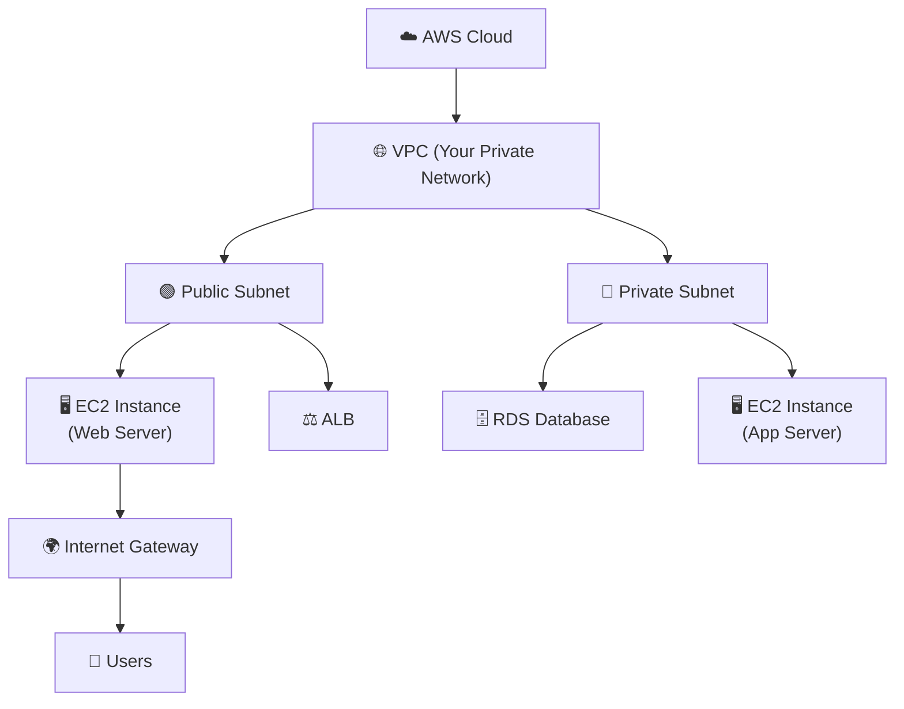

### 📋 Key VPC Components at a Glance

| Component | Purpose | Key Detail |
| --- | --- | --- |
| **VPC** | Isolated private network | Defined by a CIDR block (e.g., `10.0.0.0/16`) |
| **Subnets** | Subdivisions of a VPC | Public (internet-facing) or Private (internal) |
| **Internet Gateway (IGW)** | Connects VPC to the internet | Attached to VPC, used by public subnets |
| **NAT Gateway / NAT Instance** | Allows private subnet resources to access the internet | One-way: outbound only, no inbound from internet |
| **Route Tables** | Control traffic routing | Each subnet is associated with a route table |
| **Security Groups (SG)** | Instance-level firewall | Stateful, allow rules only |
| **NACLs** | Subnet-level firewall | Stateless, allow & deny rules |
| **VPC Peering** | Connect two VPCs privately | Non-transitive |
| **VPC Endpoints** | Private access to AWS services | Gateway (S3, DynamoDB) & Interface endpoints |
| **VPN / Direct Connect** | Connect on-premises to VPC | Encrypted or dedicated connections |

### 🔑 Default VPC vs Custom VPC

#### 🟢 Default VPC

- AWS creates a **default VPC** in every region for new accounts
- Comes with:

    - Default **subnets** in each Availability Zone (all are **public** by default)
    - A default **Internet Gateway**
    - A default **Security Group** and **NACL**
    - A default **Route Table**
- EC2 instances launched in the default VPC get a **public IPv4 address** automatically
- Great for getting started quickly, but **not recommended for production**

#### 🔵 Custom VPC

- You create and configure everything yourself
- Best practice for **production workloads**
- Full control over CIDR ranges, subnets, routing, and security
- Can have **multiple VPCs** per region (default limit: **5**, can be increased)

```bash
# View your VPCs using AWS CLI
aws ec2 describe-vpcs --query "Vpcs[*].{ID:VpcId,CIDR:CidrBlock,Default:IsDefault}" --output table

# View subnets in your VPC
aws ec2 describe-subnets --filters "Name=vpc-id,Values=vpc-xxxxxxxx" --query "Subnets[*].{ID:SubnetId,AZ:AvailabilityZone,CIDR:CidrBlock,Public:MapPublicIpOnLaunch}" --output table
```

### 🧭 Section Roadmap

> This section covers VPC at a **high level** suitable for the Developer Associate exam. Here's what you'll learn:

| Lecture | Topic | What You'll Learn |
| --- | --- | --- |
| **108** | VPC, Subnets, IGW and NAT | Core building blocks — public vs private subnets, internet access |
| **109** | NACL, SG, VPC Flow Logs | Network security layers and traffic monitoring |
| **110** | VPC Peering, Endpoints, VPN, DX | Connecting VPCs, private AWS service access, hybrid cloud |
| **111** | VPC Cheat Sheet & Closing Comments | Quick reference summary for the exam |
| **112** | Three Tier Architecture | Putting it all together — a real-world architecture pattern |

### 🌐 VPC & CIDR Basics

- **CIDR (Classless Inter-Domain Routing)** = A method for allocating IP addresses
- Every VPC must have a **primary CIDR block** (e.g., `10.0.0.0/16`)
- The CIDR block determines how many IP addresses are available

| CIDR Notation | \# of IPs | Common Use |
| --- | --- | --- |
| `/16` | 65,536 | Large VPC |
| `/24` | 256 | Typical subnet |
| `/28` | 16 | Smallest allowed subnet in AWS |
| `/32` | 1 | Single IP |

- **Private IP ranges** (RFC 1918) commonly used in VPCs:

    - `10.0.0.0/8` → Large enterprise networks
    - `172.16.0.0/12` → Medium networks
    - `192.168.0.0/16` → Small/home networks

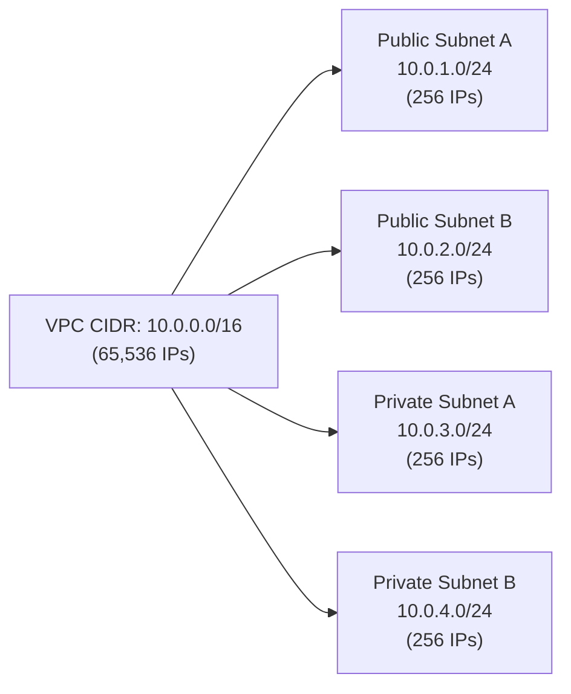

> **⚠️ Important**: AWS **reserves 5 IP addresses** in each subnet (first 4 + last 1). So a `/24` subnet with 256 IPs actually gives you **251 usable IPs**.

### 🔒 VPC & Developer Services

Understanding how VPC interacts with key developer services:

- **Lambda in VPC**: Lambda functions can be placed inside a VPC to access private resources (RDS, ElastiCache). They use an **ENI (Elastic Network Interface)** in your subnet
- **ECS/Fargate**: Tasks run inside VPC subnets — you choose public or private placement
- **RDS / ElastiCache**: Always deployed in **private subnets** with security group protection
- **API Gateway**: Can integrate with private resources via **VPC Link**
- **S3 / DynamoDB**: Accessed via **VPC Gateway Endpoints** (no internet required)

```javascript
// Example: Lambda function accessing RDS in a private VPC subnet
// The Lambda must be configured with VPC settings (subnet IDs + security group IDs)

import { RDSDataClient, ExecuteStatementCommand } from "@aws-sdk/client-rds-data";

const client = new RDSDataClient({ region: "us-east-1" });

export const handler = async (event) => {
  const params = {
    resourceArn: "arn:aws:rds:us-east-1:123456789012:cluster:my-cluster",
    secretArn: "arn:aws:secretsmanager:us-east-1:123456789012:secret:my-secret",
    database: "mydb",
    sql: "SELECT * FROM users WHERE id = :id",
    parameters: [
      { name: "id", value: { longValue: event.userId } }
    ]
  };

  const command = new ExecuteStatementCommand(params);
  const response = await client.send(command);

  return {
    statusCode: 200,
    body: JSON.stringify(response.records)
  };
};
```

### 📝 Key Exam Takeaways

- **VPC** = Your private, isolated network in AWS — you control IP ranges, subnets, routing, and security
- Every AWS account gets a **default VPC** per region with public subnets and an Internet Gateway
- **Subnets** are tied to a **single Availability Zone** — they can be public or private
- **CIDR blocks** define the IP range — AWS reserves **5 IPs per subnet**
- VPC is fundamental to deploying **Lambda in VPC**, **ECS tasks**, **RDS**, and connecting services securely
- For the DVA-C02 exam, focus on understanding **when and why** you'd use each VPC component rather than deep networking configuration
- Know the difference between **Security Groups** (stateful, instance-level) and **NACLs** (stateless, subnet-level)
- **VPC Endpoints** allow private access to AWS services without going through the internet

---

## Lecture 108: 🌐 VPC, Subnets, IGW and NAT

> **Overview**: This lecture covers the core building blocks of AWS networking — VPC, Subnets, Internet Gateways, and NAT devices. These are the foundational components that determine how your resources communicate with each other and with the internet.

### 🏗️ VPC — Virtual Private Cloud

- A **VPC** is a logically isolated virtual network within the AWS cloud, dedicated to your AWS account
- You can have **multiple VPCs** in a single AWS Region (default soft limit: **5** per region, can be increased)
- Each VPC is defined by a **CIDR block** — the range of private IP addresses available
- **Max CIDR per VPC**: You can have up to **5 CIDR blocks** per VPC (1 primary + 4 secondary)

#### 📐 CIDR Rules for a VPC

- **Min size**: `/28` → 16 IP addresses
- **Max size**: `/16` → 65,536 IP addresses
- VPC CIDR should **not overlap** with your other networks (e.g., other VPCs, on-premises networks)
- VPC is **private** — only **private IPv4 ranges** are allowed:

    - `10.0.0.0` – `10.255.255.255` (`10.0.0.0/8`)
    - `172.16.0.0` – `172.31.255.255` (`172.16.0.0/12`)
    - `192.168.0.0` – `192.168.255.255` (`192.168.0.0/16`)

```bash
# Create a VPC with a CIDR block
aws ec2 create-vpc --cidr-block 10.0.0.0/16 --tag-specifications 'ResourceType=vpc,Tags=[{Key=Name,Value=MyVPC}]'

# Describe your VPCs
aws ec2 describe-vpcs --query "Vpcs[*].{ID:VpcId,CIDR:CidrBlock,Default:IsDefault,Name:Tags[?Key=='Name']|[0].Value}" --output table
```

### 🧱 Subnets — Partitioning Your VPC

- **Subnets** allow you to partition your VPC's IP address range into smaller segments
- Each subnet is tied to a **specific Availability Zone** (AZ) — a subnet **cannot span multiple AZs**
- Two types:

    - **Public Subnet**: Has a route to the Internet Gateway → resources can be reached from the internet
    - **Private Subnet**: No route to the Internet Gateway → resources are isolated from direct internet access

#### 📊 Subnet CIDR & Reserved IPs

- Subnet CIDR must be a **subset** of the VPC CIDR
- AWS **reserves 5 IP addresses** (first 4 + last 1) in each subnet — these are **not usable**

| Reserved IP | Purpose |
| --- | --- |
| `10.0.0.0` | Network address |
| `10.0.0.1` | Reserved by AWS for the **VPC router** |
| `10.0.0.2` | Reserved by AWS for **DNS mapping** |
| `10.0.0.3` | Reserved by AWS for **future use** |
| `10.0.0.255` | Network **broadcast address** (AWS doesn't support broadcast, but reserves it) |

> **💡 Exam Tip**: If you need **29 usable IP addresses** for EC2 instances, you **cannot** use a `/27` subnet (32 IPs − 5 reserved = 27 usable). You need a `/26` subnet (64 IPs − 5 reserved = 59 usable).

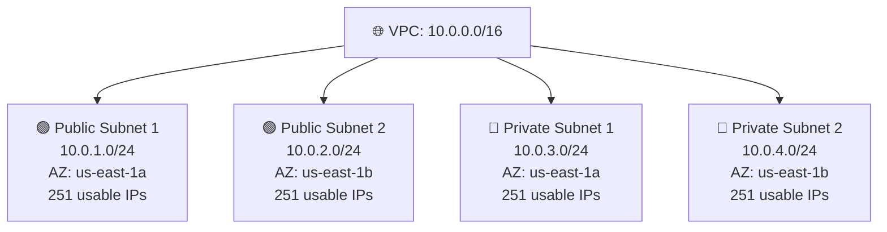

```bash
# Create a public subnet
aws ec2 create-subnet --vpc-id vpc-xxxxxxxx --cidr-block 10.0.1.0/24 --availability-zone us-east-1a --tag-specifications 'ResourceType=subnet,Tags=[{Key=Name,Value=PublicSubnet1}]'

# Create a private subnet
aws ec2 create-subnet --vpc-id vpc-xxxxxxxx --cidr-block 10.0.3.0/24 --availability-zone us-east-1a --tag-specifications 'ResourceType=subnet,Tags=[{Key=Name,Value=PrivateSubnet1}]'

# Enable auto-assign public IP for a public subnet
aws ec2 modify-subnet-attribute --subnet-id subnet-xxxxxxxx --map-public-ip-on-launch
```

### 🌍 Internet Gateway (IGW)

- An **Internet Gateway** allows resources in a VPC (e.g., EC2 instances) to connect to the **public internet**
- It performs **two functions**:

    - Provides a target in your route table for internet-routable traffic
    - Performs **NAT (Network Address Translation)** for instances that have a **public IPv4 address**
- **One IGW per VPC** — they have a 1-to-1 relationship
- IGW on its own does **not** allow internet access — you must also update the **Route Table**
- IGW is **horizontally scaled, redundant, and highly available** — no bandwidth constraints

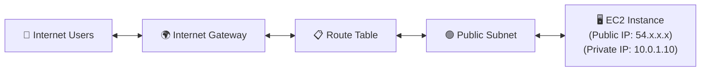

#### 🔄 How Internet Access Works (Step by Step)

1. Create an **Internet Gateway** and attach it to your VPC
1. Create a **Route Table** (or modify the main one)
1. Add a route: `0.0.0.0/0` → **IGW** (this sends all internet-bound traffic to the IGW)
1. Associate the route table with your **public subnet(s)**
1. Ensure your EC2 instances have a **public IPv4 address** (or Elastic IP)
1. Ensure the **Security Group** allows inbound/outbound traffic

```bash
# Create an Internet Gateway
aws ec2 create-internet-gateway --tag-specifications 'ResourceType=internet-gateway,Tags=[{Key=Name,Value=MyIGW}]'

# Attach IGW to VPC
aws ec2 attach-internet-gateway --internet-gateway-id igw-xxxxxxxx --vpc-id vpc-xxxxxxxx

# Create a route table for public subnets
aws ec2 create-route-table --vpc-id vpc-xxxxxxxx --tag-specifications 'ResourceType=route-table,Tags=[{Key=Name,Value=PublicRT}]'

# Add a route to the Internet Gateway (this makes the subnet "public")
aws ec2 create-route --route-table-id rtb-xxxxxxxx --destination-cidr-block 0.0.0.0/0 --gateway-id igw-xxxxxxxx

# Associate the route table with a subnet
aws ec2 associate-route-table --route-table-id rtb-xxxxxxxx --subnet-id subnet-xxxxxxxx
```

### 🔀 Route Tables

- Every subnet **must be associated** with a route table — it controls where traffic is directed
- If no explicit association, the subnet uses the **Main Route Table** (created by default with the VPC)
- A route table contains a set of **rules (routes)** that determine where network traffic is directed

#### 📋 Example Route Tables

**Public Subnet Route Table:**

| Destination | Target | Purpose |
| --- | --- | --- |
| `10.0.0.0/16` | `local` | Traffic within the VPC stays local |
| `0.0.0.0/0` | `igw-xxxxxxxx` | All other traffic → Internet Gateway |

**Private Subnet Route Table:**

| Destination | Target | Purpose |
| --- | --- | --- |
| `10.0.0.0/16` | `local` | Traffic within the VPC stays local |
| `0.0.0.0/0` | `nat-xxxxxxxx` | All other traffic → NAT Gateway |

> **💡 Key Insight**: What makes a subnet "public" vs "private" is purely the **route table**. If the route table has a route to an IGW → public. If it doesn't → private.

### 🔒 NAT — Network Address Translation

- Resources in **private subnets** sometimes need internet access (e.g., downloading software updates, patching)
- But they should **not** be directly reachable from the internet
- **NAT** solves this by allowing **outbound** internet access while blocking **inbound** connections from the internet

#### 🏢 NAT Gateway (AWS Managed)

- **AWS-managed** NAT service — highly available, scales automatically
- Created in a **public subnet** (must have an IGW route)
- Uses an **Elastic IP** (static public IP address)
- Private subnet instances route internet traffic to the NAT Gateway → NAT Gateway forwards it via the IGW
- **Bandwidth**: 5 Gbps, auto-scales up to **100 Gbps**
- **No Security Groups** needed — managed by AWS
- **Pricing**: Charged per hour + per GB of data processed

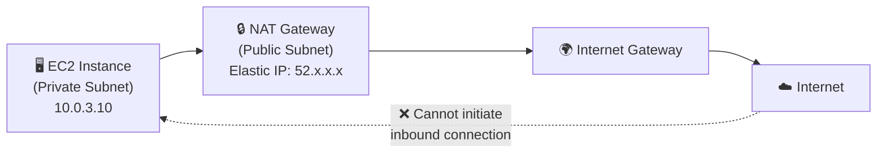

#### 🛡️ NAT Gateway — High Availability

- NAT Gateway is **resilient within a single AZ**
- For **multi-AZ fault tolerance**, you must create a **NAT Gateway in each AZ** and configure routing so resources in each AZ use their local NAT Gateway

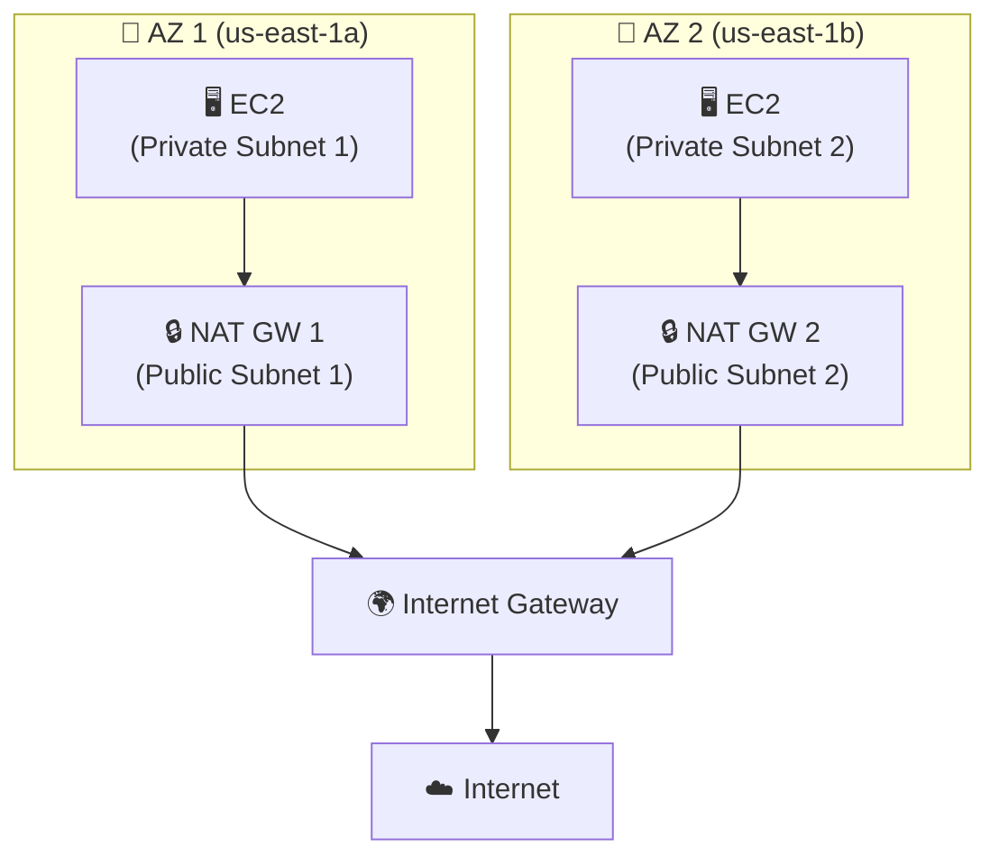

```bash
# Allocate an Elastic IP for the NAT Gateway
aws ec2 allocate-address --domain vpc

# Create a NAT Gateway in a public subnet
aws ec2 create-nat-gateway --subnet-id subnet-xxxxxxxx --allocation-id eipalloc-xxxxxxxx --tag-specifications 'ResourceType=natgateway,Tags=[{Key=Name,Value=MyNATGW}]'

# Add route in private subnet's route table → NAT Gateway
aws ec2 create-route --route-table-id rtb-private --destination-cidr-block 0.0.0.0/0 --nat-gateway-id nat-xxxxxxxx
```

#### 🖥️ NAT Instance (Legacy / Self-Managed)

- An **EC2 instance** configured to perform NAT — the **old way** of doing things
- Must be launched in a **public subnet** with a public IP or Elastic IP
- Must **disable Source/Destination Check** on the instance (important for exam!)
- You manage **everything**: scaling, patching, failover, Security Groups
- Cheaper than NAT Gateway but **not recommended** for production

> **⚠️ Important**: NAT Instances are considered **legacy**. AWS recommends using **NAT Gateway** instead. However, NAT Instances may still appear on the exam.

#### ⚖️ NAT Gateway vs NAT Instance

| Feature | NAT Gateway | NAT Instance |
| --- | --- | --- |
| **Managed by** | AWS | You |
| **Availability** | Highly available within AZ | Must script failover yourself |
| **Bandwidth** | Up to 100 Gbps | Depends on instance type |
| **Maintenance** | None (AWS handles patching) | You patch & maintain the OS |
| **Cost** | Per hour + per GB data | Per hour (EC2 instance cost) + network |
| **Security Groups** | Not applicable | Must manage security groups |
| **Elastic IP** | Required | Required |
| **Source/Dest Check** | N/A | Must be **disabled** |
| **Bastion Host** | Cannot be used as one | Can double as a bastion host |
| **Use Case** | ✅ Production workloads | 💰 Cost-saving for dev/test |

### 🔄 Complete Traffic Flow Diagram

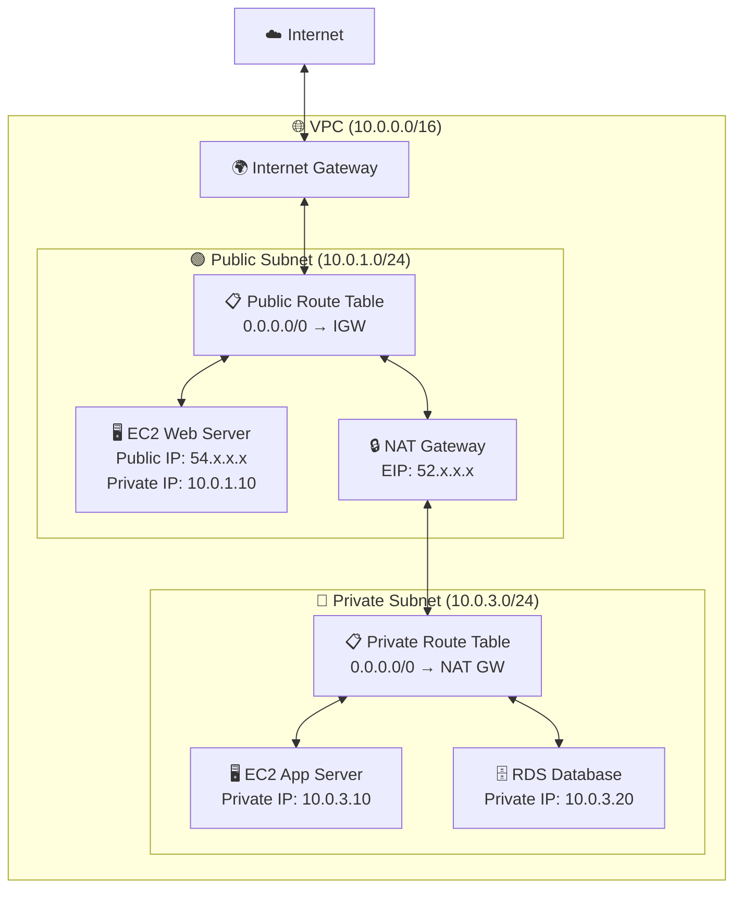

> **How it works**:
>
> - The **web server** in the public subnet communicates directly with the internet via the **IGW**
> - The **app server** in the private subnet reaches the internet via **NAT Gateway → IGW** (outbound only)
> - The **RDS database** in the private subnet has **no internet access** at all (by design)
> - Users from the internet can reach the web server but **cannot** directly reach the app server or database

### 🧪 Verifying Connectivity from an EC2 Instance

```bash
# From a PUBLIC subnet EC2 instance — should work
curl <https://checkip.amazonaws.com>
# Returns: 54.x.x.x (the instance's public IP or EIP)

# From a PRIVATE subnet EC2 instance (with NAT Gateway configured) — should work
curl <https://checkip.amazonaws.com>
# Returns: 52.x.x.x (the NAT Gateway's Elastic IP)

# From a PRIVATE subnet EC2 instance (WITHOUT NAT Gateway) — will timeout
curl <https://checkip.amazonaws.com>
# Connection timed out — no route to the internet
```

### 📝 Key Exam Takeaways

- **VPC** = Private isolated network in AWS, defined by CIDR blocks (max 5 CIDRs, range `/16` to `/28`)
- **Subnets** are tied to a **single AZ** — AWS reserves **5 IPs** per subnet
- A subnet is **public** if its route table has a route to an **Internet Gateway**, otherwise it's **private**
- **Internet Gateway (IGW)** = Managed, HA gateway that enables VPC ↔ internet communication. **One IGW per VPC**
- IGW alone is not enough — you need a **route table entry** pointing `0.0.0.0/0` to the IGW
- **NAT Gateway** = AWS-managed, allows **private subnet** resources to access the internet **outbound only**

    - Must be placed in a **public subnet** with an **Elastic IP**
    - For HA, deploy one NAT Gateway **per AZ**
- **NAT Instance** = Legacy, self-managed EC2 instance for NAT — must **disable Source/Destination Check**
- Know the **NAT Gateway vs NAT Instance** comparison table — this is a common exam question
- **Route Tables** are the key to determining public vs private — always check the routes!

---

## Lecture 109: 🛡️ NACL, SG, VPC Flow Logs

> **Overview**: This lecture dives into the two layers of network security in a VPC — Network ACLs (NACLs) at the subnet level and Security Groups (SGs) at the instance level — plus VPC Flow Logs for traffic monitoring and troubleshooting.

### 🔐 Network ACLs (NACLs)

- **Network ACL** = A firewall that controls traffic **in and out of a subnet**
- Operates at the **subnet level** — every subnet must be associated with exactly one NACL
- NACLs have **ALLOW** and **DENY** rules
- Rules are evaluated in **order of rule number** (lowest to highest) — **first match wins**
- The **default NACL** allows all inbound and outbound traffic
- A **custom NACL** denies all inbound and outbound traffic by default (until you add rules)
- Great for **blocking specific IP addresses** at the subnet level

#### 📋 NACL Rule Structure

| Component | Description |
| --- | --- |
| **Rule Number** | 1–32766 (evaluated lowest first). Rule `*` is the default deny-all |
| **Type** | Type of traffic (e.g., HTTP, SSH, Custom TCP) |
| **Protocol** | TCP, UDP, ICMP, etc. |
| **Port Range** | The port or range of ports |
| **Source (Inbound)** | CIDR range the traffic comes from |
| **Destination (Outbound)** | CIDR range the traffic goes to |
| **Allow / Deny** | Whether to allow or deny the traffic |

> **💡 Best Practice**: Increment rule numbers by **100** (e.g., 100, 200, 300) so you can easily insert new rules between existing ones later.

#### 📊 Default NACL Example

| Rule # | Type | Protocol | Port Range | Source/Dest | Allow/Deny |
| --- | --- | --- | --- | --- | --- |
| 100 | All Traffic | All | All | `0.0.0.0/0` | ✅ ALLOW |
| \* | All Traffic | All | All | `0.0.0.0/0` | ❌ DENY |

> This default NACL **allows everything** — the `*` rule is only hit if no numbered rule matches.

#### 🔧 Custom NACL Example (Web Server Subnet)

**Inbound Rules:**

| Rule # | Type | Protocol | Port | Source | Allow/Deny |
| --- | --- | --- | --- | --- | --- |
| 100 | HTTP | TCP | 80 | `0.0.0.0/0` | ✅ ALLOW |
| 110 | HTTPS | TCP | 443 | `0.0.0.0/0` | ✅ ALLOW |
| 120 | SSH | TCP | 22 | `10.0.0.0/16` | ✅ ALLOW |
| 130 | Custom TCP | TCP | 1024–65535 | `0.0.0.0/0` | ✅ ALLOW |
| \* | All Traffic | All | All | `0.0.0.0/0` | ❌ DENY |

**Outbound Rules:**

| Rule # | Type | Protocol | Port | Destination | Allow/Deny |
| --- | --- | --- | --- | --- | --- |
| 100 | HTTP | TCP | 80 | `0.0.0.0/0` | ✅ ALLOW |
| 110 | HTTPS | TCP | 443 | `0.0.0.0/0` | ✅ ALLOW |
| 120 | Custom TCP | TCP | 1024–65535 | `0.0.0.0/0` | ✅ ALLOW |
| \* | All Traffic | All | All | `0.0.0.0/0` | ❌ DENY |

#### 🔄 Ephemeral Ports — Why They Matter for NACLs

- When a client connects to a server, the **server responds on an ephemeral (random) port**
- The client opens a random port in the **ephemeral port range** to receive the response
- Different OS use different ranges:

    - **Linux**: `32768–60999`
    - **Windows**: `49152–65535`
    - **General safe range**: `1024–65535`
- Because NACLs are **stateless**, you must explicitly allow ephemeral ports in your **outbound rules** (for the server) and **inbound rules** (for the client)

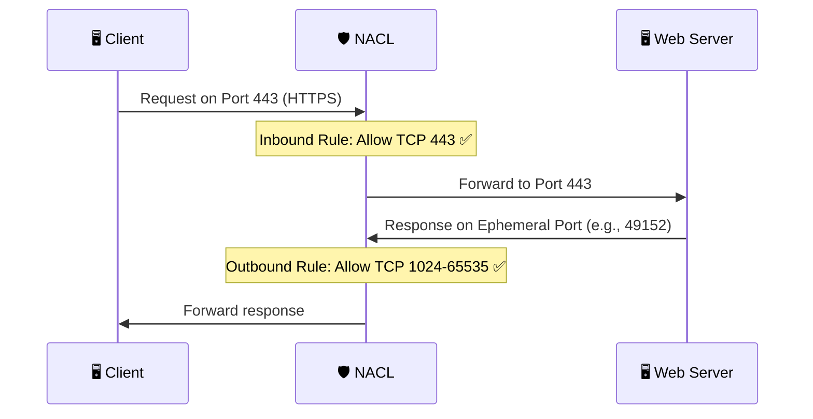

> **⚠️ Exam Tip**: If you're having connectivity issues with NACLs, check that **ephemeral ports** are allowed. This is the most common NACL misconfiguration!

#### 🔀 NACL with Multiple Subnets

- When two subnets in the same VPC communicate, **both NACLs** are evaluated
- Subnet A's **outbound** NACL and Subnet B's **inbound** NACL must both allow the traffic

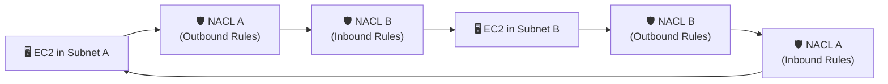

```bash
# Create a custom NACL
aws ec2 create-network-acl --vpc-id vpc-xxxxxxxx --tag-specifications 'ResourceType=network-acl,Tags=[{Key=Name,Value=WebSubnetNACL}]'

# Add an inbound rule (allow HTTP)
aws ec2 create-network-acl-entry --network-acl-id acl-xxxxxxxx --rule-number 100 --protocol tcp --port-range From=80,To=80 --cidr-block 0.0.0.0/0 --rule-action allow --ingress

# Add an outbound rule (allow ephemeral ports)
aws ec2 create-network-acl-entry --network-acl-id acl-xxxxxxxx --rule-number 120 --protocol tcp --port-range From=1024,To=65535 --cidr-block 0.0.0.0/0 --rule-action allow --egress

# Associate NACL with a subnet
aws ec2 replace-network-acl-association --association-id aclassoc-xxxxxxxx --network-acl-id acl-xxxxxxxx
```

### 🔒 Security Groups (SG)

- **Security Groups** = A firewall that controls traffic **at the ENI (Elastic Network Interface) / instance level**
- Operates at the **instance level** (attached to ENIs on EC2, RDS, Lambda in VPC, ELB, etc.)
- Security Groups only have **ALLOW** rules — there are **no DENY rules**
- Rules can reference **IP addresses** or **other security groups**
- **Stateful**: If an inbound request is allowed, the outbound response is **automatically allowed** (and vice versa) — no need to configure ephemeral ports!

#### 🆚 Stateful vs Stateless — The Critical Difference

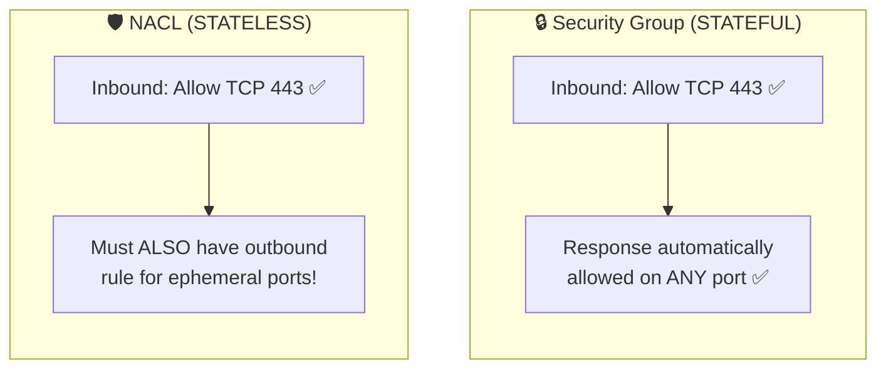

> **Stateful (Security Group)**: Remembers the connection. If traffic is allowed in, the response is automatically allowed out.<br>**Stateless (NACL)**: Does NOT remember. Every request and response is evaluated independently against the rules.

#### 📊 Security Group Example (Web Server)

**Inbound Rules:**

| Type | Protocol | Port | Source | Description |
| --- | --- | --- | --- | --- |
| HTTP | TCP | 80 | `0.0.0.0/0` | Allow web traffic |
| HTTPS | TCP | 443 | `0.0.0.0/0` | Allow secure web traffic |
| SSH | TCP | 22 | `10.0.0.0/16` | Allow SSH from VPC only |

**Outbound Rules:**

| Type | Protocol | Port | Destination | Description |
| --- | --- | --- | --- | --- |
| All Traffic | All | All | `0.0.0.0/0` | Allow all outbound (default) |

#### 🔗 Referencing Other Security Groups

- One of the most powerful features: you can allow traffic **from another security group** instead of an IP range
- This is how you build layered, scalable architectures

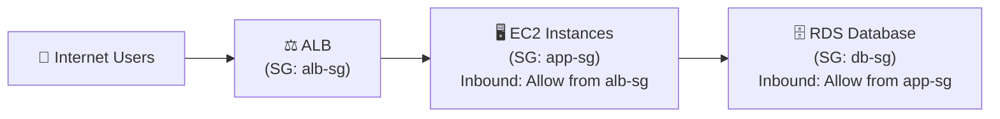

> In this pattern:
>
> - The **ALB security group** allows HTTP/HTTPS from the internet
> - The **app security group** allows traffic only from the **ALB security group** (not from any IP)
> - The **DB security group** allows traffic only from the **app security group**
> - Even if someone knows the EC2 IP, they can't bypass the ALB — the SG reference enforces the architecture

```bash
# Create a security group
aws ec2 create-security-group --group-name app-sg --description "App Server SG" --vpc-id vpc-xxxxxxxx

# Allow inbound from another security group (ALB SG)
aws ec2 authorize-security-group-ingress --group-id sg-app --protocol tcp --port 8080 --source-group sg-alb

# Allow inbound SSH from a specific CIDR
aws ec2 authorize-security-group-ingress --group-id sg-app --protocol tcp --port 22 --cidr 10.0.0.0/16
```

### ⚖️ Security Group vs NACL — Complete Comparison

| Feature | Security Group | Network ACL |
| --- | --- | --- |
| **Level** | Instance / ENI level | Subnet level |
| **Rule Types** | ALLOW only | ALLOW and DENY |
| **Statefulness** | **Stateful** (return traffic auto-allowed) | **Stateless** (must explicitly allow return traffic) |
| **Rule Evaluation** | All rules evaluated together | Rules evaluated in **order** (lowest # first, first match wins) |
| **Default Behavior** | Denies all inbound, allows all outbound | Default NACL allows all; custom NACL denies all |
| **Applies To** | Only instances assigned the SG | All instances in the associated subnet |
| **IP Blocking** | ❌ Cannot deny specific IPs | ✅ Can deny specific IPs |
| **SG References** | ✅ Can reference other SGs | ❌ Only CIDR blocks |
| **Ephemeral Ports** | Not needed (stateful) | Must be configured (stateless) |

> **🎯 When to use which**:
>
> - Use **Security Groups** for standard application-level firewall rules (allow HTTP, allow DB port from app tier, etc.)
> - Use **NACLs** when you need to **block specific IP addresses** or add a **second layer of defense** at the subnet level

### 🧱 How Traffic Flows Through Both Layers

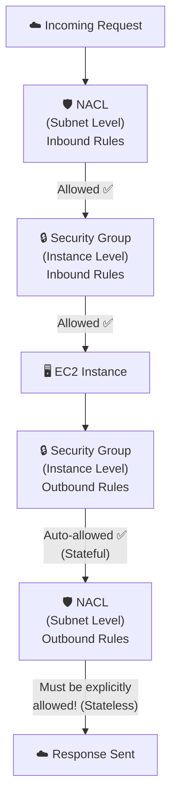

> Traffic must pass through **NACL first**, then **Security Group**. On the way back, the Security Group auto-allows (stateful), but the NACL requires explicit outbound rules (stateless).

### 📊 VPC Flow Logs

- **VPC Flow Logs** capture information about **IP traffic** going to and from network interfaces in your VPC
- They help you **monitor, troubleshoot, and audit** network connectivity
- Flow Logs can be applied at three levels:

    - **VPC level** — captures all traffic in the entire VPC
    - **Subnet level** — captures all traffic in a specific subnet
    - **ENI level** — captures traffic for a specific network interface

#### 📍 Where Flow Logs Can Be Sent

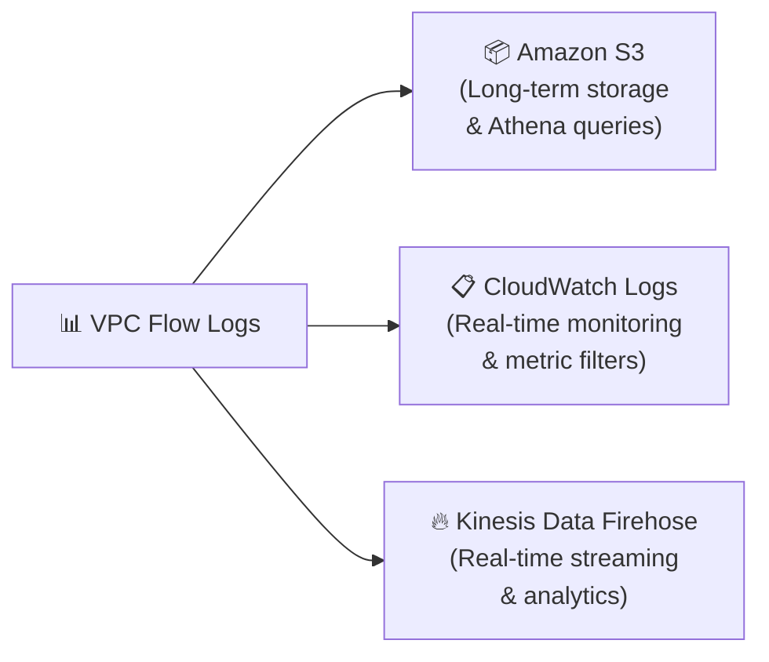

#### 📝 Flow Log Record Format

- Each log entry captures metadata about a single network flow (not packet content)
- Flow Logs do **NOT** capture the actual data/payload — only metadata

| Field | Description | Example |
| --- | --- | --- |
| `version` | Flow log version | `2` |
| `account-id` | AWS account ID | `123456789012` |
| `interface-id` | The ENI ID | `eni-0abc123` |
| `srcaddr` | Source IP address | `10.0.1.15` |
| `dstaddr` | Destination IP address | `52.94.76.5` |
| `srcport` | Source port | `49152` |
| `dstport` | Destination port | `443` |
| `protocol` | IANA protocol number | `6` (TCP) |
| `packets` | Number of packets | `20` |
| `bytes` | Number of bytes | `4500` |
| `start` | Start time (Unix) | `1620000000` |
| `end` | End time (Unix) | `1620000060` |
| `action` | `ACCEPT` or `REJECT` | `ACCEPT` |
| `log-status` | Logging status | `OK` |

#### 🔍 Example Flow Log Entries

```bash
# Accepted inbound SSH traffic
2 123456789012 eni-0abc123 203.0.113.50 10.0.1.15 12345 22 6 10 840 1620000000 1620000060 ACCEPT OK

# Rejected inbound traffic (blocked by SG or NACL)
2 123456789012 eni-0abc123 198.51.100.1 10.0.1.15 54321 3389 6 5 300 1620000000 1620000060 REJECT OK
```

#### 🕵️ Troubleshooting with Flow Logs

> **How to determine if traffic is blocked by a Security Group or NACL:**

| Scenario | Inbound Log | Outbound Log | Blocked By |
| --- | --- | --- | --- |
| SG blocks inbound | `REJECT` | No entry | **Security Group** (inbound) |
| NACL blocks inbound | `REJECT` | No entry | **NACL** (inbound) |
| SG blocks outbound | No entry (SG is stateful) | `REJECT` | **Security Group** (outbound) |
| NACL blocks outbound | `ACCEPT` (inbound OK) | `REJECT` | **NACL** (outbound) |

> **💡 Key Pattern**:
>
> - If you see `ACCEPT` inbound but `REJECT` outbound → **NACL** is blocking the response (stateless!)
> - If you see `REJECT` inbound with no outbound entry → could be **SG or NACL** blocking inbound

#### 🚫 Traffic NOT Captured by Flow Logs

- Traffic to Amazon **DNS server** (custom DNS is captured)
- Traffic for **DHCP** requests
- Traffic to the **VPC router** (e.g., `10.0.0.1`)
- Traffic to `169.254.169.254` (EC2 **instance metadata**)
- Traffic to `169.254.169.123` (**NTP** — Amazon Time Sync)
- Traffic to/from **Windows License Activation** servers
- Traffic between an **Elastic Network Load Balancer** and its target ENIs

```bash
# Create a Flow Log for a VPC → CloudWatch Logs
aws ec2 create-flow-logs \
  --resource-type VPC \
  --resource-ids vpc-xxxxxxxx \
  --traffic-type ALL \
  --log-destination-type cloud-watch-logs \
  --log-group-name /vpc/flow-logs \
  --deliver-logs-permission-arn arn:aws:iam::123456789012:role/FlowLogsRole

# Create a Flow Log for a VPC → S3
aws ec2 create-flow-logs \
  --resource-type VPC \
  --resource-ids vpc-xxxxxxxx \
  --traffic-type REJECT \
  --log-destination-type s3 \
  --log-destination arn:aws:s3:::my-flow-logs-bucket

# Query Flow Logs stored in S3 using Athena
```

```sql
-- Query rejected traffic using Athena (Flow Logs stored in S3)
SELECT srcaddr, dstaddr, dstport, protocol, action, COUNT(*) as count
FROM vpc_flow_logs
WHERE action = 'REJECT'
  AND start >= (CURRENT_TIMESTAMP - INTERVAL '24' HOUR)
GROUP BY srcaddr, dstaddr, dstport, protocol, action
ORDER BY count DESC
LIMIT 20;
```

#### 📐 Flow Logs Architecture

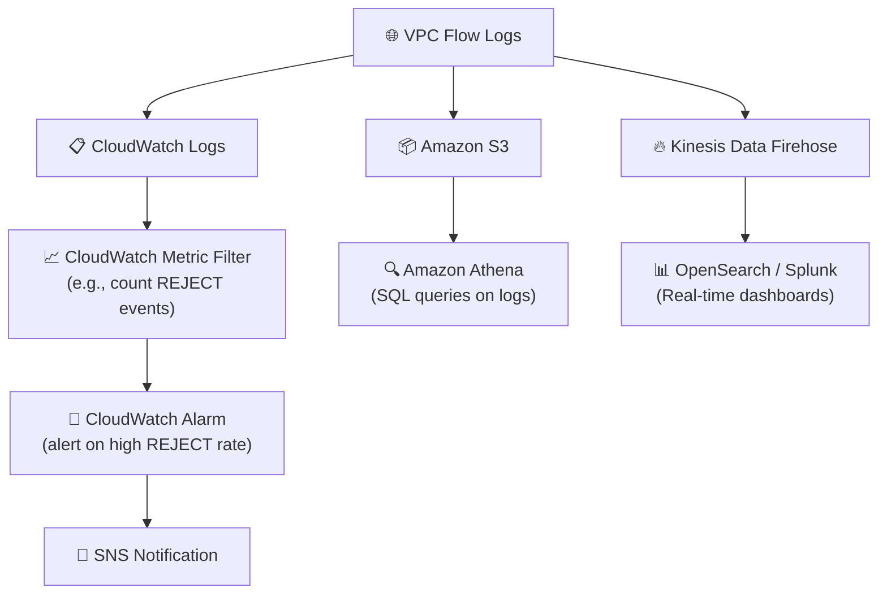

### 📝 Key Exam Takeaways

- **NACL** = Subnet-level firewall, **stateless**, supports **ALLOW & DENY** rules, evaluated in **rule number order** (first match wins)
- **Security Group** = Instance-level firewall, **stateful**, supports **ALLOW only** rules, **all rules evaluated** together
- NACLs require **ephemeral port rules** because they're stateless — Security Groups do not (stateful)
- To **block a specific IP address**, use a **NACL** (Security Groups can't deny)
- Default NACL **allows all** traffic; custom NACL **denies all** by default
- Default Security Group **denies all inbound**, **allows all outbound**
- Traffic flows through **NACL first → then Security Group** (both must allow)
- **VPC Flow Logs** capture IP traffic metadata (not payload) at VPC, subnet, or ENI level
- Flow Logs can be sent to **CloudWatch Logs**, **S3**, or **Kinesis Data Firehose**
- Flow Logs show `ACCEPT` or `REJECT` — use patterns to determine whether **SG or NACL** is blocking traffic
- Flow Logs do **not** capture DNS, DHCP, metadata (`169.254.169.254`), or NTP traffic

---

## Lecture 110: 🔗 VPC Peering, Endpoints, VPN, DX

> **Overview**: This lecture covers how to connect VPCs together, how to privately access AWS services without the internet, and how to establish hybrid connectivity between your on-premises data center and AWS. These are critical networking concepts for the Developer Associate exam.

### 🤝 VPC Peering

- **VPC Peering** = A networking connection between **two VPCs** that enables private communication using AWS's internal network
- Traffic stays on the **AWS backbone** — never traverses the public internet
- Makes the two VPCs behave as if they are in the **same network**
- Works across **different AWS accounts** and across **different AWS Regions** (inter-region peering)

#### 📋 VPC Peering Rules

- VPC CIDR ranges **must not overlap** — peering will fail if they do
- VPC Peering is **NOT transitive** — this is a critical exam concept!

    - If VPC A peers with VPC B, and VPC B peers with VPC C → A **cannot** talk to C through B
    - You must create a **direct peering connection** between A and C
- You must **update route tables** in each VPC's subnets to ensure traffic can flow through the peering connection
- **Security Groups** can reference the peered VPC's security groups (even cross-account!)

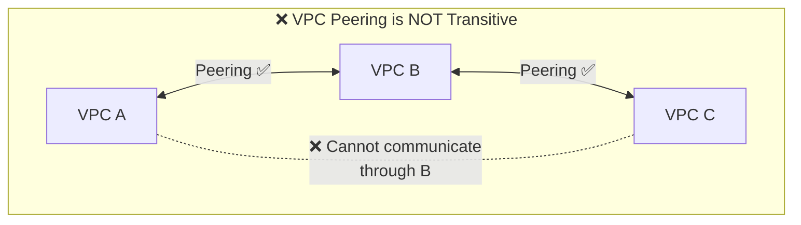

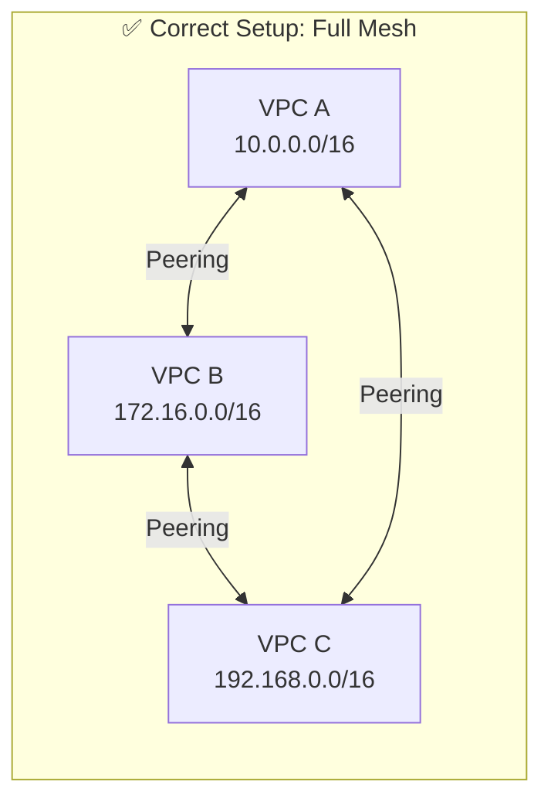

#### 🔧 Setting Up VPC Peering

```bash
# Step 1: Create a peering connection (requester VPC → accepter VPC)
aws ec2 create-vpc-peering-connection \
  --vpc-id vpc-aaaa1111 \
  --peer-vpc-id vpc-bbbb2222 \
  --peer-owner-id 987654321098 \
  --peer-region us-west-2

# Step 2: Accept the peering connection (from the accepter account/VPC)
aws ec2 accept-vpc-peering-connection --vpc-peering-connection-id pcx-xxxxxxxx

# Step 3: Update route tables in BOTH VPCs
# In VPC A's route table: route VPC B's CIDR to the peering connection
aws ec2 create-route --route-table-id rtb-aaa --destination-cidr-block 172.16.0.0/16 --vpc-peering-connection-id pcx-xxxxxxxx

# In VPC B's route table: route VPC A's CIDR to the peering connection
aws ec2 create-route --route-table-id rtb-bbb --destination-cidr-block 10.0.0.0/16 --vpc-peering-connection-id pcx-xxxxxxxx
```

#### 🔒 Security Group Cross-Reference

- With VPC Peering, you can reference a security group from the **peered VPC** in your SG rules
- Format: `<account-id>/<security-group-id>` for cross-account references

```bash
# Allow traffic from a security group in the peered VPC
aws ec2 authorize-security-group-ingress \
  --group-id sg-local \
  --protocol tcp \
  --port 3306 \
  --source-group sg-peered-vpc \
  --group-owner 987654321098
```

### 🔌 VPC Endpoints — Private Access to AWS Services

- By default, every AWS service has a **public URL** (e.g., `s3.amazonaws.com`, `dynamodb.amazonaws.com`)
- Resources in a **private subnet** would need a NAT Gateway + IGW to reach these services — this costs money and adds latency
- **VPC Endpoints** allow you to connect to AWS services **privately** from within your VPC, without leaving the AWS network
- Traffic **never leaves the Amazon network** — no internet, no NAT Gateway needed
- They are **redundant** and scale **horizontally**

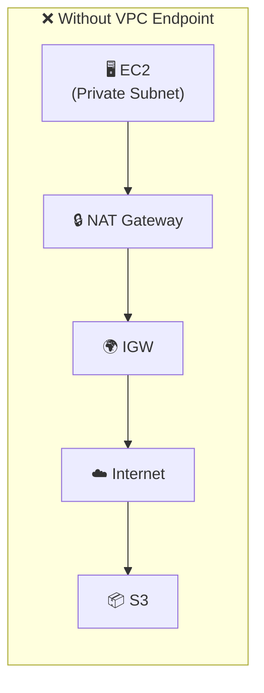

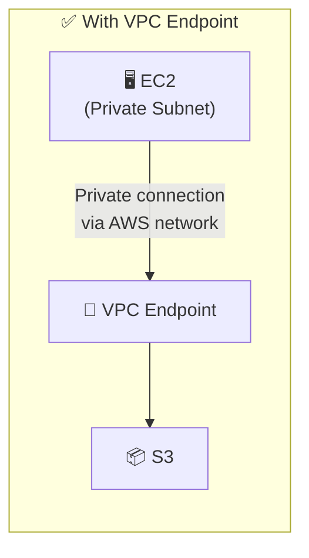

#### 🏷️ Two Types of VPC Endpoints

#### 1️⃣ Gateway Endpoints

- **Free of charge** — no additional cost
- Supported for only **two services**:

    - **Amazon S3**
    - **Amazon DynamoDB**
- Works by adding a **route in the route table** pointing to the endpoint
- Must be specified as a **target in the route table** — the route is automatically managed
- Does **not** use an ENI — uses a gateway route
- Cannot be extended outside the VPC (no VPN, peering, or Transit Gateway access)

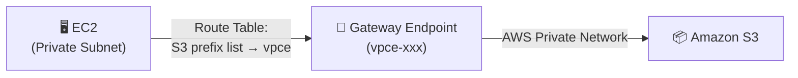

```bash
# Create a Gateway Endpoint for S3
aws ec2 create-vpc-endpoint \
  --vpc-id vpc-xxxxxxxx \
  --service-name com.amazonaws.us-east-1.s3 \
  --route-table-ids rtb-private-a rtb-private-b \
  --vpc-endpoint-type Gateway

# Create a Gateway Endpoint for DynamoDB
aws ec2 create-vpc-endpoint \
  --vpc-id vpc-xxxxxxxx \
  --service-name com.amazonaws.us-east-1.dynamodb \
  --route-table-ids rtb-private-a \
  --vpc-endpoint-type Gateway
```

#### 2️⃣ Interface Endpoints (Powered by AWS PrivateLink)

- Provisions an **ENI (Elastic Network Interface)** with a **private IP address** in your subnet
- Supported for **most AWS services** (CloudWatch, SNS, SQS, KMS, API Gateway, and many more)
- Also supports S3 (as an alternative to Gateway Endpoint)
- **Costs money**: Per hour + per GB of data processed
- Requires a **Security Group** to be attached to the ENI
- Can be accessed from **on-premises** via VPN or Direct Connect (unlike Gateway Endpoints!)
- Provides a **private DNS name** that resolves to the private IP of the ENI

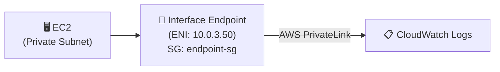

```bash
# Create an Interface Endpoint for CloudWatch Logs
aws ec2 create-vpc-endpoint \
  --vpc-id vpc-xxxxxxxx \
  --service-name com.amazonaws.us-east-1.logs \
  --subnet-ids subnet-private-a subnet-private-b \
  --security-group-ids sg-endpoint \
  --vpc-endpoint-type Interface \
  --private-dns-enabled
```

#### ⚖️ Gateway Endpoint vs Interface Endpoint

| Feature | Gateway Endpoint | Interface Endpoint |
| --- | --- | --- |
| **Services** | S3 and DynamoDB only | Most AWS services |
| **Cost** | **Free** | Per hour + per GB |
| **How it works** | Route table entry | ENI with private IP |
| **Security** | VPC Endpoint Policy | Security Group + VPC Endpoint Policy |
| **Access from on-prem** | ❌ No | ✅ Yes (via VPN / DX) |
| **Access from peered VPC** | ❌ No | ✅ Yes |
| **DNS** | Uses public DNS | Private DNS name |
| **Preferred for S3** | ✅ Yes (free, simple) | Use when on-prem access needed |

> **💡 Exam Tip**: For the exam, **Gateway Endpoint is preferred for S3 and DynamoDB** because it's free. Use Interface Endpoint when you need access from **on-premises** or from a **different VPC** via peering.

#### 🔐 VPC Endpoint Policies

- **VPC Endpoint Policies** are JSON documents that control what can be accessed through the endpoint
- They **do not replace** IAM policies or S3 bucket policies — they are an **additional layer**
- By default, the endpoint policy allows **full access** to the service

```json
{
  "Version": "2012-10-17",
  "Statement": [
    {
      "Sid": "AllowSpecificBucket",
      "Effect": "Allow",
      "Principal": "*",
      "Action": [
        "s3:GetObject",
        "s3:PutObject"
      ],
      "Resource": "arn:aws:s3:::my-secure-bucket/*"
    }
  ]
}
```

#### 🖥️ Using VPC Endpoints in Application Code

```javascript
// When using VPC Endpoints, your code doesn't change!
// The SDK automatically routes through the endpoint via DNS

import { S3Client, GetObjectCommand } from "@aws-sdk/client-s3";

// No special config needed — the VPC Endpoint handles routing
const s3Client = new S3Client({ region: "us-east-1" });

export const handler = async (event) => {
  const command = new GetObjectCommand({
    Bucket: "my-private-bucket",
    Key: "data/report.json"
  });

  const response = await s3Client.send(command);
  const body = await response.Body.transformToString();

  return {
    statusCode: 200,
    body: JSON.parse(body)
  };
};

// The traffic flows:
// Lambda (Private Subnet) → VPC Gateway Endpoint → S3
// Never touches the public internet!
```

### 🌐 Site-to-Site VPN

- Connects your **on-premises data center** to your AWS VPC over the **public internet**
- Traffic is **encrypted** using IPsec
- Quick to set up — can be running in **minutes**

#### 🧩 Components

| Component | Where | Description |
| --- | --- | --- |
| **Virtual Private Gateway (VGW)** | AWS side | VPN concentrator attached to your VPC |
| **Customer Gateway (CGW)** | On-premises side | Software or hardware device at your data center |
| **VPN Connection** | Between both | The encrypted tunnel(s) connecting VGW ↔ CGW |

```mermaid
graph LR
    A["🏢 Corporate Data Center"] --> B["📡 Customer Gateway<br/>(Your Router)"]
    B <-->|"🔐 IPsec Encrypted Tunnel<br/>(Over Public Internet)"| C["🚪 Virtual Private Gateway<br/>(VGW)"]
    C --> D["🌐 VPC"]
    D --> E["🖥️ EC2 Instances"]
```

#### 📋 Key Points for the Exam

- Uses the **public internet** — bandwidth is limited and variable
- Encrypted with **IPsec**
- Two tunnels per connection for **high availability**
- Can be set up in **minutes** (vs weeks for Direct Connect)
- VGW is attached to the VPC where you want the VPN connection
- Supports **static routing** or **dynamic routing (BGP)**

```bash
# Create a Virtual Private Gateway
aws ec2 create-vpn-gateway --type ipsec.1 --amazon-side-asn 64512

# Attach VGW to VPC
aws ec2 attach-vpn-gateway --vpn-gateway-id vgw-xxxxxxxx --vpc-id vpc-xxxxxxxx

# Create a Customer Gateway (your on-prem router's public IP)
aws ec2 create-customer-gateway --type ipsec.1 --public-ip 203.0.113.50 --bgp-asn 65000

# Create the VPN Connection
aws ec2 create-vpn-connection --type ipsec.1 --vpn-gateway-id vgw-xxxxxxxx --customer-gateway-id cgw-xxxxxxxx
```

### 🔷 AWS Direct Connect (DX)

- Provides a **dedicated, private physical connection** between your data center and AWS
- Traffic goes over a **private fiber link** — does **NOT** traverse the public internet
- Higher **bandwidth**, more **consistent network performance**, lower **latency**
- Takes **at least 1 month** to establish (physical infrastructure must be provisioned)

```mermaid
graph LR
    A["🏢 Corporate<br/>Data Center"] -->|"Physical Fiber Cable"| B["🏗️ AWS Direct Connect<br/>Location<br/>(Colocation Facility)"]
    B -->|"Dedicated Private<br/>Connection"| C["☁️ AWS Cloud"]
    C --> D["🌐 VPC"]
    C --> E["📦 S3 / AWS Services"]
```

#### ⚖️ Site-to-Site VPN vs Direct Connect

| Feature | Site-to-Site VPN | Direct Connect (DX) |
| --- | --- | --- |
| **Connection Type** | Over the **public internet** | **Dedicated private** fiber link |
| **Encryption** | ✅ IPsec encrypted | ❌ Not encrypted by default (but private) |
| **Setup Time** | **Minutes** | **1+ month** |
| **Bandwidth** | Limited by internet connection | 1 Gbps, 10 Gbps, or 100 Gbps |
| **Latency** | Variable (internet-dependent) | Consistent, low latency |
| **Cost** | Lower | Higher (dedicated infrastructure) |
| **Reliability** | Depends on internet | More reliable (SLA-backed) |
| **Use Case** | Quick setup, backup connection | Production workloads, high throughput |

> **💡 Exam Tip**: If the question mentions needing a connection **quickly**, the answer is **Site-to-Site VPN**. If it mentions **consistent performance**, **high bandwidth**, or **dedicated connection**, the answer is **Direct Connect**.

#### 🔐 VPN as a Backup for Direct Connect

- A common architecture pattern: use **Direct Connect as primary** and **Site-to-Site VPN as backup**
- If DX fails, traffic automatically fails over to the VPN tunnel

```mermaid
graph LR
    A["🏢 Data Center"] -->|"Primary: Direct Connect<br/>(Private, High Bandwidth)"| B["☁️ AWS VPC"]
    A -->|"Backup: Site-to-Site VPN<br/>(Encrypted, Over Internet)"| B
```

### 🔀 Transit Gateway (Bonus Context)

- With many VPCs and VPN/DX connections, peering becomes complex (full mesh)
- **AWS Transit Gateway** acts as a **central hub** to interconnect multiple VPCs, VPN, and DX connections
- Supports **transitive routing** (unlike VPC Peering!)
- Works across **multiple accounts** and **regions**

```mermaid
graph TD
    TGW["🔀 Transit Gateway<br/>(Central Hub)"]
    TGW <--> A["VPC A"]
    TGW <--> B["VPC B"]
    TGW <--> C["VPC C"]
    TGW <--> D["VPC D"]
    TGW <--> E["📡 VPN Connection"]
    TGW <--> F["🔷 Direct Connect"]
```

> **💡 Note**: Transit Gateway is more of a Solutions Architect topic, but know it exists as the solution when you see exam questions about connecting **many VPCs together** or needing **transitive routing**.

### 🗺️ Complete Connectivity Summary Diagram

```mermaid
graph TD
    subgraph AWS["☁️ AWS Cloud"]
        subgraph VPC_A["🌐 VPC A (10.0.0.0/16)"]
            PUB_A["🟢 Public Subnet<br/>EC2 + ALB"]
            PRIV_A["🔴 Private Subnet<br/>Lambda, ECS, RDS"]
            GW_EP["🚪 Gateway Endpoint<br/>(S3, DynamoDB)"]
            IF_EP["🔌 Interface Endpoint<br/>(CloudWatch, SQS, SNS)"]
        end

        subgraph VPC_B["🌐 VPC B (172.16.0.0/16)"]
            PRIV_B["🔴 Private Subnet<br/>Microservices"]
        end

        S3["📦 Amazon S3"]
        CW["📋 CloudWatch"]
    end

    VPC_A <-->|"🤝 VPC Peering"| VPC_B
    GW_EP -->|"Free, Private"| S3
    IF_EP -->|"PrivateLink"| CW

    ONPREM["🏢 On-Premises"] <-->|"🔐 Site-to-Site VPN<br/>(Quick, Encrypted)"| VPC_A
    ONPREM <-->|"🔷 Direct Connect<br/>(Dedicated, Fast)"| VPC_A
```

### 📝 Key Exam Takeaways

- **VPC Peering**: Connects two VPCs privately. **Not transitive** — must create direct peering for each pair. CIDRs must not overlap. Must update **route tables** in both VPCs
- **VPC Endpoints**: Private access to AWS services without internet

    - **Gateway Endpoint**: Free, for **S3 and DynamoDB only**, uses route table entries
    - **Interface Endpoint**: Costs money, uses **ENI + PrivateLink**, works for most services, accessible from **on-premises** via VPN/DX
    - **Prefer Gateway Endpoints** for S3/DynamoDB unless you need on-prem access
- **Site-to-Site VPN**: Encrypted tunnel over the **public internet**, set up in **minutes**, uses VGW + CGW
- **Direct Connect (DX)**: Dedicated **private physical connection**, takes **1+ month** to set up, higher bandwidth and consistent performance
- **VPN + DX combo**: Use DX as primary, VPN as backup — common architecture pattern
- **Transit Gateway**: Central hub for connecting many VPCs + VPN + DX with **transitive routing**

---

## Lecture 111: 📋 VPC Cheat Sheet & Closing Comments

> **Overview**: This lecture provides a complete, rapid-fire cheat sheet of every VPC concept covered in the section. It's designed as a quick-reference summary for last-minute exam revision. Every concept here is fair game on the DVA-C02 exam.

### 🌐 VPC — Virtual Private Cloud

- **VPC** = Your own isolated, private network in the AWS cloud
- A VPC is tied to a **specific AWS Region**
- Defined by **CIDR blocks** (IP address ranges) — max **5 CIDRs** per VPC
- CIDR range: min `/28` (16 IPs) to max `/16` (65,536 IPs)
- Only **private IP ranges** allowed (RFC 1918): `10.0.0.0/8`, `172.16.0.0/12`, `192.168.0.0/16`
- VPC CIDRs should **not overlap** with other VPCs or on-premises networks

### 🧱 Subnets

- Subnets = Partitions of the VPC's IP address range
- Each subnet is tied to a **single Availability Zone** (cannot span AZs)
- **Public Subnet**: Has a route table entry pointing to an Internet Gateway
- **Private Subnet**: No route to an Internet Gateway
- AWS **reserves 5 IPs** per subnet (first 4 + last 1) — these are **not assignable**

> **💡 Quick Math**: A `/24` subnet = 256 IPs − 5 reserved = **251 usable IPs**

### 🌍 Internet Gateway (IGW)

- Allows VPC resources to connect to the **public internet**
- **One IGW per VPC** (1:1 relationship)
- Must also update the **route table** with a route to the IGW (`0.0.0.0/0 → igw-xxx`)
- IGW is **horizontally scaled**, redundant, and highly available by design
- IGW alone is **not enough** — instances also need a **public IP** or **Elastic IP**

```mermaid
graph LR
    A["🖥️ EC2<br/>(Public IP)"] --> B["📋 Route Table<br/>0.0.0.0/0 → IGW"] --> C["🌍 IGW"] --> D["☁️ Internet"]
```

### 🔒 NAT Gateway / NAT Instance

- Allows instances in **private subnets** to access the internet (outbound only)
- **NAT Gateway** (AWS managed): Deployed in a **public subnet**, uses an **Elastic IP**, scales to 100 Gbps, HA within a single AZ
- For **multi-AZ HA**: Deploy one NAT Gateway **per AZ**
- **NAT Instance** (legacy, self-managed): EC2 instance performing NAT, must **disable Source/Destination Check**

| Feature | NAT Gateway | NAT Instance |
| --- | --- | --- |
| Managed by | AWS | You |
| HA | Within AZ (deploy per-AZ for full HA) | Must script failover |
| Bandwidth | Up to 100 Gbps | Depends on instance type |
| Security Groups | N/A | Must configure |
| Source/Dest Check | N/A | Must disable |
| Can be Bastion Host | ❌ No | ✅ Yes |

### 🛡️ Network ACLs (NACLs)

- **Subnet-level** firewall
- **Stateless** — must explicitly allow both inbound AND outbound traffic (including ephemeral ports)
- Supports **ALLOW** and **DENY** rules
- Rules evaluated in **order of rule number** (lowest first) — **first match wins**
- **Default NACL**: Allows all inbound and outbound
- **Custom NACL**: Denies all by default
- Great for **blocking specific IP addresses**
- **Ephemeral ports** (1024–65535) must be allowed in rules for return traffic

```mermaid
graph LR
    A["Request<br/>(Port 443)"] -->|"Inbound Rule<br/>Evaluated"| B["🛡️ NACL"]
    B -->|"Response<br/>(Ephemeral Port)"| C["Outbound Rule<br/>MUST also allow!"]
```

### 🔒 Security Groups (SGs)

- **Instance / ENI-level** firewall
- **Stateful** — return traffic is **automatically allowed**
- Supports **ALLOW rules only** (no deny)
- **All rules evaluated** together (not in order)
- Can reference **other security groups** or **CIDR blocks**
- Default: **denies all inbound**, **allows all outbound**
- **Cannot block specific IPs** — use NACLs for that

### ⚖️ NACL vs Security Group — Quick Reference

| Feature | NACL | Security Group |
| --- | --- | --- |
| **Level** | Subnet | Instance / ENI |
| **Stateful?** | ❌ Stateless | ✅ Stateful |
| **Rule Types** | Allow + Deny | Allow only |
| **Evaluation** | In order (first match) | All rules together |
| **Block IPs?** | ✅ Yes | ❌ No |
| **Ephemeral ports?** | Must configure | Not needed |

### 📊 VPC Flow Logs

- Captures **IP traffic metadata** (not payload/content) going to/from network interfaces
- Can be applied at **VPC**, **Subnet**, or **ENI** level
- Logs sent to: **CloudWatch Logs**, **S3**, or **Kinesis Data Firehose**
- Each entry shows: source/dest IPs, ports, protocol, packets, bytes, **ACCEPT/REJECT**, timestamp
- Use to **troubleshoot** connectivity — determine if SG or NACL is blocking traffic
- **Not captured**: DNS (Amazon), DHCP, metadata (`169.254.169.254`), NTP, Windows license activation

#### 🕵️ Troubleshooting Pattern

| Inbound | Outbound | Blocked By |
| --- | --- | --- |
| REJECT | — | SG or NACL inbound |
| ACCEPT | REJECT | **NACL outbound** (stateless!) |

### 🤝 VPC Peering

- Privately connects **two VPCs** using AWS's internal network
- Works **cross-account** and **cross-region**
- CIDRs **must not overlap**
- **NOT transitive** — A↔B and B↔C does **NOT** mean A↔C
- Must update **route tables** in both VPCs
- Security Groups can **cross-reference** peered VPC's SGs

```mermaid
graph LR
    A["VPC A<br/>10.0.0.0/16"] <-->|"Peering"| B["VPC B<br/>172.16.0.0/16"]
    B <-->|"Peering"| C["VPC C<br/>192.168.0.0/16"]
    A -.-|"❌ Not transitive"| C
```

### 🔌 VPC Endpoints

- Allow **private access** to AWS services without using the internet, NAT, or IGW
- Traffic stays on the **AWS private network**

#### 🚪 Gateway Endpoints

- **Free**
- Only for: **S3** and **DynamoDB**
- Uses a **route table entry** (not an ENI)
- Cannot be accessed from **on-premises** (VPN/DX)
- **Preferred** for S3 and DynamoDB (because it's free)

#### 🔌 Interface Endpoints (AWS PrivateLink)

- **Costs money** (per hour + per GB)
- Uses an **ENI** with a private IP in your subnet
- Requires a **Security Group**
- Works for **most AWS services** (CloudWatch, SQS, SNS, KMS, etc.)
- **Can be accessed from on-premises** via VPN / Direct Connect
- Also supports S3 (alternative to Gateway Endpoint)

```mermaid
graph TD
    subgraph GATEWAY["🚪 Gateway Endpoint (Free)"]
        G1["EC2 (Private)"] -->|"Route Table"| G2["S3 / DynamoDB"]
    end
    subgraph INTERFACE["🔌 Interface Endpoint (Paid)"]
        I1["EC2 (Private)"] -->|"ENI + PrivateLink"| I2["CloudWatch / SQS / SNS / KMS"]
    end
```

> **💡 Exam Rule**: Gateway Endpoint for S3/DynamoDB (free). Interface Endpoint when you need on-premises access or for any other service.

### 📡 Site-to-Site VPN

- Connects **on-premises** to AWS VPC over the **public internet**
- **Encrypted** with IPsec
- Set up in **minutes**
- Components: **Virtual Private Gateway (VGW)** on AWS side + **Customer Gateway (CGW)** on-prem
- Supports static routing or **BGP** (dynamic routing)
- Lower cost but **variable latency** (internet-dependent)

### 🔷 Direct Connect (DX)

- **Dedicated private physical connection** between on-premises and AWS
- Does **NOT** traverse the public internet
- Takes **1+ month** to establish (physical fiber provisioning)
- Higher **bandwidth** (1 / 10 / 100 Gbps), **consistent latency**
- **Not encrypted** by default (but traffic is private)
- More expensive but more **reliable**

#### ⚖️ VPN vs Direct Connect

| Feature | Site-to-Site VPN | Direct Connect |
| --- | --- | --- |
| **Medium** | Public internet | Private dedicated link |
| **Setup time** | Minutes | 1+ month |
| **Encryption** | ✅ IPsec | ❌ (private, not encrypted) |
| **Bandwidth** | Limited by internet | Up to 100 Gbps |
| **Latency** | Variable | Consistent |
| **Cost** | Lower | Higher |
| **Exam keyword** | "Quick", "budget" | "Dedicated", "consistent", "high throughput" |

> **💡 Common Pattern**: Use Direct Connect as **primary** and Site-to-Site VPN as **backup/failover**.

### 🔀 Transit Gateway

- **Hub-and-spoke** model to connect many VPCs, VPN, and DX connections
- Supports **transitive routing** (unlike VPC Peering)
- Works across **accounts** and **regions**
- Simplifies complex networking topologies

### 🏗️ Typical VPC Architecture Summary

```mermaid
graph TD
    INET["☁️ Internet"] <--> IGW["🌍 IGW"]

    subgraph VPC["🌐 VPC"]
        IGW <--> PUB["🟢 Public Subnet<br/>• EC2 (Web Server)<br/>• NAT Gateway<br/>• ALB"]
        PUB <-->|"NAT GW"| PRIV["🔴 Private Subnet<br/>• EC2 (App Server)<br/>• Lambda<br/>• ECS Tasks"]
        PRIV <--> DATA["🟣 Data Subnet<br/>• RDS<br/>• ElastiCache"]
    end

    PRIV -->|"Gateway Endpoint"| S3["📦 S3"]
    PRIV -->|"Interface Endpoint"| CW["📋 CloudWatch"]
    VPC <-->|"VPC Peering"| VPC2["🌐 Other VPC"]
    ONPREM["🏢 On-Premises"] <-->|"VPN / DX"| VPC
```

### 📝 Key Exam Takeaways

- **VPC**: Private network, CIDR-based, region-scoped, max 5 CIDRs
- **Subnets**: Single AZ, public (route to IGW) vs private (no route to IGW), 5 reserved IPs
- **IGW**: One per VPC, must have route table entry, instances need public IP
- **NAT Gateway**: In public subnet, Elastic IP, outbound-only internet for private subnets, per-AZ HA
- **NAT Instance**: Legacy, must disable Source/Dest Check, can be bastion host
- **NACL**: Subnet-level, stateless, allow+deny, rule-number order, ephemeral ports required
- **Security Group**: Instance-level, stateful, allow-only, can reference other SGs, cannot deny IPs
- **VPC Flow Logs**: Traffic metadata (not payload), ACCEPT/REJECT, → CloudWatch/S3/Firehose
- **VPC Peering**: Not transitive, no CIDR overlap, update route tables, cross-account/region
- **Gateway Endpoint**: Free, S3 + DynamoDB only, route table based
- **Interface Endpoint**: Paid, ENI + PrivateLink, most services, accessible from on-prem
- **Site-to-Site VPN**: Quick setup, encrypted, public internet, VGW + CGW
- **Direct Connect**: 1+ month, dedicated private link, high bandwidth, consistent latency
- **Transit Gateway**: Hub for many VPCs, transitive routing, cross-account

---

## Lecture 112: 🏛️ Three Tier Architecture

> **Overview**: This lecture ties together all VPC concepts into a real-world, production-grade **Three Tier Architecture** — the most common pattern for deploying web applications on AWS. Understanding this architecture is essential for both the exam and real-world AWS development.

### 🎯 What is Three Tier Architecture?

- A design pattern that separates an application into **three logical layers**, each with a distinct responsibility
- Each tier is isolated in its own **subnet layer** within the VPC, with security controls between them
- This separation provides **security**, **scalability**, and **maintainability**

| Tier | Name | Responsibility | Subnet Type |
| --- | --- | --- | --- |
| **Tier 1** | 🌐 Presentation (Web) | Receives user requests, serves static content, load balancing | Public Subnet |
| **Tier 2** | ⚙️ Application (Logic) | Business logic, API processing, compute | Private Subnet |
| **Tier 3** | 🗄️ Data (Storage) | Database storage, caching, persistent data | Private Subnet |

```mermaid
graph TD
    USERS["👥 Users / Internet"] <--> IGW["🌍 Internet Gateway"]

    subgraph VPC["🌐 VPC (10.0.0.0/16)"]

        subgraph TIER1["🟢 Tier 1: Presentation Layer (Public Subnets)"]
            ALB["⚖️ Application Load Balancer"]
            NAT["🔒 NAT Gateway"]
        end

        subgraph TIER2["🟡 Tier 2: Application Layer (Private Subnets)"]
            EC2_1["🖥️ EC2 / ECS / Lambda"]
            EC2_2["🖥️ EC2 / ECS / Lambda"]
        end

        subgraph TIER3["🔴 Tier 3: Data Layer (Private Subnets)"]
            RDS["🗄️ RDS (Multi-AZ)"]
            CACHE["⚡ ElastiCache"]
        end
    end

    IGW <--> ALB
    ALB --> EC2_1
    ALB --> EC2_2
    EC2_1 --> RDS
    EC2_2 --> RDS
    EC2_1 --> CACHE
    EC2_2 --> CACHE
    EC2_1 -.->|"Outbound via NAT"| NAT
    NAT --> IGW
```

### 🟢 Tier 1: Presentation Layer (Public Subnets)

- Deployed in **public subnets** across multiple AZs for high availability
- Contains **internet-facing** resources that users interact with

#### 📦 Key Components

- **Application Load Balancer (ALB)**

    - Internet-facing, receives all incoming HTTP/HTTPS traffic
    - Distributes requests across application tier instances
    - Performs health checks and routes traffic only to healthy targets
    - Terminates SSL/TLS (HTTPS offloading)
    - Deployed across **multiple AZs** for fault tolerance
- **NAT Gateway**

    - Allows private subnet resources to make **outbound** internet calls
    - Placed in the public subnet with an Elastic IP
    - One per AZ for high availability
- **Bastion Host** (optional)

    - An EC2 instance for **SSH access** into private subnet instances
    - Secured with a restrictive Security Group (allow SSH only from admin IPs)

#### 🔒 Security Group: ALB

```bash
# ALB Security Group — allows public internet traffic
Inbound:
  - HTTP  (80)   from 0.0.0.0/0
  - HTTPS (443)  from 0.0.0.0/0

Outbound:
  - All traffic to app-tier SG
```

### 🟡 Tier 2: Application Layer (Private Subnets)

- Deployed in **private subnets** — no direct internet access
- Contains the **business logic** and compute resources
- Reaches the internet only through the **NAT Gateway** (for updates, API calls, etc.)

#### 📦 Key Components

- **EC2 Instances** (in Auto Scaling Group) or **ECS Tasks** or **Lambda Functions**

    - Run application code, process API requests from the ALB
    - Horizontally scalable — ASG adds/removes instances based on demand
- **VPC Endpoints** for accessing AWS services privately (S3, DynamoDB, SQS, etc.)

#### 🔒 Security Group: Application Tier

```bash
# App Tier Security Group — only accepts traffic from ALB
Inbound:
  - Custom TCP (8080 or app port) from ALB Security Group (sg-alb)

Outbound:
  - TCP 3306/5432 to Data Tier SG (sg-data)  # Database
  - TCP 6379/11211 to Cache SG (sg-cache)     # ElastiCache
  - HTTPS (443) to 0.0.0.0/0                  # AWS APIs via NAT
```

> **💡 Key Pattern**: The app tier SG allows inbound **only from the ALB SG** — not from any IP address. This ensures traffic must flow through the load balancer.

### 🔴 Tier 3: Data Layer (Private Subnets)

- Deployed in **private subnets** — completely isolated from the internet
- Contains **stateful** resources: databases and caches
- No outbound internet access needed (and should not have it for security)

#### 📦 Key Components

- **Amazon RDS** (or Aurora)

    - Relational database for structured data
    - **Multi-AZ** deployment for high availability
    - Placed in a **DB Subnet Group** spanning multiple AZs
- **Amazon ElastiCache** (Redis or Memcached)

    - In-memory caching layer for session data, frequently accessed queries
    - Dramatically reduces database load and improves response times
- **Amazon DynamoDB** (accessed via VPC Gateway Endpoint)

    - NoSQL option — accessed privately through a Gateway Endpoint

#### 🔒 Security Group: Data Tier

```bash
# Data Tier Security Group — only accepts traffic from App Tier
Inbound:
  - MySQL/Aurora (3306) from App Tier SG (sg-app)
  - PostgreSQL (5432) from App Tier SG (sg-app)
  - Redis (6379) from App Tier SG (sg-app)

Outbound:
  - None needed (or restrict to VPC CIDR only)
```

### 🏗️ Complete Architecture with All VPC Components

```mermaid
graph TD
    INET["👥 Internet"] <--> IGW["🌍 Internet Gateway"]

    subgraph VPC["🌐 VPC: 10.0.0.0/16"]

        subgraph AZ1["🏢 AZ 1 (us-east-1a)"]
            PUB1["🟢 Public 10.0.1.0/24<br/>ALB Node + NAT GW"]
            APP1["🟡 Private 10.0.3.0/24<br/>EC2 App Server"]
            DB1["🔴 Private 10.0.5.0/24<br/>RDS Primary"]
        end

        subgraph AZ2["🏢 AZ 2 (us-east-1b)"]
            PUB2["🟢 Public 10.0.2.0/24<br/>ALB Node + NAT GW"]
            APP2["🟡 Private 10.0.4.0/24<br/>EC2 App Server"]
            DB2["🔴 Private 10.0.6.0/24<br/>RDS Standby"]
        end

        GW_EP["🚪 Gateway Endpoint<br/>(S3)"]
        IF_EP["🔌 Interface Endpoint<br/>(CloudWatch, SQS)"]
    end

    IGW <--> PUB1
    IGW <--> PUB2
    PUB1 --> APP1
    PUB2 --> APP2
    APP1 --> DB1
    APP2 --> DB1
    DB1 <-.->|"Sync Replication"| DB2
    APP1 --> GW_EP
    APP2 --> GW_EP
    APP1 --> IF_EP
```

### 🔐 Security: Defense in Depth

The three tier architecture implements **multiple layers of security**:

```mermaid
graph LR
    A["👥 User Request"] --> B["🛡️ NACL<br/>(Public Subnet)"]
    B --> C["🔒 SG: ALB<br/>(Allow 80/443)"]
    C --> D["⚖️ ALB"]
    D --> E["🛡️ NACL<br/>(Private Subnet)"]
    E --> F["🔒 SG: App<br/>(Allow from ALB SG)"]
    F --> G["🖥️ App Server"]
    G --> H["🛡️ NACL<br/>(Data Subnet)"]
    H --> I["🔒 SG: Data<br/>(Allow from App SG)"]
    I --> J["🗄️ RDS"]
```

| Layer | Control | What It Does |
| --- | --- | --- |
| **Route Tables** | Network routing | Public subnets → IGW, Private → NAT or no internet |
| **NACLs** | Subnet-level firewall | Stateless rules, can deny specific IPs |
| **Security Groups** | Instance-level firewall | Stateful rules, SG-to-SG references between tiers |
| **IAM Roles** | API-level permissions | EC2/ECS instance roles restrict AWS API access |
| **VPC Endpoints** | Private AWS access | S3/DynamoDB without internet traversal |

### 🖥️ Application Code in a Three Tier Architecture

```javascript
// Lambda function in the App Tier
// Reads from ElastiCache first, falls back to RDS, stores results in S3

import { RDSDataClient, ExecuteStatementCommand } from "@aws-sdk/client-rds-data";
import { S3Client, PutObjectCommand } from "@aws-sdk/client-s3";
import { createClient } from "redis";

const rdsClient = new RDSDataClient({ region: "us-east-1" });
const s3Client = new S3Client({ region: "us-east-1" });

// Redis client connects to ElastiCache in the Data Tier
const redisClient = createClient({
  url: `redis://${process.env.ELASTICACHE_ENDPOINT}:6379`
});

export const handler = async (event) => {
  await redisClient.connect();
  const userId = event.pathParameters.userId;

  // Tier 2 → Tier 3 (Cache): Check ElastiCache first
  let userData = await redisClient.get(`user:${userId}`);

  if (!userData) {
    // Tier 2 → Tier 3 (DB): Cache miss — query RDS Aurora
    const command = new ExecuteStatementCommand({
      resourceArn: process.env.DB_CLUSTER_ARN,
      secretArn: process.env.DB_SECRET_ARN,
      database: "myapp",
      sql: "SELECT * FROM users WHERE id = :id",
      parameters: [{ name: "id", value: { stringValue: userId } }]
    });

    const dbResult = await rdsClient.send(command);
    userData = JSON.stringify(dbResult.records);

    // Store in cache for next time (TTL: 5 minutes)
    await redisClient.setEx(`user:${userId}`, 300, userData);
  }

  // Tier 2 → S3 (via Gateway Endpoint): Store audit log
  await s3Client.send(new PutObjectCommand({
    Bucket: process.env.AUDIT_BUCKET,
    Key: `access-logs/${userId}/${Date.now()}.json`,
    Body: JSON.stringify({ userId, timestamp: new Date().toISOString() })
  }));

  await redisClient.disconnect();

  return {
    statusCode: 200,
    headers: { "Content-Type": "application/json" },
    body: userData
  };
};
```

### ☁️ CloudFormation Snippet: VPC Three Tier Setup

```yaml
# Simplified CloudFormation for a Three Tier VPC
Resources:
  MyVPC:
    Type: AWS::EC2::VPC
    Properties:
      CidrBlock: 10.0.0.0/16
      EnableDnsSupport: true
      EnableDnsHostnames: true

  PublicSubnet1:
    Type: AWS::EC2::Subnet
    Properties:
      VpcId: !Ref MyVPC
      CidrBlock: 10.0.1.0/24
      AvailabilityZone: !Select [0, !GetAZs ""]
      MapPublicIpOnLaunch: true

  PrivateAppSubnet1:
    Type: AWS::EC2::Subnet
    Properties:
      VpcId: !Ref MyVPC
      CidrBlock: 10.0.3.0/24
      AvailabilityZone: !Select [0, !GetAZs ""]

  PrivateDataSubnet1:
    Type: AWS::EC2::Subnet
    Properties:
      VpcId: !Ref MyVPC
      CidrBlock: 10.0.5.0/24
      AvailabilityZone: !Select [0, !GetAZs ""]

  S3GatewayEndpoint:
    Type: AWS::EC2::VPCEndpoint
    Properties:
      VpcId: !Ref MyVPC
      ServiceName: !Sub com.amazonaws.${AWS::Region}.s3
      VpcEndpointType: Gateway
      RouteTableIds:
        - !Ref PrivateAppRouteTable

  AppSecurityGroup:
    Type: AWS::EC2::SecurityGroup
    Properties:
      GroupDescription: App Tier - Allow from ALB only
      VpcId: !Ref MyVPC
      SecurityGroupIngress:
        - IpProtocol: tcp
          FromPort: 8080
          ToPort: 8080
          SourceSecurityGroupId: !Ref ALBSecurityGroup

  DataSecurityGroup:
    Type: AWS::EC2::SecurityGroup
    Properties:
      GroupDescription: Data Tier - Allow from App only
      VpcId: !Ref MyVPC
      SecurityGroupIngress:
        - IpProtocol: tcp
          FromPort: 3306
          ToPort: 3306
          SourceSecurityGroupId: !Ref AppSecurityGroup
```

### 🔄 Traffic Flow Summary

| Flow | Path | Security |
| --- | --- | --- |
| **User → App** | Internet → IGW → ALB (Public) → EC2 (Private) | NACL + ALB SG + App SG |
| **App → Database** | EC2 (App Private) → RDS (Data Private) | App SG → Data SG (port 3306) |
| **App → Cache** | EC2 (App Private) → ElastiCache (Data Private) | App SG → Cache SG (port 6379) |
| **App → S3** | EC2 (App Private) → Gateway Endpoint → S3 | VPC Endpoint Policy + IAM Role |
| **App → Internet** | EC2 (Private) → NAT GW (Public) → IGW → Internet | Outbound only, no inbound |
| **App → CloudWatch** | EC2 (Private) → Interface Endpoint → CloudWatch | SG on endpoint ENI + IAM |

### 📝 Key Exam Takeaways

- **Three Tier Architecture** = Presentation (Public) + Application (Private) + Data (Private)
- **ALB** lives in **public subnets**, distributes traffic to app tier in **private subnets**
- **App servers** (EC2/ECS/Lambda) run in **private subnets** — no direct internet exposure
- **Databases and caches** (RDS, ElastiCache) run in **isolated private subnets** — only accessible from the app tier
- **Security Groups chain**: ALB SG → App SG → Data SG — each tier only accepts traffic from the tier above
- **NAT Gateway** in public subnets allows app tier to make outbound internet calls (software updates, external APIs)
- **VPC Endpoints** provide private access to AWS services (S3 Gateway Endpoint, CloudWatch Interface Endpoint)
- **Multi-AZ** deployment across all tiers ensures **high availability** and **fault tolerance**
- This architecture is the **foundation** for most AWS workloads and is frequently referenced in exam questions about VPC design, security groups, and networking

---
